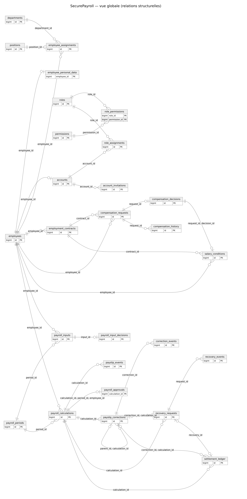

# Database Security Assessment Report — Sections 5 à 7 (phase 1)

> Sections du livrable 3, numérotées selon le plan imposé par l'énoncé : **5** ER Diagram and Database Design, **6** Data Classification and CIA Analysis, **7** Threat Model.
> Les documents détaillés `01` à `05` de `docs/security-assessment/` sont à placer en **annexes**. Chaque affirmation renvoie au fichier du dépôt qui la prouve.

---

## 5. Diagramme entité-association et conception de la base

### 5.1 Démarche

La base `secure_payroll` est construite par **douze migrations SQL** ordonnées (`database/migrations/001` à `012`), installées par `bin/init-local.py` sur une instance MySQL 8.4 privée. Toutes les tables sont en InnoDB, avec la collation `utf8mb4_0900_as_cs` (sensible à la casse et aux accents). Les montants sont en `DECIMAL(12,2)` et les horodatages en `DATETIME(6)` UTC, fixés par la base.

| Objet | Nombre | Rôle |
|---|---:|---|
| Tables | 26 | Données métier, historiques et contrôle d'accès |
| Clés étrangères | 66 | 33 structurelles, 33 de traçabilité (auteur d'une action) |
| Procédures stockées `SQL SECURITY DEFINER` | 24 | Seule voie d'écriture pour les opérations sensibles |
| Triggers | 44 | Immutabilité des historiques et validation |
| Rôles applicatifs / permissions | 6 / 31 | RBAC détaillé en section 9 |

La conception suit quatre principes de sécurité, justifiés au § 5.5 :
1. **séparer** les données selon leur sensibilité ;
2. **séparer** proposition, décision et résultat ;
3. **conserver** tout historique en ajout seul ;
4. **attribuer** chaque action à un compte et à une personne.

### 5.2 Diagramme entité-association



*Figure 5.1 — Vue globale : 26 tables, clés primaires et 33 relations structurelles. Les vues détaillées par domaine (figures 5.2 à 5.6, en annexe) donnent toutes les colonnes et tous les marqueurs de clés.*

**Lecture.** Notation « pattes de corbeau » :
- `||` : exactement un ;
- `|o` : zéro ou un ;
- `o{` : zéro ou plusieurs.

Les 33 clés étrangères de traçabilité (`created_by`, `decided_by`, `actor_id`…) relient presque chaque table à `accounts` et `employees`. Elles sont omises de la vue globale, pour la lisibilité, et signalées dans les vues par domaine par la mention `auteur → accounts`.

**Fidélité.** Les diagrammes ne sont pas dessinés à la main. `bin/generate-erd.py` les produit à partir des migrations et refuse de les écrire en cas d'incohérence : table sans clé primaire, référence vers une colonne inconnue, ou nombre de tables différent de 26. `python3 bin/generate-erd.py --check` signale tout écart entre le schéma installé et l'ERD.

| Figure | Domaine | Fichier |
|---|---|---|
| 5.2 | Identité, données personnelles et RBAC (7 tables) | `erd/images/ERD-01-IDENTITE-RBAC.png` |
| 5.3 | Organisation RH (4 tables) | `erd/images/ERD-02-ORGANISATION-RH.png` |
| 5.4 | Rémunération (4 tables) | `erd/images/ERD-03-REMUNERATION.png` |
| 5.5 | Paie et bulletins (6 tables) | `erd/images/ERD-04-PAIE.png` |
| 5.6 | Règlements et corrections (5 tables) | `erd/images/ERD-05-REGLEMENTS.png` |

### 5.3 Description des tables principales

Niveaux de classification : **R** Restreint, **C** Confidentiel, **I** Interne (section 6.2).

**Identité, données personnelles et contrôle d'accès**

| Table | Rôle | Clés et contraintes notables | Niv. |
|---|---|---|:-:|
| `employees` | Identité stable du salarié : matricule permanent, nom, archivage logique. **Pivot** de tout le modèle. | PK `id` ; UK `employee_number` ; suppression interdite par trigger | C |
| `employee_personal_data` | Données personnelles : pièce d'identité (CIN, carte de séjour, passeport), n° CNSS, naissance, situation familiale, coordonnées, banque et **RIB**. | PK = FK `employee_id` (1:0..1) ; UK sur pièce, CNSS et RIB ; CHECK de format (CIN, CNSS 9 chiffres, RIB 24 chiffres, `+212…`, âge ≥ 15 ans) ; auteur de modification obligatoire ; suppression interdite | **R** |
| `accounts` | Compte de connexion d'un salarié ; empreinte Argon2id ; désactivation. | UK `employee_id` (un compte par salarié), UK `login` ; CHECK de format Argon2id | **R** |
| `roles`, `permissions`, `role_permissions` | Catalogue fermé des 6 rôles, des 31 permissions et de leur association N:N. | PK composite `(role_id, permission_id)` | I |
| `role_assignments` | Attribution **datée** d'un rôle à un compte, avec motif, auteur, expiration et révocation. | UK `(account_id, role_id, valid_from)` ; écriture par `iam_grant` / `iam_revoke` uniquement | C |

**Organisation RH**

| Table | Rôle | Clés et contraintes notables | Niv. |
|---|---|---|:-:|
| `departments`, `positions` | Référentiels bilingues des départements et des postes. | UK `code` | I |
| `employment_contracts` | Contrats datés (type, début, fin, clôture). **Aucun salaire** dans cette table. | UK `reference` ; fin effective calculée (`effective_ends_on`) ; chevauchements refusés par procédure | C |
| `employee_assignments` | Périodes d'affectation d'un salarié à un département et un poste. | 3 FK ; fin effective calculée | C |

**Rémunération**

| Table | Rôle | Clés et contraintes notables | Niv. |
|---|---|---|:-:|
| `compensation_requests` | Proposition salariale RH (montant, date d'effet, justification), conservée sans modification. | FK salarié et contrat ; auteur (compte et personne) | **R** |
| `compensation_decisions` | Décision Finance, **unique** par demande. | UK `request_id` (1:0..1) ; auto-approbation refusée (`COMP_SELF_APPROVAL`) | C |
| `salary_conditions` | Salaire **en vigueur**, créé seulement par une décision approuvée. | FK composite `(request_id, decision_id)` → décision ; UK `request_id` ; UK `(employee_id, effective_on)` | **R** |
| `compensation_history` | Événements soumis / approuvé / rejeté. | UK `(request_id, event_type)` ; ajout seul | C |

**Paie**

| Table | Rôle | Clés et contraintes notables | Niv. |
|---|---|---|:-:|
| `payroll_periods` | Mois de paie et plafonds de primes et de retenues fixés par Finance. | UK `month_start` | C |
| `payroll_inputs` / `payroll_input_decisions` | Primes, retenues et absences proposées par RH, puis acceptées ou refusées par Finance. | UK `input_id` sur la décision (1:0..1) | **R** / C |
| `payroll_calculations` | Versions **immuables** du calcul : base, primes, retenues, brut, net, instantané JSON des sources, empreinte `source_hash`. | UK `(period_id, employee_id, version_no)` ; CHECK brut = base + primes, net = brut − retenues, net ≥ 0 | **R** |
| `payslip_events` | Cycle de vie du bulletin : vérification, approbation, publication. | UK `(calculation_id, event_type)` : chaque transition une seule fois | C |
| `payroll_approvals` | Désigne **le** calcul approuvé pour un salarié et un mois. | PK `calculation_id` ; UK `(period_id, employee_id)` ; FK composite vers le calcul | C |

**Règlements et corrections**

| Table | Rôle | Clés et contraintes notables | Niv. |
|---|---|---|:-:|
| `payslip_corrections` / `correction_events` | Révisions d'un bulletin publié et leur validation. | UK `(calculation_id, revision)` ; parent de même racine par FK composite | **R** / C |
| `recovery_requests` / `recovery_events` | Restitution d'un trop-perçu et son traitement. | UK `(request_id, event_type)` sur les événements | **R** / C |
| `settlement_ledger` | Registre en ajout seul des paiements et remboursements fictifs. | UK `reference` ; UK `recovery_id` (une restitution encaissée une seule fois) | **R** |

L'inventaire des 66 relations, avec leur cardinalité, est en annexe (`erd/RELATIONS.md`). Le dictionnaire de toutes les colonnes est dans `docs/technical-documentation/13-DICTIONNAIRE-DE-DONNEES.md`.

### 5.4 Mécanismes d'intégrité

| Niveau | Mécanisme | Exemple |
|---|---|---|
| Structure | 26 PK, 66 FK, contraintes UNIQUE | Un seul calcul approuvé par salarié et par mois |
| Domaine | Contraintes `CHECK` | RIB de 24 chiffres ; net ≥ 0 ; empreinte au format Argon2id |
| Référence | FK **composites** | Une approbation vise le calcul du **bon** salarié et du **bon** mois |
| Historique | 44 triggers `*_prevent_delete`, `*_no_update`, `*_preserve_*` | Un événement de bulletin ne peut être ni modifié ni supprimé |
| Processus | 24 procédures `SQL SECURITY DEFINER`, exécutées par 5 comptes propriétaires verrouillés | La décision salariale vérifie l'acteur, son rôle et l'absence d'auto-approbation |
| Suppression | Aucune cascade (`RESTRICT`) | Supprimer un salarié ne peut pas effacer son historique |

### 5.5 Choix de conception justifiés par la sécurité

| Choix | Justification | Lien |
|---|---|---|
| `employee_personal_data` est **séparée** d'`employees` (1:0..1) | L'application doit afficher les noms, mais pas les identifiants officiels ni le RIB. La séparation permet de n'accorder **aucun** droit sur la table sensible au compte de service. C'est vérifié par un test : « Service PHP sans accès aux données personnelles » (erreur 1142). | EC-3, T-10 |
| **Demande → décision → condition** dans trois tables | Une proposition ne devient jamais un salaire par simple changement d'état. Le salaire en vigueur n'existe que s'il référence une décision approuvée par une autre personne. | EI-2, T-06 |
| Historiques **en ajout seul** plutôt qu'une colonne d'état modifiable | Chaque transition garde son auteur, son heure SQL et son motif ; aucune ne peut être réécrite après coup. Ces historiques servent de preuve pour l'investigation (phase 10). | EI-3, EI-4, T-15 |
| **Double référence de l'auteur** : compte **et** personne | La séparation des tâches se contrôle au niveau de la personne, même si elle détenait plusieurs comptes. | EI-2 |
| **Clés étrangères composites** | Les FK simples garantiraient l'existence de la décision ou du calcul, pas leur **concordance**. Les FK composites l'imposent dans la base, indépendamment du code PHP. | EI-1, T-06 |
| Aucune colonne de salaire dans `employment_contracts` | Le contrat (Confidentiel) peut être lu par RH sans exposer la rémunération (Restreint). | EC-2 |
| Instantané JSON et `source_hash` dans `payroll_calculations` | Le bulletin conserve les sources exactes de son calcul. Un calcul devenu périmé est refusé à l'approbation (`PAY_STALE`). **Coût** : une copie supplémentaire des montants (écart E3, phase 6). | EI-6 |

### 5.6 Limites de la conception actuelle

- Le compte de service `svc_php` lisait **directement** `salary_conditions` et `compensation_requests` (Restreint) : écart E1, corrigé en phase 2 par des rôles MySQL activés à chaque requête (sections 9 et 10).
- Les données Restreint sont **en clair** au repos : écart E2, à corriger en phase 6.
- Aucune fonction applicative ne lit ni ne modifie encore `employee_personal_data`. La table est protégée par l'absence d'accès ; le contrôle d'accès fin reste à construire en phase 2.
- Les triggers protègent contre le DML, pas contre un compte disposant de `DROP`, `TRIGGER` ou `root` (T-14, T-19).

---

## 6. Classification des données et analyse CIA

### 6.1 Actifs critiques, propriétaires et utilisateurs autorisés

L'inventaire complet (annexe `01-INVENTAIRE-DES-ACTIFS.md`) recense **29 actifs** :

| Famille | Nombre | Exemples |
|---|---:|---|
| Données (D) | 8 | Personnelles, rémunérations, bulletins, règlements, authentifiants |
| Objets de sécurité de la base (S) | 6 | Procédures, triggers, privilèges |
| Secrets (K) | 4 | Mots de passe `root` et `svc_php`, sessions |
| Journaux (L) | 4 | Journal applicatif, historiques en base |
| Sauvegardes (B) | 2 | Exports et manifestes |
| Infrastructure (I) | 5 | Datadir, serveur MySQL |

**Propriétaires et dépositaire.** On distingue le **propriétaire** des données (fonction métier qui décide de l'usage et des accès), le **dépositaire** (le DBA, qui les protège sans en décider l'usage) et la **personne concernée** (le salarié, au sens de la loi marocaine 09-08). Les comptes MySQL `*_owner` sont des comptes techniques de procédures, **pas** des propriétaires de données.

| Propriétaire | Agit par le rôle | Données |
|---|---|---|
| Direction RH | `hr_manager` | Identité, données personnelles, contrats, affectations, propositions salariales |
| Direction financière | `finance_manager` | Décisions et conditions salariales, périodes, paiements |
| Responsable paie | `payroll_manager` | Calculs, bulletins, corrections, restitutions |
| RSSI | `application_administrator`, `security_auditor` | Comptes, rôles, attributions, journaux |

**Utilisateurs autorisés** :
- six profils humains : RH, Finance, Paie, Salarié (ses seuls bulletins publiés), Administrateur (droits d'autrui uniquement), Auditeur (lecture seule) ;
- le compte de service `svc_php` ;
- cinq comptes propriétaires **verrouillés**, sans connexion possible ;
- `root` (installation par socket uniquement) ;
- un compte de sauvegarde dédié.

### 6.2 Classification des données

| Niveau | Critère | Conséquence d'une divulgation | Tables |
|---|---|---|---:|
| **Restreint** | Montant de rémunération, identifiant officiel, donnée bancaire, authentifiant | Fraude, usurpation d'identité, prise de contrôle | 9 |
| **Confidentiel** | Donnée personnelle ou décision RH ou financière sans montant | Atteinte à la vie privée, ciblage, hameçonnage | 12 |
| **Interne** | Réservé au personnel ; ne concerne aucun individu | Aide à la reconnaissance | 5 |
| **Public** | Destiné à la publication | Aucune | 0 |

Cinq règles complètent la grille :
- **R1** : les clés techniques sont Interne, sauf si elles révèlent un fait personnel ;
- **R2** : une jointure prend le niveau de sa colonne la plus sensible ;
- **R3** : une copie (instantané, sauvegarde, datadir, journal) hérite du niveau de l'original ;
- **R4** : les champs libres ne doivent contenir ni montant d'un tiers, ni identifiant officiel, ni information de santé ;
- **R5** : une table prend le niveau de sa colonne la plus sensible.

**Informations nécessitant une protection renforcée** (niveau Restreint) :

| Information | Où | Pourquoi une protection supplémentaire |
|---|---|---|
| Mots de passe | `accounts.password_hash` | Une empreinte volée peut être cassée hors ligne et donner accès à tout le rôle. D'où Argon2id, jamais de clair ni de journalisation. |
| Identifiants officiels (CIN, CNSS) | `employee_personal_data` | Données d'identification nationale permettant l'usurpation ; protégées par la loi 09-08. |
| Données bancaires (RIB) | `employee_personal_data.rib` | Modifier le RIB **détourne le salaire** sans toucher au montant (T-08). Sa confidentialité **et** son intégrité sont critiques. |
| Montants de rémunération | `salary_conditions`, `compensation_requests`, `payroll_calculations`, `payroll_inputs`, corrections, registre | Information financière individuelle ; sa fuite crée des conflits internes, et son altération une perte financière. |
| Secrets d'exploitation | `.local/*.json` | Donnent un accès `root` à toutes les données. |

La classification détaillée **par colonne** et les données hors base sont en annexe (`02-CLASSIFICATION-DES-DONNEES.md`). Le chiffrement et la gestion des clés seront traités en section 13.

### 6.3 Analyse CIA

**Besoins par actif** (extrait ; matrice complète en annexe `03-ANALYSE-CIA.md`) :

| Actif | C | I | A |
|---|:-:|:-:|:-:|
| Données personnelles (CIN, CNSS, RIB) | Élevé | Élevé | Moyen |
| Rémunérations | Élevé | Élevé | Moyen |
| Calculs et bulletins | Élevé | Élevé | Élevé |
| Règlements | Élevé | Élevé | Élevé |
| Authentifiants | Élevé | Élevé | Élevé |
| RBAC | Moyen | Élevé | Élevé |
| Procédures, triggers, privilèges | Faible à moyen | Élevé | Élevé |
| Journaux et historiques | Moyen | Élevé | Moyen |
| Sauvegardes, datadir | Élevé | Élevé | Élevé |

**L'intégrité est le besoin dominant** : l'enjeu d'une paie est de verser **le bon montant à la bonne personne**. La confidentialité est élevée sur un périmètre plus étroit. La disponibilité n'est élevée que pendant la **fenêtre de paie** de fin de mois.

**Objectifs de disponibilité proposés** (à valider par la Direction financière) :
- **RTO** de 4 heures ouvrées en fenêtre de paie, 2 jours ouvrés sinon ;
- **RPO** de 24 heures.

**Exigences et état initial.** 29 exigences ont été définies et confrontées aux preuves du dépôt (tests, campagnes de laboratoire, revue de code). Le tableau donne l'état à l'issue de la phase 1 ; leur évolution au fil des corrections est présentée en section 18.

| Dimension | Satisfaites | Partielles | Non satisfaites | Point le plus faible |
|---|---:|---:|---:|---|
| Confidentialité (EC-1 à EC-9) | 4 | 4 | 1 | Aucun chiffrement au repos (EC-5) |
| Intégrité (EI-1 à EI-12) | 6 | 5 | 1 | Journal applicatif modifiable (EI-11) |
| Disponibilité (ED-1 à ED-8) | 1 | 3 | 3 | Sauvegarde non planifiée (ED-1) ; limiteur de connexion partagé (ED-4) |

ED-7 (disponibilité des futures clés de chiffrement) est « à prévoir » et n'est comptée dans aucune colonne.

**Exigences satisfaites et testées**, par exemple :
- un salarié ne lit que ses propres bulletins publiés (EC-1) ;
- montants exacts, brut et net contrôlés par `CHECK` (EI-1) ;
- séparation des tâches, avec 18 refus vérifiés (EI-2) ;
- paiement unique (EI-5) ;
- refus d'un calcul périmé (EI-6) ;
- base sans accès réseau (EC-7).

**Arbitrages entre C, I et A** :

| Tension | Arbitrage retenu |
|---|---|
| Les sauvegardes (A) multiplient les copies en clair (C) | Exports chiffrés, clé conservée séparément |
| Le chiffrement (C) rend les données illisibles si la clé est perdue (A) | Copie de secours des clés |
| L'immutabilité (I) s'oppose au droit à l'effacement (loi 09-08) | Effacement par procédure administrative tracée, après la durée légale |
| Le limiteur de connexion (C) permet de bloquer tout le monde (A) | Limiter par compte **et** par adresse IP |
| La séparation des tâches (I) bloque le processus si un titulaire est absent (A) | Suppléant nommé pour chaque rôle |

### 6.4 Écarts à traiter

| # | Écart | Phase |
|---|---|---|
| E1 | Données Restreint lisibles directement par le compte de service | 2 |
| E2, E3, E7 | Identifiants officiels, RIB, montants, instantanés et sauvegardes en clair | 6, 8 |
| E4 | Aucune lecture de donnée Restreint journalisée | 7 |
| E5 | Ni double validation ni alerte sur une modification du RIB | 2, 7 |
| E6 | Secrets protégés uniquement par les permissions de fichiers | 9 |
| E8 | Aucune durée de conservation définie | Recommandations |
| E9 | Règle R4 sur les champs libres non outillée | 7 |

---

## 7. Modèle de menace

### 7.1 Méthode

Le modèle suit six étapes :
1. modéliser le système et ses **frontières de confiance** ;
2. recenser les **surfaces d'attaque** ;
3. décrire les **acteurs de menace** ;
4. identifier les menaces selon **STRIDE** ;
5. évaluer le **risque résiduel**, en tenant compte des contrôles existants et prouvés ;
6. choisir un traitement.

Le risque vaut **vraisemblance × impact**, chacun noté de 1 à 3 :
- 1–2 : **Faible** ;
- 3–4 : **Moyen** ;
- 6–9 : **Élevé**.

Un impact de 3 (donnée Restreint, fraude, paie bloquée) donne au minimum un risque Moyen, même quand l'attaque est bloquée.

### 7.2 Modèle du système et frontières de confiance

```text
  Navigateur ── HTTP 127.0.0.1 : session, CSRF ──────────── FC-1  utilisateur ↔ application
  Serveur PHP : Argon2id, session, RBAC ; PDO avec svc_php et acteur transmis (p_actor)
     └── socket Unix, aucun port réseau ───────────────── FC-2  application ↔ base
  MySQL 8.4 : SELECT directs, 24 procédures DEFINER, 44 triggers
     └── fichiers ─────────────────────────────────────── FC-3  base ↔ système de fichiers
  .local/data (InnoDB en clair), secrets .local/*.json, sauvegardes
  Exploitant : root MySQL, scripts bin/ ──────────────────── FC-4  exploitant ↔ instance
  Dépôt Git : migrations installées en root ──────────────── FC-5  dépôt ↔ installation
```

La frontière **FC-2** est la plus importante pour une sécurité de base de données. Les procédures reçoivent l'identité de l'utilisateur en paramètre (`p_actor`) et vérifient son rôle. En revanche, MySQL **ne peut pas vérifier** que cet acteur est bien l'utilisateur web authentifié, puisque toutes les connexions utilisent le même compte `svc_php`. La sécurité de FC-2 repose donc sur le secret de ce compte (menace T-03).

### 7.3 Surfaces d'attaque

| ID | Surface | Exposée à |
|---|---|---|
| SA-1 | Formulaire de connexion | Quiconque atteint le port local 8080 |
| SA-2 | Routes avec identifiant d'objet (`/payslips/{id}`…) | Tout utilisateur connecté (IDOR) |
| SA-3 | Formulaires métier (salaires, paie, IAM) | Utilisateurs selon leur rôle |
| SA-4 | Champs libres réaffichés à d'autres rôles | Utilisateurs connectés (XSS stockée) |
| SA-5 | Cookie et fichiers de session | Navigateur, système de fichiers |
| SA-6 | Paramètre de redirection `return_to` | Tout visiteur |
| SA-7 | Socket MySQL et compte `svc_php` | Compte Linux local |
| SA-8 | Compte `root` et scripts d'administration | Exploitant |
| SA-9 | Répertoire `.local/` : datadir, secrets, journaux | Compte local, logiciel malveillant |
| SA-10 | Sauvegardes `mysqldump` | Accès au répertoire d'export |
| SA-11 | Dépôt Git (migrations, procédures) | Collaborateurs |

### 7.4 Acteurs de menace

| ID | Acteur | Motivation | Capacité |
|---|---|---|---|
| TA-1 | Salarié curieux | Connaître le salaire des collègues | Compte valide, URL modifiables |
| TA-2 | Opérateur RH, Paie ou Finance malveillant | S'augmenter, détourner un virement | Droits métier légitimes |
| TA-3 | Collusion de deux opérateurs | Gain partagé | Satisfont ensemble la séparation des tâches |
| TA-4 | Administrateur applicatif abusif | Donner un rôle à un complice | Octroi et révocation de rôles |
| TA-5 | Auditeur ou responsable indélicat | Revendre des salaires | Lecture légitime de la paie |
| TA-6 | DBA malveillant ou négligent | Fraude, effacement de traces, erreur | `root`, système de fichiers |
| TA-7 | Attaquant sans compte | Accès initial | Accès local, ou piège d'un utilisateur connecté |
| TA-8 | Logiciel malveillant sur la VM | Vol de données en masse | Lecture des fichiers de l'utilisateur |
| TA-9 | Contributeur du dépôt | Porte dérobée ou erreur de migration | Écriture dans le dépôt |

### 7.5 Menaces et risque résiduel

L'analyse STRIDE identifie **24 menaces** : **5 Élevé, 16 Moyen, 3 Faible** à l'issue de la phase 1 (tableau complet en annexe `04-MODELE-DE-MENACE.md`). Le risque résiduel après correction est présenté en section 18 ; par exemple, T-18 est corrigée en phase 3 (section 8).

| Vraisemblance ↓ / Impact → | 1 | 2 | 3 |
|---|---|---|---|
| **3** | | T-18 | |
| **2** | | T-15, T-20 | **T-07, T-08, T-11, T-19** |
| **1** | T-23 | T-22, T-24 | T-01 à T-06, T-09, T-10, T-12 à T-14, T-16, T-17, T-21 |

**Les cinq risques élevés**

| ID | STRIDE | Scénario | Pourquoi le risque reste élevé |
|---|:-:|---|---|
| T-07 | T | **Collusion RH + Finance** : une augmentation injustifiée est proposée puis approuvée | La séparation des tâches est respectée formellement. Tout est tracé, mais **rien ne détecte** une augmentation anormale. |
| T-08 | T | **Détournement de salaire** par modification du RIB | Le RIB a un format contrôlé, il est unique, et son auteur est obligatoire. Mais il n'y a ni double validation, ni notification du salarié, ni journal des accès. |
| T-11 | I | **Exfiltration légitime** : un auditeur consulte en masse les bulletins | L'accès est autorisé ; **aucune lecture n'est journalisée**, donc aucune détection n'est possible. |
| T-18 | D | **Blocage des connexions de tous** : en local, tous les utilisateurs arrivent de `127.0.0.1` et partagent le compteur du limiteur | Cinq erreurs de n'importe qui bloquent tout le monde 15 minutes, de façon renouvelable. *Déduit du code (`LoginLimiter.php`), non encore exercé.* |
| T-19 | D | **Suppression accidentelle** (`DROP TABLE`, `TRUNCATE`) | Les triggers bloquent le `DELETE`, pas le DDL. La sauvegarde est manuelle et non planifiée. |

**Menaces maîtrisées.** Plusieurs menaces classiques ont un impact maximal, mais une vraisemblance de 1 grâce à des contrôles **testés** :
- injection SQL (T-05) : requêtes préparées natives, compte de service sans DDL ;
- IDOR sur les bulletins (T-04) : contrôle du propriétaire dans la procédure ;
- auto-approbation (T-06) : `COMP_SELF_APPROVAL`, `PAY_FORBIDDEN` ;
- CSRF (T-17) et XSS stockée (T-16) : jeton, échappement, CSP ;
- force brute (T-01) : Argon2id et limiteur.

Leur preuve avant / après sera apportée en section 12.

### 7.6 Traitement des risques

| Risque | Décision | Mesure | Section du rapport |
|---|---|---|---|
| T-08 RIB | Réduire | Procédure dédiée, double validation RH + Finance, notification, journal des accès | 9, 14 |
| T-11 Exfiltration | Réduire | Journaliser les lectures de données Restreint, détecter les consultations massives | 14 |
| T-07 Collusion | Réduire, puis accepter le résiduel | Alerte au-delà d'un seuil d'augmentation ; revue par l'auditeur | 14, 17 |
| T-18 Blocage | Réduire | Limiteur par compte **et** par IP ; journaliser le compte visé | 8, 16 |
| T-19 Suppression | Réduire | Sauvegarde planifiée hors VM, exercice de restauration, `DROP` réservé à un compte distinct | 15, 16 |
| T-10, T-03 Compte de service | Réduire | Retirer les SELECT directs sur les tables Restreint ; protéger son secret | 10, 16 |
| T-12, T-13 Copies et secrets en clair | Réduire | Chiffrement des colonnes sensibles et des exports | 13, 15 |
| T-14 DBA malveillant | Accepter, et détecter | Journal MySQL hors de son contrôle, comparaison avec les sauvegardes | 14, 16 |
| Menaces maîtrisées (T-01, T-02, T-04 à T-06, T-09, T-16, T-17) | Accepter le résiduel | Maintenir les tests de non-régression | 12 |

### 7.7 Hypothèses

- La VM et le compte Linux de l'exploitant sont supposés sains. Leur compromission est un risque (TA-8), mais leur durcissement complet est hors périmètre.
- Le serveur web n'écoute que sur `127.0.0.1`. Une exposition réseau imposerait HTTPS et ajouterait des menaces distantes.
- Paiements et données de démonstration sont **fictifs** : aucune personne ni banque réelle.
