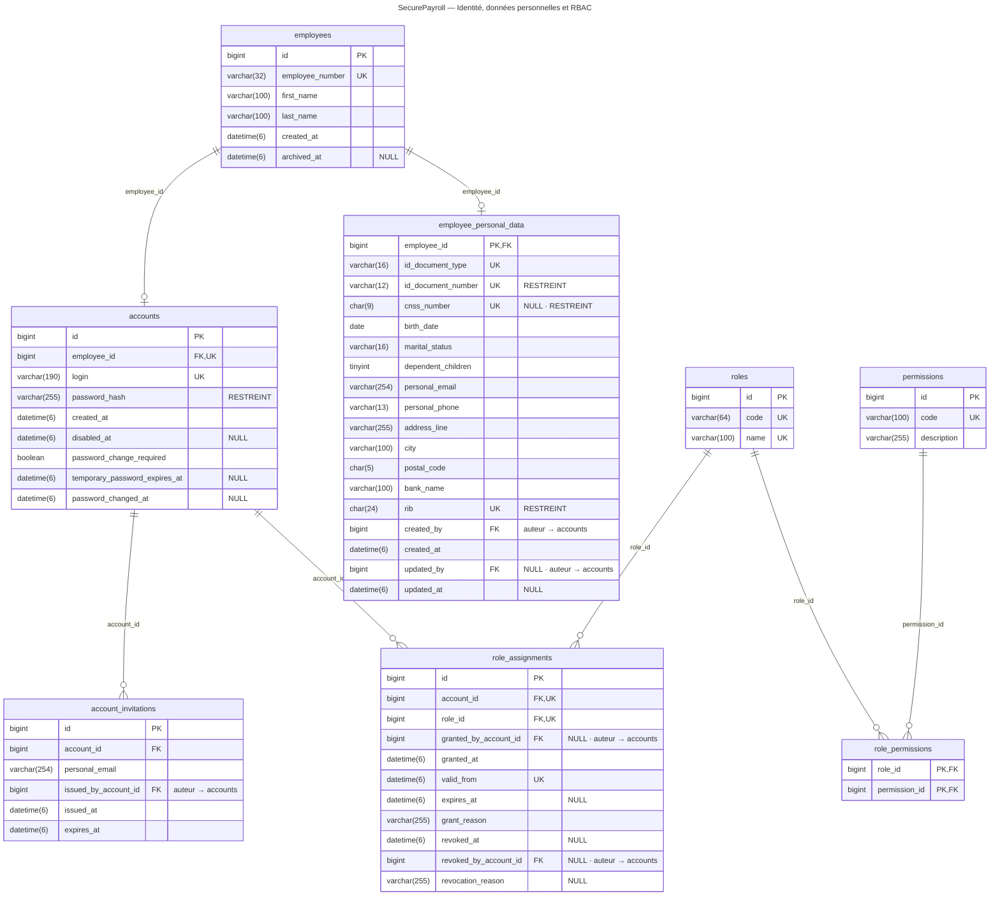
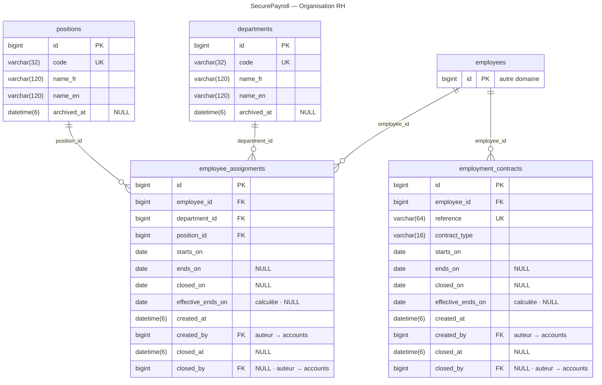
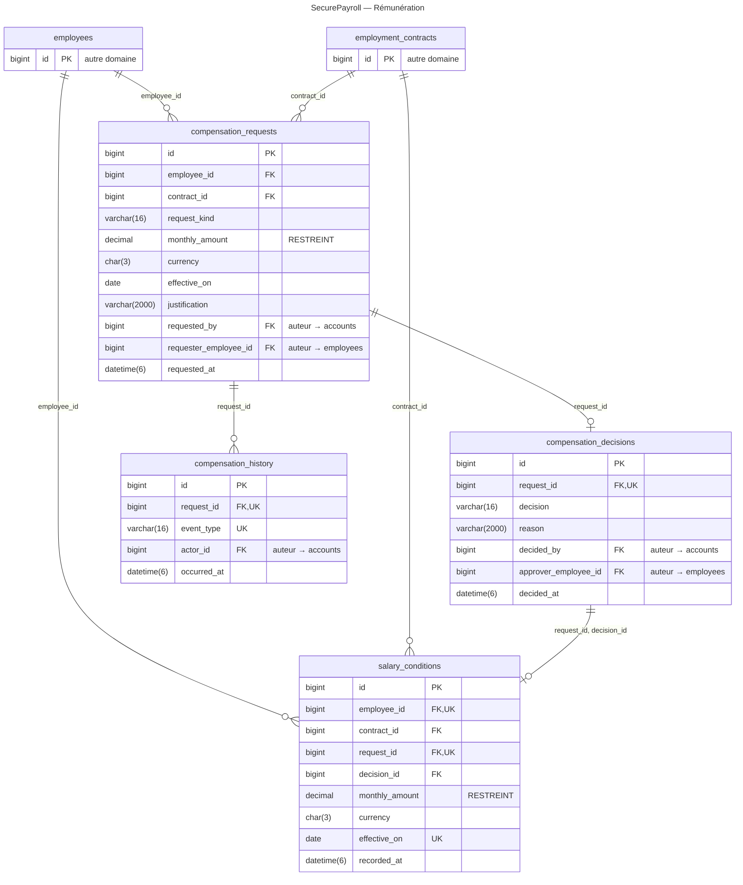
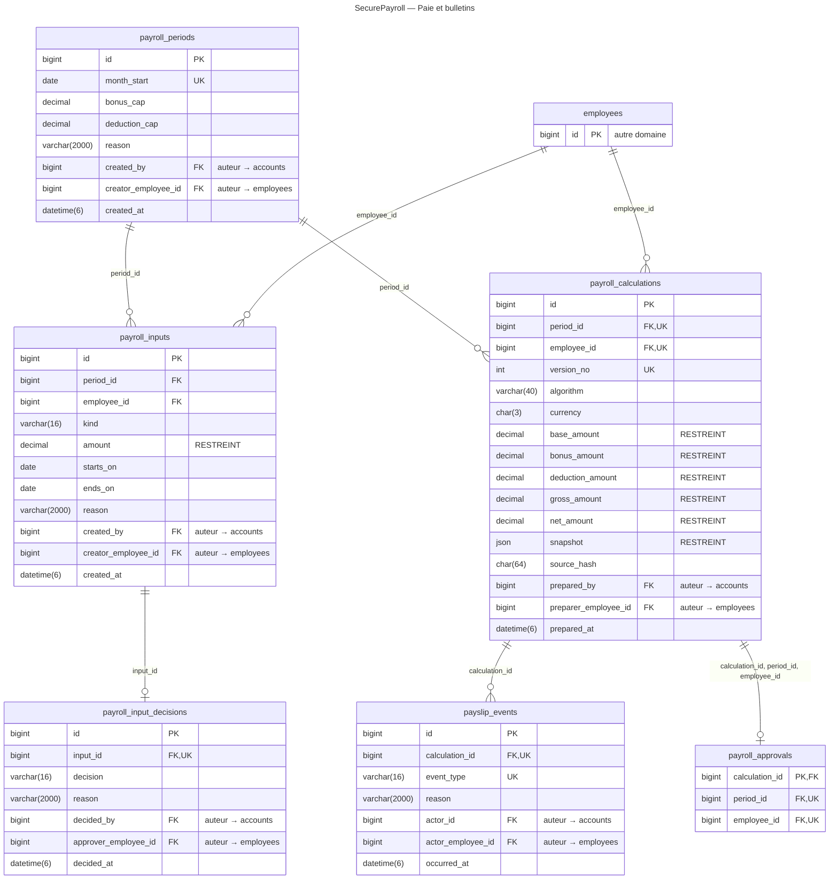
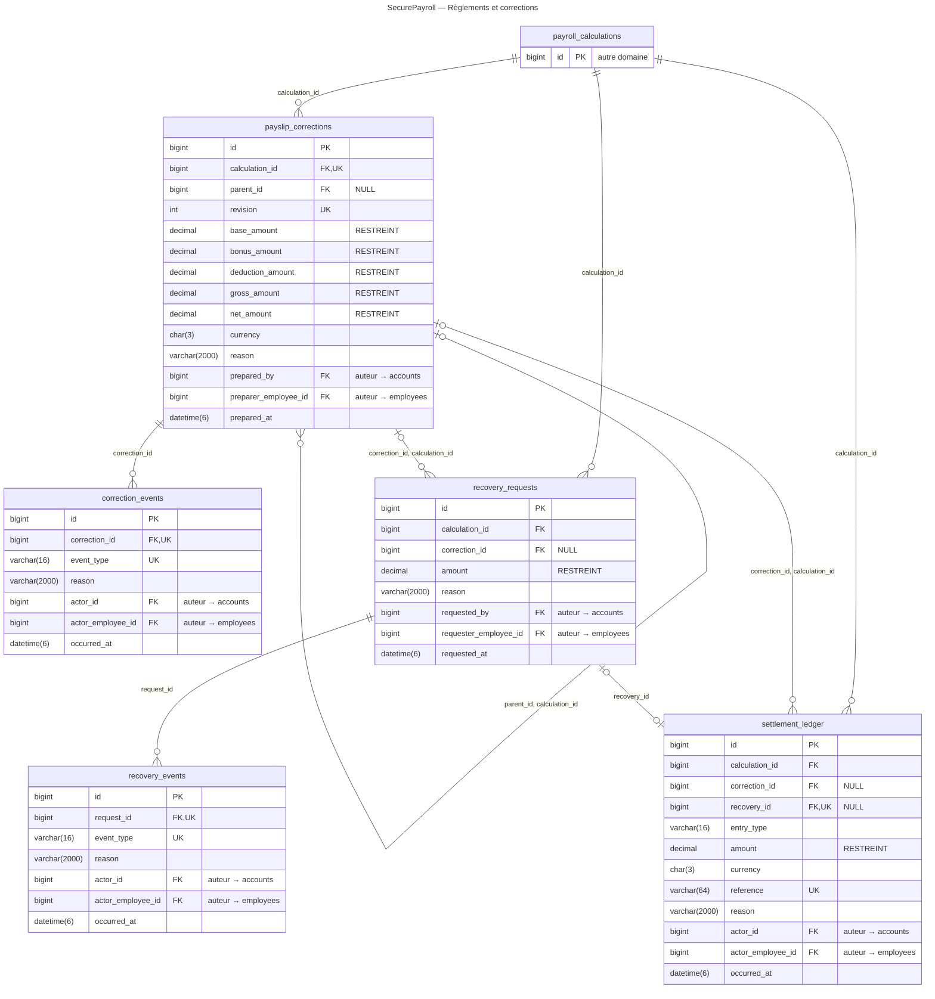

# ERD de SecurePayroll

> Fichier **généré** par `python3 bin/generate-erd.py` depuis `database/migrations/*.sql`. Ne pas modifier à la main. Les diagrammes s'affichent sur GitHub et dans l'aperçu Markdown de VS Code ; les sources `.mmd` sont à côté de ce fichier.

Notation : `PK` clé primaire, `FK` clé étrangère, `UK` membre d'une contrainte d'unicité ; `"NULL"` colonne facultative ; `"RESTREINT"` donnée du niveau le plus sensible (voir `02-CLASSIFICATION-DES-DONNEES.md`) ; `"auteur → accounts"` clé étrangère de traçabilité, signalée sans trait pour la lisibilité (liste complète dans `RELATIONS.md`). Liens : `||` exactement un, `|o` zéro ou un, `o{` zéro ou plusieurs.

## vue globale (relations structurelles)

Source : [`ERD-00-GLOBAL.mmd`](ERD-00-GLOBAL.mmd)

```mermaid
---
title: SecurePayroll — vue globale (relations structurelles)
config:
  er:
    layoutDirection: LR
---
erDiagram
    employees {
        bigint id PK
    }
    employee_personal_data {
        bigint employee_id PK
    }
    accounts {
        bigint id PK
    }
    roles {
        bigint id PK
    }
    permissions {
        bigint id PK
    }
    role_permissions {
        bigint role_id PK
        bigint permission_id PK
    }
    role_assignments {
        bigint id PK
    }
    account_invitations {
        bigint id PK
    }
    departments {
        bigint id PK
    }
    positions {
        bigint id PK
    }
    employee_assignments {
        bigint id PK
    }
    employment_contracts {
        bigint id PK
    }
    compensation_requests {
        bigint id PK
    }
    compensation_decisions {
        bigint id PK
    }
    salary_conditions {
        bigint id PK
    }
    compensation_history {
        bigint id PK
    }
    payroll_periods {
        bigint id PK
    }
    payroll_inputs {
        bigint id PK
    }
    payroll_input_decisions {
        bigint id PK
    }
    payroll_calculations {
        bigint id PK
    }
    payslip_events {
        bigint id PK
    }
    payroll_approvals {
        bigint calculation_id PK
    }
    payslip_corrections {
        bigint id PK
    }
    correction_events {
        bigint id PK
    }
    recovery_requests {
        bigint id PK
    }
    recovery_events {
        bigint id PK
    }
    settlement_ledger {
        bigint id PK
    }
    employees ||--o| employee_personal_data : "employee_id"
    employees ||--o| accounts : "employee_id"
    roles ||--o{ role_permissions : "role_id"
    permissions ||--o{ role_permissions : "permission_id"
    accounts ||--o{ role_assignments : "account_id"
    roles ||--o{ role_assignments : "role_id"
    accounts ||--o{ account_invitations : "account_id"
    employees ||--o{ employee_assignments : "employee_id"
    departments ||--o{ employee_assignments : "department_id"
    positions ||--o{ employee_assignments : "position_id"
    employees ||--o{ employment_contracts : "employee_id"
    employees ||--o{ compensation_requests : "employee_id"
    employment_contracts ||--o{ compensation_requests : "contract_id"
    compensation_requests ||--o| compensation_decisions : "request_id"
    employees ||--o{ salary_conditions : "employee_id"
    employment_contracts ||--o{ salary_conditions : "contract_id"
    compensation_decisions ||--o| salary_conditions : "request_id, decision_id"
    compensation_requests ||--o{ compensation_history : "request_id"
    payroll_periods ||--o{ payroll_inputs : "period_id"
    employees ||--o{ payroll_inputs : "employee_id"
    payroll_inputs ||--o| payroll_input_decisions : "input_id"
    payroll_periods ||--o{ payroll_calculations : "period_id"
    employees ||--o{ payroll_calculations : "employee_id"
    payroll_calculations ||--o{ payslip_events : "calculation_id"
    payroll_calculations ||--o| payroll_approvals : "calculation_id, period_id, employee_id"
    payroll_calculations ||--o{ payslip_corrections : "calculation_id"
    payslip_corrections |o--o{ payslip_corrections : "parent_id, calculation_id"
    payslip_corrections ||--o{ correction_events : "correction_id"
    payroll_calculations ||--o{ recovery_requests : "calculation_id"
    payslip_corrections |o--o{ recovery_requests : "correction_id, calculation_id"
    recovery_requests ||--o{ recovery_events : "request_id"
    payroll_calculations ||--o{ settlement_ledger : "calculation_id"
    payslip_corrections |o--o{ settlement_ledger : "correction_id, calculation_id"
    recovery_requests |o--o| settlement_ledger : "recovery_id"
```

## Identité, données personnelles et RBAC

Source : [`ERD-01-IDENTITE-RBAC.mmd`](ERD-01-IDENTITE-RBAC.mmd)

## Organisation RH

Source : [`ERD-02-ORGANISATION-RH.mmd`](ERD-02-ORGANISATION-RH.mmd)

## Rémunération

Source : [`ERD-03-REMUNERATION.mmd`](ERD-03-REMUNERATION.mmd)

## Paie et bulletins

Source : [`ERD-04-PAIE.mmd`](ERD-04-PAIE.mmd)

## Règlements et corrections

Source : [`ERD-05-REGLEMENTS.mmd`](ERD-05-REGLEMENTS.mmd)

