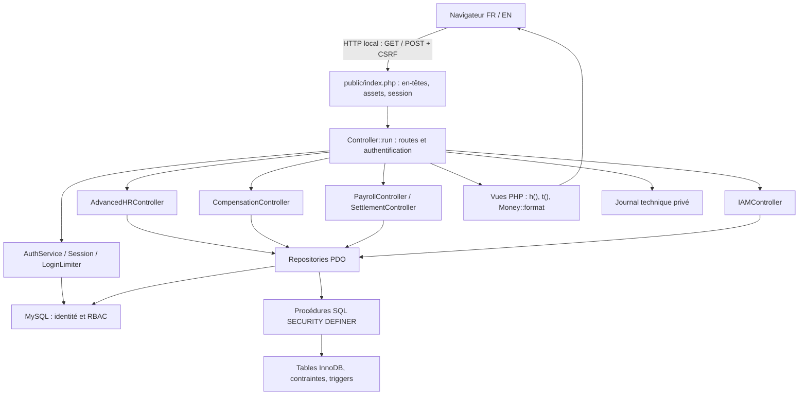

# 02 — Architecture et organisation

> Périmètre : analyse des sources au 11 novembre 2026. Les attestations de tests sont datées ; aucune campagne fonctionnelle n’a été relancée. Installation MySQL actuelle : **Non vérifié**.

## Arborescence commentée

Les caches Python, fichiers de session, compteurs, artefacts temporaires, copies de tests générées et sauvegardes ne sont pas des composants de l’architecture. Les rapports existants sont des sources historiques ; ils ne pilotent pas l’exécution.

```text
app/ — code applicatif PHP
  Auth/AuthService.php
  Auth/IAMRepository.php
  Compensation/CompensationRepository.php
  Compensation/CompensationValidation.php
  Database/Connection.php
  Finance/Money.php
  HR/EmployeeRepository.php
  HR/PeriodRepository.php
  HR/PeriodValidation.php
  I18n/Translator.php
  Payroll/Calculator.php
  Payroll/Calendar.php
  Payroll/Repository.php
  Payroll/Validation.php
  Security/LoginLimiter.php
  Security/Runtime.php
  Security/Session.php
  Views/compensation-detail.php
  Views/compensation-form.php
  Views/compensation-list.php
  Views/compensation-nav.php
  Views/dashboard.php
  Views/employee-form.php
  Views/employee.php
  Views/employees.php
  Views/error.php
  Views/footer.php
  Views/header.php
  Views/hr-catalogue.php
  Views/hr-period-detail.php
  Views/hr-period-form.php
  Views/hr-period-list.php
  Views/iam.php
  Views/language-switch.php
  Views/login.php
  Views/payroll-select.php
  Views/payroll.php
  Views/payslip.php
  Views/settlement.php
  Web/AdvancedHRController.php
  Web/CompensationController.php
  Web/Controller.php
  Web/IAMController.php
  Web/PayrollController.php
  Web/SettlementController.php
  Web/helpers.php
  bootstrap.php
bin/ — exploitation et démonstration CLI
  backup.py
  check-demo.php
  demo-finalize.py
  demo-passwords.py
  demo-state.php
  finalize-admin.py
  local-demo.py
  mad-repair.py
  payroll-admin.py
  payroll-check.py
config/ — configuration PDO privée via environnement
  .gitkeep
  database.php
database/ — définitions SQL versionnées
  audit/mad-readonly.sql
  audit/privileges-readonly.sql
  migrations/.gitkeep
  migrations/001_create_identity_and_rbac.sql
  migrations/002_advanced_hr.sql
  migrations/003_hr_period_operations.sql
  migrations/004_compensation.sql
  migrations/005_compensation_operations.sql
  migrations/006_mad_currency.sql
  migrations/007_payroll.sql
  migrations/008_payroll_operations.sql
  migrations/009_settlement.sql
  migrations/010_settlement_operations.sql
  migrations/011_iam_operations.sql
  patches/001_fix_hr_assert_permission_collation.sql
  patches/002_mad_schema_guarded.sql
  patches/003_mad_compensation_routines.sql
  seeds/.gitkeep
  seeds/001_application_roles.sql
  seeds/002_hr_permissions.sql
  seeds/003_advanced_hr_permissions.sql
  seeds/004_hr_reference_demo.sql
  seeds/005_compensation_permissions.sql
  seeds/006_payroll_permissions.sql
  seeds/007_settlement_permissions.sql
  seeds/008_iam_permissions.sql
  setup/advanced_hr_grants.sql
  setup/advanced_hr_owner.sql
  setup/advanced_hr_owner_grants.sql
  setup/compensation_grants.sql
  setup/compensation_owner.sql
  setup/compensation_owner_grants.sql
  setup/iam_grants.sql
  setup/iam_owner.sql
  setup/iam_owner_grants.sql
  setup/payroll_grants.sql
  setup/payroll_owner.sql
  setup/payroll_owner_grants.sql
  setup/settlement_grants.sql
  setup/settlement_owner.sql
  setup/settlement_owner_grants.sql
  setup/svc_php_grants.sql
docs/ — documentation et résultats historiques
  ADVANCED-HR-ACTIVATION.md
  ADVANCED-HR.md
  COMPENSATION.md
  CONTRACT-503-DIAGNOSTIC.md
  CURRENCY-MAD.md
  DEMO-PRESENTATION.md
  FINALIZATION-VALIDATION-2026-11-06.md
  FINALIZATION.md
  I18N.md
  LAB-VALIDATION-2026-11-04.md
  LAB-VALIDATION-2026-11-06.md
  LOCAL-DEMO.md
  MAD-DIAGNOSTIC.md
  MAD-REPAIR.md
  MISSION04.md
  PAYROLL-ACTIVATION.md
  PAYROLL.md
  PROGRESS.md
  RECOVERY.md
  WEB-SETUP.md
lang/ — catalogues FR/EN
  en.php
  fr.php
public/ — seule racine HTTP
  assets/app.css
  assets/app.js
  index.php
tests/ — assertions et harnais de validation
  .gitkeep
  INTEGRITY.md
  compensation-readiness.php
  compensation-unit.php
  database-config.php
  database-connect.php
  database-integrity.php
  database-socket.php
  database-structure.php
  iam-http.py
  iam-mysql.php
  iam-races.py
  login-limiter.php
  mad-repair-live.php
  mysql-attack-demonstrations.php
  payroll-calculator.php
  payroll-calendar.php
  payroll-grants.py
  payroll-http-live.py
  payroll-live.php
  payroll-mysql.php
  payroll-races.py
  payroll-web-unit.php
  private_http.py
  settlement-http.py
  settlement-mysql.php
  settlement-races.py
  sql-static.php
  validation-03c1/FINAL-REVIEW.md
  validation-03c1/REPORT.md
  validation-03c1/admin-connection.php
  validation-03c1/check-connection.php
  validation-03c1/test-launcher.py
  validation-03c1/validate.py
  web-boundaries.py
lab/ — instances et exercices isolés
  README.md
  demo-settlement-check.py
  demonstrate.py
  mysql-attacks.py
  mysql-final-recovery.py
  mysql-iam.py
  mysql-integrity.py
  mysql-mad-diagnostic.py
  mysql-mad-repair.py
  mysql-recovery.py
  mysql-security.py
  mysql-validate.py
  mysql-web-check.py
  mysql_instance.py
storage/logs/ — journaux, sessions/compteurs selon configuration ; jamais exposés
.env.example — modèle sans chargement automatique et sans secret valide
README.md — introduction générale historique
```

## Répartition des responsabilités

`app/Auth` authentifie et reconstitue les habilitations. `app/Security` fournit session, limiteur et répertoire privé. `app/Database` centralise PDO. `app/HR` porte la lecture/écriture d’identité et les adaptateurs des périodes RH. `app/Compensation` relie demandes et décisions salariales. `app/Payroll` fournit les appels SQL de paie/règlement et un calculateur/calendrier PHP de référence. `app/Finance/Money` formate exactement les chaînes décimales. `app/I18n` charge les deux dictionnaires. `app/Web` orchestre l’HTTP et `app/Views` affiche les données déjà autorisées.

`database/migrations` définit structures et opérations ; `database/seeds` alimente catalogues de rôles/permissions et références fictives ; `database/setup` définit les comptes de contexte et les droits limités ; `database/patches` contient des corrections ciblées de collation et MAD. Le code ne migre pas automatiquement au démarrage. `bin` peut installer ou provisionner avec options explicites : ces programmes ne sont pas des contrôleurs HTTP et n’ont pas été exécutés ici.

## Parcours complet d’une requête

1. Le navigateur demande une route locale sur le serveur PHP, généralement `127.0.0.1:8080`.
2. `public/index.php` charge le bootstrap, pose CSP/nosniff/no-referrer/no-store, traite les deux assets autorisés ou démarre la session pour le HTML.
3. `Session::start` applique les options cookie, les délais et la rotation ; `Controller::run` valide le chemin, la méthode et le jeton CSRF des POST.
4. Les routes publiques sont traitées avant la connexion PDO. Sur une route privée, le contrôleur exige une session puis appelle `AuthService::currentUser` qui relit compte, salarié et attributions temporelles.
5. `AuthService::can` vérifie rôle, permission et conflits selon module ; le contrôleur spécialisé valide les champs puis appelle son repository.
6. `Connection::connect` fournit PDO natif préparé en UTF-8. `Controller::database` exige exactement `DB_NAME=secure_payroll` et fixe la session SQL à UTC.
7. Les employés et certaines lectures RH/rémunération utilisent du SQL préparé direct. Les écritures historisées utilisent un CALL, avec `account_id` provenant de la session et non du formulaire.
8. La procédure contrôle à nouveau les rôles, verrouille les lignes nécessaires, applique les règles, écrit les événements et commit ; son handler rollback/resignal en cas d’erreur.
9. Le repository consomme les jeux de résultats et ferme le curseur. Le contrôleur choisit une vue ou une redirection 303. La vue échappe les données avec `h()` et traduit les libellés via `t()`.
10. Les événements techniques sont inscrits dans le journal privé ; ils ne remplacent pas les événements métier transactionnels SQL.

## Dépendances et choix techniques

L’application utilise l’extension PDO MySQL et les fonctions natives PHP de sessions, cryptographie et dates. Les scripts d’exploitation/laboratoire emploient Python et les clients `mysql`/`mysqldump`, ainsi qu’un exécutable `mysqld` pour les instances privées. Aucun Composer, paquet npm ou service de banque externe n’est requis par les chemins examinés. La typographie Inter est seulement citée dans la pile CSS et peut être remplacée par une police système ; aucune requête Google Fonts n’est définie.

La logique SQL centralise les contrôles lorsque plusieurs clients pourraient accéder à MySQL. Les vues serveur évitent une seconde couche API ; les procédures renvoient plusieurs jeux de résultats. Le coût de ce choix est une dépendance forte à MySQL et une gestion attentive des DEFINER, droits et versions des routines.

## Diagramme d’architecture



Sources principales : `public/index.php`, `app/bootstrap.php`, `app/Web/Controller.php`, `app/Database/Connection.php` et les repositories. Le diagramme représente des dépendances de code, pas un relevé réseau de la VM.
