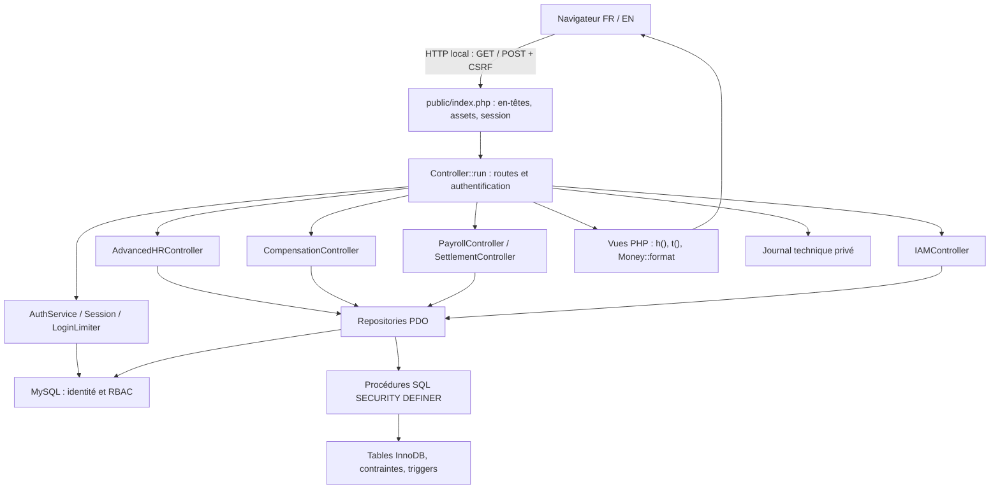
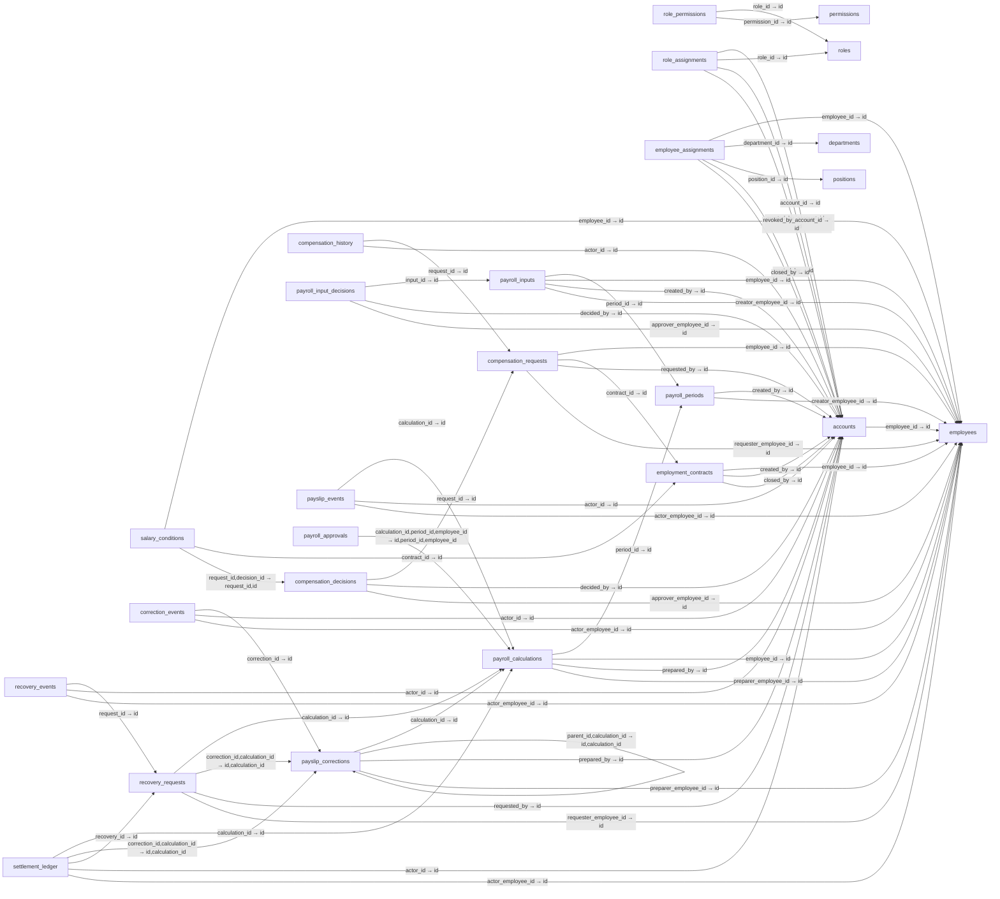
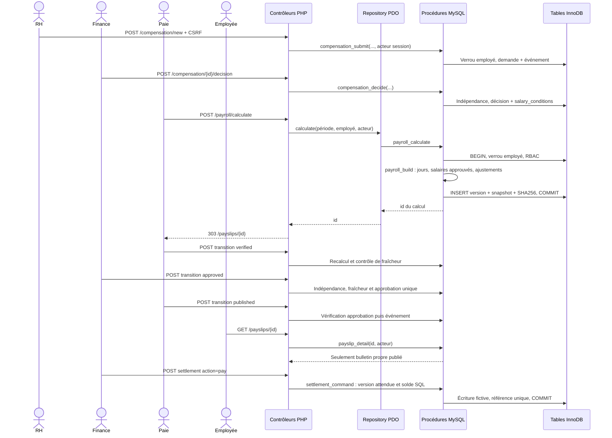

# SecurePayroll — Rapport technique et fonctionnel complet

**Module : Database Security**  
**Application : Secure Employee & Payroll Management System**  
**Date d’analyse : 11 novembre 2026**  
**Environnement de réalisation : Ubuntu Linux / VMware, PHP/PDO, MySQL, HTML/CSS/JavaScript**  
**Langues : français et anglais — devise des nouvelles opérations : MAD**

Ce rapport consolide les quinze chapitres de la documentation. Les fonctionnalités sont décrites à partir du code réel. L’installation actuelle de MySQL est Non vérifié ; la recette principale du 6 novembre est explicitement présentée comme preuve historique. Aucun secret réel n’est reproduit.

## Table des matières

1. [01 — Présentation générale de SecurePayroll](#chapitre-01)
2. [02 — Architecture et organisation](#chapitre-02)
3. [03 — Frontend et pages](#chapitre-03)
4. [04 — Backend PHP](#chapitre-04)
5. [05 — Conception et inventaire MySQL](#chapitre-05)
6. [06 — Procédures stockées et triggers](#chapitre-06)
7. [07 — Sécurité, RBAC et IAM](#chapitre-07)
8. [08 — Règles métier et traitement de la paie](#chapitre-08)
9. [09 — Scénario fonctionnel Nadia TRAORE](#chapitre-09)
10. [10 — Tests et validation](#chapitre-10)
11. [11 — Installation, exploitation et maintenance](#chapitre-11)
12. [12 — Limites, contradictions et perspectives](#chapitre-12)
13. [13 — Dictionnaire complet des données](#chapitre-13)
14. [14 — Inventaire des routes HTTP](#chapitre-14)
15. [15 — Inventaire des rôles et permissions](#chapitre-15)
16. [Diagrammes sources complémentaires](#diagrammes-complementaires)

---

<a id="chapitre-01"></a>

# 01 — Présentation générale de SecurePayroll

> Périmètre : analyse des sources au 11 novembre 2026. Les attestations de tests sont datées ; aucune campagne fonctionnelle n’a été relancée. Installation MySQL actuelle : **Non vérifié**.

## Finalité académique

**SecurePayroll — Secure Employee & Payroll Management System** est une application web locale de gestion des employés et de simulation de paie développée dans le cadre du module Database Security. Elle permet d’étudier une chaîne de décisions distinctes, depuis le contrat administratif jusqu’au paiement fictif, en faisant de MySQL une frontière de contrôle métier et de sécurité.

Le projet associe PHP/PDO, MySQL, HTML, CSS et JavaScript. Il ne déclare pas de framework MVC externe ni d’ORM : les classes `App\…` sont chargées par `app/bootstrap.php`, le routeur est écrit dans `app/Web/Controller.php` et les vues PHP produisent le HTML. L’environnement Ubuntu sous VMware est le contexte de réalisation fourni ; le code ne dépend pas d’une API VMware. Les campagnes historiques citent MySQL **8.4.11** et PHP CLI **8.5.4** ; ces versions ne sont pas un relevé actuel du serveur.

L’interface propose le français et l’anglais. Les nouvelles opérations sont exprimées en **MAD**. Les traces anciennes `UM` sont conservées en rémunération, sans conversion implicite ; la paie exige MAD. Source : `Money::REFERENCE_CURRENCY`, migration 006, procédures MAD et `payroll_build`.

## Périmètre fonctionnel constaté

| Domaine | Implémentation dans les sources | Installation / validation attestée |
|---|---|---|
| Authentification et sessions | Login Argon2id, limitation par IP, renouvellement et expiration | Rapports HTTP isolés ; six connexions principales dans le rapport du 06/11 |
| Identité RH | Création, liste, recherche, fiche et modification des noms | Recette RH historique ; aucun archivage par formulaire |
| Référentiels | Départements et postes bilingues consultables | Pages RH attestées ; administration des catalogues absente |
| Contrats et affectations | Création, consultation et clôture conservant l’historique | Procédures et tests isolés ; sources de Nadia attestées |
| Rémunération | Proposition RH, décision Finance indépendante, conditions versionnées | MAD et historique attestés ; ancien UM volontairement conservé |
| Paie | Mois/plafonds, ajustements approuvés, calcul, vérification, approbation, publication | Campagnes SQL/HTTP/concurrence ; bulletin de Nadia attesté |
| Règlements | Paiement fictif, correction, complément et restitution contrôlée | Module codé, option d’activation ; principal : paiement attesté ; corrections : isolé |
| IAM | Consultation, octroi et révocation de rôles | Module codé, option d’activation ; recette principale et campagnes isolées |
| Audit | Historiques métier SQL, historique IAM et journal technique local | Pas de console web générale des logs |
| Fiscalité, banque, PDF de bulletin | Absents des routes et calculs | Aucun résultat revendiqué |

## Échelle des preuves

**Implémenté** signifie qu’un chemin de code concret existe. **Installé historiquement** signifie qu’un rapport identifié décrit l’installation ; cela ne certifie pas l’état du 11 novembre. **Testé historiquement** renvoie à une campagne datée et au périmètre exercé. **Partiel** désigne une capacité disponible avec une couverture limitée, par exemple IAM sans création de comptes ni réinitialisation de mots de passe. **Prévu / perspective** désigne une évolution absente du code, sans promesse de livraison.

Le relevé structurel des sources compte **25 tables, 24 procédures distinctes, 42 triggers et 31 permissions** après prise en compte des remplacements de procédures. Une procédure réécrite dans une migration et un patch n’est comptée qu’une fois. Les 47 lignes de l’inventaire HTTP comprennent les méthodes GET/POST séparées et une ligne regroupant les deux assets ; ce nombre ne signifie pas 47 écrans.

## Lecture conseillée pour un jury

Commencer par l’architecture, suivre le scénario Nadia, présenter ensuite la frontière PDO/procédures, la matrice de rôles, les historiques immuables et les tests de concurrence. Le dictionnaire fournit la preuve détaillée des contraintes ; les chapitres de limites distinguent simulation académique et obligations d’un système professionnel.

Sources de synthèse : `public/index.php`, `app/Web/`, `database/migrations/001–011`, `database/seeds/`, `docs/DEMO-PRESENTATION.md`, `storage/logs/demo-verification.json`. Les mots de passe et empreintes d’authentification réelles sont exclus des livrables.

---

<a id="chapitre-02"></a>

# 02 — Architecture et organisation

> Périmètre : analyse des sources au 11 novembre 2026. Les attestations de tests sont datées ; aucune campagne fonctionnelle n’a été relancée. Installation MySQL actuelle : **Non vérifié**.

## Arborescence commentée

Les caches Python, fichiers de session, compteurs, artefacts temporaires, copies de tests générées et sauvegardes ne sont pas des composants de l’architecture. Les rapports existants sont des sources historiques ; ils ne pilotent pas l’exécution.

```text
app/ — code applicatif PHP
  Auth/AuthService.php
  Auth/IAMRepository.php
  Compensation/CompensationRepository.php
  Compensation/CompensationValidation.php
  Database/Connection.php
  Finance/Money.php
  HR/EmployeeRepository.php
  HR/PeriodRepository.php
  HR/PeriodValidation.php
  I18n/Translator.php
  Payroll/Calculator.php
  Payroll/Calendar.php
  Payroll/Repository.php
  Payroll/Validation.php
  Security/LoginLimiter.php
  Security/Runtime.php
  Security/Session.php
  Views/compensation-detail.php
  Views/compensation-form.php
  Views/compensation-list.php
  Views/compensation-nav.php
  Views/dashboard.php
  Views/employee-form.php
  Views/employee.php
  Views/employees.php
  Views/error.php
  Views/footer.php
  Views/header.php
  Views/hr-catalogue.php
  Views/hr-period-detail.php
  Views/hr-period-form.php
  Views/hr-period-list.php
  Views/iam.php
  Views/language-switch.php
  Views/login.php
  Views/payroll-select.php
  Views/payroll.php
  Views/payslip.php
  Views/settlement.php
  Web/AdvancedHRController.php
  Web/CompensationController.php
  Web/Controller.php
  Web/IAMController.php
  Web/PayrollController.php
  Web/SettlementController.php
  Web/helpers.php
  bootstrap.php
bin/ — exploitation et démonstration CLI
  backup.py
  check-demo.php
  demo-finalize.py
  demo-passwords.py
  demo-state.php
  finalize-admin.py
  local-demo.py
  mad-repair.py
  payroll-admin.py
  payroll-check.py
config/ — configuration PDO privée via environnement
  .gitkeep
  database.php
database/ — définitions SQL versionnées
  audit/mad-readonly.sql
  audit/privileges-readonly.sql
  migrations/.gitkeep
  migrations/001_create_identity_and_rbac.sql
  migrations/002_advanced_hr.sql
  migrations/003_hr_period_operations.sql
  migrations/004_compensation.sql
  migrations/005_compensation_operations.sql
  migrations/006_mad_currency.sql
  migrations/007_payroll.sql
  migrations/008_payroll_operations.sql
  migrations/009_settlement.sql
  migrations/010_settlement_operations.sql
  migrations/011_iam_operations.sql
  patches/001_fix_hr_assert_permission_collation.sql
  patches/002_mad_schema_guarded.sql
  patches/003_mad_compensation_routines.sql
  seeds/.gitkeep
  seeds/001_application_roles.sql
  seeds/002_hr_permissions.sql
  seeds/003_advanced_hr_permissions.sql
  seeds/004_hr_reference_demo.sql
  seeds/005_compensation_permissions.sql
  seeds/006_payroll_permissions.sql
  seeds/007_settlement_permissions.sql
  seeds/008_iam_permissions.sql
  setup/advanced_hr_grants.sql
  setup/advanced_hr_owner.sql
  setup/advanced_hr_owner_grants.sql
  setup/compensation_grants.sql
  setup/compensation_owner.sql
  setup/compensation_owner_grants.sql
  setup/iam_grants.sql
  setup/iam_owner.sql
  setup/iam_owner_grants.sql
  setup/payroll_grants.sql
  setup/payroll_owner.sql
  setup/payroll_owner_grants.sql
  setup/settlement_grants.sql
  setup/settlement_owner.sql
  setup/settlement_owner_grants.sql
  setup/svc_php_grants.sql
docs/ — documentation et résultats historiques
  ADVANCED-HR-ACTIVATION.md
  ADVANCED-HR.md
  COMPENSATION.md
  CONTRACT-503-DIAGNOSTIC.md
  CURRENCY-MAD.md
  DEMO-PRESENTATION.md
  FINALIZATION-VALIDATION-2026-11-06.md
  FINALIZATION.md
  I18N.md
  LAB-VALIDATION-2026-11-04.md
  LAB-VALIDATION-2026-11-06.md
  LOCAL-DEMO.md
  MAD-DIAGNOSTIC.md
  MAD-REPAIR.md
  MISSION04.md
  PAYROLL-ACTIVATION.md
  PAYROLL.md
  PROGRESS.md
  RECOVERY.md
  WEB-SETUP.md
lang/ — catalogues FR/EN
  en.php
  fr.php
public/ — seule racine HTTP
  assets/app.css
  assets/app.js
  index.php
tests/ — assertions et harnais de validation
  .gitkeep
  INTEGRITY.md
  compensation-readiness.php
  compensation-unit.php
  database-config.php
  database-connect.php
  database-integrity.php
  database-socket.php
  database-structure.php
  iam-http.py
  iam-mysql.php
  iam-races.py
  login-limiter.php
  mad-repair-live.php
  mysql-attack-demonstrations.php
  payroll-calculator.php
  payroll-calendar.php
  payroll-grants.py
  payroll-http-live.py
  payroll-live.php
  payroll-mysql.php
  payroll-races.py
  payroll-web-unit.php
  private_http.py
  settlement-http.py
  settlement-mysql.php
  settlement-races.py
  sql-static.php
  validation-03c1/FINAL-REVIEW.md
  validation-03c1/REPORT.md
  validation-03c1/admin-connection.php
  validation-03c1/check-connection.php
  validation-03c1/test-launcher.py
  validation-03c1/validate.py
  web-boundaries.py
lab/ — instances et exercices isolés
  README.md
  demo-settlement-check.py
  demonstrate.py
  mysql-attacks.py
  mysql-final-recovery.py
  mysql-iam.py
  mysql-integrity.py
  mysql-mad-diagnostic.py
  mysql-mad-repair.py
  mysql-recovery.py
  mysql-security.py
  mysql-validate.py
  mysql-web-check.py
  mysql_instance.py
storage/logs/ — journaux, sessions/compteurs selon configuration ; jamais exposés
.env.example — modèle sans chargement automatique et sans secret valide
README.md — introduction générale historique
```

## Répartition des responsabilités

`app/Auth` authentifie et reconstitue les habilitations. `app/Security` fournit session, limiteur et répertoire privé. `app/Database` centralise PDO. `app/HR` porte la lecture/écriture d’identité et les adaptateurs des périodes RH. `app/Compensation` relie demandes et décisions salariales. `app/Payroll` fournit les appels SQL de paie/règlement et un calculateur/calendrier PHP de référence. `app/Finance/Money` formate exactement les chaînes décimales. `app/I18n` charge les deux dictionnaires. `app/Web` orchestre l’HTTP et `app/Views` affiche les données déjà autorisées.

`database/migrations` définit structures et opérations ; `database/seeds` alimente catalogues de rôles/permissions et références fictives ; `database/setup` définit les comptes de contexte et les droits limités ; `database/patches` contient des corrections ciblées de collation et MAD. Le code ne migre pas automatiquement au démarrage. `bin` peut installer ou provisionner avec options explicites : ces programmes ne sont pas des contrôleurs HTTP et n’ont pas été exécutés ici.

## Parcours complet d’une requête

1. Le navigateur demande une route locale sur le serveur PHP, généralement `127.0.0.1:8080`.
2. `public/index.php` charge le bootstrap, pose CSP/nosniff/no-referrer/no-store, traite les deux assets autorisés ou démarre la session pour le HTML.
3. `Session::start` applique les options cookie, les délais et la rotation ; `Controller::run` valide le chemin, la méthode et le jeton CSRF des POST.
4. Les routes publiques sont traitées avant la connexion PDO. Sur une route privée, le contrôleur exige une session puis appelle `AuthService::currentUser` qui relit compte, salarié et attributions temporelles.
5. `AuthService::can` vérifie rôle, permission et conflits selon module ; le contrôleur spécialisé valide les champs puis appelle son repository.
6. `Connection::connect` fournit PDO natif préparé en UTF-8. `Controller::database` exige exactement `DB_NAME=secure_payroll` et fixe la session SQL à UTC.
7. Les employés et certaines lectures RH/rémunération utilisent du SQL préparé direct. Les écritures historisées utilisent un CALL, avec `account_id` provenant de la session et non du formulaire.
8. La procédure contrôle à nouveau les rôles, verrouille les lignes nécessaires, applique les règles, écrit les événements et commit ; son handler rollback/resignal en cas d’erreur.
9. Le repository consomme les jeux de résultats et ferme le curseur. Le contrôleur choisit une vue ou une redirection 303. La vue échappe les données avec `h()` et traduit les libellés via `t()`.
10. Les événements techniques sont inscrits dans le journal privé ; ils ne remplacent pas les événements métier transactionnels SQL.

## Dépendances et choix techniques

L’application utilise l’extension PDO MySQL et les fonctions natives PHP de sessions, cryptographie et dates. Les scripts d’exploitation/laboratoire emploient Python et les clients `mysql`/`mysqldump`, ainsi qu’un exécutable `mysqld` pour les instances privées. Aucun Composer, paquet npm ou service de banque externe n’est requis par les chemins examinés. La typographie Inter est seulement citée dans la pile CSS et peut être remplacée par une police système ; aucune requête Google Fonts n’est définie.

La logique SQL centralise les contrôles lorsque plusieurs clients pourraient accéder à MySQL. Les vues serveur évitent une seconde couche API ; les procédures renvoient plusieurs jeux de résultats. Le coût de ce choix est une dépendance forte à MySQL et une gestion attentive des DEFINER, droits et versions des routines.

## Diagramme d’architecture



Sources principales : `public/index.php`, `app/bootstrap.php`, `app/Web/Controller.php`, `app/Database/Connection.php` et les repositories. Le diagramme représente des dépendances de code, pas un relevé réseau de la VM.

---

<a id="chapitre-03"></a>

# 03 — Frontend et pages

> Périmètre : analyse des sources au 11 novembre 2026. Les attestations de tests sont datées ; aucune campagne fonctionnelle n’a été relancée. Installation MySQL actuelle : **Non vérifié**.

## Tableau récapitulatif des interfaces réellement routées

| Page | Route | Description | Rôles autorisés | Contrôleur | Données utilisées |
|---|---|---|---|---|---|
| Connexion | /login | Vue login | Public | Controller | Session |
| Tableau de bord | /dashboard | Vue dashboard | Tout compte actif authentifié | Controller | Identité, rôles, permissions |
| Annuaire | /employees | Vue employees | RH | Controller | employees |
| Création d’un employé | /employees/new | Vue employee-form | RH | Controller | employees |
| Fiche employé / profil personnel | /employees/{id} | Vue employee | RH ; tout compte actif pour sa propre fiche | Controller | employees |
| Modification d’identité | /employees/{id}/edit | Vue employee-form | RH | Controller | employees |
| Départements | /departments | Vue hr-catalogue | RH | AdvancedHRController | departments |
| Postes | /positions | Vue hr-catalogue | RH | AdvancedHRController | positions |
| Liste des contracts | /contracts | Vue hr-period-list | RH | AdvancedHRController | employment_contracts, employees |
| Historique individuel des contracts | /employees/{id}/contracts | Vue hr-period-list | RH | AdvancedHRController | employment_contracts, employees |
| Création contracts | /contracts/new | Vue hr-period-form | RH | AdvancedHRController | employment_contracts, employees, hr_create_contract |
| Détail contracts | /contracts/{id} | Vue hr-period-detail | RH | AdvancedHRController | employment_contracts |
| Liste des assignments | /assignments | Vue hr-period-list | RH | AdvancedHRController | employee_assignments, employees |
| Historique individuel des assignments | /employees/{id}/assignments | Vue hr-period-list | RH | AdvancedHRController | employee_assignments, employees |
| Création assignments | /assignments/new | Vue hr-period-form | RH | AdvancedHRController | employee_assignments, employees, departments, positions ; hr_create_assignment |
| Détail assignments | /assignments/{id} | Vue hr-period-detail | RH | AdvancedHRController | employee_assignments |
| Demandes salariales | /compensation | Vue compensation-list | RH, Finance | CompensationController | compensation_requests, compensation_decisions, salary_conditions, employment_contracts, employees |
| Employés sous contrat | /compensation/employees | Vue compensation-list | RH, Finance | CompensationController | compensation_requests, compensation_decisions, salary_conditions, employment_contracts, employees |
| Approbations Finance en attente | /compensation/pending | Vue compensation-list | RH, Finance | CompensationController | compensation_requests, compensation_decisions, salary_conditions, employment_contracts, employees |
| Historique des conditions salariales | /compensation/history | Vue compensation-list | RH, Finance | CompensationController | compensation_requests, compensation_decisions, salary_conditions, employment_contracts, employees |
| Proposition salariale | /compensation/new | Vue compensation-form | RH, Finance | CompensationController | compensation_submit ; compensation_requests, compensation_history |
| Détail de demande salariale | /compensation/{id} | Vue compensation-detail | RH, Finance | CompensationController | compensation_requests, compensation_decisions, compensation_history, employees, employment_contracts |
| Paie / espace employé | /payroll | Vue payroll | RH, Paie, Finance, Audit, Employé | PayrollController | payroll_overview |
| Bulletin de salaire | /payslips/{id} | Vue payslip | RH, Paie, Finance, Audit ; Employé pour son bulletin publié | PayrollController | payslip_detail |
| Règlements, corrections et remboursements | /payslips/{id}/settlement | Vue settlement | RH, Paie, Finance, Audit ; Employé pour son bulletin publié | SettlementController | settlement_detail / settlement_command ; tables settlement/corrections/recovery |
| Administration IAM / audit des rôles | /iam | Vue iam | Admin, Audit | IAMController | iam_overview ; accounts, roles, role_assignments |

Le rôle associé à chaque permission est fixé dans le chapitre 15. Les droits RH correspondent à HR Manager ; compensation.read à RH/Finance ; payroll.read à RH/Paie/Finance/Audit ; payslip.self à Employee ; iam.read à Admin/Audit. L’accès à sa fiche et au tableau de bord est ouvert à tout compte authentifié actif, même sans rôle.

## Connexion — `/login`

**Objectif et affichage :** Formulaire ou 303 si connecté. Connexion ; afficher/masquer le mot de passe ; changement FR/EN.

**Accès :** Public. Les contrôles serveur précèdent le rendu ; masquer un lien ne suffit pas à autoriser une action.

**Vue / contrôleur :** [app/Views/login.php](../../app/Views/login.php) ; [app/Web/Controller.php](../../app/Web/Controller.php) (`run`).

**Données et SQL :** Session. Les appels SQL exacts et leurs contrôles figurent au chapitre 06.

**Champs :** login (HTML 190 caractères ; PHP 760 octets), password (4096 octets maximum), csrf.

**Validations :** Tous obligatoires ; password_verify Argon2id ; cinq réservations échouées/IP/900 s.

**Interactions :** Connexion ; afficher/masquer le mot de passe ; changement FR/EN.

**Sécurité :** session pour les pages privées, autorisation serveur, échappement `h()` des valeurs dynamiques et CSRF pour chaque POST ; contrôle SQL supplémentaire pour les commandes historisées.

**Limites :** Aucune inscription, récupération ni changement de mot de passe web.

## Tableau de bord — `/dashboard`

**Objectif et affichage :** 200 tableau de bord. Cartes des rôles actifs ; profil ; liens de module ; déconnexion et langue dans l’en-tête.

**Accès :** Authentifié. Les contrôles serveur précèdent le rendu ; masquer un lien ne suffit pas à autoriser une action.

**Vue / contrôleur :** [app/Views/dashboard.php](../../app/Views/dashboard.php) ; [app/Web/Controller.php](../../app/Web/Controller.php) (`run`).

**Données et SQL :** Identité, rôles, permissions. Les appels SQL exacts et leurs contrôles figurent au chapitre 06.

**Champs :** Aucun formulaire métier.

**Validations :** Session relue ; liens conditionnés par can().

**Interactions :** Cartes des rôles actifs ; profil ; liens de module ; déconnexion et langue dans l’en-tête.

**Sécurité :** session pour les pages privées, autorisation serveur, échappement `h()` des valeurs dynamiques et CSRF pour chaque POST ; contrôle SQL supplémentaire pour les commandes historisées.

**Limites :** Pas de statistiques financières agrégées ; certaines cartes de repli annoncent une capacité à venir.

## Annuaire — `/employees`

**Objectif et affichage :** 200 liste paginée. Recherche, précédent/suivant, ouvrir la fiche, créer selon droit.

**Accès :** employees.read. Les contrôles serveur précèdent le rendu ; masquer un lien ne suffit pas à autoriser une action.

**Vue / contrôleur :** [app/Views/employees.php](../../app/Views/employees.php) ; [app/Web/Controller.php](../../app/Web/Controller.php) (`run / EmployeeRepository::listing`).

**Données et SQL :** employees. Les appels SQL exacts et leurs contrôles figurent au chapitre 06.

**Champs :** GET q, page.

**Validations :** q ≤ 400 octets sinon filtre vidé ; page entière 1–1 000 000 ; recherche LIKE littérale avec échappement de !/%/_.

**Interactions :** Recherche, précédent/suivant, ouvrir la fiche, créer selon droit.

**Sécurité :** session pour les pages privées, autorisation serveur, échappement `h()` des valeurs dynamiques et CSRF pour chaque POST ; contrôle SQL supplémentaire pour les commandes historisées.

**Limites :** 20 lignes/page ; pas de suppression ni export.

## Création d’un employé — `/employees/new`

**Objectif et affichage :** Formulaire ; POST 303 ou 409/422. Enregistrer, annuler ; erreurs par champ ; matricule readonly en édition.

**Accès :** employees.create. Les contrôles serveur précèdent le rendu ; masquer un lien ne suffit pas à autoriser une action.

**Vue / contrôleur :** [app/Views/employee-form.php](../../app/Views/employee-form.php) ; [app/Web/Controller.php](../../app/Web/Controller.php) (`run / EmployeeRepository::create`).

**Données et SQL :** employees. Les appels SQL exacts et leurs contrôles figurent au chapitre 06.

**Champs :** Création : employee_number, first_name, last_name ; modification : first_name, last_name et version cachée ; csrf.

**Validations :** Matricule 1–32 caractères Unicode, noms 1–100 ; trim, UTF-8 valide et caractères de contrôle refusés. Doublon : 409. Version HMAC et UPDATE conditionnel.

**Interactions :** Enregistrer, annuler ; erreurs par champ ; matricule readonly en édition.

**Sécurité :** session pour les pages privées, autorisation serveur, échappement `h()` des valeurs dynamiques et CSRF pour chaque POST ; contrôle SQL supplémentaire pour les commandes historisées.

**Limites :** Matricule immuable ; archivage et compte non modifiables ici.

## Fiche employé / profil personnel — `/employees/{id}`

**Objectif et affichage :** 200 fiche ; 403/404. Identité, matricule, dates, état d’archivage ; liens modifier, contrats, affectations, salaire selon droits.

**Accès :** employees.read OU id = salarié connecté. Les contrôles serveur précèdent le rendu ; masquer un lien ne suffit pas à autoriser une action.

**Vue / contrôleur :** [app/Views/employee.php](../../app/Views/employee.php) ; [app/Web/Controller.php](../../app/Web/Controller.php) (`run / EmployeeRepository::find`).

**Données et SQL :** employees. Les appels SQL exacts et leurs contrôles figurent au chapitre 06.

**Champs :** Aucun champ métier éditable.

**Validations :** Pour un non-RH, id doit être exactement user.employee_id.

**Interactions :** Identité, matricule, dates, état d’archivage ; liens modifier, contrats, affectations, salaire selon droits.

**Sécurité :** session pour les pages privées, autorisation serveur, échappement `h()` des valeurs dynamiques et CSRF pour chaque POST ; contrôle SQL supplémentaire pour les commandes historisées.

**Limites :** Profil de consultation ; pas de changement du compte ni mot de passe.

## Modification d’identité — `/employees/{id}/edit`

**Objectif et affichage :** Formulaire ; POST 303 ou 409/422. Enregistrer, annuler ; erreurs par champ ; matricule readonly en édition.

**Accès :** employees.update. Les contrôles serveur précèdent le rendu ; masquer un lien ne suffit pas à autoriser une action.

**Vue / contrôleur :** [app/Views/employee-form.php](../../app/Views/employee-form.php) ; [app/Web/Controller.php](../../app/Web/Controller.php) (`run / EmployeeRepository::update`).

**Données et SQL :** employees. Les appels SQL exacts et leurs contrôles figurent au chapitre 06.

**Champs :** Création : employee_number, first_name, last_name ; modification : first_name, last_name et version cachée ; csrf.

**Validations :** Matricule 1–32 caractères Unicode, noms 1–100 ; trim, UTF-8 valide et caractères de contrôle refusés. Doublon : 409. Version HMAC et UPDATE conditionnel.

**Interactions :** Enregistrer, annuler ; erreurs par champ ; matricule readonly en édition.

**Sécurité :** session pour les pages privées, autorisation serveur, échappement `h()` des valeurs dynamiques et CSRF pour chaque POST ; contrôle SQL supplémentaire pour les commandes historisées.

**Limites :** Matricule immuable ; archivage et compte non modifiables ici.

## Départements — `/departments`

**Objectif et affichage :** 200 catalogue consultable. Code, libellé dans la langue choisie et état d’archivage.

**Accès :** departments.read. Les contrôles serveur précèdent le rendu ; masquer un lien ne suffit pas à autoriser une action.

**Vue / contrôleur :** [app/Views/hr-catalogue.php](../../app/Views/hr-catalogue.php) ; [app/Web/AdvancedHRController.php](../../app/Web/AdvancedHRController.php) (`handle / catalogue`).

**Données et SQL :** departments. Les appels SQL exacts et leurs contrôles figurent au chapitre 06.

**Champs :** Aucun formulaire.

**Validations :** Rôle RH et permission departments.read ou positions.read.

**Interactions :** Code, libellé dans la langue choisie et état d’archivage.

**Sécurité :** session pour les pages privées, autorisation serveur, échappement `h()` des valeurs dynamiques et CSRF pour chaque POST ; contrôle SQL supplémentaire pour les commandes historisées.

**Limites :** Consultation seulement ; aucun POST de création/modification de catalogue.

## Postes — `/positions`

**Objectif et affichage :** 200 catalogue consultable. Code, libellé dans la langue choisie et état d’archivage.

**Accès :** positions.read. Les contrôles serveur précèdent le rendu ; masquer un lien ne suffit pas à autoriser une action.

**Vue / contrôleur :** [app/Views/hr-catalogue.php](../../app/Views/hr-catalogue.php) ; [app/Web/AdvancedHRController.php](../../app/Web/AdvancedHRController.php) (`handle / catalogue`).

**Données et SQL :** positions. Les appels SQL exacts et leurs contrôles figurent au chapitre 06.

**Champs :** Aucun formulaire.

**Validations :** Rôle RH et permission departments.read ou positions.read.

**Interactions :** Code, libellé dans la langue choisie et état d’archivage.

**Sécurité :** session pour les pages privées, autorisation serveur, échappement `h()` des valeurs dynamiques et CSRF pour chaque POST ; contrôle SQL supplémentaire pour les commandes historisées.

**Limites :** Consultation seulement ; aucun POST de création/modification de catalogue.

## Liste des contracts — `/contracts`

**Objectif et affichage :** 200 historique paginé. Historique, état calculé courant/prévu/terminé ; ouvrir un détail, créer selon permission.

**Accès :** contracts.read. Les contrôles serveur précèdent le rendu ; masquer un lien ne suffit pas à autoriser une action.

**Vue / contrôleur :** [app/Views/hr-period-list.php](../../app/Views/hr-period-list.php) ; [app/Web/AdvancedHRController.php](../../app/Web/AdvancedHRController.php) (`handle / listing`).

**Données et SQL :** employment_contracts, employees. Les appels SQL exacts et leurs contrôles figurent au chapitre 06.

**Champs :** GET page ; employee_id facultatif selon route.

**Validations :** Identifiant salarié positif ; existence vérifiée si filtre actif ; permission de lecture requise.

**Interactions :** Historique, état calculé courant/prévu/terminé ; ouvrir un détail, créer selon permission.

**Sécurité :** session pour les pages privées, autorisation serveur, échappement `h()` des valeurs dynamiques et CSRF pour chaque POST ; contrôle SQL supplémentaire pour les commandes historisées.

**Limites :** 20 lignes/page ; une vue partagée pour contrats et affectations.

## Historique individuel des contracts — `/employees/{id}/contracts`

**Objectif et affichage :** 200 historique du salarié. Historique, état calculé courant/prévu/terminé ; ouvrir un détail, créer selon permission.

**Accès :** contracts.read. Les contrôles serveur précèdent le rendu ; masquer un lien ne suffit pas à autoriser une action.

**Vue / contrôleur :** [app/Views/hr-period-list.php](../../app/Views/hr-period-list.php) ; [app/Web/AdvancedHRController.php](../../app/Web/AdvancedHRController.php) (`handle / listing`).

**Données et SQL :** employment_contracts, employees. Les appels SQL exacts et leurs contrôles figurent au chapitre 06.

**Champs :** GET page ; employee_id facultatif selon route.

**Validations :** Identifiant salarié positif ; existence vérifiée si filtre actif ; permission de lecture requise.

**Interactions :** Historique, état calculé courant/prévu/terminé ; ouvrir un détail, créer selon permission.

**Sécurité :** session pour les pages privées, autorisation serveur, échappement `h()` des valeurs dynamiques et CSRF pour chaque POST ; contrôle SQL supplémentaire pour les commandes historisées.

**Limites :** 20 lignes/page ; une vue partagée pour contrats et affectations.

## Création contracts — `/contracts/new`

**Objectif et affichage :** Formulaire ; POST 303 ou erreur métier. Créer, annuler ; préremplissage depuis la fiche ; choix de catalogues traduits.

**Accès :** contracts.create. Les contrôles serveur précèdent le rendu ; masquer un lien ne suffit pas à autoriser une action.

**Vue / contrôleur :** [app/Views/hr-period-form.php](../../app/Views/hr-period-form.php) ; [app/Web/AdvancedHRController.php](../../app/Web/AdvancedHRController.php) (`handle / create`).

**Données et SQL :** employment_contracts, employees, hr_create_contract. Les appels SQL exacts et leurs contrôles figurent au chapitre 06.

**Champs :** employee_number ; starts_on ; ends_on facultatif ; contrat : reference, contract_type ; affectation : department_id, position_id ; csrf.

**Validations :** Dates ISO réelles ≥ 1900 ; fin ≥ début ; permanent sans fin ; fixed_term/internship avec fin ; référence 1–64 ; salarié actif ; catalogues actifs ; absence de chevauchement SQL.

**Interactions :** Créer, annuler ; préremplissage depuis la fiche ; choix de catalogues traduits.

**Sécurité :** session pour les pages privées, autorisation serveur, échappement `h()` des valeurs dynamiques et CSRF pour chaque POST ; contrôle SQL supplémentaire pour les commandes historisées.

**Limites :** Aucun salaire dans le contrat ; pas d’édition arbitraire d’une période enregistrée.

## Détail contracts — `/contracts/{id}`

**Objectif et affichage :** 200 détail. Afficher dates/auteurs et fin effective ; clôturer ; historique salarié et liste.

**Accès :** contracts.read. Les contrôles serveur précèdent le rendu ; masquer un lien ne suffit pas à autoriser une action.

**Vue / contrôleur :** [app/Views/hr-period-detail.php](../../app/Views/hr-period-detail.php) ; [app/Web/AdvancedHRController.php](../../app/Web/AdvancedHRController.php) (`handle / find`).

**Données et SQL :** employment_contracts. Les appels SQL exacts et leurs contrôles figurent au chapitre 06.

**Champs :** closed_on et csrf si clôture autorisée.

**Validations :** Date entre starts_on et ends_on prévue si présente ; clôture unique ; garde SQL de couverture salariale pour contrat.

**Interactions :** Afficher dates/auteurs et fin effective ; clôturer ; historique salarié et liste.

**Sécurité :** session pour les pages privées, autorisation serveur, échappement `h()` des valeurs dynamiques et CSRF pour chaque POST ; contrôle SQL supplémentaire pour les commandes historisées.

**Limites :** Clôture irréversible par ce workflow ; pas de suppression.

## Liste des assignments — `/assignments`

**Objectif et affichage :** 200 historique paginé. Historique, état calculé courant/prévu/terminé ; ouvrir un détail, créer selon permission.

**Accès :** assignments.read. Les contrôles serveur précèdent le rendu ; masquer un lien ne suffit pas à autoriser une action.

**Vue / contrôleur :** [app/Views/hr-period-list.php](../../app/Views/hr-period-list.php) ; [app/Web/AdvancedHRController.php](../../app/Web/AdvancedHRController.php) (`handle / listing`).

**Données et SQL :** employee_assignments, employees. Les appels SQL exacts et leurs contrôles figurent au chapitre 06.

**Champs :** GET page ; employee_id facultatif selon route.

**Validations :** Identifiant salarié positif ; existence vérifiée si filtre actif ; permission de lecture requise.

**Interactions :** Historique, état calculé courant/prévu/terminé ; ouvrir un détail, créer selon permission.

**Sécurité :** session pour les pages privées, autorisation serveur, échappement `h()` des valeurs dynamiques et CSRF pour chaque POST ; contrôle SQL supplémentaire pour les commandes historisées.

**Limites :** 20 lignes/page ; une vue partagée pour contrats et affectations.

## Historique individuel des assignments — `/employees/{id}/assignments`

**Objectif et affichage :** 200 historique du salarié. Historique, état calculé courant/prévu/terminé ; ouvrir un détail, créer selon permission.

**Accès :** assignments.read. Les contrôles serveur précèdent le rendu ; masquer un lien ne suffit pas à autoriser une action.

**Vue / contrôleur :** [app/Views/hr-period-list.php](../../app/Views/hr-period-list.php) ; [app/Web/AdvancedHRController.php](../../app/Web/AdvancedHRController.php) (`handle / listing`).

**Données et SQL :** employee_assignments, employees. Les appels SQL exacts et leurs contrôles figurent au chapitre 06.

**Champs :** GET page ; employee_id facultatif selon route.

**Validations :** Identifiant salarié positif ; existence vérifiée si filtre actif ; permission de lecture requise.

**Interactions :** Historique, état calculé courant/prévu/terminé ; ouvrir un détail, créer selon permission.

**Sécurité :** session pour les pages privées, autorisation serveur, échappement `h()` des valeurs dynamiques et CSRF pour chaque POST ; contrôle SQL supplémentaire pour les commandes historisées.

**Limites :** 20 lignes/page ; une vue partagée pour contrats et affectations.

## Création assignments — `/assignments/new`

**Objectif et affichage :** Formulaire ; POST 303 ou erreur métier. Créer, annuler ; préremplissage depuis la fiche ; choix de catalogues traduits.

**Accès :** assignments.create. Les contrôles serveur précèdent le rendu ; masquer un lien ne suffit pas à autoriser une action.

**Vue / contrôleur :** [app/Views/hr-period-form.php](../../app/Views/hr-period-form.php) ; [app/Web/AdvancedHRController.php](../../app/Web/AdvancedHRController.php) (`handle / create`).

**Données et SQL :** employee_assignments, employees, departments, positions ; hr_create_assignment. Les appels SQL exacts et leurs contrôles figurent au chapitre 06.

**Champs :** employee_number ; starts_on ; ends_on facultatif ; contrat : reference, contract_type ; affectation : department_id, position_id ; csrf.

**Validations :** Dates ISO réelles ≥ 1900 ; fin ≥ début ; permanent sans fin ; fixed_term/internship avec fin ; référence 1–64 ; salarié actif ; catalogues actifs ; absence de chevauchement SQL.

**Interactions :** Créer, annuler ; préremplissage depuis la fiche ; choix de catalogues traduits.

**Sécurité :** session pour les pages privées, autorisation serveur, échappement `h()` des valeurs dynamiques et CSRF pour chaque POST ; contrôle SQL supplémentaire pour les commandes historisées.

**Limites :** Aucun salaire dans le contrat ; pas d’édition arbitraire d’une période enregistrée.

## Détail assignments — `/assignments/{id}`

**Objectif et affichage :** 200 détail. Afficher dates/auteurs et fin effective ; clôturer ; historique salarié et liste.

**Accès :** assignments.read. Les contrôles serveur précèdent le rendu ; masquer un lien ne suffit pas à autoriser une action.

**Vue / contrôleur :** [app/Views/hr-period-detail.php](../../app/Views/hr-period-detail.php) ; [app/Web/AdvancedHRController.php](../../app/Web/AdvancedHRController.php) (`handle / find`).

**Données et SQL :** employee_assignments. Les appels SQL exacts et leurs contrôles figurent au chapitre 06.

**Champs :** closed_on et csrf si clôture autorisée.

**Validations :** Date entre starts_on et ends_on prévue si présente ; clôture unique ; garde SQL de couverture salariale pour contrat.

**Interactions :** Afficher dates/auteurs et fin effective ; clôturer ; historique salarié et liste.

**Sécurité :** session pour les pages privées, autorisation serveur, échappement `h()` des valeurs dynamiques et CSRF pour chaque POST ; contrôle SQL supplémentaire pour les commandes historisées.

**Limites :** Clôture irréversible par ce workflow ; pas de suppression.

## Demandes salariales — `/compensation`

**Objectif et affichage :** 200 liste paginée. Onglets demandes, sous contrat, attente, historique ; ouverture de détail et nouvelle proposition si droit.

**Accès :** compensation.read. Les contrôles serveur précèdent le rendu ; masquer un lien ne suffit pas à autoriser une action.

**Vue / contrôleur :** [app/Views/compensation-list.php](../../app/Views/compensation-list.php) ; [app/Web/CompensationController.php](../../app/Web/CompensationController.php) (`handle`).

**Données et SQL :** compensation_requests, compensation_decisions, salary_conditions, employment_contracts, employees. Les appels SQL exacts et leurs contrôles figurent au chapitre 06.

**Champs :** GET page ; status pour /compensation ; employee_id pour /history.

**Validations :** Statut limité à vide/pending/approved/rejected ; page entière ; contrôle compensation.read.

**Interactions :** Onglets demandes, sous contrat, attente, historique ; ouverture de détail et nouvelle proposition si droit.

**Sécurité :** session pour les pages privées, autorisation serveur, échappement `h()` des valeurs dynamiques et CSRF pour chaque POST ; contrôle SQL supplémentaire pour les commandes historisées.

**Limites :** 20 lignes/page ; employés sous contrat signifie lignes de contrats, pas nécessairement salariés distincts ; pas d’accès employee à cet historique global.

## Employés sous contrat — `/compensation/employees`

**Objectif et affichage :** 200 liste paginée. Onglets demandes, sous contrat, attente, historique ; ouverture de détail et nouvelle proposition si droit.

**Accès :** compensation.read. Les contrôles serveur précèdent le rendu ; masquer un lien ne suffit pas à autoriser une action.

**Vue / contrôleur :** [app/Views/compensation-list.php](../../app/Views/compensation-list.php) ; [app/Web/CompensationController.php](../../app/Web/CompensationController.php) (`handle`).

**Données et SQL :** compensation_requests, compensation_decisions, salary_conditions, employment_contracts, employees. Les appels SQL exacts et leurs contrôles figurent au chapitre 06.

**Champs :** GET page ; status pour /compensation ; employee_id pour /history.

**Validations :** Statut limité à vide/pending/approved/rejected ; page entière ; contrôle compensation.read.

**Interactions :** Onglets demandes, sous contrat, attente, historique ; ouverture de détail et nouvelle proposition si droit.

**Sécurité :** session pour les pages privées, autorisation serveur, échappement `h()` des valeurs dynamiques et CSRF pour chaque POST ; contrôle SQL supplémentaire pour les commandes historisées.

**Limites :** 20 lignes/page ; employés sous contrat signifie lignes de contrats, pas nécessairement salariés distincts ; pas d’accès employee à cet historique global.

## Approbations Finance en attente — `/compensation/pending`

**Objectif et affichage :** 200 liste paginée. Onglets demandes, sous contrat, attente, historique ; ouverture de détail et nouvelle proposition si droit.

**Accès :** compensation.read. Les contrôles serveur précèdent le rendu ; masquer un lien ne suffit pas à autoriser une action.

**Vue / contrôleur :** [app/Views/compensation-list.php](../../app/Views/compensation-list.php) ; [app/Web/CompensationController.php](../../app/Web/CompensationController.php) (`handle`).

**Données et SQL :** compensation_requests, compensation_decisions, salary_conditions, employment_contracts, employees. Les appels SQL exacts et leurs contrôles figurent au chapitre 06.

**Champs :** GET page ; status pour /compensation ; employee_id pour /history.

**Validations :** Statut limité à vide/pending/approved/rejected ; page entière ; contrôle compensation.read.

**Interactions :** Onglets demandes, sous contrat, attente, historique ; ouverture de détail et nouvelle proposition si droit.

**Sécurité :** session pour les pages privées, autorisation serveur, échappement `h()` des valeurs dynamiques et CSRF pour chaque POST ; contrôle SQL supplémentaire pour les commandes historisées.

**Limites :** 20 lignes/page ; employés sous contrat signifie lignes de contrats, pas nécessairement salariés distincts ; pas d’accès employee à cet historique global.

## Historique des conditions salariales — `/compensation/history`

**Objectif et affichage :** 200 liste paginée. Onglets demandes, sous contrat, attente, historique ; ouverture de détail et nouvelle proposition si droit.

**Accès :** compensation.read. Les contrôles serveur précèdent le rendu ; masquer un lien ne suffit pas à autoriser une action.

**Vue / contrôleur :** [app/Views/compensation-list.php](../../app/Views/compensation-list.php) ; [app/Web/CompensationController.php](../../app/Web/CompensationController.php) (`handle`).

**Données et SQL :** compensation_requests, compensation_decisions, salary_conditions, employment_contracts, employees. Les appels SQL exacts et leurs contrôles figurent au chapitre 06.

**Champs :** GET page ; status pour /compensation ; employee_id pour /history.

**Validations :** Statut limité à vide/pending/approved/rejected ; page entière ; contrôle compensation.read.

**Interactions :** Onglets demandes, sous contrat, attente, historique ; ouverture de détail et nouvelle proposition si droit.

**Sécurité :** session pour les pages privées, autorisation serveur, échappement `h()` des valeurs dynamiques et CSRF pour chaque POST ; contrôle SQL supplémentaire pour les commandes historisées.

**Limites :** 20 lignes/page ; employés sous contrat signifie lignes de contrats, pas nécessairement salariés distincts ; pas d’accès employee à cet historique global.

## Proposition salariale — `/compensation/new`

**Objectif et affichage :** Formulaire ; POST 303 ou 409/422/503. Soumettre ou annuler ; erreurs traduites ; informations de règle de date.

**Accès :** compensation.read ET compensation.submit. Les contrôles serveur précèdent le rendu ; masquer un lien ne suffit pas à autoriser une action.

**Vue / contrôleur :** [app/Views/compensation-form.php](../../app/Views/compensation-form.php) ; [app/Web/CompensationController.php](../../app/Web/CompensationController.php) (`handle / submit`).

**Données et SQL :** compensation_submit ; compensation_requests, compensation_history. Les appels SQL exacts et leurs contrôles figurent au chapitre 06.

**Champs :** employee_number, reference, monthly_amount, effective_on, justification, csrf.

**Validations :** Montant positif : 1–10 chiffres entiers, 1–2 décimales facultatives, virgule/point admis ; justification Unicode 1–2000 ; dates valides ; couple contrat/salarié réel ; schéma devise prêt.

**Interactions :** Soumettre ou annuler ; erreurs traduites ; informations de règle de date.

**Sécurité :** session pour les pages privées, autorisation serveur, échappement `h()` des valeurs dynamiques et CSRF pour chaque POST ; contrôle SQL supplémentaire pour les commandes historisées.

**Limites :** Initiale à la date de début du contrat ; révision au premier jour d’un mois et après la dernière version ; UM bloque les nouvelles décisions favorables.

## Détail de demande salariale — `/compensation/{id}`

**Objectif et affichage :** 200 détail, décision et événements. Demande, montant, contrat, identité des acteurs, décision et événements ; approuver/rejeter si autorisé.

**Accès :** compensation.read. Les contrôles serveur précèdent le rendu ; masquer un lien ne suffit pas à autoriser une action.

**Vue / contrôleur :** [app/Views/compensation-detail.php](../../app/Views/compensation-detail.php) ; [app/Web/CompensationController.php](../../app/Web/CompensationController.php) (`handle / find / events`).

**Données et SQL :** compensation_requests, compensation_decisions, compensation_history, employees, employment_contracts. Les appels SQL exacts et leurs contrôles figurent au chapitre 06.

**Champs :** decision=approved/rejected, reason 1–2000, csrf selon Finance.

**Validations :** Décideur distinct du demandeur et bénéficiaire au niveau employee_id ; décision unique ; nouvelle vérification des sources SQL.

**Interactions :** Demande, montant, contrat, identité des acteurs, décision et événements ; approuver/rejeter si autorisé.

**Sécurité :** session pour les pages privées, autorisation serveur, échappement `h()` des valeurs dynamiques et CSRF pour chaque POST ; contrôle SQL supplémentaire pour les commandes historisées.

**Limites :** Une demande décidée ne se réécrit pas ; un rejet est conservé.

## Paie / espace employé — `/payroll`

**Objectif et affichage :** 200 espace Paie ou bulletins personnels. Créer période, proposer prime/retenue/suspension, décider, calculer, consulter bulletin ; listes de mois et de calculs ; pagination.

**Accès :** payroll.read OU payslip.self. Les contrôles serveur précèdent le rendu ; masquer un lien ne suffit pas à autoriser une action.

**Vue / contrôleur :** [app/Views/payroll.php](../../app/Views/payroll.php) ; [app/Web/PayrollController.php](../../app/Web/PayrollController.php) (`handle / overview`).

**Données et SQL :** payroll_overview. Les appels SQL exacts et leurs contrôles figurent au chapitre 06.

**Champs :** Finance : month, bonus_cap, deduction_cap, reason ; RH : period_id, employee_id, kind, amount, starts_on, ends_on, reason ; Paie : period_id, employee_id ; Finance décision : decision, reason ; csrf dans chaque POST.

**Validations :** Mois ISO valide ; plafonds ≥ 0 explicites ; identifiants positifs ; kind bonus/deduction/paid_leave/unpaid_leave ; montant positif pour argent et zéro pour suspension ; bornes inclusives dans le mois ; motif 1–2000.

**Interactions :** Créer période, proposer prime/retenue/suspension, décider, calculer, consulter bulletin ; listes de mois et de calculs ; pagination.

**Sécurité :** session pour les pages privées, autorisation serveur, échappement `h()` des valeurs dynamiques et CSRF pour chaque POST ; contrôle SQL supplémentaire pour les commandes historisées.

**Limites :** Employee ne reçoit ni mois de sélection ni autres salariés ni ajustements ; seulement ses bulletins publiés. 120 mois, 500 salariés de sélection et 50 entrées/calculs par page côté SQL.

## Bulletin de salaire — `/payslips/{id}`

**Objectif et affichage :** 200 bulletin ; 404 inaccessible. Base/primes/retenues/brut/net, mois/version, calendrier journalier, événements et versions ; vérifier, approuver/rejeter, publier ; ouvrir règlement si publié et activé.

**Accès :** payroll.read OU payslip.self + propriété/publication SQL. Les contrôles serveur précèdent le rendu ; masquer un lien ne suffit pas à autoriser une action.

**Vue / contrôleur :** [app/Views/payslip.php](../../app/Views/payslip.php) ; [app/Web/PayrollController.php](../../app/Web/PayrollController.php) (`handle / detail`).

**Données et SQL :** payslip_detail. Les appels SQL exacts et leurs contrôles figurent au chapitre 06.

**Champs :** event=verified/approved/rejected/published, reason et csrf selon état/droit.

**Validations :** État requis, bénéficiaire exclu, Finance distinct du préparateur, version courante et recalcul de fraîcheur avant vérification/approbation.

**Interactions :** Base/primes/retenues/brut/net, mois/version, calendrier journalier, événements et versions ; vérifier, approuver/rejeter, publier ; ouvrir règlement si publié et activé.

**Sécurité :** session pour les pages privées, autorisation serveur, échappement `h()` des valeurs dynamiques et CSRF pour chaque POST ; contrôle SQL supplémentaire pour les commandes historisées.

**Limites :** Bulletin HTML ; aucune route PDF de bulletin ; un salarié ne voit que ses versions publiées.

## Règlements, corrections et remboursements — `/payslips/{id}/settlement`

**Objectif et affichage :** SETTLEMENT_ENABLED=1 ; 200/303 ou erreur. Solde, net effectif, corrections et événements, registre financier, demandes/reçus ; boutons conditionnés par état, propriété et droits.

**Accès :** GET payroll.read OU payslip.self ; POST permission selon action. Les contrôles serveur précèdent le rendu ; masquer un lien ne suffit pas à autoriser une action.

**Vue / contrôleur :** [app/Views/settlement.php](../../app/Views/settlement.php) ; [app/Web/SettlementController.php](../../app/Web/SettlementController.php) (`handle / settlement ou settle`).

**Données et SQL :** settlement_detail / settlement_command ; tables settlement/corrections/recovery. Les appels SQL exacts et leurs contrôles figurent au chapitre 06.

**Champs :** action, expected, target, reason ; correct : base, bonus, deduction ; pay/recover_receive : reference ; csrf.

**Validations :** expected=0 pour bulletin initial ; target=0 admis sans objet ciblé ; référence [A-Za-z0-9_-]{8,64} ; montants validés pour correction uniquement ; SQL calcule montant payable/remboursable.

**Interactions :** Solde, net effectif, corrections et événements, registre financier, demandes/reçus ; boutons conditionnés par état, propriété et droits.

**Sécurité :** session pour les pages privées, autorisation serveur, échappement `h()` des valeurs dynamiques et CSRF pour chaque POST ; contrôle SQL supplémentaire pour les commandes historisées.

**Limites :** SETTLEMENT_ENABLED=1 requis ; simulation intégrale du solde, aucun virement ni paiement partiel choisi librement ; aucune correction de Nadia attestée sur la principale.

## Administration IAM / audit des rôles — `/iam`

**Objectif et affichage :** IAM_ENABLED=1 ; 200 ou 404/403. Choisir compte/rôle et octroyer ; historique avec motifs, dates/auteurs ; révoquer une attribution non déjà révoquée.

**Accès :** iam.read. Les contrôles serveur précèdent le rendu ; masquer un lien ne suffit pas à autoriser une action.

**Vue / contrôleur :** [app/Views/iam.php](../../app/Views/iam.php) ; [app/Web/IAMController.php](../../app/Web/IAMController.php) (`handle / overview`).

**Données et SQL :** iam_overview ; accounts, roles, role_assignments. Les appels SQL exacts et leurs contrôles figurent au chapitre 06.

**Champs :** Octroi : account, role, reason ; révocation : reason ; csrf ; GET page.

**Validations :** Rôle dans les six codes canoniques ; compte actif d’une autre personne ; motif 1–255 ; pas de doublon ni cumul opérationnel, y compris attribution future conflictuelle.

**Interactions :** Choisir compte/rôle et octroyer ; historique avec motifs, dates/auteurs ; révoquer une attribution non déjà révoquée.

**Sécurité :** session pour les pages privées, autorisation serveur, échappement `h()` des valeurs dynamiques et CSRF pour chaque POST ; contrôle SQL supplémentaire pour les commandes historisées.

**Limites :** IAM_ENABLED=1 ; 500 comptes au maximum dans la sélection, 50 attributions/page ; pas de création de comptes, programmation ni expiration personnalisée dans le formulaire.

## Composants partagés et erreurs

`header.php` fournit sidebar, navigation conditionnelle, fil d’Ariane, avatar textuel, rôles, sélection de langue et déconnexion POST. `footer.php` ferme le contenu et affiche le pied de page. `language-switch.php` construit le formulaire FR/EN avec csrf et return_to ; `compensation-nav.php` expose les onglets ; `payroll-select.php` réutilise les sélecteurs de salarié et de période. Ces fichiers ne sont pas des pages routées séparément.

`error.php` est utilisé pour 403/404/405/409/422/503 selon la branche. Les erreurs métier sont traduites ; les exceptions SQL inconnues deviennent une indisponibilité générique. Les succès transitent par une clé flash en session, consommée à la requête suivante. Le bootstrap peut produire une réponse texte 500 hors traitement normal. Aucun écran de trace SQL n’est exposé.

## Design et ergonomie

`public/assets/app.css` définit vert principal #17634f, vert profond #103e34, menthe #e9f3ed, fond #f5f7f4, encre #192e2c, gris #6e7d79 et bordures #e3e9e5. Les messages d’erreur emploient des tons rouges, les confirmations des verts, les attentes des jaunes. Les composants comprennent cartes arrondies, badges, tableaux défilants, grilles de formulaires et boutons primary/secondary. La connexion est organisée en panneau de présentation et panneau de saisie.

La pile typographique est Inter, ui-sans-serif, system-ui puis polices système ; taille de base 14 px. La navigation latérale fixe mesure 245 px, puis 220 px à un seuil intermédiaire. Des media queries à 1500, 1100, 760, 700 et 480 px adaptent espacements, grilles, navigation, compte et tableaux. Sous 760 px, le menu latéral devient escamotable, les formulaires passent à une colonne et le bouton menu l’ouvre. Les tableaux disposent d’un défilement horizontal. Ces comportements sont constatés dans le CSS ; aucune nouvelle recette visuelle multi-écrans n’a été exécutée.

Les formulaires utilisent labels, required, maxlength, types date/month, inputmode decimal, messages par champ et aria-invalid/aria-describedby selon vue. `app.js` personnalise seulement les champs manquants pour les formulaires marqués, permet d’afficher le mot de passe et ouvre/ferme le menu (Échap compris). Il n’effectue aucun calcul financier ni appel réseau AJAX. Les attributs ARIA et prefers-reduced-motion améliorent l’usage ; la conformité WCAG exhaustive reste Non vérifié.

## Bilinguisme et protections côté navigateur

`Translator::locale` accepte uniquement fr/en, français par défaut. `Translator::text` cherche une clé dans la langue puis dans le français et enfin `common.unavailable`. Les paramètres sont remplacés par strtr, puis les vues les échappent. La langue est stockée en session ; `/language` n’est pas un GET, contrôle CSRF et liste blanche du chemin de retour. Les dates techniques restent UTC. Money produit par exemple « 12 000,00 MAD » en français et « 12,000.00 MAD » en anglais, sans conversion monétaire.

La CSP refuse par défaut toutes les sources puis autorise CSS/JS/images/formulaires de même origine ; elle interdit frames et base URI. `h()` utilise ENT_QUOTES | ENT_SUBSTITUTE en UTF-8. Le JavaScript local passe par textContent pour le bouton du mot de passe. Les formulaires natifs ne remplacent pas les validations PHP et SQL. Source : `public/index.php`, `helpers.php`, `Translator.php`, `Money.php`, CSS/JS et vues citées.

---

<a id="chapitre-04"></a>

# 04 — Backend PHP

> Périmètre : analyse des sources au 11 novembre 2026. Les attestations de tests sont datées ; aucune campagne fonctionnelle n’a été relancée. Installation MySQL actuelle : **Non vérifié**.

## Amorçage et modèle d’exécution

`app/bootstrap.php` active E_ALL, désactive l’affichage d’erreurs, active les logs, ignore les arguments d’exception et fixe UTC. Son autoloader ne résout que les classes App\ avec un nom validé. Un handler convertit les avertissements PHP en ErrorException ; le handler global journalise classe/fichier/ligne, puis répond 500 sans trace ni argument. La destination finale du journal est fournie par Runtime.

Aucune classe Entity/Model active-record n’est définie. Les données sont des tableaux associatifs renvoyés par PDO ; les validateurs sont des fonctions pures et les repositories ne déterminent pas à eux seuls les autorisations HTTP. Les contrôleurs ont un handle/run et des render privés qui utilisent extract(EXTR_SKIP), puis une vue choisie dans le code.

## Contrats de retour et dépendances communs

Les lectures repository retournent array, ?array ou bool selon signature. Les commandes SQL publiques renvoient généralement un id positif (`SELECT ... AS id`) ou void pour clôture RH et IAM. Les tableaux métier sont décrits par les SELECT et le dictionnaire. Les erreurs sont levées sous forme d’exceptions puis traduites par le contrôleur ; aucun repository ne doit être enveloppé dans une transaction PHP lorsque la procédure la gère déjà.

Les signatures ci-dessous proviennent directement des déclarations PHP, y compris les paramètres, valeurs par défaut et types de retour. Les dépendances `use` désignent des classes importées, pas toutes les fonctions natives utilisées. Les constantes et détails des règles se trouvent dans les chapitres Sécurité et Paie.

## `App\Auth\AuthService`

**Fichier :** [app/Auth/AuthService.php](../../app/Auth/AuthService.php).

**Responsabilité :** Authentifier par Argon2id et reconstituer à chaque requête l’identité, les rôles, permissions et conflits.

**Dépendances importées :** App\Security\Session, PDO.

### Méthodes et paramètres

```php
public function __construct(private PDO $db) 
public function login(string $login, #[\SensitiveParameter] string $password): bool
public function currentUser(): ?array
public static function can(array $user, string $permission): bool
```

**MySQL :** Références textuelles directes : employees, accounts, roles, permissions, role_permissions, role_assignments.

**Contrat et sécurité :** les types de retour ci-dessus sont les contrats PHP. Les valeurs invalides provoquent une exception ou un résultat de validation négatif selon méthode ; elles ne sont pas persistées par cette classe, sauf session/limiteur/journal dans les composants de sécurité. Voir les règles détaillées des chapitres 07–08.

## `App\Auth\IAMRepository`

**Fichier :** [app/Auth/IAMRepository.php](../../app/Auth/IAMRepository.php).

**Responsabilité :** Adapter les trois procédures IAM et consommer tous les jeux de résultats.

**Dépendances importées :** PDO.

### Méthodes et paramètres

```php
public function __construct(private PDO $db) 
public function overview(int $actor,int $page): array
public function grant(int $account,string $role,string $reason,int $actor): void
public function revoke(int $assignment,string $reason,int $actor): void
private function call(string $sql,array $parameters): array
```

**MySQL :** CALL iam_grant, iam_overview, iam_revoke. Références textuelles directes : accounts, roles.

**Sécurité et résultats :** paramètres liés aux requêtes préparées ; les identifiants de table dynamiques sont sélectionnés par liste fermée lorsqu’ils existent. L’acteur est transmis par le contrôleur. Les fermetures de curseurs et, pour les adaptateurs concernés, le drainage nextRowset évitent de laisser des résultats CALL en attente. Les lectures RH/rémunération directes dépendent des autorisations PHP et des droits du compte SQL.

## `App\Compensation\CompensationRepository`

**Fichier :** [app/Compensation/CompensationRepository.php](../../app/Compensation/CompensationRepository.php).

**Responsabilité :** Lire les demandes, décisions et historiques, vérifier la devise et appeler les commandes salariales.

**Dépendances importées :** PDO.

### Méthodes et paramètres

```php
public function __construct(private PDO $db) 
public function referenceCurrencyReady(): bool
public function requests(string $status, int $page): array
public function find(int $id): ?array
public function events(int $request): array
public function contract(string $number, string $reference): ?array
public function contractedEmployees(int $page): array
public function history(int $page, ?int $employee): array
public function submit(array $values, array $contract, int $actor): int
public function decide(int $request, string $decision, string $reason, int $actor): int
private function call(string $sql, array $params): int
```

**MySQL :** CALL compensation_decide, compensation_submit, terminé. Références textuelles directes : employees, accounts, employment_contracts, compensation_requests, compensation_decisions, salary_conditions, compensation_history.

**Sécurité et résultats :** paramètres liés aux requêtes préparées ; les identifiants de table dynamiques sont sélectionnés par liste fermée lorsqu’ils existent. L’acteur est transmis par le contrôleur. Les fermetures de curseurs et, pour les adaptateurs concernés, le drainage nextRowset évitent de laisser des résultats CALL en attente. Les lectures RH/rémunération directes dépendent des autorisations PHP et des droits du compte SQL.

## `App\Compensation\CompensationValidation`

**Fichier :** [app/Compensation/CompensationValidation.php](../../app/Compensation/CompensationValidation.php).

**Responsabilité :** Normaliser montants exacts et valider textes Unicode et dates de proposition.

**Dépendances importées :** App\HR\PeriodValidation.

### Méthodes et paramètres

```php
public static function amount(string $value): ?string
public static function text(string $value, int $limit): bool
public static function errors(array $values): array
```

**MySQL :** Pas de nom de table direct ; les dépendances peuvent réaliser les accès.

**Contrat et sécurité :** les types de retour ci-dessus sont les contrats PHP. Les valeurs invalides provoquent une exception ou un résultat de validation négatif selon méthode ; elles ne sont pas persistées par cette classe, sauf session/limiteur/journal dans les composants de sécurité. Voir les règles détaillées des chapitres 07–08.

## `App\Database\Connection`

**Fichier :** [app/Database/Connection.php](../../app/Database/Connection.php).

**Responsabilité :** Valider la configuration et ouvrir PDO MySQL sans exposer les erreurs du pilote.

**Dépendances importées :** PDO, PDOException, RuntimeException.

### Méthodes et paramètres

```php
public static function validateConfiguration(): void
public static function connect(): PDO
private static function configuration(): array
```

**MySQL :** Pas de nom de table direct ; les dépendances peuvent réaliser les accès.

**Options PDO :** ERRMODE_EXCEPTION, FETCH_ASSOC, ATTR_EMULATE_PREPARES=false, charset utf8mb4. Variables host/port/name/user/password non vides, root refusé, validation anti-injection DSN, port 1–65535 et socket absolu optionnel. En cas d’échec PDO : RuntimeException générique sans chaînage du pilote.

## `App\Finance\Money`

**Fichier :** [app/Finance/Money.php](../../app/Finance/Money.php).

**Responsabilité :** Formater une chaîne décimale MAD/UM selon FR/EN sans calcul flottant ni conversion.

**Dépendances importées :** App\I18n\Translator.

### Méthodes et paramètres

```php
public static function format(string $amount, string $currency): string
```

**MySQL :** Pas de nom de table direct ; les dépendances peuvent réaliser les accès.

**Contrat et sécurité :** les types de retour ci-dessus sont les contrats PHP. Les valeurs invalides provoquent une exception ou un résultat de validation négatif selon méthode ; elles ne sont pas persistées par cette classe, sauf session/limiteur/journal dans les composants de sécurité. Voir les règles détaillées des chapitres 07–08.

## `App\HR\EmployeeRepository`

**Fichier :** [app/HR/EmployeeRepository.php](../../app/HR/EmployeeRepository.php).

**Responsabilité :** Lire/rechercher et créer/modifier uniquement l’identité autorisée ; concurrence optimiste.

**Dépendances importées :** PDO.

### Méthodes et paramètres

```php
public function __construct(private PDO $db) 
public function listing(string $search, int $page): array
public function find(int $id): ?array
public function create(array $values): int
public static function version(array $row): string
public function update(array $row, array $values): bool
```

**MySQL :** Références textuelles directes : employees.

**Sécurité et résultats :** paramètres liés aux requêtes préparées ; les identifiants de table dynamiques sont sélectionnés par liste fermée lorsqu’ils existent. L’acteur est transmis par le contrôleur. Les fermetures de curseurs et, pour les adaptateurs concernés, le drainage nextRowset évitent de laisser des résultats CALL en attente. Les lectures RH/rémunération directes dépendent des autorisations PHP et des droits du compte SQL.

## `App\HR\PeriodRepository`

**Fichier :** [app/HR/PeriodRepository.php](../../app/HR/PeriodRepository.php).

**Responsabilité :** Lire les catalogues/périodes RH et appeler les procédures de création/clôture.

**Dépendances importées :** PDO, RuntimeException.

### Méthodes et paramètres

```php
public function __construct(private PDO $db, private string $language = 'fr') 
private function table(string $kind): string
public function catalogue(string $kind, bool $activeOnly = false): array
private function projection(string $kind): string
public function listing(string $kind, ?int $employeeId, int $page): array
public function find(string $kind, int $id): ?array
public function employeeByNumber(string $number): ?array
public function create(string $kind, array $values, int $actor): int
public function close(string $kind, int $id, string $end, int $actor): void
```

**MySQL :** CALL hr_close_assignment, hr_close_contract, hr_create_assignment, hr_create_contract. Références textuelles directes : employees, departments, positions, employee_assignments, employment_contracts.

**Sécurité et résultats :** paramètres liés aux requêtes préparées ; les identifiants de table dynamiques sont sélectionnés par liste fermée lorsqu’ils existent. L’acteur est transmis par le contrôleur. Les fermetures de curseurs et, pour les adaptateurs concernés, le drainage nextRowset évitent de laisser des résultats CALL en attente. Les lectures RH/rémunération directes dépendent des autorisations PHP et des droits du compte SQL.

## `App\HR\PeriodValidation`

**Fichier :** [app/HR/PeriodValidation.php](../../app/HR/PeriodValidation.php).

**Responsabilité :** Valider dates, types et identifiants RH ; dériver le statut temporel.

**Dépendances importées :** Aucune ; fonctions natives et/ou références pleinement qualifiées.

### Méthodes et paramètres

```php
public static function date(string $value): bool
public static function errors(string $kind, array $values): array
public static function status(array $row): string
```

**MySQL :** Pas de nom de table direct ; les dépendances peuvent réaliser les accès.

**Contrat et sécurité :** les types de retour ci-dessus sont les contrats PHP. Les valeurs invalides provoquent une exception ou un résultat de validation négatif selon méthode ; elles ne sont pas persistées par cette classe, sauf session/limiteur/journal dans les composants de sécurité. Voir les règles détaillées des chapitres 07–08.

## `App\I18n\Translator`

**Fichier :** [app/I18n/Translator.php](../../app/I18n/Translator.php).

**Responsabilité :** Résoudre langue et clés de traduction avec repli français.

**Dépendances importées :** Aucune ; fonctions natives et/ou références pleinement qualifiées.

### Méthodes et paramètres

```php
public static function locale(): string
public static function text(string $key, array $parameters = []): string
private static function catalogue(string $language): array
```

**MySQL :** Pas de nom de table direct ; les dépendances peuvent réaliser les accès.

**Contrat et sécurité :** les types de retour ci-dessus sont les contrats PHP. Les valeurs invalides provoquent une exception ou un résultat de validation négatif selon méthode ; elles ne sont pas persistées par cette classe, sauf session/limiteur/journal dans les composants de sécurité. Voir les règles détaillées des chapitres 07–08.

## `App\Payroll\Calculator`

**Fichier :** [app/Payroll/Calculator.php](../../app/Payroll/Calculator.php).

**Responsabilité :** Calculateur pur indépendant en centimes entiers pour validation et comparaison ; non appelé par le parcours HTTP de calcul.

**Dépendances importées :** Aucune ; fonctions natives et/ou références pleinement qualifiées.

### Méthodes et paramètres

```php
public static function calculate(string $month, array $days, string $bonus, string $deduction, string $bonusCap, string $deductionCap): array
private static function cents(string $amount): int
private static function decimal(int $cents): string
```

**MySQL :** Pas de nom de table direct ; les dépendances peuvent réaliser les accès.

**Contrat et sécurité :** les types de retour ci-dessus sont les contrats PHP. Les valeurs invalides provoquent une exception ou un résultat de validation négatif selon méthode ; elles ne sont pas persistées par cette classe, sauf session/limiteur/journal dans les composants de sécurité. Voir les règles détaillées des chapitres 07–08.

## `App\Payroll\Calendar`

**Fichier :** [app/Payroll/Calendar.php](../../app/Payroll/Calendar.php).

**Responsabilité :** Transformer des sources approuvées de confiance en journées couvertes, avec contrôles d’identité, chevauchements et devise.

**Dépendances importées :** App\HR\PeriodValidation.

### Méthodes et paramètres

```php
public static function build(int $employee, string $month, array $contracts, array $conditions, array $suspensions = []): array
private static function identity(mixed $row, int $employee): void
private static function period(array $row, string $endKey, bool $nullable): void
```

**MySQL :** Pas de nom de table direct ; les dépendances peuvent réaliser les accès.

**Contrat et sécurité :** les types de retour ci-dessus sont les contrats PHP. Les valeurs invalides provoquent une exception ou un résultat de validation négatif selon méthode ; elles ne sont pas persistées par cette classe, sauf session/limiteur/journal dans les composants de sécurité. Voir les règles détaillées des chapitres 07–08.

## `App\Payroll\Repository`

**Fichier :** [app/Payroll/Repository.php](../../app/Payroll/Repository.php).

**Responsabilité :** Adapter les procédures Paie et Settlement ; décoder les instantanés et renvoyer des tableaux structurés.

**Dépendances importées :** PDO.

### Méthodes et paramètres

```php
public function __construct(private PDO $db) 
public function overview(int $actor, int $page): array
public function detail(int $id, int $actor): array
public function createPeriod(string $month, string $bonusCap, string $deductionCap, string $reason, int $actor): int
public function submitInput(int $period, int $employee, string $kind, string $amount, string $start, string $end, string $reason, int $actor): int
public function decideInput(int $id, string $decision, string $reason, int $actor): int
public function calculate(int $period, int $employee, int $actor): int
public function transition(int $id, string $event, string $reason, int $actor): int
public function settlement(int $root, int $actor): array
public function settle(array $parameters): int
private function command(string $sql, array $parameters): int
private function call(string $sql, array $parameters): array
```

**MySQL :** CALL payroll_calculate, payroll_input_decide, payroll_input_submit, payroll_overview, payroll_period_create, payslip_detail, payslip_transition, settlement_command, settlement_detail. Références textuelles directes : employees.

**Sécurité et résultats :** paramètres liés aux requêtes préparées ; les identifiants de table dynamiques sont sélectionnés par liste fermée lorsqu’ils existent. L’acteur est transmis par le contrôleur. Les fermetures de curseurs et, pour les adaptateurs concernés, le drainage nextRowset évitent de laisser des résultats CALL en attente. Les lectures RH/rémunération directes dépendent des autorisations PHP et des droits du compte SQL.

## `App\Payroll\Validation`

**Fichier :** [app/Payroll/Validation.php](../../app/Payroll/Validation.php).

**Responsabilité :** Valider IDs, mois, montants zéro/positifs et éléments de paie.

**Dépendances importées :** App\Compensation\CompensationValidation, App\HR\PeriodValidation.

### Méthodes et paramètres

```php
public static function amount(string $value): ?string
public static function id(mixed $value): ?int
public static function month(string $value): bool
public static function input(array $values): bool
```

**MySQL :** Pas de nom de table direct ; les dépendances peuvent réaliser les accès.

**Contrat et sécurité :** les types de retour ci-dessus sont les contrats PHP. Les valeurs invalides provoquent une exception ou un résultat de validation négatif selon méthode ; elles ne sont pas persistées par cette classe, sauf session/limiteur/journal dans les composants de sécurité. Voir les règles détaillées des chapitres 07–08.

## `App\Security\LoginLimiter`

**Fichier :** [app/Security/LoginLimiter.php](../../app/Security/LoginLimiter.php).

**Responsabilité :** Réserver les tentatives par IP dans un fichier verrouillé et libérer seulement une connexion réussie.

**Dépendances importées :** Aucune ; fonctions natives et/ou références pleinement qualifiées.

### Méthodes et paramètres

```php
public static function allow(): bool
public static function succeeded(): void
```

**MySQL :** Pas de nom de table direct ; les dépendances peuvent réaliser les accès.

**Contrat et sécurité :** les types de retour ci-dessus sont les contrats PHP. Les valeurs invalides provoquent une exception ou un résultat de validation négatif selon méthode ; elles ne sont pas persistées par cette classe, sauf session/limiteur/journal dans les composants de sécurité. Voir les règles détaillées des chapitres 07–08.

## `App\Security\Runtime`

**Fichier :** [app/Security/Runtime.php](../../app/Security/Runtime.php).

**Responsabilité :** Sélectionner le répertoire privé de logs/limiteur et, si option configurée, des sessions.

**Dépendances importées :** Aucune ; fonctions natives et/ou références pleinement qualifiées.

### Méthodes et paramètres

```php
public static function directory(): string
```

**MySQL :** Pas de nom de table direct ; les dépendances peuvent réaliser les accès.

**Contrat et sécurité :** les types de retour ci-dessus sont les contrats PHP. Les valeurs invalides provoquent une exception ou un résultat de validation négatif selon méthode ; elles ne sont pas persistées par cette classe, sauf session/limiteur/journal dans les composants de sécurité. Voir les règles détaillées des chapitres 07–08.

## `App\Security\Session`

**Fichier :** [app/Security/Session.php](../../app/Security/Session.php).

**Responsabilité :** Démarrer, expirer et renouveler les sessions ; générer et valider les jetons CSRF.

**Dépendances importées :** Aucune ; fonctions natives et/ou références pleinement qualifiées.

### Méthodes et paramètres

```php
public static function start(): void
public static function signIn(int $accountId): void
public static function clear(): void
public static function validCsrf(mixed $token): bool
```

**MySQL :** Pas de nom de table direct ; les dépendances peuvent réaliser les accès.

**Contrat et sécurité :** les types de retour ci-dessus sont les contrats PHP. Les valeurs invalides provoquent une exception ou un résultat de validation négatif selon méthode ; elles ne sont pas persistées par cette classe, sauf session/limiteur/journal dans les composants de sécurité. Voir les règles détaillées des chapitres 07–08.

## `App\Web\AdvancedHRController`

**Fichier :** [app/Web/AdvancedHRController.php](../../app/Web/AdvancedHRController.php).

**Responsabilité :** Orchestrer les catalogues, contrats et affectations et traduire les refus métier.

**Dépendances importées :** App\Auth\AuthService, App\HR\EmployeeRepository, App\HR\PeriodRepository, App\HR\PeriodValidation, PDO, PDOException.

### Méthodes et paramètres

```php
public function __construct(private PDO $db) 
public static function matches(string $path): bool
public static function methods(string $path): array
private function render(string $view, array $data, int $status = 200): void
public function handle(string $path, string $method, array $data): void
private function notFound(array $data): void
private function databaseError(PDOException $error): array
```

**MySQL :** Références textuelles directes : employees, departments, positions.

**Sécurité et résultats :** permission évaluée avec AuthService::can, champs filtrés/validés puis SQL via repository ; réponse HTML/303, erreurs 403/404/409/422/503 selon route. Le contrôleur central applique CSRF avant délégation. Les signatures privées render/erreurs sont internes et ne constituent pas des routes.

## `App\Web\CompensationController`

**Fichier :** [app/Web/CompensationController.php](../../app/Web/CompensationController.php).

**Responsabilité :** Orchestrer soumission, listes et décision Finance des demandes salariales.

**Dépendances importées :** App\Auth\AuthService, App\Compensation\CompensationRepository, App\Compensation\CompensationValidation, PDO, PDOException.

### Méthodes et paramètres

```php
public function __construct(private PDO $db) 
public static function matches(string $path): bool
public static function methods(string $path): array
private function render(string $view, array $data, int $status = 200): void
public function handle(string $path, string $method, array $data): void
private function databaseError(PDOException $error): array
```

**MySQL :** Références textuelles directes : employees.

**Sécurité et résultats :** permission évaluée avec AuthService::can, champs filtrés/validés puis SQL via repository ; réponse HTML/303, erreurs 403/404/409/422/503 selon route. Le contrôleur central applique CSRF avant délégation. Les signatures privées render/erreurs sont internes et ne constituent pas des routes.

## `App\Web\Controller`

**Fichier :** [app/Web/Controller.php](../../app/Web/Controller.php).

**Responsabilité :** Routeur central, authentification, identité RH, erreurs et délégation des modules.

**Dépendances importées :** App\Auth\AuthService, App\Database\Connection, App\HR\EmployeeRepository, App\Security\LoginLimiter, App\Security\Session, PDO, PDOException.

### Méthodes et paramètres

```php
private function database(): PDO
private function render(string $view, array $data = [], int $status = 200): void
private function existingMethods(string $path): array
public function run(): void
private function logContractCreationDiagnostic(PDOException $exception): void
private function denied(array $data): void
```

**MySQL :** Références textuelles directes : employees.

**Sécurité et résultats :** permission évaluée avec AuthService::can, champs filtrés/validés puis SQL via repository ; réponse HTML/303, erreurs 403/404/409/422/503 selon route. Le contrôleur central applique CSRF avant délégation. Les signatures privées render/erreurs sont internes et ne constituent pas des routes.

## `App\Web\IAMController`

**Fichier :** [app/Web/IAMController.php](../../app/Web/IAMController.php).

**Responsabilité :** Orchestrer lecture, octroi et révocation des attributions sans gérer les mots de passe.

**Dépendances importées :** App\Auth\AuthService, App\Auth\IAMRepository, App\Compensation\CompensationValidation, App\Payroll\Validation, PDO, PDOException.

### Méthodes et paramètres

```php
public function __construct(private PDO $db) 
public static function matches(string $path): bool
public static function methods(string $path): array
private function render(string $view,array $data,int $status=200): void
public function handle(string $path,string $method,array $data): void
```

**MySQL :** Pas de nom de table direct ; les dépendances peuvent réaliser les accès.

**Sécurité et résultats :** permission évaluée avec AuthService::can, champs filtrés/validés puis SQL via repository ; réponse HTML/303, erreurs 403/404/409/422/503 selon route. Le contrôleur central applique CSRF avant délégation. Les signatures privées render/erreurs sont internes et ne constituent pas des routes.

## `App\Web\PayrollController`

**Fichier :** [app/Web/PayrollController.php](../../app/Web/PayrollController.php).

**Responsabilité :** Orchestrer mois, éléments, calcul, transitions et consultation des bulletins ; déléguer Settlement.

**Dépendances importées :** App\Auth\AuthService, App\Compensation\CompensationValidation, App\Payroll\Repository, App\Payroll\Validation, PDO, PDOException.

### Méthodes et paramètres

```php
public function __construct(private PDO $db) 
public static function matches(string $path): bool
public static function methods(string $path): array
private function render(string $view, array $data, int $status = 200): void
public function handle(string $path, string $method, array $data): void
```

**MySQL :** Pas de nom de table direct ; les dépendances peuvent réaliser les accès.

**Sécurité et résultats :** permission évaluée avec AuthService::can, champs filtrés/validés puis SQL via repository ; réponse HTML/303, erreurs 403/404/409/422/503 selon route. Le contrôleur central applique CSRF avant délégation. Les signatures privées render/erreurs sont internes et ne constituent pas des routes.

## `App\Web\SettlementController`

**Fichier :** [app/Web/SettlementController.php](../../app/Web/SettlementController.php).

**Responsabilité :** Orchestrer corrections, paiements fictifs et restitutions avec version attendue.

**Dépendances importées :** App\Auth\AuthService, App\Compensation\CompensationValidation, App\Payroll\Repository, App\Payroll\Validation, PDO, PDOException.

### Méthodes et paramètres

```php
public function __construct(private PDO $db) 
private function render(string $view, array $data, int $status = 200): void
public static function permission(string $action): ?string
public function handle(string $path, string $method, array $data): void
```

**MySQL :** Pas de nom de table direct ; les dépendances peuvent réaliser les accès.

**Sécurité et résultats :** permission évaluée avec AuthService::can, champs filtrés/validés puis SQL via repository ; réponse HTML/303, erreurs 403/404/409/422/503 selon route. Le contrôleur central applique CSRF avant délégation. Les signatures privées render/erreurs sont internes et ne constituent pas des routes.

## Fonctions de app/Web/helpers.php

- `t(key, parameters): string`, `locale(): string`, `roleNames(roles): string` : traduction et présentation des rôles.
- `h(value): string` : échappement HTML de toute valeur par htmlspecialchars UTF-8.
- `field(data, key): string` : refuse les valeurs POST/GET de type tableau en renvoyant une chaîne vide.
- `redirectTo(path): never` : en-tête Location 303 et exit ; les chemins sont construits côté serveur.
- `csrfField(): string` : champ caché avec jeton échappé.
- `languageReturnPath(value): string` : chemin interne autorisé, sans hôte/protocole/fragment, sinon /dashboard.
- `employeeErrors(values, creating): array` : longueurs Unicode et caractères de contrôle ; messages traduits par champ.
- `auditEvent(event, actor, employee, resource): void` : JSON horodaté dans error_log, identifiants seulement, aucun motif libre ni montant.

## Transactions, concurrence et journalisation

`EmployeeRepository::update` compare les anciennes valeurs binaires dans WHERE ; la version HMAC est liée au CSRF de session. Un doublon de matricule retourne 409. La création d’identité est un INSERT simple, sans événement métier SQL atomique : le log PHP intervient après écriture.

Les procédures financières et IAM possèdent leurs transactions. Les exceptions SQL utilisent rollback/resignal et les opérations concurrentes sont sérialisées par le verrou de la ligne employé. Les erreurs 1062, 1205 et 1213 sont rendues comme conflits 409 dans les modules concernés ; l’interface demande une nouvelle tentative, sans retry automatique généralisé. Les lectures peuvent être multi-jeux de résultats ; `Repository::detail` décode snapshot avec JSON_THROW_ON_ERROR et profondeur 32.

Le journal PHP protège la confidentialité en ne recopiant pas getMessage/errorInfo[2] en sortie brute. Un diagnostic temporaire de `/contracts/new` subsiste dans Controller : opération, SQLSTATE et code MySQL seulement. L’audit métier des procédures conserve au contraire les motifs et identités dans les tables autorisées.

Les routes détaillées sont dans `14-INVENTAIRE-DES-ROUTES.md`. Le parcours navigateur/PHP/PDO/MySQL/réponse est développé dans `02-ARCHITECTURE.md` et la séquence de paie.

## Complément — contrats détaillés des méthodes métier

| Classe / méthodes | Entrées et traitement | Retour / effet attendu |
|---|---|---|
| AuthService::login | login et mot de passe sensible ; recherche préparée, vérification Argon2id ; identité active | bool ; true initialise Session::signIn, false ne connecte pas |
| AuthService::currentUser | account_id de session ; relecture identité et rôles | ?array contenant account_id, employee_id, employee_number, first_name, last_name, roles, permissions, compensation_conflict, payroll_conflict ; null et session nettoyée si identité invalide |
| AuthService::can | tableau user et code permission | bool ; rôle attendu ET permission, avec contrôle de conflits propre au module |
| Connection::validateConfiguration / connect | environnement privé ; configuration validée, socket facultatif | void sans connexion pour validateConfiguration ; instance PDO pour connect ; RuntimeException générique si invalide/indisponible |
| EmployeeRepository::listing | search littéral, page bornée par contrôleur ; COUNT puis LIMIT 20 | array rows/total/page ; lignes d’identité et état d’archivage |
| EmployeeRepository::find / create | id positif ; ou values validés matricule/prénom/nom | ?array si lecture ; int lastInsertId si création |
| EmployeeRepository::version / update | ancien tableau et CSRF ; nouvelles valeurs de nom | signature HMAC string ; bool si UPDATE conditionnel réussi ou état final déjà identique ; false si conflit |
| PeriodRepository::catalogue | kind departments/positions, activeOnly et langue constructeur | array de id/code/label/archived_at ; noms de tables et colonnes choisis en liste fermée |
| PeriodRepository::listing / find | kind contracts/assignments, employeeId facultatif, page ; ou id | rows/total/page pour liste ; ?array pour détail, projection enrichie de salarié et libellés d’affectation |
| PeriodRepository::employeeByNumber | matricule exact | ?array id/employee_number/first_name/last_name/archived_at |
| PeriodRepository::create / close | kind validé, salarié et champs, actor ; ou id/date de clôture/actor | int id nouveau ou void ; CALL autonome avec curseur fermé |
| PeriodValidation::date / errors / status | date ISO ; valeurs de formulaire et kind ; ou ligne à fin effective | bool ; array de clés de traduction d’erreur ; clé de statut hr.status.ended/planned/current |
| CompensationRepository::referenceCurrencyReady | aucune entrée utilisateur ; information_schema.COLUMNS | bool si les deux colonnes sont char(3), défaut MAD ; ne vérifie pas les routines |
| CompensationRepository::requests | status fermé et page | rows/total/page/pages ; état dérivé d’une LEFT JOIN décision, pending si absent |
| CompensationRepository::find / events | id de demande | ?array enrichi de contrat/demandeur/approbateur ; array d’événements avec acteur et instant |
| CompensationRepository::contract | employee_number et reference exacts | ?array du contrat joint au salarié non archivé |
| CompensationRepository::contractedEmployees / history | page et employee facultatif pour history | rows/total/page/pages ; history dérive ends_on par prochaine version et fin du contrat |
| CompensationRepository::submit / decide | values et contrat résolu côté serveur, actor ; ou request/decision/reason/actor | int id retourné par procédure ; exception si id absent ou erreur d’un jeu de résultats différé |
| CompensationValidation::amount | chaîne décimale utilisateur, point/virgule | ?string normalisée avec deux décimales ; null si zéro/invalide |
| CompensationValidation::text / errors | texte Unicode/limite ; ou tableau de formulaire | bool ; array de clés d’erreurs, jamais messages PDO |
| Calendar::build | employee, month, contrats, conditions approuvées, suspensions ; types d’identité stricts | array de jours date/salary_condition_id/monthly_amount/currency/paid ; InvalidArgumentException si couverture ou identité invalide |
| Calculator::calculate | mois, journées de référence, bonus/deduction et plafonds exacts | array algorithm/month/currency/calendar_days/covered_days/paid_days/base/bonus/deduction/gross/net/inputs/salary_sources ; montants en chaînes |
| Validation::amount / id / month / input | chaînes de formulaire ; kinds et dates | ?string montant admettant zéro ; ?int id ; bool mois ; bool validité des éléments |
| Payroll\Repository::overview | actor et page | periods/employees/inputs/calculations à partir de quatre jeux SQL ; jeux restreints pour Employee |
| Payroll\Repository::detail | id du calcul et actor | row dont snapshot est décodé en array, events, versions ; exception si première ligne absente |
| Payroll\Repository::createPeriod / submitInput / decideInput | mois/caps/motif ; élément salarié/période/type/montant/dates ; ou id/décision/motif ; actor obligatoire | int id renvoyé par payroll_period_create / payroll_input_submit / payroll_input_decide |
| Payroll\Repository::calculate / transition | période/salarié/actor ; ou calcul/event/reason/actor | int id du calcul ou événement ; aucun calcul financier PHP dans ces méthodes |
| Payroll\Repository::settlement | root et actor | summary/corrections/correctionEvents/ledger/recoveries/recoveryEvents issus de six jeux |
| Payroll\Repository::settle | tableau ordonné root/action/target/expected/base/bonus/deduction/reference/reason/actor | int id de l’objet/événement créé par settlement_command |
| IAMRepository::overview / grant / revoke | actor/page ; cible account/role/reason/actor ; assignment/reason/actor | accounts/roles/assignments pour lecture ; void pour commandes, résultat SQL drainé |
| Session::start / signIn / clear / validCsrf | contexte HTTP ; accountId authentifié ; token fourni | void pour transitions de session ; bool pour comparaison CSRF |
| LoginLimiter::allow / succeeded | adresse REMOTE_ADDR et réservation statique de requête | bool autorisation/réservation ; void pour libération ciblée d’un succès |
| Runtime::directory | APP_RUNTIME_DIR facultatif et métadonnées système | string chemin ; exception si répertoire configuré insuffisamment privé |
| Translator::locale / text | langue session ; clé et paramètres de substitution | fr/en ; string traduite avec repli français ; les vues restent responsables de h() |
| Money::format | montant positif ou nul sous forme de chaîne, MAD/UM | string localisée ; UnexpectedValueException si représentation invalide ; aucune conversion |
| Controller::run | URI, méthode, GET/POST, session | void ou fin via redirectTo ; route/CSRF/authentification/délégation/rendu |
| Contrôleurs spécialisés ::matches / methods | chemin complet | bool de correspondance ; array de méthodes HTTP admises |
| Contrôleurs spécialisés ::handle | path, method, data contenant user et contexte de vue | void ou 303 ; refuse accès/champs/états invalides avant commande |
| SettlementController::permission | code action pay/correct/verified/... | ?string permission ; null pour action inconnue ; ne dépend jamais d’un rôle fourni comme identité |

Les méthodes privées table/projection/call/command/render/databaseError et assertions internes sont des adaptateurs : elles sélectionnent les ressources dans des listes constantes, consomment les résultats, produisent le HTML ou traduisent les codes SQL. Leur signature complète et leur contexte figurent dans les fiches de classe précédentes ; elles ne sont pas accessibles par URL.

---

<a id="chapitre-05"></a>

# 05 — Conception et inventaire MySQL

> Analyse des sources au 11 novembre 2026. Schéma installé actuellement : **Non vérifié**. Les déclarations SQL et les attestations historiques sont distinguées.

## Périmètre et preuve

Le schéma versionné comprend 25 tables après migrations 001–011, 24 procédures distinctes et 42 triggers. Les campagnes isolées et la recette principale du 6 novembre sont des preuves historiques. Le schéma effectivement présent au 11 novembre n’a pas été interrogé : aucune variable DB_* ou MYSQL_* de connexion n’est disponible, aucun accès administratif supplémentaire n’a été demandé. Une table installée hors migrations ne peut donc être exclue. L’inventaire ci-dessous est exhaustif pour les sources, sans se présenter comme un relevé live.

## Tables déclarées

| Table | Objectif | Colonnes | Source |
|---|---|---:|---|
| employees | Identité stable des salariés ; matricule permanent, noms et archivage logique. | 6 | [database/migrations/001_create_identity_and_rbac.sql](../../database/migrations/001_create_identity_and_rbac.sql) |
| accounts | Compte de connexion rattaché à un salarié ; identifiant, empreinte Argon2id et désactivation. | 6 | [database/migrations/001_create_identity_and_rbac.sql](../../database/migrations/001_create_identity_and_rbac.sql) |
| roles | Catalogue fermé des six rôles applicatifs canoniques. | 3 | [database/migrations/001_create_identity_and_rbac.sql](../../database/migrations/001_create_identity_and_rbac.sql) |
| permissions | Catalogue des capacités métier nommées. | 3 | [database/migrations/001_create_identity_and_rbac.sql](../../database/migrations/001_create_identity_and_rbac.sql) |
| role_permissions | Association N:N entre rôles et permissions. | 2 | [database/migrations/001_create_identity_and_rbac.sql](../../database/migrations/001_create_identity_and_rbac.sql) |
| role_assignments | Attributions temporelles des rôles aux comptes, octroi et révocation traçables. | 11 | [database/migrations/001_create_identity_and_rbac.sql](../../database/migrations/001_create_identity_and_rbac.sql) |
| departments | Catalogue bilingue des départements ; archivage logique. | 5 | [database/migrations/002_advanced_hr.sql](../../database/migrations/002_advanced_hr.sql) |
| positions | Catalogue bilingue des métiers réutilisables entre départements. | 5 | [database/migrations/002_advanced_hr.sql](../../database/migrations/002_advanced_hr.sql) |
| employee_assignments | Périodes datées d’affectation d’un employé à un département et un poste. | 12 | [database/migrations/002_advanced_hr.sql](../../database/migrations/002_advanced_hr.sql) |
| employment_contracts | Contrats administratifs datés ; aucun salaire dans cette table. | 12 | [database/migrations/002_advanced_hr.sql](../../database/migrations/002_advanced_hr.sql) |
| compensation_requests | Propositions initiales ou révisions salariales RH, conservées sans modification. | 11 | [database/migrations/004_compensation.sql](../../database/migrations/004_compensation.sql) |
| compensation_decisions | Décision Finance unique pour chaque demande salariale. | 7 | [database/migrations/004_compensation.sql](../../database/migrations/004_compensation.sql) |
| salary_conditions | Versions des salaires approuvés, liées à la demande et à la décision. | 9 | [database/migrations/004_compensation.sql](../../database/migrations/004_compensation.sql) |
| compensation_history | Événements submitted/approved/rejected des demandes salariales. | 5 | [database/migrations/004_compensation.sql](../../database/migrations/004_compensation.sql) |
| payroll_periods | Mois de paie et plafonds absolus de primes/retenues explicités par Finance. | 8 | [database/migrations/007_payroll.sql](../../database/migrations/007_payroll.sql) |
| payroll_inputs | Primes, retenues et suspensions payées ou non payées proposées par RH. | 11 | [database/migrations/007_payroll.sql](../../database/migrations/007_payroll.sql) |
| payroll_input_decisions | Décision Finance unique sur chaque élément de paie. | 7 | [database/migrations/007_payroll.sql](../../database/migrations/007_payroll.sql) |
| payroll_calculations | Versions immuables de calcul, montants et instantané JSON des sources. | 16 | [database/migrations/007_payroll.sql](../../database/migrations/007_payroll.sql) |
| payslip_events | Transitions motivées de vérification, décision et publication du bulletin. | 7 | [database/migrations/007_payroll.sql](../../database/migrations/007_payroll.sql) |
| payroll_approvals | Ancrage de l’unique calcul approuvé pour un salarié et un mois. | 3 | [database/migrations/007_payroll.sql](../../database/migrations/007_payroll.sql) |
| payslip_corrections | Versions exceptionnelles de remplacement des montants d’un bulletin publié. | 14 | [database/migrations/009_settlement.sql](../../database/migrations/009_settlement.sql) |
| correction_events | Vérification, décision et publication des corrections. | 7 | [database/migrations/009_settlement.sql](../../database/migrations/009_settlement.sql) |
| recovery_requests | Demandes de restitution d’un trop-perçu fictif. | 8 | [database/migrations/009_settlement.sql](../../database/migrations/009_settlement.sql) |
| recovery_events | Approbation, rejet et réception des restitutions. | 7 | [database/migrations/009_settlement.sql](../../database/migrations/009_settlement.sql) |
| settlement_ledger | Écritures immuables des paiements et remboursements fictifs avec référence unique. | 12 | [database/migrations/009_settlement.sql](../../database/migrations/009_settlement.sql) |

## Modèle relationnel et cardinalités

`employees` est le pivot d’identité, `accounts.employee_id` est unique : un salarié peut avoir zéro ou un compte, chaque compte référence exactement un salarié. Le code de défense recherche pourtant les conflits sur toutes les identités de compte d’une personne ; cette défense anticipative ne signifie pas que plusieurs comptes par salarié sont autorisés par le schéma actuel.

Les comptes et rôles sont associés N:N à travers `role_assignments`, avec une temporalité et un historique d’octroi/révocation. Les rôles et permissions sont associés N:N via `role_permissions` à clé primaire composée. Un employé possède plusieurs périodes contractuelles et affectations dans le temps ; les procédures interdisent leur chevauchement pour une même catégorie.

Les départements et postes sont indépendants. `employee_assignments` référence les deux ; aucune FK ne rattache directement un poste à un département. Il ne faut donc pas dessiner de relation supplémentaire `positions.department_id`.

Une demande salariale concerne un employé et un contrat ; elle peut avoir zéro ou une décision grâce à UNIQUE(request_id). Une condition approuvée référence la paire (request_id, decision_id) de la décision et ne peut partager son request_id avec une autre condition. La cohérence entre montant, bénéficiaire, décision approved et contrat est renforcée par les procédures : une FK ne valide pas à elle seule toutes ces égalités métier.

Un mois de paie est unique par month_start. Pour un salarié et un mois, plusieurs calculs versionnés sont possibles avant approbation. `payroll_approvals` impose une seule approbation pour le couple période/employé ; sa FK composée prouve que le calcul correspond au bon couple. Les corrections possèdent une racine calculation_id et un parent de même racine via une FK composée ; ce parent peut être NULL pour la première correction. Les reçus possèdent une référence de registre unique et un recovery_id unique lorsqu’il est renseigné.

## Intégrité physique et logique

Toutes les tables sont déclarées InnoDB en utf8mb4_0900_as_cs ; une comparaison applicative peut être encore plus stricte grâce à CAST AS BINARY. Les identifiants sont majoritairement BIGINT UNSIGNED, les montants DECIMAL(12,2), les jours DATE, les instants DATETIME(6). Les dates techniques sont traitées en UTC.

Les PK et UNIQUE empêchent les doublons structurants ; les FK bloquent les références inexistantes et les suppressions de parents référencés. Lorsque ON DELETE/UPDATE n’est pas explicitement écrit, le comportement restrictif InnoDB s’applique ; aucune cascade métier n’est définie. Les CHECK encadrent montants, états, bornes, motifs, devise et identités canoniques. Le détail exact de chaque expression est dans le dictionnaire, avec les index déclarés.

Les clés étrangères peuvent entraîner des index de support créés implicitement par InnoDB. Leur nom physique ne doit pas être inventé : seul SHOW INDEX sur le serveur confirmerait ces noms. Les noms de contraintes FK/CHECK non explicités dans la migration 009 sont générés par MySQL ; leurs expressions sont reproduites, pas leurs noms supposés.

`effective_ends_on` est une colonne générée stockée dans les deux tables de périodes RH. Les conditions salariales n’ont pas de colonne de fin : leur fin est dérivée de la prochaine date d’effet moins un jour et de la fin effective du contrat (`CompensationRepository::history`). La protection contre chevauchements dépend de verrous et procédures, pas d’une contrainte SQL d’exclusion inexistante dans ces fichiers.

## Normalisation et dénormalisations justifiées

Les catalogues de rôles/permissions et départements/postes évitent les libellés répétés dans chaque opération. Les tables d’association matérialisent les N:N. La séparation demande/décision/condition évite de transformer une proposition en salaire applicable par simple changement d’état.

Les colonnes actor_employee_id, requester_employee_id et approver_employee_id conservent une identité de personne à côté de l’identifiant de compte pour la séparation des tâches et la traçabilité. Les calculs conservent simultanément les totaux et un snapshot JSON : c’est une dénormalisation d’historisation volontaire. Les contraintes assurent gross=base+bonus et net=gross−deduction, tandis que le recalcul SQL compare la fraîcheur des sources avant approbation. Il ne s’agit pas d’une preuve formelle de troisième forme normale de toute la base.

## Historique de la devise et patches

La migration 004 utilisait UM en CHAR(2). La migration 006 élargit à CHAR(3), change le défaut à MAD et autorise UM/MAD pour préserver l’existant, puis remplace trois routines. Le patch 002 est une réparation de schéma gardée ; le patch 003 reprend les routines MAD. Le patch 001 corrige la collation du paramètre de hr_assert_permission et rétablit son EXECUTE au propriétaire après DROP/CREATE. Ces scripts ne doivent jamais être rejoués comme une chaîne automatique sur une installation inconnue.

## Diagrammes

Les fichiers `ENTITE-ASSOCIATION.mmd` et `RELATIONS-MYSQL.mmd` contiennent toutes les FK extraites des CREATE TABLE. Le diagramme EA distingue une référence parent obligatoire d’une référence composite rendue optionnelle par une composante NULL. Les contraintes de workflow ne deviennent pas des relations supplémentaires. La version PDF inclut des planches graphiques regroupées par domaine ; la liste FK et le fichier Mermaid complet restent la référence pour les liens entre domaines.

## Inspection future en lecture seule

Les commandes ci-dessous sont préparées uniquement. Elles utilisent un profil de lecture existant nommé ici LECTURE_EXISTANTE, à remplacer par un profil déjà autorisé ; aucune création de profil ni authentification administrative n’est exécutée.

```bash
mysql --login-path=LECTURE_EXISTANTE --database=secure_payroll --batch --execute="SELECT VERSION(), CURRENT_USER(), DATABASE(), @@session.time_zone; SHOW FULL TABLES; SHOW GRANTS FOR CURRENT_USER;"
```

Pour les détails (lecture seule), exécuter les requêtes de `INSPECTION-MYSQL-LECTURE-SEULE.sql`. SHOW CREATE TABLE et SHOW CREATE PROCEDURE/TRIGGER doivent compléter le relevé, car certaines définitions peuvent être masquées par les privilèges. L’accès à mysql.user et aux droits d’autres comptes peut exiger un opérateur administratif : justifié pour confirmer ACCOUNT LOCK, DEFINER et moindre privilège, sans élargir les droits de l’application.

La preuve actuelle disponible est `storage/logs/demo-verification.json` : elle atteste les propriétaires/droits et quatre comptes de lignes de rémunération au 06/11, mais ne contient pas un dump détaillé du schéma. Le dictionnaire du chapitre 13 reste un dictionnaire de sources.

---

<a id="chapitre-06"></a>

# 06 — Procédures stockées et triggers

> Analyse des sources au 11 novembre 2026. Schéma installé actuellement : **Non vérifié**. Les déclarations SQL et les attestations historiques sont distinguées.

## Convention d’inventaire

Les 24 noms distincts sont reconstruits en prenant la dernière définition versionnée par migration puis les correctifs ciblés. Pour hr_assert_permission, le patch 001 précise la collation. Pour les trois routines MAD, le patch 003 reprend la migration 006. Cela décrit la version attendue, pas l’application effective des correctifs sur un serveur. Toutes les procédures inventoriées déclarent SQL SECURITY DEFINER. Les helpers ne sont pas des commandes publiques du service.

| Procédure | Objectif | Source de définition retenue |
|---|---|---|
| hr_assert_permission | Exiger un compte et salarié actifs, le rôle RH, la permission demandée et une attribution valide. | [database/patches/001_fix_hr_assert_permission_collation.sql](../../database/patches/001_fix_hr_assert_permission_collation.sql) |
| hr_create_assignment | Créer une affectation datée sans chevauchement après verrou du salarié et validation des catalogues actifs. | [database/migrations/003_hr_period_operations.sql](../../database/migrations/003_hr_period_operations.sql) |
| hr_close_assignment | Clôturer une affectation une seule fois sans modifier son identité ni ses bornes initiales. | [database/migrations/003_hr_period_operations.sql](../../database/migrations/003_hr_period_operations.sql) |
| hr_create_contract | Créer un contrat administratif cohérent et non chevauchant pour un salarié actif. | [database/migrations/003_hr_period_operations.sql](../../database/migrations/003_hr_period_operations.sql) |
| hr_close_contract | Clôturer un contrat sans suppression ; la garde ec_salary_coverage protège les conditions approuvées. | [database/migrations/003_hr_period_operations.sql](../../database/migrations/003_hr_period_operations.sql) |
| compensation_assert_permission | Exiger identité active, rôle et permission, sans cumul RH/Finance au niveau personne. | [database/migrations/005_compensation_operations.sql](../../database/migrations/005_compensation_operations.sql) |
| compensation_check_period | Déterminer initial/revision, contrôler couverture du contrat, progression temporelle et absence de salaire UM bloquant. | [database/patches/003_mad_compensation_routines.sql](../../database/patches/003_mad_compensation_routines.sql) |
| compensation_submit | Créer demande MAD et événement submitted atomiquement, à partir du contrat verrouillé. | [database/patches/003_mad_compensation_routines.sql](../../database/patches/003_mad_compensation_routines.sql) |
| compensation_decide | Décider indépendamment une demande une seule fois ; une approbation ajoute une salary_condition MAD et l’événement. | [database/patches/003_mad_compensation_routines.sql](../../database/patches/003_mad_compensation_routines.sql) |
| payroll_assert | Assertion RBAC de référence : activité, permission, rôle et incompatibilités opérationnelles sous lectures courantes. | [database/migrations/008_payroll_operations.sql](../../database/migrations/008_payroll_operations.sql) |
| payroll_period_create | Créer un mois unique avec plafonds explicites et motif Finance. | [database/migrations/008_payroll_operations.sql](../../database/migrations/008_payroll_operations.sql) |
| payroll_input_submit | Soumettre un ajustement ou une suspension dans le mois, avant gel par approbation. | [database/migrations/008_payroll_operations.sql](../../database/migrations/008_payroll_operations.sql) |
| payroll_input_decide | Décider un élément indépendamment ; contrôler plafonds cumulés, couverture et chevauchements des suspensions. | [database/migrations/008_payroll_operations.sql](../../database/migrations/008_payroll_operations.sql) |
| payroll_build | Construire le calendrier approuvé, les totaux et le JSON de preuve ; refuser attente, manque de salaire ou net invalide. | [database/migrations/008_payroll_operations.sql](../../database/migrations/008_payroll_operations.sql) |
| payroll_calculate | Préparer une nouvelle version immuable de bulletin et son empreinte de sources. | [database/migrations/008_payroll_operations.sql](../../database/migrations/008_payroll_operations.sql) |
| payslip_transition | Vérifier, décider puis publier selon états, indépendance, dernière version et fraîcheur des sources. | [database/migrations/008_payroll_operations.sql](../../database/migrations/008_payroll_operations.sql) |
| payroll_read_assert | Déterminer accès personnel ou personnel habilité, puis réutiliser payroll_assert. | [database/migrations/008_payroll_operations.sql](../../database/migrations/008_payroll_operations.sql) |
| payroll_overview | Fournir mois, salariés de sélection, éléments et calculs avec filtrage personnel des bulletins publiés. | [database/migrations/008_payroll_operations.sql](../../database/migrations/008_payroll_operations.sql) |
| payslip_detail | Fournir bulletin, événements et versions ; accès personnel limité à ses bulletins publiés. | [database/migrations/008_payroll_operations.sql](../../database/migrations/008_payroll_operations.sql) |
| settlement_command | Traiter corrections, transitions, paiement du solde et restitution par une commande transactionnelle à version attendue. | [database/migrations/010_settlement_operations.sql](../../database/migrations/010_settlement_operations.sql) |
| settlement_detail | Lire de façon cohérente le net effectif, le solde et les historiques accessibles de règlement. | [database/migrations/010_settlement_operations.sql](../../database/migrations/010_settlement_operations.sql) |
| iam_overview | Lire les comptes sans empreinte, les rôles et les attributions avec permission Admin/Audit. | [database/migrations/011_iam_operations.sql](../../database/migrations/011_iam_operations.sql) |
| iam_grant | Octroyer un rôle à une autre personne active sans doublon ni cumul opérationnel, y compris futur. | [database/migrations/011_iam_operations.sql](../../database/migrations/011_iam_operations.sql) |
| iam_revoke | Révoquer une attribution d’autrui une seule fois en conservant toutes les données d’octroi. | [database/migrations/011_iam_operations.sql](../../database/migrations/011_iam_operations.sql) |

## Procédure `hr_assert_permission`

**Source :** [database/patches/001_fix_hr_assert_permission_collation.sql](../../database/patches/001_fix_hr_assert_permission_collation.sql). **DEFINER déclaré :** `'hr_module_owner'@'localhost'`.

**Objectif :** Exiger un compte et salarié actifs, le rôle RH, la permission demandée et une attribution valide.

### Paramètres et modes

```sql
hr_assert_permission(
    IN p_actor BIGINT UNSIGNED,
    IN p_permission VARCHAR(100) CHARACTER SET utf8mb4 COLLATE utf8mb4_0900_as_cs
)
```

**Tables directement référencées :** employees, accounts, roles, permissions, role_permissions, role_assignments.

**Appels imbriqués :** Aucun.

**Permissions métier visibles :** Paramètre dynamique ou assertion héritée de l’appelant ; voir définition. Le compte appelant doit disposer de EXECUTE ; `svc_php` ne reçoit que les points d’entrée publics déclarés dans setup/*_grants.sql. Le DEFINER doit posséder ses droits d’objets et de routines imbriquées.

**Transaction :** aucune ouverture autonome ; helper/lecture exécuté dans le contexte de son appelant. Pas de clause de verrouillage explicite directe dans le corps ; les helpers peuvent en prendre.

**Effets persistants directs :** Aucune écriture de table directe.

**Erreurs SIGNAL explicites :** `HR_FORBIDDEN`. Les erreurs SQL natives (unicité/FK, deadlock ou timeout) restent possibles et sont propagées.

### Définition exacte pour contrôle des branches et de la sécurité

```sql
CREATE DEFINER = 'hr_module_owner'@'localhost' PROCEDURE secure_payroll.hr_assert_permission(
    IN p_actor BIGINT UNSIGNED,
    IN p_permission VARCHAR(100) CHARACTER SET utf8mb4 COLLATE utf8mb4_0900_as_cs
)
SQL SECURITY DEFINER
READS SQL DATA
BEGIN
    IF NOT EXISTS (
        SELECT 1 FROM accounts a JOIN employees e ON e.id=a.employee_id
        JOIN role_assignments ra ON ra.account_id=a.id JOIN roles r ON r.id=ra.role_id
        JOIN role_permissions rp ON rp.role_id=r.id JOIN permissions p ON p.id=rp.permission_id
        WHERE a.id=p_actor AND a.disabled_at IS NULL AND e.archived_at IS NULL
        AND r.code='hr_manager' AND p.code=p_permission AND ra.valid_from <= UTC_TIMESTAMP(6)
        AND (ra.expires_at IS NULL OR ra.expires_at > UTC_TIMESTAMP(6))
        AND (ra.revoked_at IS NULL OR ra.revoked_at > UTC_TIMESTAMP(6))
    ) THEN
        SIGNAL SQLSTATE '45000' SET MESSAGE_TEXT='HR_FORBIDDEN';
    END IF;
END$$
```

## Procédure `hr_create_assignment`

**Source :** [database/migrations/003_hr_period_operations.sql](../../database/migrations/003_hr_period_operations.sql). **DEFINER déclaré :** `'hr_module_owner'@'localhost'`.

**Objectif :** Créer une affectation datée sans chevauchement après verrou du salarié et validation des catalogues actifs.

### Paramètres et modes

```sql
hr_create_assignment(IN p_employee BIGINT UNSIGNED, IN p_department BIGINT UNSIGNED, IN p_position BIGINT UNSIGNED,
    IN p_start DATE, IN p_end DATE, IN p_actor BIGINT UNSIGNED)
```

**Tables directement référencées :** employees, departments, positions, employee_assignments.

**Appels imbriqués :** hr_assert_permission.

**Permissions métier visibles :** assignments.create. Le compte appelant doit disposer de EXECUTE ; `svc_php` ne reçoit que les points d’entrée publics déclarés dans setup/*_grants.sql. Le DEFINER doit posséder ses droits d’objets et de routines imbriquées.

**Transaction :** transaction explicite avec COMMIT ; isolation courante de la session non remplacée dans cette routine. Handler SQLEXCEPTION : ROLLBACK puis RESIGNAL. Verrou(s) FOR UPDATE et/ou FOR SHARE présent(s).

**Effets persistants directs :** INSERT dans employee_assignments. 

**Erreurs SIGNAL explicites :** `HR_DATES`, `HR_EMPLOYEE`, `HR_OVERLAP`, `HR_REFERENCE`. Les erreurs SQL natives (unicité/FK, deadlock ou timeout) restent possibles et sont propagées.

### Définition exacte pour contrôle des branches et de la sécurité

```sql
CREATE DEFINER = 'hr_module_owner'@'localhost' PROCEDURE hr_create_assignment(IN p_employee BIGINT UNSIGNED, IN p_department BIGINT UNSIGNED, IN p_position BIGINT UNSIGNED,
    IN p_start DATE, IN p_end DATE, IN p_actor BIGINT UNSIGNED)
SQL SECURITY DEFINER
MODIFIES SQL DATA
BEGIN
    DECLARE v_employee BIGINT UNSIGNED DEFAULT NULL;
    DECLARE v_conflict BIGINT UNSIGNED DEFAULT NULL;
    DECLARE v_created BIGINT UNSIGNED;
    DECLARE EXIT HANDLER FOR SQLEXCEPTION BEGIN ROLLBACK; RESIGNAL; END;
    START TRANSACTION;
    CALL hr_assert_permission(p_actor, 'assignments.create');
    IF p_start IS NULL OR p_start < '1900-01-01' OR (p_end IS NOT NULL AND p_end < p_start) THEN
        SIGNAL SQLSTATE '45000' SET MESSAGE_TEXT='HR_DATES';
    END IF;
    BEGIN
        DECLARE CONTINUE HANDLER FOR NOT FOUND SET v_employee=NULL;
        SELECT id INTO v_employee FROM employees WHERE id=p_employee AND archived_at IS NULL FOR UPDATE;
    END;
    IF v_employee IS NULL THEN
        SIGNAL SQLSTATE '45000' SET MESSAGE_TEXT='HR_EMPLOYEE';
    END IF;
    BEGIN
        DECLARE v_department BIGINT UNSIGNED DEFAULT NULL;
        DECLARE v_position BIGINT UNSIGNED DEFAULT NULL;
        DECLARE CONTINUE HANDLER FOR NOT FOUND BEGIN END;
        SELECT id INTO v_department FROM departments WHERE id=p_department AND archived_at IS NULL FOR SHARE;
        SELECT id INTO v_position FROM positions WHERE id=p_position AND archived_at IS NULL FOR SHARE;
        IF v_department IS NULL OR v_position IS NULL THEN
            SIGNAL SQLSTATE '45000' SET MESSAGE_TEXT='HR_REFERENCE';
        END IF;
    END;
    
    BEGIN
        DECLARE CONTINUE HANDLER FOR NOT FOUND SET v_conflict=NULL;
        SELECT id INTO v_conflict FROM employee_assignments
        WHERE employee_id=p_employee AND starts_on <= COALESCE(p_end,'9999-12-31')
        AND (effective_ends_on IS NULL OR effective_ends_on >= p_start)
        ORDER BY starts_on LIMIT 1 FOR UPDATE;
    END;
    IF v_conflict IS NOT NULL THEN
        SIGNAL SQLSTATE '45000' SET MESSAGE_TEXT='HR_OVERLAP';
    END IF;
    INSERT INTO employee_assignments (employee_id,department_id,position_id,starts_on,ends_on,created_by,created_at)
    VALUES (p_employee,p_department,p_position,p_start,p_end,p_actor,UTC_TIMESTAMP(6));
    SET v_created=LAST_INSERT_ID();
    COMMIT;
    SELECT v_created AS id;
END$$
```

## Procédure `hr_close_assignment`

**Source :** [database/migrations/003_hr_period_operations.sql](../../database/migrations/003_hr_period_operations.sql). **DEFINER déclaré :** `'hr_module_owner'@'localhost'`.

**Objectif :** Clôturer une affectation une seule fois sans modifier son identité ni ses bornes initiales.

### Paramètres et modes

```sql
hr_close_assignment(IN p_id BIGINT UNSIGNED, IN p_end DATE, IN p_actor BIGINT UNSIGNED)
```

**Tables directement référencées :** employees, employee_assignments.

**Appels imbriqués :** hr_assert_permission.

**Permissions métier visibles :** assignments.close. Le compte appelant doit disposer de EXECUTE ; `svc_php` ne reçoit que les points d’entrée publics déclarés dans setup/*_grants.sql. Le DEFINER doit posséder ses droits d’objets et de routines imbriquées.

**Transaction :** transaction explicite avec COMMIT ; isolation courante de la session non remplacée dans cette routine. Handler SQLEXCEPTION : ROLLBACK puis RESIGNAL. Verrou(s) FOR UPDATE et/ou FOR SHARE présent(s).

**Effets persistants directs :** UPDATE dans employee_assignments.

**Erreurs SIGNAL explicites :** `HR_ALREADY_CLOSED`, `HR_DATES`, `HR_NOT_FOUND`. Les erreurs SQL natives (unicité/FK, deadlock ou timeout) restent possibles et sont propagées.

### Définition exacte pour contrôle des branches et de la sécurité

```sql
CREATE DEFINER = 'hr_module_owner'@'localhost' PROCEDURE hr_close_assignment(IN p_id BIGINT UNSIGNED, IN p_end DATE, IN p_actor BIGINT UNSIGNED)
SQL SECURITY DEFINER
MODIFIES SQL DATA
BEGIN
    DECLARE v_employee BIGINT UNSIGNED DEFAULT NULL;
    DECLARE v_parent BIGINT UNSIGNED DEFAULT NULL;
    DECLARE v_start DATE;
    DECLARE v_end DATE;
    DECLARE v_closed DATE;
    DECLARE EXIT HANDLER FOR SQLEXCEPTION BEGIN ROLLBACK; RESIGNAL; END;
    START TRANSACTION;
    CALL hr_assert_permission(p_actor, 'assignments.close');
    
    BEGIN
        DECLARE CONTINUE HANDLER FOR NOT FOUND SET v_employee=NULL;
        SELECT employee_id INTO v_employee FROM employee_assignments WHERE id=p_id;
    END;
    IF v_employee IS NULL THEN
        SIGNAL SQLSTATE '45000' SET MESSAGE_TEXT='HR_NOT_FOUND';
    END IF;
    SELECT id INTO v_parent FROM employees WHERE id=v_employee FOR UPDATE;
    
    SELECT starts_on,ends_on,closed_on INTO v_start,v_end,v_closed
        FROM employee_assignments WHERE id=p_id FOR UPDATE;
    IF v_closed IS NOT NULL THEN
        SIGNAL SQLSTATE '45000' SET MESSAGE_TEXT='HR_ALREADY_CLOSED';
    END IF;
    IF p_end IS NULL OR p_end < v_start OR (v_end IS NOT NULL AND p_end > v_end) THEN
        SIGNAL SQLSTATE '45000' SET MESSAGE_TEXT='HR_DATES';
    END IF;
    UPDATE employee_assignments SET closed_on=p_end,closed_at=UTC_TIMESTAMP(6),closed_by=p_actor WHERE id=p_id;
    COMMIT;
END$$
```

## Procédure `hr_create_contract`

**Source :** [database/migrations/003_hr_period_operations.sql](../../database/migrations/003_hr_period_operations.sql). **DEFINER déclaré :** `'hr_module_owner'@'localhost'`.

**Objectif :** Créer un contrat administratif cohérent et non chevauchant pour un salarié actif.

### Paramètres et modes

```sql
hr_create_contract(IN p_employee BIGINT UNSIGNED, IN p_reference VARCHAR(64), IN p_type VARCHAR(16),
    IN p_start DATE, IN p_end DATE, IN p_actor BIGINT UNSIGNED)
```

**Tables directement référencées :** employees, employment_contracts.

**Appels imbriqués :** hr_assert_permission.

**Permissions métier visibles :** contracts.create. Le compte appelant doit disposer de EXECUTE ; `svc_php` ne reçoit que les points d’entrée publics déclarés dans setup/*_grants.sql. Le DEFINER doit posséder ses droits d’objets et de routines imbriquées.

**Transaction :** transaction explicite avec COMMIT ; isolation courante de la session non remplacée dans cette routine. Handler SQLEXCEPTION : ROLLBACK puis RESIGNAL. Verrou(s) FOR UPDATE et/ou FOR SHARE présent(s).

**Effets persistants directs :** INSERT dans employment_contracts. 

**Erreurs SIGNAL explicites :** `HR_CONTRACT_TYPE`, `HR_DATES`, `HR_EMPLOYEE`, `HR_OVERLAP`. Les erreurs SQL natives (unicité/FK, deadlock ou timeout) restent possibles et sont propagées.

### Définition exacte pour contrôle des branches et de la sécurité

```sql
CREATE DEFINER = 'hr_module_owner'@'localhost' PROCEDURE hr_create_contract(IN p_employee BIGINT UNSIGNED, IN p_reference VARCHAR(64), IN p_type VARCHAR(16),
    IN p_start DATE, IN p_end DATE, IN p_actor BIGINT UNSIGNED)
SQL SECURITY DEFINER
MODIFIES SQL DATA
BEGIN
    DECLARE v_employee BIGINT UNSIGNED DEFAULT NULL;
    DECLARE v_conflict BIGINT UNSIGNED DEFAULT NULL;
    DECLARE v_created BIGINT UNSIGNED;
    DECLARE EXIT HANDLER FOR SQLEXCEPTION BEGIN ROLLBACK; RESIGNAL; END;
    START TRANSACTION;
    CALL hr_assert_permission(p_actor, 'contracts.create');
    IF p_start IS NULL OR p_start < '1900-01-01' OR (p_end IS NOT NULL AND p_end < p_start) THEN
        SIGNAL SQLSTATE '45000' SET MESSAGE_TEXT='HR_DATES';
    END IF;
    BEGIN
        DECLARE CONTINUE HANDLER FOR NOT FOUND SET v_employee=NULL;
        SELECT id INTO v_employee FROM employees WHERE id=p_employee AND archived_at IS NULL FOR UPDATE;
    END;
    IF v_employee IS NULL THEN
        SIGNAL SQLSTATE '45000' SET MESSAGE_TEXT='HR_EMPLOYEE';
    END IF;
    IF p_type IS NULL OR p_type NOT IN ('permanent','fixed_term','internship')
        OR (p_type='permanent' AND p_end IS NOT NULL)
        OR (p_type IN ('fixed_term','internship') AND p_end IS NULL)
        OR p_reference IS NULL OR CHAR_LENGTH(TRIM(p_reference))=0 THEN
        SIGNAL SQLSTATE '45000' SET MESSAGE_TEXT='HR_CONTRACT_TYPE';
    END IF;
    
    BEGIN
        DECLARE CONTINUE HANDLER FOR NOT FOUND SET v_conflict=NULL;
        SELECT id INTO v_conflict FROM employment_contracts
        WHERE employee_id=p_employee AND starts_on <= COALESCE(p_end,'9999-12-31')
        AND (effective_ends_on IS NULL OR effective_ends_on >= p_start)
        ORDER BY starts_on LIMIT 1 FOR UPDATE;
    END;
    IF v_conflict IS NOT NULL THEN
        SIGNAL SQLSTATE '45000' SET MESSAGE_TEXT='HR_OVERLAP';
    END IF;
    INSERT INTO employment_contracts (employee_id,reference,contract_type,starts_on,ends_on,created_by,created_at)
    VALUES (p_employee,p_reference,p_type,p_start,p_end,p_actor,UTC_TIMESTAMP(6));
    SET v_created=LAST_INSERT_ID();
    COMMIT;
    SELECT v_created AS id;
END$$
```

## Procédure `hr_close_contract`

**Source :** [database/migrations/003_hr_period_operations.sql](../../database/migrations/003_hr_period_operations.sql). **DEFINER déclaré :** `'hr_module_owner'@'localhost'`.

**Objectif :** Clôturer un contrat sans suppression ; la garde ec_salary_coverage protège les conditions approuvées.

### Paramètres et modes

```sql
hr_close_contract(IN p_id BIGINT UNSIGNED, IN p_end DATE, IN p_actor BIGINT UNSIGNED)
```

**Tables directement référencées :** employees, employment_contracts.

**Appels imbriqués :** hr_assert_permission.

**Permissions métier visibles :** contracts.close. Le compte appelant doit disposer de EXECUTE ; `svc_php` ne reçoit que les points d’entrée publics déclarés dans setup/*_grants.sql. Le DEFINER doit posséder ses droits d’objets et de routines imbriquées.

**Transaction :** transaction explicite avec COMMIT ; isolation courante de la session non remplacée dans cette routine. Handler SQLEXCEPTION : ROLLBACK puis RESIGNAL. Verrou(s) FOR UPDATE et/ou FOR SHARE présent(s).

**Effets persistants directs :** UPDATE dans employment_contracts.

**Erreurs SIGNAL explicites :** `HR_ALREADY_CLOSED`, `HR_DATES`, `HR_NOT_FOUND`. Les erreurs SQL natives (unicité/FK, deadlock ou timeout) restent possibles et sont propagées.

### Définition exacte pour contrôle des branches et de la sécurité

```sql
CREATE DEFINER = 'hr_module_owner'@'localhost' PROCEDURE hr_close_contract(IN p_id BIGINT UNSIGNED, IN p_end DATE, IN p_actor BIGINT UNSIGNED)
SQL SECURITY DEFINER
MODIFIES SQL DATA
BEGIN
    DECLARE v_employee BIGINT UNSIGNED DEFAULT NULL;
    DECLARE v_parent BIGINT UNSIGNED DEFAULT NULL;
    DECLARE v_start DATE;
    DECLARE v_end DATE;
    DECLARE v_closed DATE;
    DECLARE EXIT HANDLER FOR SQLEXCEPTION BEGIN ROLLBACK; RESIGNAL; END;
    START TRANSACTION;
    CALL hr_assert_permission(p_actor, 'contracts.close');
    
    BEGIN
        DECLARE CONTINUE HANDLER FOR NOT FOUND SET v_employee=NULL;
        SELECT employee_id INTO v_employee FROM employment_contracts WHERE id=p_id;
    END;
    IF v_employee IS NULL THEN
        SIGNAL SQLSTATE '45000' SET MESSAGE_TEXT='HR_NOT_FOUND';
    END IF;
    SELECT id INTO v_parent FROM employees WHERE id=v_employee FOR UPDATE;
    
    SELECT starts_on,ends_on,closed_on INTO v_start,v_end,v_closed
        FROM employment_contracts WHERE id=p_id FOR UPDATE;
    IF v_closed IS NOT NULL THEN
        SIGNAL SQLSTATE '45000' SET MESSAGE_TEXT='HR_ALREADY_CLOSED';
    END IF;
    IF p_end IS NULL OR p_end < v_start OR (v_end IS NOT NULL AND p_end > v_end) THEN
        SIGNAL SQLSTATE '45000' SET MESSAGE_TEXT='HR_DATES';
    END IF;
    UPDATE employment_contracts SET closed_on=p_end,closed_at=UTC_TIMESTAMP(6),closed_by=p_actor WHERE id=p_id;
    COMMIT;
END$$
```

## Procédure `compensation_assert_permission`

**Source :** [database/migrations/005_compensation_operations.sql](../../database/migrations/005_compensation_operations.sql). **DEFINER déclaré :** `'compensation_owner'@'localhost'`.

**Objectif :** Exiger identité active, rôle et permission, sans cumul RH/Finance au niveau personne.

### Paramètres et modes

```sql
compensation_assert_permission(
 IN p_actor BIGINT UNSIGNED,
 IN p_permission VARCHAR(100) CHARACTER SET utf8mb4 COLLATE utf8mb4_0900_as_cs,
 IN p_role VARCHAR(64) CHARACTER SET utf8mb4 COLLATE utf8mb4_0900_as_cs,
 OUT p_person BIGINT UNSIGNED)
```

**Tables directement référencées :** employees, accounts, roles, permissions, role_permissions, role_assignments.

**Appels imbriqués :** Aucun.

**Permissions métier visibles :** Paramètre dynamique ou assertion héritée de l’appelant ; voir définition. Le compte appelant doit disposer de EXECUTE ; `svc_php` ne reçoit que les points d’entrée publics déclarés dans setup/*_grants.sql. Le DEFINER doit posséder ses droits d’objets et de routines imbriquées.

**Transaction :** aucune ouverture autonome ; helper/lecture exécuté dans le contexte de son appelant. Verrou(s) FOR UPDATE et/ou FOR SHARE présent(s).

**Effets persistants directs :** Aucune écriture de table directe.

**Erreurs SIGNAL explicites :** `COMP_FORBIDDEN`. Les erreurs SQL natives (unicité/FK, deadlock ou timeout) restent possibles et sont propagées.

### Définition exacte pour contrôle des branches et de la sécurité

```sql
CREATE DEFINER = 'compensation_owner'@'localhost' PROCEDURE compensation_assert_permission(
 IN p_actor BIGINT UNSIGNED,
 IN p_permission VARCHAR(100) CHARACTER SET utf8mb4 COLLATE utf8mb4_0900_as_cs,
 IN p_role VARCHAR(64) CHARACTER SET utf8mb4 COLLATE utf8mb4_0900_as_cs,
 OUT p_person BIGINT UNSIGNED)
SQL SECURITY DEFINER READS SQL DATA
BEGIN
 DECLARE v_grant BIGINT UNSIGNED DEFAULT NULL;
 DECLARE v_conflict BIGINT UNSIGNED DEFAULT NULL;
 DECLARE CONTINUE HANDLER FOR NOT FOUND BEGIN END;
 SET p_person=NULL;
 SELECT a.employee_id INTO p_person FROM accounts a JOIN employees e ON e.id=a.employee_id
 WHERE a.id=p_actor AND a.disabled_at IS NULL AND e.archived_at IS NULL FOR SHARE;
 
 SELECT ra.account_id INTO v_grant FROM role_assignments ra JOIN roles r ON r.id=ra.role_id
 JOIN role_permissions rp ON rp.role_id=r.id JOIN permissions p ON p.id=rp.permission_id
 WHERE ra.account_id=p_actor AND r.code=p_role AND p.code=p_permission
 AND ra.valid_from<=UTC_TIMESTAMP(6) AND (ra.expires_at IS NULL OR ra.expires_at>UTC_TIMESTAMP(6))
 AND (ra.revoked_at IS NULL OR ra.revoked_at>UTC_TIMESTAMP(6)) LIMIT 1 FOR SHARE;
 
 SELECT a.id INTO v_conflict FROM accounts a JOIN role_assignments ra ON ra.account_id=a.id JOIN roles r ON r.id=ra.role_id
 WHERE a.employee_id=p_person AND r.code IN ('hr_manager','finance_manager') AND r.code<>p_role
 AND ra.valid_from<=UTC_TIMESTAMP(6) AND (ra.expires_at IS NULL OR ra.expires_at>UTC_TIMESTAMP(6))
 AND (ra.revoked_at IS NULL OR ra.revoked_at>UTC_TIMESTAMP(6)) LIMIT 1 FOR SHARE;
 IF p_person IS NULL OR v_grant IS NULL OR v_conflict IS NOT NULL THEN
  SIGNAL SQLSTATE '45000' SET MESSAGE_TEXT='COMP_FORBIDDEN';
 END IF;
END$$
```

## Procédure `compensation_check_period`

**Source :** [database/patches/003_mad_compensation_routines.sql](../../database/patches/003_mad_compensation_routines.sql). **DEFINER déclaré :** `'compensation_owner'@'localhost'`.

**Objectif :** Déterminer initial/revision, contrôler couverture du contrat, progression temporelle et absence de salaire UM bloquant.

### Paramètres et modes

```sql
compensation_check_period(
 IN p_contract BIGINT UNSIGNED, IN p_employee BIGINT UNSIGNED, IN p_effective DATE,
 OUT p_kind VARCHAR(16) CHARACTER SET utf8mb4 COLLATE utf8mb4_0900_as_cs)
```

**Tables directement référencées :** employment_contracts, salary_conditions.

**Appels imbriqués :** Aucun.

**Permissions métier visibles :** Paramètre dynamique ou assertion héritée de l’appelant ; voir définition. Le compte appelant doit disposer de EXECUTE ; `svc_php` ne reçoit que les points d’entrée publics déclarés dans setup/*_grants.sql. Le DEFINER doit posséder ses droits d’objets et de routines imbriquées.

**Transaction :** aucune ouverture autonome ; helper/lecture exécuté dans le contexte de son appelant. Verrou(s) FOR UPDATE et/ou FOR SHARE présent(s).

**Effets persistants directs :** Aucune écriture de table directe.

**Erreurs SIGNAL explicites :** `COMP_COVERAGE`, `COMP_CURRENCY_REVIEW`, `COMP_EFFECTIVE_DATE`. Les erreurs SQL natives (unicité/FK, deadlock ou timeout) restent possibles et sont propagées.

### Définition exacte pour contrôle des branches et de la sécurité

```sql
CREATE DEFINER = 'compensation_owner'@'localhost' PROCEDURE compensation_check_period(
 IN p_contract BIGINT UNSIGNED, IN p_employee BIGINT UNSIGNED, IN p_effective DATE,
 OUT p_kind VARCHAR(16) CHARACTER SET utf8mb4 COLLATE utf8mb4_0900_as_cs)
SQL SECURITY DEFINER READS SQL DATA
BEGIN
 DECLARE v_start DATE DEFAULT NULL;
 DECLARE v_end DATE;
 DECLARE v_latest DATE DEFAULT NULL;
 DECLARE v_currency CHAR(3) CHARACTER SET utf8mb4 COLLATE utf8mb4_0900_as_cs;
 BEGIN
  DECLARE CONTINUE HANDLER FOR NOT FOUND SET v_start=NULL;
  SELECT starts_on,effective_ends_on INTO v_start,v_end FROM employment_contracts
  WHERE id=p_contract AND employee_id=p_employee FOR SHARE;
 END;
 IF v_start IS NULL OR p_effective IS NULL OR p_effective<v_start OR (v_end IS NOT NULL AND p_effective>v_end) THEN
  SIGNAL SQLSTATE '45000' SET MESSAGE_TEXT='COMP_COVERAGE';
 END IF;
 BEGIN
  DECLARE CONTINUE HANDLER FOR NOT FOUND SET v_latest=NULL;
  SELECT effective_on,currency INTO v_latest,v_currency FROM salary_conditions WHERE contract_id=p_contract
  ORDER BY effective_on DESC LIMIT 1 FOR SHARE;
 END;
 IF v_latest IS NOT NULL AND v_currency<>'MAD' THEN
  
  SIGNAL SQLSTATE '45000' SET MESSAGE_TEXT='COMP_CURRENCY_REVIEW';
 END IF;
 SET p_kind=IF(v_latest IS NULL,'initial','revision');
 IF (v_latest IS NULL AND p_effective<>v_start)
 OR (v_latest IS NOT NULL AND (DAYOFMONTH(p_effective)<>1 OR p_effective<=v_latest)) THEN
  SIGNAL SQLSTATE '45000' SET MESSAGE_TEXT='COMP_EFFECTIVE_DATE';
 END IF;
END$$
```

## Procédure `compensation_submit`

**Source :** [database/patches/003_mad_compensation_routines.sql](../../database/patches/003_mad_compensation_routines.sql). **DEFINER déclaré :** `'compensation_owner'@'localhost'`.

**Objectif :** Créer demande MAD et événement submitted atomiquement, à partir du contrat verrouillé.

### Paramètres et modes

```sql
compensation_submit(
 IN p_employee BIGINT UNSIGNED, IN p_contract BIGINT UNSIGNED, IN p_amount DECIMAL(12,2),
 IN p_effective DATE, IN p_justification VARCHAR(2000) CHARACTER SET utf8mb4 COLLATE utf8mb4_0900_as_cs,
 IN p_actor BIGINT UNSIGNED)
```

**Tables directement référencées :** employees, compensation_requests, compensation_history.

**Appels imbriqués :** compensation_assert_permission, compensation_check_period.

**Permissions métier visibles :** compensation.submit. Le compte appelant doit disposer de EXECUTE ; `svc_php` ne reçoit que les points d’entrée publics déclarés dans setup/*_grants.sql. Le DEFINER doit posséder ses droits d’objets et de routines imbriquées.

**Transaction :** transaction explicite avec COMMIT ; isolation courante de la session non remplacée dans cette routine. Handler SQLEXCEPTION : ROLLBACK puis RESIGNAL. Verrou(s) FOR UPDATE et/ou FOR SHARE présent(s).

**Effets persistants directs :** INSERT dans compensation_history, compensation_requests. 

**Erreurs SIGNAL explicites :** `COMP_INVALID`. Les erreurs SQL natives (unicité/FK, deadlock ou timeout) restent possibles et sont propagées.

### Définition exacte pour contrôle des branches et de la sécurité

```sql
CREATE DEFINER = 'compensation_owner'@'localhost' PROCEDURE compensation_submit(
 IN p_employee BIGINT UNSIGNED, IN p_contract BIGINT UNSIGNED, IN p_amount DECIMAL(12,2),
 IN p_effective DATE, IN p_justification VARCHAR(2000) CHARACTER SET utf8mb4 COLLATE utf8mb4_0900_as_cs,
 IN p_actor BIGINT UNSIGNED)
SQL SECURITY DEFINER MODIFIES SQL DATA
BEGIN
 DECLARE v_parent BIGINT UNSIGNED DEFAULT NULL;
 DECLARE v_person BIGINT UNSIGNED;
 DECLARE v_kind VARCHAR(16) CHARACTER SET utf8mb4 COLLATE utf8mb4_0900_as_cs;
 DECLARE v_id BIGINT UNSIGNED;
 DECLARE EXIT HANDLER FOR SQLEXCEPTION BEGIN ROLLBACK; RESIGNAL; END;
 START TRANSACTION;
 
 SELECT id INTO v_parent FROM employees WHERE id=p_employee AND archived_at IS NULL FOR UPDATE;
 CALL compensation_assert_permission(p_actor,'compensation.submit','hr_manager',v_person);
 IF v_parent IS NULL OR p_amount IS NULL OR p_amount<=0 OR p_justification IS NULL
 OR CHAR_LENGTH(TRIM(p_justification))=0 THEN
  SIGNAL SQLSTATE '45000' SET MESSAGE_TEXT='COMP_INVALID';
 END IF;
 CALL compensation_check_period(p_contract,p_employee,p_effective,v_kind);
 INSERT INTO compensation_requests(employee_id,contract_id,request_kind,monthly_amount,currency,
  effective_on,justification,requested_by,requester_employee_id,requested_at)
 VALUES(p_employee,p_contract,v_kind,p_amount,'MAD',p_effective,TRIM(p_justification),p_actor,v_person,UTC_TIMESTAMP(6));
 SET v_id=LAST_INSERT_ID();
 INSERT INTO compensation_history(request_id,event_type,actor_id,occurred_at)
 VALUES(v_id,'submitted',p_actor,UTC_TIMESTAMP(6));
 COMMIT;
 SELECT v_id AS id;
END$$
```

## Procédure `compensation_decide`

**Source :** [database/patches/003_mad_compensation_routines.sql](../../database/patches/003_mad_compensation_routines.sql). **DEFINER déclaré :** `'compensation_owner'@'localhost'`.

**Objectif :** Décider indépendamment une demande une seule fois ; une approbation ajoute une salary_condition MAD et l’événement.

### Paramètres et modes

```sql
compensation_decide(
 IN p_request BIGINT UNSIGNED,
 IN p_decision VARCHAR(16) CHARACTER SET utf8mb4 COLLATE utf8mb4_0900_as_cs,
 IN p_reason VARCHAR(2000) CHARACTER SET utf8mb4 COLLATE utf8mb4_0900_as_cs,
 IN p_actor BIGINT UNSIGNED)
```

**Tables directement référencées :** employees, compensation_requests, compensation_decisions, salary_conditions, compensation_history.

**Appels imbriqués :** compensation_assert_permission, compensation_check_period.

**Permissions métier visibles :** compensation.decide. Le compte appelant doit disposer de EXECUTE ; `svc_php` ne reçoit que les points d’entrée publics déclarés dans setup/*_grants.sql. Le DEFINER doit posséder ses droits d’objets et de routines imbriquées.

**Transaction :** transaction explicite avec COMMIT ; isolation courante de la session non remplacée dans cette routine. Handler SQLEXCEPTION : ROLLBACK puis RESIGNAL. Verrou(s) FOR UPDATE et/ou FOR SHARE présent(s).

**Effets persistants directs :** INSERT dans compensation_decisions, compensation_history, salary_conditions. 

**Erreurs SIGNAL explicites :** `COMP_ALREADY_DECIDED`, `COMP_CURRENCY_REVIEW`, `COMP_INVALID`, `COMP_NOT_FOUND`, `COMP_SELF_APPROVAL`, `COMP_STALE`. Les erreurs SQL natives (unicité/FK, deadlock ou timeout) restent possibles et sont propagées.

### Définition exacte pour contrôle des branches et de la sécurité

```sql
CREATE DEFINER = 'compensation_owner'@'localhost' PROCEDURE compensation_decide(
 IN p_request BIGINT UNSIGNED,
 IN p_decision VARCHAR(16) CHARACTER SET utf8mb4 COLLATE utf8mb4_0900_as_cs,
 IN p_reason VARCHAR(2000) CHARACTER SET utf8mb4 COLLATE utf8mb4_0900_as_cs,
 IN p_actor BIGINT UNSIGNED)
SQL SECURITY DEFINER MODIFIES SQL DATA
BEGIN
 DECLARE v_employee BIGINT UNSIGNED DEFAULT NULL;
 DECLARE v_parent BIGINT UNSIGNED DEFAULT NULL;
 DECLARE v_contract BIGINT UNSIGNED;
 DECLARE v_requester BIGINT UNSIGNED;
 DECLARE v_person BIGINT UNSIGNED;
 DECLARE v_amount DECIMAL(12,2);
 DECLARE v_currency CHAR(3) CHARACTER SET utf8mb4 COLLATE utf8mb4_0900_as_cs;
 DECLARE v_effective DATE;
 DECLARE v_kind VARCHAR(16) CHARACTER SET utf8mb4 COLLATE utf8mb4_0900_as_cs;
 DECLARE v_current_kind VARCHAR(16) CHARACTER SET utf8mb4 COLLATE utf8mb4_0900_as_cs;
 DECLARE v_existing BIGINT UNSIGNED DEFAULT NULL;
 DECLARE v_decision BIGINT UNSIGNED;
 DECLARE v_archived DATETIME(6);
 DECLARE EXIT HANDLER FOR SQLEXCEPTION BEGIN ROLLBACK; RESIGNAL; END;
 START TRANSACTION;
 SELECT employee_id INTO v_employee FROM compensation_requests WHERE id=p_request;
 IF v_employee IS NULL THEN
  SIGNAL SQLSTATE '45000' SET MESSAGE_TEXT='COMP_NOT_FOUND';
 END IF;
 SELECT id,archived_at INTO v_parent,v_archived FROM employees WHERE id=v_employee FOR UPDATE;
 CALL compensation_assert_permission(p_actor,'compensation.decide','finance_manager',v_person);
 IF v_parent IS NULL OR (p_decision='approved' AND v_archived IS NOT NULL) THEN
  SIGNAL SQLSTATE '45000' SET MESSAGE_TEXT='COMP_INVALID';
 END IF;
 SELECT contract_id,requester_employee_id,monthly_amount,effective_on,request_kind,currency
 INTO v_contract,v_requester,v_amount,v_effective,v_kind,v_currency FROM compensation_requests WHERE id=p_request FOR SHARE;
 IF v_person=v_requester OR v_person=v_employee THEN
  SIGNAL SQLSTATE '45000' SET MESSAGE_TEXT='COMP_SELF_APPROVAL';
 END IF;
 IF p_decision IS NULL OR p_decision NOT IN ('approved','rejected') OR p_reason IS NULL OR CHAR_LENGTH(TRIM(p_reason))=0 THEN
  SIGNAL SQLSTATE '45000' SET MESSAGE_TEXT='COMP_INVALID';
 END IF;
 BEGIN
  DECLARE CONTINUE HANDLER FOR NOT FOUND SET v_existing=NULL;
  SELECT id INTO v_existing FROM compensation_decisions WHERE request_id=p_request FOR SHARE;
 END;
 IF v_existing IS NOT NULL THEN
  SIGNAL SQLSTATE '45000' SET MESSAGE_TEXT='COMP_ALREADY_DECIDED';
 END IF;
 IF p_decision='approved' THEN
  IF v_currency<>'MAD' THEN
   SIGNAL SQLSTATE '45000' SET MESSAGE_TEXT='COMP_CURRENCY_REVIEW';
  END IF;
  CALL compensation_check_period(v_contract,v_employee,v_effective,v_current_kind);
  IF v_current_kind<>v_kind THEN
   SIGNAL SQLSTATE '45000' SET MESSAGE_TEXT='COMP_STALE';
  END IF;
 END IF;
 INSERT INTO compensation_decisions(request_id,decision,reason,decided_by,approver_employee_id,decided_at)
 VALUES(p_request,p_decision,TRIM(p_reason),p_actor,v_person,UTC_TIMESTAMP(6));
 SET v_decision=LAST_INSERT_ID();
 IF p_decision='approved' THEN
  INSERT INTO salary_conditions(employee_id,contract_id,request_id,decision_id,monthly_amount,currency,effective_on,recorded_at)
  VALUES(v_employee,v_contract,p_request,v_decision,v_amount,v_currency,v_effective,UTC_TIMESTAMP(6));
 END IF;
 INSERT INTO compensation_history(request_id,event_type,actor_id,occurred_at)
 VALUES(p_request,p_decision,p_actor,UTC_TIMESTAMP(6));
 COMMIT;
 SELECT v_decision AS id;
END$$
```

## Procédure `payroll_assert`

**Source :** [database/migrations/008_payroll_operations.sql](../../database/migrations/008_payroll_operations.sql). **DEFINER déclaré :** `'payroll_owner'@'localhost'`.

**Objectif :** Assertion RBAC de référence : activité, permission, rôle et incompatibilités opérationnelles sous lectures courantes.

### Paramètres et modes

```sql
payroll_assert(
 IN p_actor BIGINT UNSIGNED,
 IN p_permission VARCHAR(100) CHARACTER SET utf8mb4 COLLATE utf8mb4_0900_as_cs,
 IN p_role VARCHAR(64) CHARACTER SET utf8mb4 COLLATE utf8mb4_0900_as_cs,
 OUT p_person BIGINT UNSIGNED)
```

**Tables directement référencées :** employees, accounts, roles, permissions, role_permissions, role_assignments.

**Appels imbriqués :** Aucun.

**Permissions métier visibles :** Paramètre dynamique ou assertion héritée de l’appelant ; voir définition. Le compte appelant doit disposer de EXECUTE ; `svc_php` ne reçoit que les points d’entrée publics déclarés dans setup/*_grants.sql. Le DEFINER doit posséder ses droits d’objets et de routines imbriquées.

**Transaction :** aucune ouverture autonome ; helper/lecture exécuté dans le contexte de son appelant. Verrou(s) FOR UPDATE et/ou FOR SHARE présent(s).

**Effets persistants directs :** Aucune écriture de table directe.

**Erreurs SIGNAL explicites :** `PAY_FORBIDDEN`. Les erreurs SQL natives (unicité/FK, deadlock ou timeout) restent possibles et sont propagées.

### Définition exacte pour contrôle des branches et de la sécurité

```sql
CREATE DEFINER='payroll_owner'@'localhost' PROCEDURE payroll_assert(
 IN p_actor BIGINT UNSIGNED,
 IN p_permission VARCHAR(100) CHARACTER SET utf8mb4 COLLATE utf8mb4_0900_as_cs,
 IN p_role VARCHAR(64) CHARACTER SET utf8mb4 COLLATE utf8mb4_0900_as_cs,
 OUT p_person BIGINT UNSIGNED)
SQL SECURITY DEFINER READS SQL DATA
BEGIN
 DECLARE v_grant BIGINT UNSIGNED DEFAULT NULL;
 DECLARE v_conflict BIGINT UNSIGNED DEFAULT NULL;
 DECLARE CONTINUE HANDLER FOR NOT FOUND BEGIN END;
 SET p_person=NULL;
 SELECT a.employee_id INTO p_person FROM accounts a JOIN employees e ON e.id=a.employee_id
 WHERE a.id=p_actor AND a.disabled_at IS NULL AND e.archived_at IS NULL FOR SHARE;
 SELECT ra.account_id INTO v_grant FROM role_assignments ra JOIN roles r ON r.id=ra.role_id
 JOIN role_permissions rp ON rp.role_id=r.id JOIN permissions p ON p.id=rp.permission_id
 WHERE ra.account_id=p_actor AND r.code=p_role AND p.code=p_permission
 AND ra.valid_from<=UTC_TIMESTAMP(6) AND (ra.expires_at IS NULL OR ra.expires_at>UTC_TIMESTAMP(6))
 AND (ra.revoked_at IS NULL OR ra.revoked_at>UTC_TIMESTAMP(6)) LIMIT 1 FOR SHARE;
 IF p_role<>'employee' THEN
  SELECT a.id INTO v_conflict FROM accounts a JOIN role_assignments ra ON ra.account_id=a.id
  JOIN roles r ON r.id=ra.role_id WHERE a.employee_id=p_person
  AND r.code IN ('hr_manager','payroll_manager','finance_manager','application_administrator','security_auditor')
  AND r.code<>p_role AND ra.valid_from<=UTC_TIMESTAMP(6)
  AND (ra.expires_at IS NULL OR ra.expires_at>UTC_TIMESTAMP(6))
  AND (ra.revoked_at IS NULL OR ra.revoked_at>UTC_TIMESTAMP(6)) LIMIT 1 FOR SHARE;
 END IF;
 IF p_person IS NULL OR v_grant IS NULL OR v_conflict IS NOT NULL THEN
  SIGNAL SQLSTATE '45000' SET MESSAGE_TEXT='PAY_FORBIDDEN';
 END IF;
END$$
```

## Procédure `payroll_period_create`

**Source :** [database/migrations/008_payroll_operations.sql](../../database/migrations/008_payroll_operations.sql). **DEFINER déclaré :** `'payroll_owner'@'localhost'`.

**Objectif :** Créer un mois unique avec plafonds explicites et motif Finance.

### Paramètres et modes

```sql
payroll_period_create(
 IN p_month DATE, IN p_bonus_cap DECIMAL(12,2), IN p_deduction_cap DECIMAL(12,2),
 IN p_reason VARCHAR(2000) CHARACTER SET utf8mb4 COLLATE utf8mb4_0900_as_cs,
 IN p_actor BIGINT UNSIGNED)
```

**Tables directement référencées :** payroll_periods.

**Appels imbriqués :** payroll_assert.

**Permissions métier visibles :** payroll.period.create. Le compte appelant doit disposer de EXECUTE ; `svc_php` ne reçoit que les points d’entrée publics déclarés dans setup/*_grants.sql. Le DEFINER doit posséder ses droits d’objets et de routines imbriquées.

**Transaction :** transaction explicite avec COMMIT ; isolation courante de la session non remplacée dans cette routine. Handler SQLEXCEPTION : ROLLBACK puis RESIGNAL. Pas de clause de verrouillage explicite directe dans le corps ; les helpers peuvent en prendre.

**Effets persistants directs :** INSERT dans payroll_periods. 

**Erreurs SIGNAL explicites :** `PAY_INVALID`. Les erreurs SQL natives (unicité/FK, deadlock ou timeout) restent possibles et sont propagées.

### Définition exacte pour contrôle des branches et de la sécurité

```sql
CREATE DEFINER='payroll_owner'@'localhost' PROCEDURE payroll_period_create(
 IN p_month DATE, IN p_bonus_cap DECIMAL(12,2), IN p_deduction_cap DECIMAL(12,2),
 IN p_reason VARCHAR(2000) CHARACTER SET utf8mb4 COLLATE utf8mb4_0900_as_cs,
 IN p_actor BIGINT UNSIGNED)
SQL SECURITY DEFINER MODIFIES SQL DATA
BEGIN
 DECLARE v_person BIGINT UNSIGNED;
 DECLARE v_id BIGINT UNSIGNED;
 DECLARE EXIT HANDLER FOR SQLEXCEPTION BEGIN ROLLBACK; RESIGNAL; END;
 START TRANSACTION;
 CALL payroll_assert(p_actor,'payroll.period.create','finance_manager',v_person);
 IF p_month IS NULL OR p_month<'1900-01-01' OR DAYOFMONTH(p_month)<>1
 OR p_bonus_cap IS NULL OR p_bonus_cap<0 OR p_deduction_cap IS NULL OR p_deduction_cap<0
 OR p_reason IS NULL OR CHAR_LENGTH(TRIM(p_reason))=0 THEN
  SIGNAL SQLSTATE '45000' SET MESSAGE_TEXT='PAY_INVALID';
 END IF;
 INSERT INTO payroll_periods(month_start,bonus_cap,deduction_cap,reason,created_by,creator_employee_id)
 VALUES(p_month,p_bonus_cap,p_deduction_cap,TRIM(p_reason),p_actor,v_person);
 SET v_id=LAST_INSERT_ID();
 COMMIT;
 SELECT v_id AS id;
END$$
```

## Procédure `payroll_input_submit`

**Source :** [database/migrations/008_payroll_operations.sql](../../database/migrations/008_payroll_operations.sql). **DEFINER déclaré :** `'payroll_owner'@'localhost'`.

**Objectif :** Soumettre un ajustement ou une suspension dans le mois, avant gel par approbation.

### Paramètres et modes

```sql
payroll_input_submit(
 IN p_period BIGINT UNSIGNED, IN p_employee BIGINT UNSIGNED,
 IN p_kind VARCHAR(16) CHARACTER SET utf8mb4 COLLATE utf8mb4_0900_as_cs,
 IN p_amount DECIMAL(12,2), IN p_start DATE, IN p_end DATE,
 IN p_reason VARCHAR(2000) CHARACTER SET utf8mb4 COLLATE utf8mb4_0900_as_cs,
 IN p_actor BIGINT UNSIGNED)
```

**Tables directement référencées :** employees, payroll_periods, payroll_inputs, payroll_approvals.

**Appels imbriqués :** payroll_assert.

**Permissions métier visibles :** payroll.input.submit. Le compte appelant doit disposer de EXECUTE ; `svc_php` ne reçoit que les points d’entrée publics déclarés dans setup/*_grants.sql. Le DEFINER doit posséder ses droits d’objets et de routines imbriquées.

**Transaction :** transaction explicite avec COMMIT ; isolation READ COMMITTED explicitement demandée. Handler SQLEXCEPTION : ROLLBACK puis RESIGNAL. Verrou(s) FOR UPDATE et/ou FOR SHARE présent(s).

**Effets persistants directs :** INSERT dans payroll_inputs. 

**Erreurs SIGNAL explicites :** `PAY_FROZEN`, `PAY_INVALID`. Les erreurs SQL natives (unicité/FK, deadlock ou timeout) restent possibles et sont propagées.

### Définition exacte pour contrôle des branches et de la sécurité

```sql
CREATE DEFINER='payroll_owner'@'localhost' PROCEDURE payroll_input_submit(
 IN p_period BIGINT UNSIGNED, IN p_employee BIGINT UNSIGNED,
 IN p_kind VARCHAR(16) CHARACTER SET utf8mb4 COLLATE utf8mb4_0900_as_cs,
 IN p_amount DECIMAL(12,2), IN p_start DATE, IN p_end DATE,
 IN p_reason VARCHAR(2000) CHARACTER SET utf8mb4 COLLATE utf8mb4_0900_as_cs,
 IN p_actor BIGINT UNSIGNED)
SQL SECURITY DEFINER MODIFIES SQL DATA
BEGIN
 DECLARE v_person BIGINT UNSIGNED;
 DECLARE v_parent BIGINT UNSIGNED DEFAULT NULL;
 DECLARE v_month DATE DEFAULT NULL;
 DECLARE v_id BIGINT UNSIGNED;
 DECLARE EXIT HANDLER FOR SQLEXCEPTION BEGIN ROLLBACK; RESIGNAL; END;
 SET TRANSACTION ISOLATION LEVEL READ COMMITTED;
 START TRANSACTION;
 SELECT id INTO v_parent FROM employees WHERE id=p_employee AND archived_at IS NULL FOR UPDATE;
 CALL payroll_assert(p_actor,'payroll.input.submit','hr_manager',v_person);
 SELECT month_start INTO v_month FROM payroll_periods WHERE id=p_period;
 IF v_parent IS NULL OR v_month IS NULL OR p_start IS NULL OR p_end IS NULL
 OR p_start<v_month OR p_end>LAST_DAY(v_month) OR p_end<p_start
 OR p_reason IS NULL OR CHAR_LENGTH(TRIM(p_reason))=0 OR p_kind IS NULL OR p_amount IS NULL
 OR NOT ((p_kind IN ('bonus','deduction') AND p_amount>0) OR (p_kind IN ('paid_leave','unpaid_leave') AND p_amount=0)) THEN
  SIGNAL SQLSTATE '45000' SET MESSAGE_TEXT='PAY_INVALID';
 END IF;
 IF EXISTS(SELECT 1 FROM payroll_approvals WHERE employee_id=p_employee AND period_id=p_period) THEN
  SIGNAL SQLSTATE '45000' SET MESSAGE_TEXT='PAY_FROZEN';
 END IF;
 INSERT INTO payroll_inputs(period_id,employee_id,kind,amount,starts_on,ends_on,reason,created_by,creator_employee_id)
 VALUES(p_period,p_employee,p_kind,p_amount,p_start,p_end,TRIM(p_reason),p_actor,v_person);
 SET v_id=LAST_INSERT_ID();
 COMMIT;
 SELECT v_id AS id;
END$$
```

## Procédure `payroll_input_decide`

**Source :** [database/migrations/008_payroll_operations.sql](../../database/migrations/008_payroll_operations.sql). **DEFINER déclaré :** `'payroll_owner'@'localhost'`.

**Objectif :** Décider un élément indépendamment ; contrôler plafonds cumulés, couverture et chevauchements des suspensions.

### Paramètres et modes

```sql
payroll_input_decide(
 IN p_input BIGINT UNSIGNED,
 IN p_decision VARCHAR(16) CHARACTER SET utf8mb4 COLLATE utf8mb4_0900_as_cs,
 IN p_reason VARCHAR(2000) CHARACTER SET utf8mb4 COLLATE utf8mb4_0900_as_cs,
 IN p_actor BIGINT UNSIGNED)
```

**Tables directement référencées :** employees, employment_contracts, payroll_periods, payroll_inputs, payroll_input_decisions, payroll_approvals.

**Appels imbriqués :** payroll_assert.

**Permissions métier visibles :** payroll.input.decide. Le compte appelant doit disposer de EXECUTE ; `svc_php` ne reçoit que les points d’entrée publics déclarés dans setup/*_grants.sql. Le DEFINER doit posséder ses droits d’objets et de routines imbriquées.

**Transaction :** transaction explicite avec COMMIT ; isolation READ COMMITTED explicitement demandée. Handler SQLEXCEPTION : ROLLBACK puis RESIGNAL. Verrou(s) FOR UPDATE et/ou FOR SHARE présent(s).

**Effets persistants directs :** INSERT dans payroll_input_decisions. 

**Erreurs SIGNAL explicites :** `PAY_CAP`, `PAY_COVERAGE`, `PAY_DECIDED`, `PAY_FORBIDDEN`, `PAY_FROZEN`, `PAY_OVERLAP`. Les erreurs SQL natives (unicité/FK, deadlock ou timeout) restent possibles et sont propagées.

### Définition exacte pour contrôle des branches et de la sécurité

```sql
CREATE DEFINER='payroll_owner'@'localhost' PROCEDURE payroll_input_decide(
 IN p_input BIGINT UNSIGNED,
 IN p_decision VARCHAR(16) CHARACTER SET utf8mb4 COLLATE utf8mb4_0900_as_cs,
 IN p_reason VARCHAR(2000) CHARACTER SET utf8mb4 COLLATE utf8mb4_0900_as_cs,
 IN p_actor BIGINT UNSIGNED)
SQL SECURITY DEFINER MODIFIES SQL DATA
BEGIN
 DECLARE v_employee BIGINT UNSIGNED DEFAULT NULL;
 DECLARE v_period BIGINT UNSIGNED;
 DECLARE v_creator BIGINT UNSIGNED;
 DECLARE v_person BIGINT UNSIGNED;
 DECLARE v_parent BIGINT UNSIGNED;
 DECLARE v_id BIGINT UNSIGNED;
 DECLARE v_bonus DECIMAL(20,2);
 DECLARE v_deduction DECIMAL(20,2);
 DECLARE v_day DATE;
 DECLARE v_end DATE;
 DECLARE v_kind VARCHAR(16) CHARACTER SET utf8mb4 COLLATE utf8mb4_0900_as_cs;
 DECLARE v_coverage INT;
 DECLARE EXIT HANDLER FOR SQLEXCEPTION BEGIN ROLLBACK; RESIGNAL; END;
 SET TRANSACTION ISOLATION LEVEL READ COMMITTED;
 START TRANSACTION;
 SELECT employee_id,period_id,creator_employee_id INTO v_employee,v_period,v_creator FROM payroll_inputs WHERE id=p_input;
 SELECT id INTO v_parent FROM employees WHERE id=v_employee AND archived_at IS NULL FOR UPDATE;
 CALL payroll_assert(p_actor,'payroll.input.decide','finance_manager',v_person);
 IF v_employee IS NULL OR v_parent IS NULL OR v_person IN (v_employee,v_creator)
 OR p_decision IS NULL OR p_decision NOT IN ('approved','rejected')
 OR p_reason IS NULL OR CHAR_LENGTH(TRIM(p_reason))=0 THEN
  SIGNAL SQLSTATE '45000' SET MESSAGE_TEXT='PAY_FORBIDDEN';
 END IF;
 IF EXISTS(SELECT 1 FROM payroll_input_decisions WHERE input_id=p_input) THEN
  SIGNAL SQLSTATE '45000' SET MESSAGE_TEXT='PAY_DECIDED';
 END IF;
 IF EXISTS(SELECT 1 FROM payroll_approvals WHERE employee_id=v_employee AND period_id=v_period) THEN
  SIGNAL SQLSTATE '45000' SET MESSAGE_TEXT='PAY_FROZEN';
 END IF;
 IF p_decision='approved' THEN
  SELECT kind,starts_on,ends_on INTO v_kind,v_day,v_end FROM payroll_inputs WHERE id=p_input;
  IF v_kind IN ('paid_leave','unpaid_leave') THEN
   coverage_loop: LOOP
    SELECT COUNT(*) INTO v_coverage FROM employment_contracts WHERE employee_id=v_employee
     AND starts_on<=v_day AND (effective_ends_on IS NULL OR effective_ends_on>=v_day);
    IF v_coverage<>1 THEN SIGNAL SQLSTATE '45000' SET MESSAGE_TEXT='PAY_COVERAGE'; END IF;
    IF v_day=v_end THEN LEAVE coverage_loop; END IF;
    SET v_day=DATE_ADD(v_day,INTERVAL 1 DAY);
   END LOOP;
  END IF;
  SELECT COALESCE(SUM(IF(i.kind='bonus',i.amount,0)),0),COALESCE(SUM(IF(i.kind='deduction',i.amount,0)),0)
   INTO v_bonus,v_deduction FROM payroll_inputs i LEFT JOIN payroll_input_decisions d ON d.input_id=i.id
   WHERE i.employee_id=v_employee AND i.period_id=v_period AND (d.decision='approved' OR i.id=p_input);
  IF EXISTS(SELECT 1 FROM payroll_periods WHERE id=v_period AND (v_bonus>bonus_cap OR v_deduction>deduction_cap)) THEN
   SIGNAL SQLSTATE '45000' SET MESSAGE_TEXT='PAY_CAP';
  END IF;
  IF EXISTS(SELECT 1 FROM payroll_inputs i JOIN payroll_inputs n ON n.id=p_input
   JOIN payroll_input_decisions d ON d.input_id=i.id AND d.decision='approved'
   WHERE n.kind IN ('paid_leave','unpaid_leave') AND i.kind IN ('paid_leave','unpaid_leave')
   AND i.employee_id=v_employee AND i.period_id=v_period AND i.starts_on<=n.ends_on AND i.ends_on>=n.starts_on) THEN
   SIGNAL SQLSTATE '45000' SET MESSAGE_TEXT='PAY_OVERLAP';
  END IF;
 END IF;
 INSERT INTO payroll_input_decisions(input_id,decision,reason,decided_by,approver_employee_id)
 VALUES(p_input,p_decision,TRIM(p_reason),p_actor,v_person);
 SET v_id=LAST_INSERT_ID();
 COMMIT;
 SELECT v_id AS id;
END$$
```

## Procédure `payroll_build`

**Source :** [database/migrations/008_payroll_operations.sql](../../database/migrations/008_payroll_operations.sql). **DEFINER déclaré :** `'payroll_owner'@'localhost'`.

**Objectif :** Construire le calendrier approuvé, les totaux et le JSON de preuve ; refuser attente, manque de salaire ou net invalide.

### Paramètres et modes

```sql
payroll_build(
 IN p_period BIGINT UNSIGNED, IN p_employee BIGINT UNSIGNED,
 OUT p_base DECIMAL(12,2), OUT p_bonus DECIMAL(12,2), OUT p_deduction DECIMAL(12,2), OUT p_snapshot JSON)
```

**Tables directement référencées :** employment_contracts, compensation_requests, compensation_decisions, salary_conditions, payroll_periods, payroll_inputs, payroll_input_decisions.

**Appels imbriqués :** Aucun.

**Permissions métier visibles :** Paramètre dynamique ou assertion héritée de l’appelant ; voir définition. Le compte appelant doit disposer de EXECUTE ; `svc_php` ne reçoit que les points d’entrée publics déclarés dans setup/*_grants.sql. Le DEFINER doit posséder ses droits d’objets et de routines imbriquées.

**Transaction :** aucune ouverture autonome ; helper/lecture exécuté dans le contexte de son appelant. Pas de clause de verrouillage explicite directe dans le corps ; les helpers peuvent en prendre.

**Effets persistants directs :** Aucune écriture de table directe.

**Erreurs SIGNAL explicites :** `PAY_CAP`, `PAY_COVERAGE`, `PAY_INVALID`, `PAY_NET`, `PAY_OVERLAP`, `PAY_PENDING`, `PAY_SALARY`. Les erreurs SQL natives (unicité/FK, deadlock ou timeout) restent possibles et sont propagées.

### Définition exacte pour contrôle des branches et de la sécurité

```sql
CREATE DEFINER='payroll_owner'@'localhost' PROCEDURE payroll_build(
 IN p_period BIGINT UNSIGNED, IN p_employee BIGINT UNSIGNED,
 OUT p_base DECIMAL(12,2), OUT p_bonus DECIMAL(12,2), OUT p_deduction DECIMAL(12,2), OUT p_snapshot JSON)
SQL SECURITY DEFINER READS SQL DATA
BEGIN
 DECLARE v_month DATE DEFAULT NULL;
 DECLARE v_day DATE;
 DECLARE v_contract BIGINT UNSIGNED;
 DECLARE v_condition BIGINT UNSIGNED;
 DECLARE v_count INT;
 DECLARE v_days INT DEFAULT 0;
 DECLARE v_amount DECIMAL(12,2);
 DECLARE v_numerator DECIMAL(24,2) DEFAULT 0;
 DECLARE v_currency CHAR(3) CHARACTER SET utf8mb4 COLLATE utf8mb4_0900_as_cs;
 DECLARE v_bonus_cap DECIMAL(12,2);
 DECLARE v_deduction_cap DECIMAL(12,2);
 DECLARE v_total_bonus DECIMAL(20,2);
 DECLARE v_total_deduction DECIMAL(20,2);
 DECLARE v_unpaid INT;
 DECLARE v_pending INT;
 DECLARE v_input BIGINT UNSIGNED DEFAULT 0;
 DECLARE v_next BIGINT UNSIGNED;
 DECLARE v_inputs JSON;
 DECLARE v_calendar JSON;
 DECLARE v_row JSON;
 DECLARE v_good INT;
 SELECT month_start,bonus_cap,deduction_cap INTO v_month,v_bonus_cap,v_deduction_cap FROM payroll_periods WHERE id=p_period;
 IF v_month IS NULL THEN SIGNAL SQLSTATE '45000' SET MESSAGE_TEXT='PAY_INVALID'; END IF;
 SELECT COUNT(*) INTO v_pending FROM payroll_inputs i LEFT JOIN payroll_input_decisions d ON d.input_id=i.id
 WHERE i.period_id=p_period AND i.employee_id=p_employee AND d.id IS NULL;
 IF v_pending>0 THEN SIGNAL SQLSTATE '45000' SET MESSAGE_TEXT='PAY_PENDING'; END IF;
 SET v_day=v_month;
 SET v_calendar=JSON_ARRAY();
 SET v_inputs=JSON_ARRAY();
 calendar_loop: WHILE v_day<=LAST_DAY(v_month) DO
  SELECT COUNT(*),MAX(id) INTO v_count,v_contract FROM employment_contracts
   WHERE employee_id=p_employee AND starts_on<=v_day AND (effective_ends_on IS NULL OR effective_ends_on>=v_day);
  SELECT COUNT(*),COALESCE(SUM(i.kind='unpaid_leave'),0) INTO v_good,v_unpaid FROM payroll_inputs i
   JOIN payroll_input_decisions d ON d.input_id=i.id AND d.decision='approved'
   WHERE i.period_id=p_period AND i.employee_id=p_employee AND i.kind IN ('paid_leave','unpaid_leave')
   AND i.starts_on<=v_day AND i.ends_on>=v_day;
  IF v_count>1 OR v_good>1 THEN SIGNAL SQLSTATE '45000' SET MESSAGE_TEXT='PAY_OVERLAP'; END IF;
  IF v_count=0 AND v_good>0 THEN SIGNAL SQLSTATE '45000' SET MESSAGE_TEXT='PAY_COVERAGE'; END IF;
  IF v_count=1 THEN
   SET v_condition=NULL;
   SELECT id,monthly_amount,currency INTO v_condition,v_amount,v_currency FROM salary_conditions
    WHERE contract_id=v_contract AND employee_id=p_employee AND effective_on<=v_day
    ORDER BY effective_on DESC LIMIT 1;
   IF v_condition IS NULL OR v_currency<>'MAD' THEN SIGNAL SQLSTATE '45000' SET MESSAGE_TEXT='PAY_SALARY'; END IF;
   SELECT COUNT(*) INTO v_good FROM salary_conditions s
    JOIN compensation_decisions d ON d.id=s.decision_id AND d.request_id=s.request_id AND d.decision='approved'
     AND d.approver_employee_id<>s.employee_id
    JOIN compensation_requests q ON q.id=s.request_id AND q.employee_id=s.employee_id AND q.contract_id=s.contract_id
     AND q.monthly_amount=s.monthly_amount AND q.currency=s.currency AND q.effective_on=s.effective_on
     AND q.requester_employee_id<>d.approver_employee_id
    WHERE s.id=v_condition;
   IF v_good<>1 THEN SIGNAL SQLSTATE '45000' SET MESSAGE_TEXT='PAY_SALARY'; END IF;
   SET v_days=v_days+1;
   IF v_unpaid=0 THEN SET v_numerator=v_numerator+v_amount; END IF;
   SELECT JSON_OBJECT('date',v_day,'contract_id',v_contract,'starts_on',starts_on,'ends_on',effective_ends_on,
     'salary_condition_id',v_condition,'monthly_amount',CAST(v_amount AS CHAR),'paid',IF(v_unpaid=0,1,0)) INTO v_row
    FROM employment_contracts WHERE id=v_contract;
   SET v_calendar=JSON_ARRAY_APPEND(v_calendar,'$',v_row);
  END IF;
  IF v_day=LAST_DAY(v_month) THEN LEAVE calendar_loop; END IF;
  SET v_day=DATE_ADD(v_day,INTERVAL 1 DAY);
 END WHILE;
 IF v_days=0 THEN SIGNAL SQLSTATE '45000' SET MESSAGE_TEXT='PAY_COVERAGE'; END IF;
 SELECT COALESCE(SUM(IF(i.kind='bonus',i.amount,0)),0),COALESCE(SUM(IF(i.kind='deduction',i.amount,0)),0)
  INTO v_total_bonus,v_total_deduction FROM payroll_inputs i JOIN payroll_input_decisions d ON d.input_id=i.id AND d.decision='approved'
  WHERE i.period_id=p_period AND i.employee_id=p_employee;
 IF v_total_bonus>v_bonus_cap OR v_total_deduction>v_deduction_cap THEN SIGNAL SQLSTATE '45000' SET MESSAGE_TEXT='PAY_CAP'; END IF;
 IF v_total_bonus>9999999999.99 OR v_total_deduction>9999999999.99 THEN SIGNAL SQLSTATE '45000' SET MESSAGE_TEXT='PAY_INVALID'; END IF;
 SET p_base=ROUND(v_numerator/DAYOFMONTH(LAST_DAY(v_month)),2);
 SET p_bonus=v_total_bonus;
 SET p_deduction=v_total_deduction;
 IF p_base+p_bonus>9999999999.99 OR p_deduction>p_base+p_bonus THEN SIGNAL SQLSTATE '45000' SET MESSAGE_TEXT='PAY_NET'; END IF;
 input_loop: LOOP
  SELECT MIN(i.id) INTO v_next FROM payroll_inputs i JOIN payroll_input_decisions d ON d.input_id=i.id AND d.decision='approved'
   WHERE i.period_id=p_period AND i.employee_id=p_employee AND i.id>v_input;
  IF v_next IS NULL THEN LEAVE input_loop; END IF;
  SELECT JSON_OBJECT('id',i.id,'decision_id',d.id,'kind',i.kind,'amount',CAST(i.amount AS CHAR),
   'starts_on',i.starts_on,'ends_on',i.ends_on) INTO v_row
   FROM payroll_inputs i JOIN payroll_input_decisions d ON d.input_id=i.id WHERE i.id=v_next;
  SET v_inputs=JSON_ARRAY_APPEND(v_inputs,'$',v_row);
  SET v_input=v_next;
 END LOOP;
 SET p_snapshot=JSON_OBJECT('algorithm','calendar-days-v1','month',DATE_FORMAT(v_month,'%Y-%m'),
  'employee_id',p_employee,'currency','MAD','bonus_cap',CAST(v_bonus_cap AS CHAR),
  'deduction_cap',CAST(v_deduction_cap AS CHAR),'days',v_calendar,'inputs',v_inputs);
END$$
```

## Procédure `payroll_calculate`

**Source :** [database/migrations/008_payroll_operations.sql](../../database/migrations/008_payroll_operations.sql). **DEFINER déclaré :** `'payroll_owner'@'localhost'`.

**Objectif :** Préparer une nouvelle version immuable de bulletin et son empreinte de sources.

### Paramètres et modes

```sql
payroll_calculate(
 IN p_period BIGINT UNSIGNED, IN p_employee BIGINT UNSIGNED, IN p_actor BIGINT UNSIGNED)
```

**Tables directement référencées :** employees, payroll_calculations, payroll_approvals.

**Appels imbriqués :** payroll_assert, payroll_build.

**Permissions métier visibles :** payroll.calculate. Le compte appelant doit disposer de EXECUTE ; `svc_php` ne reçoit que les points d’entrée publics déclarés dans setup/*_grants.sql. Le DEFINER doit posséder ses droits d’objets et de routines imbriquées.

**Transaction :** transaction explicite avec COMMIT ; isolation READ COMMITTED explicitement demandée. Handler SQLEXCEPTION : ROLLBACK puis RESIGNAL. Verrou(s) FOR UPDATE et/ou FOR SHARE présent(s).

**Effets persistants directs :** INSERT dans payroll_calculations. 

**Erreurs SIGNAL explicites :** `PAY_FORBIDDEN`, `PAY_FROZEN`. Les erreurs SQL natives (unicité/FK, deadlock ou timeout) restent possibles et sont propagées.

### Définition exacte pour contrôle des branches et de la sécurité

```sql
CREATE DEFINER='payroll_owner'@'localhost' PROCEDURE payroll_calculate(
 IN p_period BIGINT UNSIGNED, IN p_employee BIGINT UNSIGNED, IN p_actor BIGINT UNSIGNED)
SQL SECURITY DEFINER MODIFIES SQL DATA
BEGIN
 DECLARE v_person BIGINT UNSIGNED;
 DECLARE v_parent BIGINT UNSIGNED DEFAULT NULL;
 DECLARE v_version INT UNSIGNED;
 DECLARE v_base DECIMAL(12,2);
 DECLARE v_bonus DECIMAL(12,2);
 DECLARE v_deduction DECIMAL(12,2);
 DECLARE v_snapshot JSON;
 DECLARE v_id BIGINT UNSIGNED;
 DECLARE EXIT HANDLER FOR SQLEXCEPTION BEGIN ROLLBACK; RESIGNAL; END;
 SET TRANSACTION ISOLATION LEVEL READ COMMITTED;
 START TRANSACTION;
 SELECT id INTO v_parent FROM employees WHERE id=p_employee AND archived_at IS NULL FOR UPDATE;
 CALL payroll_assert(p_actor,'payroll.calculate','payroll_manager',v_person);
 IF v_parent IS NULL OR v_person=p_employee THEN SIGNAL SQLSTATE '45000' SET MESSAGE_TEXT='PAY_FORBIDDEN'; END IF;
 IF EXISTS(SELECT 1 FROM payroll_approvals WHERE period_id=p_period AND employee_id=p_employee) THEN
  SIGNAL SQLSTATE '45000' SET MESSAGE_TEXT='PAY_FROZEN';
 END IF;
 CALL payroll_build(p_period,p_employee,v_base,v_bonus,v_deduction,v_snapshot);
 SELECT COALESCE(MAX(version_no),0)+1 INTO v_version FROM payroll_calculations WHERE period_id=p_period AND employee_id=p_employee;
 INSERT INTO payroll_calculations(period_id,employee_id,version_no,algorithm,base_amount,bonus_amount,deduction_amount,
  gross_amount,net_amount,snapshot,source_hash,prepared_by,preparer_employee_id)
 VALUES(p_period,p_employee,v_version,'calendar-days-v1',v_base,v_bonus,v_deduction,v_base+v_bonus,v_base+v_bonus-v_deduction,
  v_snapshot,SHA2(CAST(v_snapshot AS CHAR),256),p_actor,v_person);
 SET v_id=LAST_INSERT_ID();
 COMMIT;
 SELECT v_id AS id;
END$$
```

## Procédure `payslip_transition`

**Source :** [database/migrations/008_payroll_operations.sql](../../database/migrations/008_payroll_operations.sql). **DEFINER déclaré :** `'payroll_owner'@'localhost'`.

**Objectif :** Vérifier, décider puis publier selon états, indépendance, dernière version et fraîcheur des sources.

### Paramètres et modes

```sql
payslip_transition(
 IN p_calculation BIGINT UNSIGNED,
 IN p_event VARCHAR(16) CHARACTER SET utf8mb4 COLLATE utf8mb4_0900_as_cs,
 IN p_reason VARCHAR(2000) CHARACTER SET utf8mb4 COLLATE utf8mb4_0900_as_cs,
 IN p_actor BIGINT UNSIGNED)
```

**Tables directement référencées :** employees, payroll_calculations, payslip_events, payroll_approvals.

**Appels imbriqués :** payroll_assert, payroll_build.

**Permissions métier visibles :** payslip.decide, payslip.publish, payslip.verify. Le compte appelant doit disposer de EXECUTE ; `svc_php` ne reçoit que les points d’entrée publics déclarés dans setup/*_grants.sql. Le DEFINER doit posséder ses droits d’objets et de routines imbriquées.

**Transaction :** transaction explicite avec COMMIT ; isolation READ COMMITTED explicitement demandée. Handler SQLEXCEPTION : ROLLBACK puis RESIGNAL. Verrou(s) FOR UPDATE et/ou FOR SHARE présent(s).

**Effets persistants directs :** INSERT dans payroll_approvals, payslip_events. 

**Erreurs SIGNAL explicites :** `PAY_FORBIDDEN`, `PAY_FROZEN`, `PAY_INVALID`, `PAY_STALE`, `PAY_STATE`. Les erreurs SQL natives (unicité/FK, deadlock ou timeout) restent possibles et sont propagées.

### Définition exacte pour contrôle des branches et de la sécurité

```sql
CREATE DEFINER='payroll_owner'@'localhost' PROCEDURE payslip_transition(
 IN p_calculation BIGINT UNSIGNED,
 IN p_event VARCHAR(16) CHARACTER SET utf8mb4 COLLATE utf8mb4_0900_as_cs,
 IN p_reason VARCHAR(2000) CHARACTER SET utf8mb4 COLLATE utf8mb4_0900_as_cs,
 IN p_actor BIGINT UNSIGNED)
SQL SECURITY DEFINER MODIFIES SQL DATA
BEGIN
 DECLARE v_employee BIGINT UNSIGNED DEFAULT NULL;
 DECLARE v_period BIGINT UNSIGNED;
 DECLARE v_preparer BIGINT UNSIGNED;
 DECLARE v_person BIGINT UNSIGNED;
 DECLARE v_parent BIGINT UNSIGNED DEFAULT NULL;
 DECLARE v_hash CHAR(64) CHARACTER SET ascii COLLATE ascii_bin;
 DECLARE v_snapshot JSON;
 DECLARE v_base DECIMAL(12,2);
 DECLARE v_bonus DECIMAL(12,2);
 DECLARE v_deduction DECIMAL(12,2);
 DECLARE v_id BIGINT UNSIGNED;
 DECLARE EXIT HANDLER FOR SQLEXCEPTION BEGIN ROLLBACK; RESIGNAL; END;
 SET TRANSACTION ISOLATION LEVEL READ COMMITTED;
 START TRANSACTION;
 SELECT employee_id,period_id,preparer_employee_id,source_hash INTO v_employee,v_period,v_preparer,v_hash
  FROM payroll_calculations WHERE id=p_calculation;
 SELECT id INTO v_parent FROM employees WHERE id=v_employee AND archived_at IS NULL FOR UPDATE;
 IF p_event IN ('approved','rejected') THEN
  CALL payroll_assert(p_actor,'payslip.decide','finance_manager',v_person);
 ELSEIF p_event IN ('verified','published') THEN
  CALL payroll_assert(p_actor,IF(p_event='verified','payslip.verify','payslip.publish'),'payroll_manager',v_person);
 ELSE SIGNAL SQLSTATE '45000' SET MESSAGE_TEXT='PAY_INVALID';
 END IF;
 IF v_employee IS NULL OR v_parent IS NULL OR v_person=v_employee
 OR p_reason IS NULL OR CHAR_LENGTH(TRIM(p_reason))=0
 OR (p_event IN ('approved','rejected') AND v_person=v_preparer) THEN
  SIGNAL SQLSTATE '45000' SET MESSAGE_TEXT='PAY_FORBIDDEN';
 END IF;
 IF p_event='published' THEN
  IF NOT EXISTS(SELECT 1 FROM payroll_approvals WHERE calculation_id=p_calculation) THEN
   SIGNAL SQLSTATE '45000' SET MESSAGE_TEXT='PAY_STATE';
  END IF;
 ELSE
  IF EXISTS(SELECT 1 FROM payroll_approvals WHERE employee_id=v_employee AND period_id=v_period)
   OR EXISTS(SELECT 1 FROM payslip_events WHERE calculation_id=p_calculation AND event_type IN ('approved','rejected')) THEN
   SIGNAL SQLSTATE '45000' SET MESSAGE_TEXT='PAY_FROZEN';
  END IF;
  IF p_calculation<>(SELECT id FROM payroll_calculations WHERE employee_id=v_employee AND period_id=v_period ORDER BY version_no DESC LIMIT 1) THEN
   SIGNAL SQLSTATE '45000' SET MESSAGE_TEXT='PAY_STALE';
  END IF;
  IF p_event IN ('approved','rejected') AND NOT EXISTS(SELECT 1 FROM payslip_events WHERE calculation_id=p_calculation AND event_type='verified') THEN
   SIGNAL SQLSTATE '45000' SET MESSAGE_TEXT='PAY_STATE';
  END IF;
  IF p_event IN ('verified','approved') THEN
   CALL payroll_build(v_period,v_employee,v_base,v_bonus,v_deduction,v_snapshot);
   IF SHA2(CAST(v_snapshot AS CHAR),256)<>v_hash OR NOT EXISTS(SELECT 1 FROM payroll_calculations
    WHERE id=p_calculation AND base_amount=v_base AND bonus_amount=v_bonus AND deduction_amount=v_deduction
     AND gross_amount=v_base+v_bonus AND net_amount=v_base+v_bonus-v_deduction) THEN
    SIGNAL SQLSTATE '45000' SET MESSAGE_TEXT='PAY_STALE';
   END IF;
  END IF;
 END IF;
 INSERT INTO payslip_events(calculation_id,event_type,reason,actor_id,actor_employee_id)
 VALUES(p_calculation,p_event,TRIM(p_reason),p_actor,v_person);
 SET v_id=LAST_INSERT_ID();
 IF p_event='approved' THEN
  INSERT INTO payroll_approvals(calculation_id,period_id,employee_id) VALUES(p_calculation,v_period,v_employee);
 END IF;
 COMMIT;
 SELECT v_id AS id;
END$$
```

## Procédure `payroll_read_assert`

**Source :** [database/migrations/008_payroll_operations.sql](../../database/migrations/008_payroll_operations.sql). **DEFINER déclaré :** `'payroll_owner'@'localhost'`.

**Objectif :** Déterminer accès personnel ou personnel habilité, puis réutiliser payroll_assert.

### Paramètres et modes

```sql
payroll_read_assert(
 IN p_actor BIGINT UNSIGNED, OUT p_person BIGINT UNSIGNED, OUT p_staff BOOLEAN)
```

**Tables directement référencées :** roles, role_assignments.

**Appels imbriqués :** payroll_assert.

**Permissions métier visibles :** payroll.read, payslip.self. Le compte appelant doit disposer de EXECUTE ; `svc_php` ne reçoit que les points d’entrée publics déclarés dans setup/*_grants.sql. Le DEFINER doit posséder ses droits d’objets et de routines imbriquées.

**Transaction :** aucune ouverture autonome ; helper/lecture exécuté dans le contexte de son appelant. Pas de clause de verrouillage explicite directe dans le corps ; les helpers peuvent en prendre.

**Effets persistants directs :** Aucune écriture de table directe.

**Erreurs SIGNAL explicites :** Pas de SIGNAL propre ; erreurs propagées des helpers/SQL. Les erreurs SQL natives (unicité/FK, deadlock ou timeout) restent possibles et sont propagées.

### Définition exacte pour contrôle des branches et de la sécurité

```sql
CREATE DEFINER='payroll_owner'@'localhost' PROCEDURE payroll_read_assert(
 IN p_actor BIGINT UNSIGNED, OUT p_person BIGINT UNSIGNED, OUT p_staff BOOLEAN)
SQL SECURITY DEFINER READS SQL DATA
BEGIN
 DECLARE v_role VARCHAR(64) CHARACTER SET utf8mb4 COLLATE utf8mb4_0900_as_cs DEFAULT NULL;
 SELECT MIN(r.code) INTO v_role FROM role_assignments ra JOIN roles r ON r.id=ra.role_id
 WHERE ra.account_id=p_actor AND r.code IN ('hr_manager','payroll_manager','finance_manager','security_auditor')
 AND ra.valid_from<=UTC_TIMESTAMP(6) AND (ra.expires_at IS NULL OR ra.expires_at>UTC_TIMESTAMP(6))
 AND (ra.revoked_at IS NULL OR ra.revoked_at>UTC_TIMESTAMP(6));
 SET p_staff=(v_role IS NOT NULL);
 CALL payroll_assert(p_actor,IF(p_staff,'payroll.read','payslip.self'),COALESCE(v_role,'employee'),p_person);
END$$
```

## Procédure `payroll_overview`

**Source :** [database/migrations/008_payroll_operations.sql](../../database/migrations/008_payroll_operations.sql). **DEFINER déclaré :** `'payroll_owner'@'localhost'`.

**Objectif :** Fournir mois, salariés de sélection, éléments et calculs avec filtrage personnel des bulletins publiés.

### Paramètres et modes

```sql
payroll_overview(
 IN p_actor BIGINT UNSIGNED, IN p_page INT UNSIGNED)
```

**Tables directement référencées :** employees, payroll_periods, payroll_inputs, payroll_input_decisions, payroll_calculations, payslip_events.

**Appels imbriqués :** payroll_read_assert.

**Permissions métier visibles :** Paramètre dynamique ou assertion héritée de l’appelant ; voir définition. Le compte appelant doit disposer de EXECUTE ; `svc_php` ne reçoit que les points d’entrée publics déclarés dans setup/*_grants.sql. Le DEFINER doit posséder ses droits d’objets et de routines imbriquées.

**Transaction :** aucune ouverture autonome ; helper/lecture exécuté dans le contexte de son appelant. Pas de clause de verrouillage explicite directe dans le corps ; les helpers peuvent en prendre.

**Effets persistants directs :** Aucune écriture de table directe.

**Erreurs SIGNAL explicites :** `PAY_INVALID`. Les erreurs SQL natives (unicité/FK, deadlock ou timeout) restent possibles et sont propagées.

### Définition exacte pour contrôle des branches et de la sécurité

```sql
CREATE DEFINER='payroll_owner'@'localhost' PROCEDURE payroll_overview(
 IN p_actor BIGINT UNSIGNED, IN p_page INT UNSIGNED)
SQL SECURITY DEFINER READS SQL DATA
BEGIN
 DECLARE v_person BIGINT UNSIGNED;
 DECLARE v_staff BOOLEAN;
 DECLARE v_offset INT UNSIGNED;
 CALL payroll_read_assert(p_actor,v_person,v_staff);
 IF p_page IS NULL OR p_page<1 OR p_page>1000000 THEN SIGNAL SQLSTATE '45000' SET MESSAGE_TEXT='PAY_INVALID'; END IF;
 SET v_offset=(p_page-1)*50;
 SELECT * FROM payroll_periods WHERE v_staff ORDER BY month_start DESC LIMIT 120;
 SELECT id,employee_number,first_name,last_name FROM employees WHERE v_staff AND archived_at IS NULL ORDER BY employee_number LIMIT 500;
 SELECT i.*,e.employee_number,COALESCE(d.decision,'pending') AS status,d.reason AS decision_reason
 FROM payroll_inputs i JOIN employees e ON e.id=i.employee_id LEFT JOIN payroll_input_decisions d ON d.input_id=i.id
 WHERE v_staff ORDER BY i.id DESC LIMIT 50 OFFSET v_offset;
 SELECT c.id,c.period_id,c.employee_id,c.version_no,c.currency,c.base_amount,c.bonus_amount,c.deduction_amount,
 c.gross_amount,c.net_amount,c.prepared_at,p.month_start,e.employee_number,e.first_name,e.last_name,
 COALESCE((SELECT event_type FROM payslip_events WHERE calculation_id=c.id ORDER BY id DESC LIMIT 1),'prepared') AS status
 FROM payroll_calculations c JOIN payroll_periods p ON p.id=c.period_id JOIN employees e ON e.id=c.employee_id
 WHERE v_staff OR (c.employee_id=v_person AND EXISTS(SELECT 1 FROM payslip_events WHERE calculation_id=c.id AND event_type='published'))
 ORDER BY c.id DESC LIMIT 50 OFFSET v_offset;
END$$
```

## Procédure `payslip_detail`

**Source :** [database/migrations/008_payroll_operations.sql](../../database/migrations/008_payroll_operations.sql). **DEFINER déclaré :** `'payroll_owner'@'localhost'`.

**Objectif :** Fournir bulletin, événements et versions ; accès personnel limité à ses bulletins publiés.

### Paramètres et modes

```sql
payslip_detail(
 IN p_calculation BIGINT UNSIGNED, IN p_actor BIGINT UNSIGNED)
```

**Tables directement référencées :** employees, payroll_periods, payroll_calculations, payslip_events.

**Appels imbriqués :** payroll_read_assert.

**Permissions métier visibles :** Paramètre dynamique ou assertion héritée de l’appelant ; voir définition. Le compte appelant doit disposer de EXECUTE ; `svc_php` ne reçoit que les points d’entrée publics déclarés dans setup/*_grants.sql. Le DEFINER doit posséder ses droits d’objets et de routines imbriquées.

**Transaction :** aucune ouverture autonome ; helper/lecture exécuté dans le contexte de son appelant. Pas de clause de verrouillage explicite directe dans le corps ; les helpers peuvent en prendre.

**Effets persistants directs :** Aucune écriture de table directe.

**Erreurs SIGNAL explicites :** `PAY_NOT_FOUND`. Les erreurs SQL natives (unicité/FK, deadlock ou timeout) restent possibles et sont propagées.

### Définition exacte pour contrôle des branches et de la sécurité

```sql
CREATE DEFINER='payroll_owner'@'localhost' PROCEDURE payslip_detail(
 IN p_calculation BIGINT UNSIGNED, IN p_actor BIGINT UNSIGNED)
SQL SECURITY DEFINER READS SQL DATA
BEGIN
 DECLARE v_person BIGINT UNSIGNED;
 DECLARE v_staff BOOLEAN;
 CALL payroll_read_assert(p_actor,v_person,v_staff);
 IF NOT EXISTS(SELECT 1 FROM payroll_calculations c WHERE c.id=p_calculation AND
  (v_staff OR (c.employee_id=v_person AND EXISTS(SELECT 1 FROM payslip_events WHERE calculation_id=c.id AND event_type='published')))) THEN
  SIGNAL SQLSTATE '45000' SET MESSAGE_TEXT='PAY_NOT_FOUND';
 END IF;
 SELECT c.*,p.month_start,e.employee_number,e.first_name,e.last_name,
 COALESCE((SELECT event_type FROM payslip_events WHERE calculation_id=c.id ORDER BY id DESC LIMIT 1),'prepared') AS status
 FROM payroll_calculations c JOIN payroll_periods p ON p.id=c.period_id JOIN employees e ON e.id=c.employee_id
 WHERE c.id=p_calculation;
 SELECT event_type,reason,actor_id,actor_employee_id,occurred_at FROM payslip_events WHERE calculation_id=p_calculation ORDER BY id;
 SELECT c.id,c.version_no,c.prepared_at,c.net_amount,c.currency FROM payroll_calculations c
 JOIN payroll_calculations original ON original.id=p_calculation AND c.employee_id=original.employee_id AND c.period_id=original.period_id
 WHERE v_staff OR EXISTS(SELECT 1 FROM payslip_events WHERE calculation_id=c.id AND event_type='published') ORDER BY c.version_no;
END$$
```

## Procédure `settlement_command`

**Source :** [database/migrations/010_settlement_operations.sql](../../database/migrations/010_settlement_operations.sql). **DEFINER déclaré :** `'settlement_owner'@'localhost'`.

**Objectif :** Traiter corrections, transitions, paiement du solde et restitution par une commande transactionnelle à version attendue.

### Paramètres et modes

```sql
settlement_command(
 IN p_root BIGINT UNSIGNED,
 IN p_action VARCHAR(32) CHARACTER SET utf8mb4 COLLATE utf8mb4_0900_as_cs,
 IN p_target BIGINT UNSIGNED, IN p_expected BIGINT UNSIGNED,
 IN p_base DECIMAL(12,2), IN p_bonus DECIMAL(12,2), IN p_deduction DECIMAL(12,2),
 IN p_reference VARCHAR(64) CHARACTER SET utf8mb4 COLLATE utf8mb4_0900_as_cs,
 IN p_reason VARCHAR(2000) CHARACTER SET utf8mb4 COLLATE utf8mb4_0900_as_cs,
 IN p_actor BIGINT UNSIGNED)
```

**Tables directement référencées :** employees, payroll_periods, payroll_calculations, payslip_events, payslip_corrections, correction_events, recovery_requests, recovery_events, settlement_ledger.

**Appels imbriqués :** payroll_assert.

**Permissions métier visibles :** payroll.payment, payroll.recovery.decide, payroll.recovery.receive, payroll.recovery.request, payslip.correct, payslip.decide, payslip.publish, payslip.verify. Le compte appelant doit disposer de EXECUTE ; `svc_php` ne reçoit que les points d’entrée publics déclarés dans setup/*_grants.sql. Le DEFINER doit posséder ses droits d’objets et de routines imbriquées.

**Transaction :** transaction explicite avec COMMIT ; isolation READ COMMITTED explicitement demandée. Handler SQLEXCEPTION : ROLLBACK puis RESIGNAL. Verrou(s) FOR UPDATE et/ou FOR SHARE présent(s).

**Effets persistants directs :** INSERT dans correction_events, payslip_corrections, recovery_events, recovery_requests, settlement_ledger. 

**Erreurs SIGNAL explicites :** `PAY_CAP`, `PAY_FORBIDDEN`, `PAY_INVALID`, `PAY_NOT_FOUND`, `PAY_STALE`, `PAY_STATE`. Les erreurs SQL natives (unicité/FK, deadlock ou timeout) restent possibles et sont propagées.

### Définition exacte pour contrôle des branches et de la sécurité

```sql
CREATE DEFINER='settlement_owner'@'localhost' PROCEDURE settlement_command(
 IN p_root BIGINT UNSIGNED,
 IN p_action VARCHAR(32) CHARACTER SET utf8mb4 COLLATE utf8mb4_0900_as_cs,
 IN p_target BIGINT UNSIGNED, IN p_expected BIGINT UNSIGNED,
 IN p_base DECIMAL(12,2), IN p_bonus DECIMAL(12,2), IN p_deduction DECIMAL(12,2),
 IN p_reference VARCHAR(64) CHARACTER SET utf8mb4 COLLATE utf8mb4_0900_as_cs,
 IN p_reason VARCHAR(2000) CHARACTER SET utf8mb4 COLLATE utf8mb4_0900_as_cs,
 IN p_actor BIGINT UNSIGNED)
SQL SECURITY DEFINER MODIFIES SQL DATA
BEGIN
 DECLARE v_employee BIGINT UNSIGNED DEFAULT NULL;
 DECLARE v_parent BIGINT UNSIGNED DEFAULT NULL;
 DECLARE v_person BIGINT UNSIGNED;
 DECLARE v_preparer BIGINT UNSIGNED;
 DECLARE v_current BIGINT UNSIGNED DEFAULT 0;
 DECLARE v_revision INT UNSIGNED;
 DECLARE v_net DECIMAL(20,2);
 DECLARE v_balance DECIMAL(20,2);
 DECLARE v_amount DECIMAL(12,2);
 DECLARE v_requester BIGINT UNSIGNED;
 DECLARE v_id BIGINT UNSIGNED;
 DECLARE v_state VARCHAR(16) CHARACTER SET utf8mb4 COLLATE utf8mb4_0900_as_cs;
 DECLARE v_permission VARCHAR(100) CHARACTER SET utf8mb4 COLLATE utf8mb4_0900_as_cs;
 DECLARE v_role VARCHAR(64) CHARACTER SET utf8mb4 COLLATE utf8mb4_0900_as_cs;
 DECLARE EXIT HANDLER FOR SQLEXCEPTION BEGIN ROLLBACK; RESIGNAL; END;
 SET TRANSACTION ISOLATION LEVEL READ COMMITTED;
 START TRANSACTION;
 SET v_permission=CASE p_action WHEN 'correct' THEN 'payslip.correct'
 WHEN 'verified' THEN 'payslip.verify' WHEN 'approved' THEN 'payslip.decide'
 WHEN 'rejected' THEN 'payslip.decide' WHEN 'published' THEN 'payslip.publish'
 WHEN 'pay' THEN 'payroll.payment' WHEN 'recover_request' THEN 'payroll.recovery.request'
 WHEN 'recover_approve' THEN 'payroll.recovery.decide' WHEN 'recover_reject' THEN 'payroll.recovery.decide'
 WHEN 'recover_receive' THEN 'payroll.recovery.receive' ELSE NULL END;
 IF v_permission IS NULL THEN SIGNAL SQLSTATE '45000' SET MESSAGE_TEXT='PAY_INVALID'; END IF;
 SET v_role=IF(p_action IN ('approved','rejected','pay','recover_approve','recover_reject'),'finance_manager','payroll_manager');
 SELECT employee_id,preparer_employee_id INTO v_employee,v_preparer FROM payroll_calculations WHERE id=p_root;
 SELECT id INTO v_parent FROM employees WHERE id=v_employee AND archived_at IS NULL FOR UPDATE;
 CALL payroll_assert(p_actor,v_permission,v_role,v_person);
 IF v_parent IS NULL OR NOT EXISTS(SELECT 1 FROM payslip_events WHERE calculation_id=p_root AND event_type='published') THEN
  SIGNAL SQLSTATE '45000' SET MESSAGE_TEXT='PAY_NOT_FOUND';
 END IF;
 IF v_person=v_employee THEN SIGNAL SQLSTATE '45000' SET MESSAGE_TEXT='PAY_FORBIDDEN'; END IF;
 IF p_reason IS NULL OR CHAR_LENGTH(TRIM(p_reason)) NOT BETWEEN 1 AND 2000 THEN
  SIGNAL SQLSTATE '45000' SET MESSAGE_TEXT='PAY_INVALID';
 END IF;
 SELECT COALESCE(MAX(c.id),0) INTO v_current FROM payslip_corrections c
 JOIN correction_events e ON e.correction_id=c.id AND e.event_type='published' WHERE c.calculation_id=p_root;
 SELECT net_amount INTO v_net FROM payroll_calculations WHERE id=p_root;
 IF v_current<>0 THEN
  SELECT net_amount,preparer_employee_id INTO v_net,v_preparer FROM payslip_corrections WHERE id=v_current;
 END IF;
 SELECT v_net-COALESCE(SUM(IF(entry_type='payment',amount,-amount)),0) INTO v_balance
 FROM settlement_ledger WHERE calculation_id=p_root;
 IF p_expected IS NULL OR p_expected<>v_current THEN SIGNAL SQLSTATE '45000' SET MESSAGE_TEXT='PAY_STALE'; END IF;
 IF p_action='correct' THEN
  IF EXISTS(SELECT 1 FROM payslip_corrections c WHERE c.calculation_id=p_root
   AND NOT EXISTS(SELECT 1 FROM correction_events e WHERE e.correction_id=c.id AND e.event_type IN ('published','rejected')))
   OR EXISTS(SELECT 1 FROM recovery_requests r WHERE r.calculation_id=p_root
   AND NOT EXISTS(SELECT 1 FROM recovery_events e WHERE e.request_id=r.id AND e.event_type IN ('received','rejected'))) THEN
   SIGNAL SQLSTATE '45000' SET MESSAGE_TEXT='PAY_STATE';
  END IF;
  IF p_base IS NULL OR p_bonus IS NULL OR p_deduction IS NULL OR p_base<0 OR p_bonus<0 OR p_deduction<0
   OR p_base+p_bonus>9999999999.99 OR p_base+p_bonus-p_deduction<0 THEN
   SIGNAL SQLSTATE '45000' SET MESSAGE_TEXT='PAY_INVALID';
  END IF;
  IF EXISTS(SELECT 1 FROM payroll_calculations c JOIN payroll_periods p ON p.id=c.period_id
    WHERE c.id=p_root AND (p_bonus>p.bonus_cap OR p_deduction>p.deduction_cap)) THEN
   SIGNAL SQLSTATE '45000' SET MESSAGE_TEXT='PAY_CAP';
  END IF;
  
  
  SELECT COALESCE(MAX(revision),0)+1 INTO v_revision FROM payslip_corrections WHERE calculation_id=p_root;
  INSERT INTO payslip_corrections(calculation_id,parent_id,revision,base_amount,bonus_amount,deduction_amount,gross_amount,net_amount,reason,prepared_by,preparer_employee_id)
  VALUES(p_root,NULLIF(v_current,0),v_revision,p_base,p_bonus,p_deduction,p_base+p_bonus,p_base+p_bonus-p_deduction,TRIM(p_reason),p_actor,v_person);
  SET v_id=LAST_INSERT_ID();
 ELSEIF p_action IN ('verified','approved','rejected','published') THEN
  SET v_state=NULL;
  SELECT c.preparer_employee_id,COALESCE((SELECT event_type FROM correction_events WHERE correction_id=c.id ORDER BY id DESC LIMIT 1),'prepared')
  INTO v_preparer,v_state FROM payslip_corrections c
  WHERE c.id=p_target AND c.calculation_id=p_root AND COALESCE(c.parent_id,0)=v_current;
  IF v_state IS NULL OR NOT ((p_action='verified' AND v_state='prepared')
    OR (p_action IN ('approved','rejected') AND v_state='verified') OR (p_action='published' AND v_state='approved')) THEN
   SIGNAL SQLSTATE '45000' SET MESSAGE_TEXT='PAY_STATE';
  END IF;
  IF p_action IN ('approved','rejected') AND v_person=v_preparer THEN
   SIGNAL SQLSTATE '45000' SET MESSAGE_TEXT='PAY_FORBIDDEN';
  END IF;
  INSERT INTO correction_events(correction_id,event_type,reason,actor_id,actor_employee_id)
  VALUES(p_target,p_action,TRIM(p_reason),p_actor,v_person);
  SET v_id=LAST_INSERT_ID();
 ELSE
  
  IF EXISTS(SELECT 1 FROM payslip_corrections c WHERE c.calculation_id=p_root
   AND NOT EXISTS(SELECT 1 FROM correction_events e WHERE e.correction_id=c.id AND e.event_type IN ('published','rejected'))) THEN
   SIGNAL SQLSTATE '45000' SET MESSAGE_TEXT='PAY_STATE';
  END IF;
  IF p_action IN ('pay','recover_receive') AND (p_reference IS NULL OR NOT REGEXP_LIKE(p_reference,'^[A-Za-z0-9_-]{8,64}$','c')) THEN
   SIGNAL SQLSTATE '45000' SET MESSAGE_TEXT='PAY_INVALID';
  END IF;
  IF p_action='pay' THEN
   IF v_person=v_preparer THEN SIGNAL SQLSTATE '45000' SET MESSAGE_TEXT='PAY_FORBIDDEN'; END IF;
   IF v_balance<=0 THEN SIGNAL SQLSTATE '45000' SET MESSAGE_TEXT='PAY_STATE'; END IF;
   INSERT INTO settlement_ledger(calculation_id,correction_id,entry_type,amount,reference,reason,actor_id,actor_employee_id)
   VALUES(p_root,NULLIF(v_current,0),'payment',v_balance,p_reference,TRIM(p_reason),p_actor,v_person);
   SET v_id=LAST_INSERT_ID();
  ELSEIF p_action='recover_request' THEN
   IF v_balance>=0 OR EXISTS(SELECT 1 FROM recovery_requests r WHERE r.calculation_id=p_root
     AND NOT EXISTS(SELECT 1 FROM recovery_events e WHERE e.request_id=r.id AND e.event_type IN ('received','rejected'))) THEN
    SIGNAL SQLSTATE '45000' SET MESSAGE_TEXT='PAY_STATE';
   END IF;
   INSERT INTO recovery_requests(calculation_id,correction_id,amount,reason,requested_by,requester_employee_id)
   VALUES(p_root,NULLIF(v_current,0),-v_balance,TRIM(p_reason),p_actor,v_person);
   SET v_id=LAST_INSERT_ID();
  ELSE
   SET v_state=NULL;
   SELECT r.amount,r.requester_employee_id,COALESCE((SELECT event_type FROM recovery_events WHERE request_id=r.id ORDER BY id DESC LIMIT 1),'pending')
   INTO v_amount,v_requester,v_state FROM recovery_requests r
   WHERE r.id=p_target AND r.calculation_id=p_root AND COALESCE(r.correction_id,0)=v_current;
   IF v_state IS NULL OR NOT ((p_action IN ('recover_approve','recover_reject') AND v_state='pending')
     OR (p_action='recover_receive' AND v_state='approved')) THEN
    SIGNAL SQLSTATE '45000' SET MESSAGE_TEXT='PAY_STATE';
   END IF;
   IF p_action IN ('recover_approve','recover_reject') AND v_person IN (v_requester,v_preparer) THEN
    SIGNAL SQLSTATE '45000' SET MESSAGE_TEXT='PAY_FORBIDDEN';
   END IF;
   IF p_action='recover_receive' THEN
    IF v_balance>=0 OR v_amount> -v_balance THEN SIGNAL SQLSTATE '45000' SET MESSAGE_TEXT='PAY_STATE'; END IF;
    INSERT INTO settlement_ledger(calculation_id,correction_id,recovery_id,entry_type,amount,reference,reason,actor_id,actor_employee_id)
    VALUES(p_root,NULLIF(v_current,0),p_target,'recovery',v_amount,p_reference,TRIM(p_reason),p_actor,v_person);
   END IF;
   INSERT INTO recovery_events(request_id,event_type,reason,actor_id,actor_employee_id)
   VALUES(p_target,CASE p_action WHEN 'recover_approve' THEN 'approved' WHEN 'recover_reject' THEN 'rejected' ELSE 'received' END,TRIM(p_reason),p_actor,v_person);
   SET v_id=LAST_INSERT_ID();
  END IF;
 END IF;
 COMMIT;
 SELECT v_id AS id;
END$$
```

## Procédure `settlement_detail`

**Source :** [database/migrations/010_settlement_operations.sql](../../database/migrations/010_settlement_operations.sql). **DEFINER déclaré :** `'settlement_owner'@'localhost'`.

**Objectif :** Lire de façon cohérente le net effectif, le solde et les historiques accessibles de règlement.

### Paramètres et modes

```sql
settlement_detail(IN p_root BIGINT UNSIGNED, IN p_actor BIGINT UNSIGNED)
```

**Tables directement référencées :** employees, payroll_calculations, payslip_events, payslip_corrections, correction_events, recovery_requests, recovery_events, settlement_ledger.

**Appels imbriqués :** payroll_read_assert.

**Permissions métier visibles :** Paramètre dynamique ou assertion héritée de l’appelant ; voir définition. Le compte appelant doit disposer de EXECUTE ; `svc_php` ne reçoit que les points d’entrée publics déclarés dans setup/*_grants.sql. Le DEFINER doit posséder ses droits d’objets et de routines imbriquées.

**Transaction :** transaction explicite avec COMMIT ; isolation courante de la session non remplacée dans cette routine. Handler SQLEXCEPTION : ROLLBACK puis RESIGNAL. Verrou(s) FOR UPDATE et/ou FOR SHARE présent(s).

**Effets persistants directs :** Aucune écriture de table directe.

**Erreurs SIGNAL explicites :** `PAY_NOT_FOUND`. Les erreurs SQL natives (unicité/FK, deadlock ou timeout) restent possibles et sont propagées.

### Définition exacte pour contrôle des branches et de la sécurité

```sql
CREATE DEFINER='settlement_owner'@'localhost' PROCEDURE settlement_detail(IN p_root BIGINT UNSIGNED, IN p_actor BIGINT UNSIGNED)
SQL SECURITY DEFINER READS SQL DATA
BEGIN
 DECLARE v_person BIGINT UNSIGNED;
 DECLARE v_staff BOOLEAN;
 DECLARE v_employee BIGINT UNSIGNED DEFAULT NULL;
 DECLARE v_parent BIGINT UNSIGNED;
 DECLARE v_current BIGINT UNSIGNED DEFAULT 0;
 DECLARE v_net DECIMAL(12,2);
 DECLARE EXIT HANDLER FOR SQLEXCEPTION BEGIN ROLLBACK; RESIGNAL; END;
 START TRANSACTION;
 SELECT employee_id INTO v_employee FROM payroll_calculations WHERE id=p_root;
 SELECT id INTO v_parent FROM employees WHERE id=v_employee FOR SHARE;
 CALL payroll_read_assert(p_actor,v_person,v_staff);
 IF v_employee IS NULL OR (NOT v_staff AND v_person<>v_employee)
  OR NOT EXISTS(SELECT 1 FROM payslip_events WHERE calculation_id=p_root AND event_type='published') THEN
  SIGNAL SQLSTATE '45000' SET MESSAGE_TEXT='PAY_NOT_FOUND';
 END IF;
 SELECT COALESCE(MAX(c.id),0) INTO v_current FROM payslip_corrections c
 JOIN correction_events e ON e.correction_id=c.id AND e.event_type='published' WHERE c.calculation_id=p_root;
 SELECT net_amount INTO v_net FROM payroll_calculations WHERE id=p_root;
 IF v_current<>0 THEN SELECT net_amount INTO v_net FROM payslip_corrections WHERE id=v_current; END IF;
 SELECT p_root AS calculation_id,v_employee AS employee_id,v_current AS current_correction_id,v_net AS net_amount,
 v_net-COALESCE(SUM(IF(entry_type='payment',amount,-amount)),0) AS balance,'MAD' AS currency
 FROM settlement_ledger WHERE calculation_id=p_root;
 SELECT c.*,COALESCE((SELECT event_type FROM correction_events WHERE correction_id=c.id ORDER BY id DESC LIMIT 1),'prepared') AS status
 FROM payslip_corrections c WHERE c.calculation_id=p_root AND (v_staff OR EXISTS(SELECT 1 FROM correction_events WHERE correction_id=c.id AND event_type='published')) ORDER BY c.revision;
 SELECT e.* FROM correction_events e JOIN payslip_corrections c ON c.id=e.correction_id
 WHERE c.calculation_id=p_root AND (v_staff OR EXISTS(SELECT 1 FROM correction_events WHERE correction_id=c.id AND event_type='published')) ORDER BY e.id;
 SELECT * FROM settlement_ledger WHERE calculation_id=p_root ORDER BY id;
 SELECT r.*,COALESCE((SELECT event_type FROM recovery_events WHERE request_id=r.id ORDER BY id DESC LIMIT 1),'pending') AS status
 FROM recovery_requests r WHERE r.calculation_id=p_root AND (v_staff OR EXISTS(SELECT 1 FROM recovery_events WHERE request_id=r.id AND event_type='received')) ORDER BY r.id;
 SELECT e.* FROM recovery_events e JOIN recovery_requests r ON r.id=e.request_id WHERE r.calculation_id=p_root AND v_staff ORDER BY e.id;
 COMMIT;
END$$
```

## Procédure `iam_overview`

**Source :** [database/migrations/011_iam_operations.sql](../../database/migrations/011_iam_operations.sql). **DEFINER déclaré :** `'iam_owner'@'localhost'`.

**Objectif :** Lire les comptes sans empreinte, les rôles et les attributions avec permission Admin/Audit.

### Paramètres et modes

```sql
iam_overview(IN p_actor BIGINT UNSIGNED, IN p_page INT UNSIGNED)
```

**Tables directement référencées :** employees, accounts, roles, role_assignments.

**Appels imbriqués :** payroll_assert.

**Permissions métier visibles :** iam.read. Le compte appelant doit disposer de EXECUTE ; `svc_php` ne reçoit que les points d’entrée publics déclarés dans setup/*_grants.sql. Le DEFINER doit posséder ses droits d’objets et de routines imbriquées.

**Transaction :** aucune ouverture autonome ; helper/lecture exécuté dans le contexte de son appelant. Pas de clause de verrouillage explicite directe dans le corps ; les helpers peuvent en prendre.

**Effets persistants directs :** Aucune écriture de table directe.

**Erreurs SIGNAL explicites :** `IAM_INVALID`. Les erreurs SQL natives (unicité/FK, deadlock ou timeout) restent possibles et sont propagées.

### Définition exacte pour contrôle des branches et de la sécurité

```sql
CREATE DEFINER='iam_owner'@'localhost' PROCEDURE iam_overview(IN p_actor BIGINT UNSIGNED, IN p_page INT UNSIGNED)
SQL SECURITY DEFINER READS SQL DATA
BEGIN
 DECLARE v_person BIGINT UNSIGNED;
 DECLARE v_offset INT UNSIGNED;
 DECLARE v_role VARCHAR(64) CHARACTER SET utf8mb4 COLLATE utf8mb4_0900_as_cs;
 SET v_role=IF(EXISTS(SELECT 1 FROM accounts a JOIN role_assignments ra ON ra.account_id=a.id JOIN roles r ON r.id=ra.role_id
  WHERE a.id=p_actor AND r.code='application_administrator' AND ra.valid_from<=UTC_TIMESTAMP(6)
  AND (ra.expires_at IS NULL OR ra.expires_at>UTC_TIMESTAMP(6)) AND ra.revoked_at IS NULL),'application_administrator','security_auditor');
 CALL payroll_assert(p_actor,'iam.read',v_role,v_person);
 IF p_page IS NULL OR p_page<1 OR p_page>1000000 THEN SIGNAL SQLSTATE '45000' SET MESSAGE_TEXT='IAM_INVALID'; END IF;
 SET v_offset=(p_page-1)*50;
 SELECT a.id,a.employee_id,a.login,a.disabled_at,e.employee_number,e.archived_at FROM accounts a JOIN employees e ON e.id=a.employee_id ORDER BY a.id LIMIT 500;
 SELECT id,code,name FROM roles ORDER BY id;
 SELECT ra.*,a.login,r.code FROM role_assignments ra JOIN accounts a ON a.id=ra.account_id JOIN roles r ON r.id=ra.role_id ORDER BY ra.id DESC LIMIT 50 OFFSET v_offset;
END$$
```

## Procédure `iam_grant`

**Source :** [database/migrations/011_iam_operations.sql](../../database/migrations/011_iam_operations.sql). **DEFINER déclaré :** `'iam_owner'@'localhost'`.

**Objectif :** Octroyer un rôle à une autre personne active sans doublon ni cumul opérationnel, y compris futur.

### Paramètres et modes

```sql
iam_grant(
 IN p_account BIGINT UNSIGNED,
 IN p_role VARCHAR(64) CHARACTER SET utf8mb4 COLLATE utf8mb4_0900_as_cs,
 IN p_reason VARCHAR(2000) CHARACTER SET utf8mb4 COLLATE utf8mb4_0900_as_cs,
 IN p_actor BIGINT UNSIGNED)
```

**Tables directement référencées :** employees, accounts, roles, role_assignments.

**Appels imbriqués :** payroll_assert.

**Permissions métier visibles :** iam.grant. Le compte appelant doit disposer de EXECUTE ; `svc_php` ne reçoit que les points d’entrée publics déclarés dans setup/*_grants.sql. Le DEFINER doit posséder ses droits d’objets et de routines imbriquées.

**Transaction :** transaction explicite avec COMMIT ; isolation READ COMMITTED explicitement demandée. Handler SQLEXCEPTION : ROLLBACK puis RESIGNAL. Verrou(s) FOR UPDATE et/ou FOR SHARE présent(s).

**Effets persistants directs :** INSERT dans role_assignments. 

**Erreurs SIGNAL explicites :** `IAM_CONFLICT`, `IAM_FORBIDDEN`, `IAM_INVALID`. Les erreurs SQL natives (unicité/FK, deadlock ou timeout) restent possibles et sont propagées.

### Définition exacte pour contrôle des branches et de la sécurité

```sql
CREATE DEFINER='iam_owner'@'localhost' PROCEDURE iam_grant(
 IN p_account BIGINT UNSIGNED,
 IN p_role VARCHAR(64) CHARACTER SET utf8mb4 COLLATE utf8mb4_0900_as_cs,
 IN p_reason VARCHAR(2000) CHARACTER SET utf8mb4 COLLATE utf8mb4_0900_as_cs,
 IN p_actor BIGINT UNSIGNED)
SQL SECURITY DEFINER MODIFIES SQL DATA
BEGIN
 DECLARE v_employee BIGINT UNSIGNED DEFAULT NULL;
 DECLARE v_parent BIGINT UNSIGNED DEFAULT NULL;
 DECLARE v_person BIGINT UNSIGNED;
 DECLARE v_role BIGINT UNSIGNED DEFAULT NULL;
 DECLARE v_active BIGINT UNSIGNED DEFAULT NULL;
 DECLARE v_id BIGINT UNSIGNED;
 DECLARE EXIT HANDLER FOR SQLEXCEPTION BEGIN ROLLBACK; RESIGNAL; END;
 SET TRANSACTION ISOLATION LEVEL READ COMMITTED;
 START TRANSACTION;
 SELECT employee_id INTO v_employee FROM accounts WHERE id=p_account;
 SELECT id INTO v_parent FROM employees WHERE id=v_employee AND archived_at IS NULL FOR UPDATE;
 CALL payroll_assert(p_actor,'iam.grant','application_administrator',v_person);
 SELECT id INTO v_role FROM roles WHERE code=p_role;
 IF v_employee=v_person THEN SIGNAL SQLSTATE '45000' SET MESSAGE_TEXT='IAM_FORBIDDEN'; END IF;
 IF v_parent IS NULL OR v_role IS NULL OR NOT EXISTS(SELECT 1 FROM accounts WHERE id=p_account AND disabled_at IS NULL)
  OR p_reason IS NULL OR CHAR_LENGTH(TRIM(p_reason)) NOT BETWEEN 1 AND 255 THEN
  SIGNAL SQLSTATE '45000' SET MESSAGE_TEXT='IAM_INVALID';
 END IF;
 
 SELECT employee_id INTO v_active FROM accounts WHERE id=p_account AND disabled_at IS NULL FOR SHARE;
 IF v_active IS NULL THEN SIGNAL SQLSTATE '45000' SET MESSAGE_TEXT='IAM_INVALID'; END IF;
 
 IF EXISTS(SELECT 1 FROM accounts a JOIN role_assignments ra ON ra.account_id=a.id JOIN roles r ON r.id=ra.role_id
  WHERE a.employee_id=v_employee AND (ra.expires_at IS NULL OR ra.expires_at>UTC_TIMESTAMP(6))
  AND (ra.revoked_at IS NULL OR ra.revoked_at>UTC_TIMESTAMP(6))
  AND (r.code=p_role OR (r.code<>'employee' AND p_role<>'employee'))) THEN
  SIGNAL SQLSTATE '45000' SET MESSAGE_TEXT='IAM_CONFLICT';
 END IF;
 INSERT INTO role_assignments(account_id,role_id,granted_by_account_id,grant_reason)
 VALUES(p_account,v_role,p_actor,TRIM(p_reason));
 SET v_id=LAST_INSERT_ID();
 COMMIT;
 SELECT v_id AS id;
END$$
```

## Procédure `iam_revoke`

**Source :** [database/migrations/011_iam_operations.sql](../../database/migrations/011_iam_operations.sql). **DEFINER déclaré :** `'iam_owner'@'localhost'`.

**Objectif :** Révoquer une attribution d’autrui une seule fois en conservant toutes les données d’octroi.

### Paramètres et modes

```sql
iam_revoke(
 IN p_assignment BIGINT UNSIGNED,
 IN p_reason VARCHAR(2000) CHARACTER SET utf8mb4 COLLATE utf8mb4_0900_as_cs,
 IN p_actor BIGINT UNSIGNED)
```

**Tables directement référencées :** employees, accounts, role_assignments.

**Appels imbriqués :** payroll_assert.

**Permissions métier visibles :** iam.revoke. Le compte appelant doit disposer de EXECUTE ; `svc_php` ne reçoit que les points d’entrée publics déclarés dans setup/*_grants.sql. Le DEFINER doit posséder ses droits d’objets et de routines imbriquées.

**Transaction :** transaction explicite avec COMMIT ; isolation READ COMMITTED explicitement demandée. Handler SQLEXCEPTION : ROLLBACK puis RESIGNAL. Verrou(s) FOR UPDATE et/ou FOR SHARE présent(s).

**Effets persistants directs :** UPDATE dans role_assignments.

**Erreurs SIGNAL explicites :** `IAM_FORBIDDEN`, `IAM_INVALID`, `IAM_STATE`. Les erreurs SQL natives (unicité/FK, deadlock ou timeout) restent possibles et sont propagées.

### Définition exacte pour contrôle des branches et de la sécurité

```sql
CREATE DEFINER='iam_owner'@'localhost' PROCEDURE iam_revoke(
 IN p_assignment BIGINT UNSIGNED,
 IN p_reason VARCHAR(2000) CHARACTER SET utf8mb4 COLLATE utf8mb4_0900_as_cs,
 IN p_actor BIGINT UNSIGNED)
SQL SECURITY DEFINER MODIFIES SQL DATA
BEGIN
 DECLARE v_employee BIGINT UNSIGNED DEFAULT NULL;
 DECLARE v_parent BIGINT UNSIGNED;
 DECLARE v_person BIGINT UNSIGNED;
 DECLARE EXIT HANDLER FOR SQLEXCEPTION BEGIN ROLLBACK; RESIGNAL; END;
 SET TRANSACTION ISOLATION LEVEL READ COMMITTED;
 START TRANSACTION;
 SELECT a.employee_id INTO v_employee FROM accounts a JOIN role_assignments ra ON ra.account_id=a.id WHERE ra.id=p_assignment;
 SELECT id INTO v_parent FROM employees WHERE id=v_employee FOR UPDATE;
 CALL payroll_assert(p_actor,'iam.revoke','application_administrator',v_person);
 IF v_employee=v_person THEN SIGNAL SQLSTATE '45000' SET MESSAGE_TEXT='IAM_FORBIDDEN'; END IF;
 IF v_employee IS NULL OR p_reason IS NULL OR CHAR_LENGTH(TRIM(p_reason)) NOT BETWEEN 1 AND 255 THEN
  SIGNAL SQLSTATE '45000' SET MESSAGE_TEXT='IAM_INVALID';
 END IF;
 UPDATE role_assignments SET revoked_at=CURRENT_TIMESTAMP(6),revoked_by_account_id=p_actor,revocation_reason=TRIM(p_reason)
 WHERE id=p_assignment AND revoked_at IS NULL;
 IF ROW_COUNT()<>1 THEN SIGNAL SQLSTATE '45000' SET MESSAGE_TEXT='IAM_STATE'; END IF;
 COMMIT;
 SELECT p_assignment AS id;
END$$
```

## Triggers : inventaire et portée

Les 42 triggers sont tous BEFORE, par ligne. Aucun trigger AFTER n’est déclaré. Les triggers financiers refusent tout UPDATE/DELETE, même si une écriture propose la même valeur ; les triggers identité et attribution examinent les différences et autorisent certaines transitions précises. Les créations d’événements ne sont pas générées par des triggers : les procédures les insèrent dans la même transaction que l’opération.

Le mécanisme ne rend pas les données inviolables contre un administrateur ayant DROP TRIGGER, ALTER ou des droits de restauration. Les permissions DDL doivent rester séparées du compte web ; une empreinte SHA256 de snapshot ne constitue pas un journal signé externe.

| Trigger | Table | Moment | Événement | Source |
|---|---|---|---|---|
| employees_preserve_identity | employees | BEFORE | UPDATE | [database/migrations/001_create_identity_and_rbac.sql](../../database/migrations/001_create_identity_and_rbac.sql) |
| employees_prevent_delete | employees | BEFORE | DELETE | [database/migrations/001_create_identity_and_rbac.sql](../../database/migrations/001_create_identity_and_rbac.sql) |
| accounts_preserve_identity | accounts | BEFORE | UPDATE | [database/migrations/001_create_identity_and_rbac.sql](../../database/migrations/001_create_identity_and_rbac.sql) |
| accounts_prevent_delete | accounts | BEFORE | DELETE | [database/migrations/001_create_identity_and_rbac.sql](../../database/migrations/001_create_identity_and_rbac.sql) |
| assignments_validate_insert | role_assignments | BEFORE | INSERT | [database/migrations/001_create_identity_and_rbac.sql](../../database/migrations/001_create_identity_and_rbac.sql) |
| assignments_preserve_history | role_assignments | BEFORE | UPDATE | [database/migrations/001_create_identity_and_rbac.sql](../../database/migrations/001_create_identity_and_rbac.sql) |
| assignments_prevent_delete | role_assignments | BEFORE | DELETE | [database/migrations/001_create_identity_and_rbac.sql](../../database/migrations/001_create_identity_and_rbac.sql) |
| ea_no_delete | employee_assignments | BEFORE | DELETE | [database/migrations/002_advanced_hr.sql](../../database/migrations/002_advanced_hr.sql) |
| ec_no_delete | employment_contracts | BEFORE | DELETE | [database/migrations/002_advanced_hr.sql](../../database/migrations/002_advanced_hr.sql) |
| ea_preserve_history | employee_assignments | BEFORE | UPDATE | [database/migrations/002_advanced_hr.sql](../../database/migrations/002_advanced_hr.sql) |
| ec_preserve_history | employment_contracts | BEFORE | UPDATE | [database/migrations/002_advanced_hr.sql](../../database/migrations/002_advanced_hr.sql) |
| cr_no_update | compensation_requests | BEFORE | UPDATE | [database/migrations/004_compensation.sql](../../database/migrations/004_compensation.sql) |
| cr_no_delete | compensation_requests | BEFORE | DELETE | [database/migrations/004_compensation.sql](../../database/migrations/004_compensation.sql) |
| cd_no_update | compensation_decisions | BEFORE | UPDATE | [database/migrations/004_compensation.sql](../../database/migrations/004_compensation.sql) |
| cd_no_delete | compensation_decisions | BEFORE | DELETE | [database/migrations/004_compensation.sql](../../database/migrations/004_compensation.sql) |
| sc_no_update | salary_conditions | BEFORE | UPDATE | [database/migrations/004_compensation.sql](../../database/migrations/004_compensation.sql) |
| sc_no_delete | salary_conditions | BEFORE | DELETE | [database/migrations/004_compensation.sql](../../database/migrations/004_compensation.sql) |
| ch_no_update | compensation_history | BEFORE | UPDATE | [database/migrations/004_compensation.sql](../../database/migrations/004_compensation.sql) |
| ch_no_delete | compensation_history | BEFORE | DELETE | [database/migrations/004_compensation.sql](../../database/migrations/004_compensation.sql) |
| ec_salary_coverage | employment_contracts | BEFORE | UPDATE | [database/migrations/004_compensation.sql](../../database/migrations/004_compensation.sql) |
| payroll_periods_no_update | payroll_periods | BEFORE | UPDATE | [database/migrations/007_payroll.sql](../../database/migrations/007_payroll.sql) |
| payroll_periods_no_delete | payroll_periods | BEFORE | DELETE | [database/migrations/007_payroll.sql](../../database/migrations/007_payroll.sql) |
| payroll_inputs_no_update | payroll_inputs | BEFORE | UPDATE | [database/migrations/007_payroll.sql](../../database/migrations/007_payroll.sql) |
| payroll_inputs_no_delete | payroll_inputs | BEFORE | DELETE | [database/migrations/007_payroll.sql](../../database/migrations/007_payroll.sql) |
| payroll_input_decisions_no_update | payroll_input_decisions | BEFORE | UPDATE | [database/migrations/007_payroll.sql](../../database/migrations/007_payroll.sql) |
| payroll_input_decisions_no_delete | payroll_input_decisions | BEFORE | DELETE | [database/migrations/007_payroll.sql](../../database/migrations/007_payroll.sql) |
| payroll_calculations_no_update | payroll_calculations | BEFORE | UPDATE | [database/migrations/007_payroll.sql](../../database/migrations/007_payroll.sql) |
| payroll_calculations_no_delete | payroll_calculations | BEFORE | DELETE | [database/migrations/007_payroll.sql](../../database/migrations/007_payroll.sql) |
| payslip_events_no_update | payslip_events | BEFORE | UPDATE | [database/migrations/007_payroll.sql](../../database/migrations/007_payroll.sql) |
| payslip_events_no_delete | payslip_events | BEFORE | DELETE | [database/migrations/007_payroll.sql](../../database/migrations/007_payroll.sql) |
| payroll_approvals_no_update | payroll_approvals | BEFORE | UPDATE | [database/migrations/007_payroll.sql](../../database/migrations/007_payroll.sql) |
| payroll_approvals_no_delete | payroll_approvals | BEFORE | DELETE | [database/migrations/007_payroll.sql](../../database/migrations/007_payroll.sql) |
| payslip_corrections_no_update | payslip_corrections | BEFORE | UPDATE | [database/migrations/009_settlement.sql](../../database/migrations/009_settlement.sql) |
| payslip_corrections_no_delete | payslip_corrections | BEFORE | DELETE | [database/migrations/009_settlement.sql](../../database/migrations/009_settlement.sql) |
| correction_events_no_update | correction_events | BEFORE | UPDATE | [database/migrations/009_settlement.sql](../../database/migrations/009_settlement.sql) |
| correction_events_no_delete | correction_events | BEFORE | DELETE | [database/migrations/009_settlement.sql](../../database/migrations/009_settlement.sql) |
| recovery_requests_no_update | recovery_requests | BEFORE | UPDATE | [database/migrations/009_settlement.sql](../../database/migrations/009_settlement.sql) |
| recovery_requests_no_delete | recovery_requests | BEFORE | DELETE | [database/migrations/009_settlement.sql](../../database/migrations/009_settlement.sql) |
| recovery_events_no_update | recovery_events | BEFORE | UPDATE | [database/migrations/009_settlement.sql](../../database/migrations/009_settlement.sql) |
| recovery_events_no_delete | recovery_events | BEFORE | DELETE | [database/migrations/009_settlement.sql](../../database/migrations/009_settlement.sql) |
| settlement_ledger_no_update | settlement_ledger | BEFORE | UPDATE | [database/migrations/009_settlement.sql](../../database/migrations/009_settlement.sql) |
| settlement_ledger_no_delete | settlement_ledger | BEFORE | DELETE | [database/migrations/009_settlement.sql](../../database/migrations/009_settlement.sql) |

### `employees_preserve_identity`

**Déclenchement :** BEFORE UPDATE ON employees, pour chaque ligne. **Contexte déclaré :** Créateur de la migration (non fixé dans le SQL).

**Comportement / objectif :** Examen conditionnel des anciennes/nouvelles valeurs ; refus des mutations interdites. Les conditions exactes sont reproduites ci-dessous.

```sql
CREATE TRIGGER employees_preserve_identity BEFORE UPDATE ON employees FOR EACH ROW
BEGIN
    IF NOT (NEW.id <=> OLD.id)
        OR NOT (CAST(NEW.employee_number AS BINARY) <=> CAST(OLD.employee_number AS BINARY))
        OR NOT (NEW.created_at <=> OLD.created_at) THEN
        SIGNAL SQLSTATE '45000' SET MESSAGE_TEXT = 'Employee identity is immutable';
    END IF;
END$$
```

### `employees_prevent_delete`

**Déclenchement :** BEFORE DELETE ON employees, pour chaque ligne. **Contexte déclaré :** Créateur de la migration (non fixé dans le SQL).

**Comportement / objectif :** Refus inconditionnel de l’opération avec SIGNAL ; conservation append-only.

```sql
CREATE TRIGGER employees_prevent_delete BEFORE DELETE ON employees FOR EACH ROW
BEGIN
    SIGNAL SQLSTATE '45000' SET MESSAGE_TEXT = 'Archive employees instead of deleting them';
END$$
```

### `accounts_preserve_identity`

**Déclenchement :** BEFORE UPDATE ON accounts, pour chaque ligne. **Contexte déclaré :** Créateur de la migration (non fixé dans le SQL).

**Comportement / objectif :** Examen conditionnel des anciennes/nouvelles valeurs ; refus des mutations interdites. Les conditions exactes sont reproduites ci-dessous.

```sql
CREATE TRIGGER accounts_preserve_identity BEFORE UPDATE ON accounts FOR EACH ROW
BEGIN
    IF NOT (NEW.id <=> OLD.id) OR NOT (NEW.employee_id <=> OLD.employee_id)
        OR NOT (NEW.created_at <=> OLD.created_at) THEN
        SIGNAL SQLSTATE '45000' SET MESSAGE_TEXT = 'Account identity is immutable';
    END IF;
END$$
```

### `accounts_prevent_delete`

**Déclenchement :** BEFORE DELETE ON accounts, pour chaque ligne. **Contexte déclaré :** Créateur de la migration (non fixé dans le SQL).

**Comportement / objectif :** Refus inconditionnel de l’opération avec SIGNAL ; conservation append-only.

```sql
CREATE TRIGGER accounts_prevent_delete BEFORE DELETE ON accounts FOR EACH ROW
BEGIN
    SIGNAL SQLSTATE '45000' SET MESSAGE_TEXT = 'Disable accounts instead of deleting them';
END$$
```

### `assignments_validate_insert`

**Déclenchement :** BEFORE INSERT ON role_assignments, pour chaque ligne. **Contexte déclaré :** Créateur de la migration (non fixé dans le SQL).

**Comportement / objectif :** Examen conditionnel des anciennes/nouvelles valeurs ; refus des mutations interdites. Les conditions exactes sont reproduites ci-dessous.

```sql
CREATE TRIGGER assignments_validate_insert BEFORE INSERT ON role_assignments FOR EACH ROW
BEGIN
    IF @@session.time_zone <> '+00:00'
        OR NOT (NEW.granted_at <=> CURRENT_TIMESTAMP(6)) THEN
        SIGNAL SQLSTATE '45000' SET MESSAGE_TEXT = 'Grant time must be the current SQL instant in UTC';
    END IF;
    IF NEW.revoked_at IS NOT NULL OR NEW.revoked_by_account_id IS NOT NULL
        OR NEW.revocation_reason IS NOT NULL THEN
        SIGNAL SQLSTATE '45000' SET MESSAGE_TEXT = 'New assignments cannot already be revoked';
    END IF;
END$$
```

### `assignments_preserve_history`

**Déclenchement :** BEFORE UPDATE ON role_assignments, pour chaque ligne. **Contexte déclaré :** Créateur de la migration (non fixé dans le SQL).

**Comportement / objectif :** Examen conditionnel des anciennes/nouvelles valeurs ; refus des mutations interdites. Les conditions exactes sont reproduites ci-dessous.

```sql
CREATE TRIGGER assignments_preserve_history BEFORE UPDATE ON role_assignments FOR EACH ROW
BEGIN
    IF NOT (NEW.id <=> OLD.id) OR NOT (NEW.account_id <=> OLD.account_id) OR NOT (NEW.role_id <=> OLD.role_id)
        OR NOT (NEW.granted_by_account_id <=> OLD.granted_by_account_id)
        OR NOT (NEW.granted_at <=> OLD.granted_at) OR NOT (NEW.valid_from <=> OLD.valid_from)
        OR NOT (NEW.expires_at <=> OLD.expires_at)
        OR NOT (CAST(NEW.grant_reason AS BINARY) <=> CAST(OLD.grant_reason AS BINARY)) THEN
        SIGNAL SQLSTATE '45000' SET MESSAGE_TEXT = 'Assignment grant data is immutable';
    END IF;
    
    IF NOT (NEW.revoked_at <=> OLD.revoked_at)
        OR NOT (NEW.revoked_by_account_id <=> OLD.revoked_by_account_id)
        OR NOT (CAST(NEW.revocation_reason AS BINARY) <=> CAST(OLD.revocation_reason AS BINARY)) THEN
        IF OLD.revoked_at IS NOT NULL OR NEW.revoked_at IS NULL
            OR NEW.revoked_by_account_id IS NULL OR @@session.time_zone <> '+00:00'
            OR NOT (NEW.revoked_at <=> CURRENT_TIMESTAMP(6)) THEN
            SIGNAL SQLSTATE '45000' SET MESSAGE_TEXT = 'Only a first revocation at the current SQL instant is allowed';
        END IF;
    END IF;
END$$
```

### `assignments_prevent_delete`

**Déclenchement :** BEFORE DELETE ON role_assignments, pour chaque ligne. **Contexte déclaré :** Créateur de la migration (non fixé dans le SQL).

**Comportement / objectif :** Refus inconditionnel de l’opération avec SIGNAL ; conservation append-only.

```sql
CREATE TRIGGER assignments_prevent_delete BEFORE DELETE ON role_assignments FOR EACH ROW
BEGIN
    SIGNAL SQLSTATE '45000' SET MESSAGE_TEXT = 'Role assignment history cannot be deleted';
END$$
```

### `ea_no_delete`

**Déclenchement :** BEFORE DELETE ON employee_assignments, pour chaque ligne. **Contexte déclaré :** 'hr_module_owner'@'localhost'.

**Comportement / objectif :** Refus inconditionnel de l’opération avec SIGNAL ; conservation append-only.

```sql
CREATE DEFINER = 'hr_module_owner'@'localhost' TRIGGER ea_no_delete BEFORE DELETE ON employee_assignments FOR EACH ROW
BEGIN
    SIGNAL SQLSTATE '45000' SET MESSAGE_TEXT = 'HR_HISTORY_IMMUTABLE';
END$$
```

### `ec_no_delete`

**Déclenchement :** BEFORE DELETE ON employment_contracts, pour chaque ligne. **Contexte déclaré :** 'hr_module_owner'@'localhost'.

**Comportement / objectif :** Refus inconditionnel de l’opération avec SIGNAL ; conservation append-only.

```sql
CREATE DEFINER = 'hr_module_owner'@'localhost' TRIGGER ec_no_delete BEFORE DELETE ON employment_contracts FOR EACH ROW
BEGIN
    SIGNAL SQLSTATE '45000' SET MESSAGE_TEXT = 'HR_HISTORY_IMMUTABLE';
END$$
```

### `ea_preserve_history`

**Déclenchement :** BEFORE UPDATE ON employee_assignments, pour chaque ligne. **Contexte déclaré :** 'hr_module_owner'@'localhost'.

**Comportement / objectif :** Examen conditionnel des anciennes/nouvelles valeurs ; refus des mutations interdites. Les conditions exactes sont reproduites ci-dessous.

```sql
CREATE DEFINER = 'hr_module_owner'@'localhost' TRIGGER ea_preserve_history BEFORE UPDATE ON employee_assignments FOR EACH ROW
BEGIN
    IF NOT (NEW.id <=> OLD.id) OR NOT (NEW.employee_id <=> OLD.employee_id)
        OR NOT (NEW.department_id <=> OLD.department_id) OR NOT (NEW.position_id <=> OLD.position_id)
        OR NOT (NEW.starts_on <=> OLD.starts_on) OR NOT (NEW.ends_on <=> OLD.ends_on)
        OR NOT (NEW.created_at <=> OLD.created_at) OR NOT (NEW.created_by <=> OLD.created_by) THEN
        SIGNAL SQLSTATE '45000' SET MESSAGE_TEXT = 'HR_HISTORY_IMMUTABLE';
    END IF;
    IF NOT (NEW.closed_on <=> OLD.closed_on) OR NOT (NEW.closed_at <=> OLD.closed_at)
        OR NOT (NEW.closed_by <=> OLD.closed_by) THEN
        IF OLD.closed_on IS NOT NULL OR NEW.closed_on IS NULL OR NEW.closed_at IS NULL OR NEW.closed_by IS NULL THEN
            SIGNAL SQLSTATE '45000' SET MESSAGE_TEXT = 'HR_ALREADY_CLOSED';
        END IF;
    END IF;
END$$
```

### `ec_preserve_history`

**Déclenchement :** BEFORE UPDATE ON employment_contracts, pour chaque ligne. **Contexte déclaré :** 'hr_module_owner'@'localhost'.

**Comportement / objectif :** Examen conditionnel des anciennes/nouvelles valeurs ; refus des mutations interdites. Les conditions exactes sont reproduites ci-dessous.

```sql
CREATE DEFINER = 'hr_module_owner'@'localhost' TRIGGER ec_preserve_history BEFORE UPDATE ON employment_contracts FOR EACH ROW
BEGIN
    IF NOT (NEW.id <=> OLD.id) OR NOT (NEW.employee_id <=> OLD.employee_id)
        OR NOT (CAST(NEW.reference AS BINARY) <=> CAST(OLD.reference AS BINARY))
        OR NOT (CAST(NEW.contract_type AS BINARY) <=> CAST(OLD.contract_type AS BINARY))
        OR NOT (NEW.starts_on <=> OLD.starts_on) OR NOT (NEW.ends_on <=> OLD.ends_on)
        OR NOT (NEW.created_at <=> OLD.created_at) OR NOT (NEW.created_by <=> OLD.created_by) THEN
        SIGNAL SQLSTATE '45000' SET MESSAGE_TEXT = 'HR_HISTORY_IMMUTABLE';
    END IF;
    IF NOT (NEW.closed_on <=> OLD.closed_on) OR NOT (NEW.closed_at <=> OLD.closed_at)
        OR NOT (NEW.closed_by <=> OLD.closed_by) THEN
        IF OLD.closed_on IS NOT NULL OR NEW.closed_on IS NULL OR NEW.closed_at IS NULL OR NEW.closed_by IS NULL THEN
            SIGNAL SQLSTATE '45000' SET MESSAGE_TEXT = 'HR_ALREADY_CLOSED';
        END IF;
    END IF;
END$$
```

### `cr_no_update`

**Déclenchement :** BEFORE UPDATE ON compensation_requests, pour chaque ligne. **Contexte déclaré :** 'compensation_owner'@'localhost'.

**Comportement / objectif :** Refus inconditionnel de l’opération avec SIGNAL ; conservation append-only.

```sql
CREATE DEFINER = 'compensation_owner'@'localhost' TRIGGER cr_no_update BEFORE UPDATE ON compensation_requests FOR EACH ROW
BEGIN
 SIGNAL SQLSTATE '45000' SET MESSAGE_TEXT='COMP_IMMUTABLE';
END$$
```

### `cr_no_delete`

**Déclenchement :** BEFORE DELETE ON compensation_requests, pour chaque ligne. **Contexte déclaré :** 'compensation_owner'@'localhost'.

**Comportement / objectif :** Refus inconditionnel de l’opération avec SIGNAL ; conservation append-only.

```sql
CREATE DEFINER = 'compensation_owner'@'localhost' TRIGGER cr_no_delete BEFORE DELETE ON compensation_requests FOR EACH ROW
BEGIN
 SIGNAL SQLSTATE '45000' SET MESSAGE_TEXT='COMP_IMMUTABLE';
END$$
```

### `cd_no_update`

**Déclenchement :** BEFORE UPDATE ON compensation_decisions, pour chaque ligne. **Contexte déclaré :** 'compensation_owner'@'localhost'.

**Comportement / objectif :** Refus inconditionnel de l’opération avec SIGNAL ; conservation append-only.

```sql
CREATE DEFINER = 'compensation_owner'@'localhost' TRIGGER cd_no_update BEFORE UPDATE ON compensation_decisions FOR EACH ROW
BEGIN
 SIGNAL SQLSTATE '45000' SET MESSAGE_TEXT='COMP_IMMUTABLE';
END$$
```

### `cd_no_delete`

**Déclenchement :** BEFORE DELETE ON compensation_decisions, pour chaque ligne. **Contexte déclaré :** 'compensation_owner'@'localhost'.

**Comportement / objectif :** Refus inconditionnel de l’opération avec SIGNAL ; conservation append-only.

```sql
CREATE DEFINER = 'compensation_owner'@'localhost' TRIGGER cd_no_delete BEFORE DELETE ON compensation_decisions FOR EACH ROW
BEGIN
 SIGNAL SQLSTATE '45000' SET MESSAGE_TEXT='COMP_IMMUTABLE';
END$$
```

### `sc_no_update`

**Déclenchement :** BEFORE UPDATE ON salary_conditions, pour chaque ligne. **Contexte déclaré :** 'compensation_owner'@'localhost'.

**Comportement / objectif :** Refus inconditionnel de l’opération avec SIGNAL ; conservation append-only.

```sql
CREATE DEFINER = 'compensation_owner'@'localhost' TRIGGER sc_no_update BEFORE UPDATE ON salary_conditions FOR EACH ROW
BEGIN
 SIGNAL SQLSTATE '45000' SET MESSAGE_TEXT='COMP_IMMUTABLE';
END$$
```

### `sc_no_delete`

**Déclenchement :** BEFORE DELETE ON salary_conditions, pour chaque ligne. **Contexte déclaré :** 'compensation_owner'@'localhost'.

**Comportement / objectif :** Refus inconditionnel de l’opération avec SIGNAL ; conservation append-only.

```sql
CREATE DEFINER = 'compensation_owner'@'localhost' TRIGGER sc_no_delete BEFORE DELETE ON salary_conditions FOR EACH ROW
BEGIN
 SIGNAL SQLSTATE '45000' SET MESSAGE_TEXT='COMP_IMMUTABLE';
END$$
```

### `ch_no_update`

**Déclenchement :** BEFORE UPDATE ON compensation_history, pour chaque ligne. **Contexte déclaré :** 'compensation_owner'@'localhost'.

**Comportement / objectif :** Refus inconditionnel de l’opération avec SIGNAL ; conservation append-only.

```sql
CREATE DEFINER = 'compensation_owner'@'localhost' TRIGGER ch_no_update BEFORE UPDATE ON compensation_history FOR EACH ROW
BEGIN
 SIGNAL SQLSTATE '45000' SET MESSAGE_TEXT='COMP_IMMUTABLE';
END$$
```

### `ch_no_delete`

**Déclenchement :** BEFORE DELETE ON compensation_history, pour chaque ligne. **Contexte déclaré :** 'compensation_owner'@'localhost'.

**Comportement / objectif :** Refus inconditionnel de l’opération avec SIGNAL ; conservation append-only.

```sql
CREATE DEFINER = 'compensation_owner'@'localhost' TRIGGER ch_no_delete BEFORE DELETE ON compensation_history FOR EACH ROW
BEGIN
 SIGNAL SQLSTATE '45000' SET MESSAGE_TEXT='COMP_IMMUTABLE';
END$$
```

### `ec_salary_coverage`

**Déclenchement :** BEFORE UPDATE ON employment_contracts, pour chaque ligne. **Contexte déclaré :** 'compensation_owner'@'localhost'.

**Comportement / objectif :** Examen conditionnel des anciennes/nouvelles valeurs ; refus des mutations interdites. Les conditions exactes sont reproduites ci-dessous.

```sql
CREATE DEFINER = 'compensation_owner'@'localhost' TRIGGER ec_salary_coverage BEFORE UPDATE ON employment_contracts FOR EACH ROW
BEGIN
 DECLARE v_condition BIGINT UNSIGNED DEFAULT NULL;
 IF NOT (NEW.closed_on <=> OLD.closed_on) AND NEW.closed_on IS NOT NULL THEN
  BEGIN
   DECLARE CONTINUE HANDLER FOR NOT FOUND SET v_condition=NULL;
   
   SELECT id INTO v_condition FROM salary_conditions
   WHERE contract_id=OLD.id AND effective_on>NEW.closed_on LIMIT 1 FOR SHARE;
  END;
  IF v_condition IS NOT NULL THEN
   SIGNAL SQLSTATE '45000' SET MESSAGE_TEXT='COMP_CONTRACT_COVERAGE';
  END IF;
 END IF;
END$$
```

### `payroll_periods_no_update`

**Déclenchement :** BEFORE UPDATE ON payroll_periods, pour chaque ligne. **Contexte déclaré :** 'payroll_owner'@'localhost'.

**Comportement / objectif :** Refus inconditionnel de l’opération avec SIGNAL ; conservation append-only.

```sql
CREATE DEFINER='payroll_owner'@'localhost' TRIGGER payroll_periods_no_update BEFORE UPDATE ON payroll_periods FOR EACH ROW
BEGIN
 SIGNAL SQLSTATE '45000' SET MESSAGE_TEXT='PAY_IMMUTABLE';
END$$
```

### `payroll_periods_no_delete`

**Déclenchement :** BEFORE DELETE ON payroll_periods, pour chaque ligne. **Contexte déclaré :** 'payroll_owner'@'localhost'.

**Comportement / objectif :** Refus inconditionnel de l’opération avec SIGNAL ; conservation append-only.

```sql
CREATE DEFINER='payroll_owner'@'localhost' TRIGGER payroll_periods_no_delete BEFORE DELETE ON payroll_periods FOR EACH ROW
BEGIN
 SIGNAL SQLSTATE '45000' SET MESSAGE_TEXT='PAY_IMMUTABLE';
END$$
```

### `payroll_inputs_no_update`

**Déclenchement :** BEFORE UPDATE ON payroll_inputs, pour chaque ligne. **Contexte déclaré :** 'payroll_owner'@'localhost'.

**Comportement / objectif :** Refus inconditionnel de l’opération avec SIGNAL ; conservation append-only.

```sql
CREATE DEFINER='payroll_owner'@'localhost' TRIGGER payroll_inputs_no_update BEFORE UPDATE ON payroll_inputs FOR EACH ROW
BEGIN
 SIGNAL SQLSTATE '45000' SET MESSAGE_TEXT='PAY_IMMUTABLE';
END$$
```

### `payroll_inputs_no_delete`

**Déclenchement :** BEFORE DELETE ON payroll_inputs, pour chaque ligne. **Contexte déclaré :** 'payroll_owner'@'localhost'.

**Comportement / objectif :** Refus inconditionnel de l’opération avec SIGNAL ; conservation append-only.

```sql
CREATE DEFINER='payroll_owner'@'localhost' TRIGGER payroll_inputs_no_delete BEFORE DELETE ON payroll_inputs FOR EACH ROW
BEGIN
 SIGNAL SQLSTATE '45000' SET MESSAGE_TEXT='PAY_IMMUTABLE';
END$$
```

### `payroll_input_decisions_no_update`

**Déclenchement :** BEFORE UPDATE ON payroll_input_decisions, pour chaque ligne. **Contexte déclaré :** 'payroll_owner'@'localhost'.

**Comportement / objectif :** Refus inconditionnel de l’opération avec SIGNAL ; conservation append-only.

```sql
CREATE DEFINER='payroll_owner'@'localhost' TRIGGER payroll_input_decisions_no_update BEFORE UPDATE ON payroll_input_decisions FOR EACH ROW
BEGIN
 SIGNAL SQLSTATE '45000' SET MESSAGE_TEXT='PAY_IMMUTABLE';
END$$
```

### `payroll_input_decisions_no_delete`

**Déclenchement :** BEFORE DELETE ON payroll_input_decisions, pour chaque ligne. **Contexte déclaré :** 'payroll_owner'@'localhost'.

**Comportement / objectif :** Refus inconditionnel de l’opération avec SIGNAL ; conservation append-only.

```sql
CREATE DEFINER='payroll_owner'@'localhost' TRIGGER payroll_input_decisions_no_delete BEFORE DELETE ON payroll_input_decisions FOR EACH ROW
BEGIN
 SIGNAL SQLSTATE '45000' SET MESSAGE_TEXT='PAY_IMMUTABLE';
END$$
```

### `payroll_calculations_no_update`

**Déclenchement :** BEFORE UPDATE ON payroll_calculations, pour chaque ligne. **Contexte déclaré :** 'payroll_owner'@'localhost'.

**Comportement / objectif :** Refus inconditionnel de l’opération avec SIGNAL ; conservation append-only.

```sql
CREATE DEFINER='payroll_owner'@'localhost' TRIGGER payroll_calculations_no_update BEFORE UPDATE ON payroll_calculations FOR EACH ROW
BEGIN
 SIGNAL SQLSTATE '45000' SET MESSAGE_TEXT='PAY_IMMUTABLE';
END$$
```

### `payroll_calculations_no_delete`

**Déclenchement :** BEFORE DELETE ON payroll_calculations, pour chaque ligne. **Contexte déclaré :** 'payroll_owner'@'localhost'.

**Comportement / objectif :** Refus inconditionnel de l’opération avec SIGNAL ; conservation append-only.

```sql
CREATE DEFINER='payroll_owner'@'localhost' TRIGGER payroll_calculations_no_delete BEFORE DELETE ON payroll_calculations FOR EACH ROW
BEGIN
 SIGNAL SQLSTATE '45000' SET MESSAGE_TEXT='PAY_IMMUTABLE';
END$$
```

### `payslip_events_no_update`

**Déclenchement :** BEFORE UPDATE ON payslip_events, pour chaque ligne. **Contexte déclaré :** 'payroll_owner'@'localhost'.

**Comportement / objectif :** Refus inconditionnel de l’opération avec SIGNAL ; conservation append-only.

```sql
CREATE DEFINER='payroll_owner'@'localhost' TRIGGER payslip_events_no_update BEFORE UPDATE ON payslip_events FOR EACH ROW
BEGIN
 SIGNAL SQLSTATE '45000' SET MESSAGE_TEXT='PAY_IMMUTABLE';
END$$
```

### `payslip_events_no_delete`

**Déclenchement :** BEFORE DELETE ON payslip_events, pour chaque ligne. **Contexte déclaré :** 'payroll_owner'@'localhost'.

**Comportement / objectif :** Refus inconditionnel de l’opération avec SIGNAL ; conservation append-only.

```sql
CREATE DEFINER='payroll_owner'@'localhost' TRIGGER payslip_events_no_delete BEFORE DELETE ON payslip_events FOR EACH ROW
BEGIN
 SIGNAL SQLSTATE '45000' SET MESSAGE_TEXT='PAY_IMMUTABLE';
END$$
```

### `payroll_approvals_no_update`

**Déclenchement :** BEFORE UPDATE ON payroll_approvals, pour chaque ligne. **Contexte déclaré :** 'payroll_owner'@'localhost'.

**Comportement / objectif :** Refus inconditionnel de l’opération avec SIGNAL ; conservation append-only.

```sql
CREATE DEFINER='payroll_owner'@'localhost' TRIGGER payroll_approvals_no_update BEFORE UPDATE ON payroll_approvals FOR EACH ROW
BEGIN
 SIGNAL SQLSTATE '45000' SET MESSAGE_TEXT='PAY_IMMUTABLE';
END$$
```

### `payroll_approvals_no_delete`

**Déclenchement :** BEFORE DELETE ON payroll_approvals, pour chaque ligne. **Contexte déclaré :** 'payroll_owner'@'localhost'.

**Comportement / objectif :** Refus inconditionnel de l’opération avec SIGNAL ; conservation append-only.

```sql
CREATE DEFINER='payroll_owner'@'localhost' TRIGGER payroll_approvals_no_delete BEFORE DELETE ON payroll_approvals FOR EACH ROW
BEGIN
 SIGNAL SQLSTATE '45000' SET MESSAGE_TEXT='PAY_IMMUTABLE';
END$$
```

### `payslip_corrections_no_update`

**Déclenchement :** BEFORE UPDATE ON payslip_corrections, pour chaque ligne. **Contexte déclaré :** 'settlement_owner'@'localhost'.

**Comportement / objectif :** Refus inconditionnel de l’opération avec SIGNAL ; conservation append-only.

```sql
CREATE DEFINER='settlement_owner'@'localhost' TRIGGER payslip_corrections_no_update BEFORE UPDATE ON payslip_corrections FOR EACH ROW BEGIN SIGNAL SQLSTATE '45000' SET MESSAGE_TEXT='PAY_IMMUTABLE'; END$$
```

### `payslip_corrections_no_delete`

**Déclenchement :** BEFORE DELETE ON payslip_corrections, pour chaque ligne. **Contexte déclaré :** 'settlement_owner'@'localhost'.

**Comportement / objectif :** Refus inconditionnel de l’opération avec SIGNAL ; conservation append-only.

```sql
CREATE DEFINER='settlement_owner'@'localhost' TRIGGER payslip_corrections_no_delete BEFORE DELETE ON payslip_corrections FOR EACH ROW BEGIN SIGNAL SQLSTATE '45000' SET MESSAGE_TEXT='PAY_IMMUTABLE'; END$$
```

### `correction_events_no_update`

**Déclenchement :** BEFORE UPDATE ON correction_events, pour chaque ligne. **Contexte déclaré :** 'settlement_owner'@'localhost'.

**Comportement / objectif :** Refus inconditionnel de l’opération avec SIGNAL ; conservation append-only.

```sql
CREATE DEFINER='settlement_owner'@'localhost' TRIGGER correction_events_no_update BEFORE UPDATE ON correction_events FOR EACH ROW BEGIN SIGNAL SQLSTATE '45000' SET MESSAGE_TEXT='PAY_IMMUTABLE'; END$$
```

### `correction_events_no_delete`

**Déclenchement :** BEFORE DELETE ON correction_events, pour chaque ligne. **Contexte déclaré :** 'settlement_owner'@'localhost'.

**Comportement / objectif :** Refus inconditionnel de l’opération avec SIGNAL ; conservation append-only.

```sql
CREATE DEFINER='settlement_owner'@'localhost' TRIGGER correction_events_no_delete BEFORE DELETE ON correction_events FOR EACH ROW BEGIN SIGNAL SQLSTATE '45000' SET MESSAGE_TEXT='PAY_IMMUTABLE'; END$$
```

### `recovery_requests_no_update`

**Déclenchement :** BEFORE UPDATE ON recovery_requests, pour chaque ligne. **Contexte déclaré :** 'settlement_owner'@'localhost'.

**Comportement / objectif :** Refus inconditionnel de l’opération avec SIGNAL ; conservation append-only.

```sql
CREATE DEFINER='settlement_owner'@'localhost' TRIGGER recovery_requests_no_update BEFORE UPDATE ON recovery_requests FOR EACH ROW BEGIN SIGNAL SQLSTATE '45000' SET MESSAGE_TEXT='PAY_IMMUTABLE'; END$$
```

### `recovery_requests_no_delete`

**Déclenchement :** BEFORE DELETE ON recovery_requests, pour chaque ligne. **Contexte déclaré :** 'settlement_owner'@'localhost'.

**Comportement / objectif :** Refus inconditionnel de l’opération avec SIGNAL ; conservation append-only.

```sql
CREATE DEFINER='settlement_owner'@'localhost' TRIGGER recovery_requests_no_delete BEFORE DELETE ON recovery_requests FOR EACH ROW BEGIN SIGNAL SQLSTATE '45000' SET MESSAGE_TEXT='PAY_IMMUTABLE'; END$$
```

### `recovery_events_no_update`

**Déclenchement :** BEFORE UPDATE ON recovery_events, pour chaque ligne. **Contexte déclaré :** 'settlement_owner'@'localhost'.

**Comportement / objectif :** Refus inconditionnel de l’opération avec SIGNAL ; conservation append-only.

```sql
CREATE DEFINER='settlement_owner'@'localhost' TRIGGER recovery_events_no_update BEFORE UPDATE ON recovery_events FOR EACH ROW BEGIN SIGNAL SQLSTATE '45000' SET MESSAGE_TEXT='PAY_IMMUTABLE'; END$$
```

### `recovery_events_no_delete`

**Déclenchement :** BEFORE DELETE ON recovery_events, pour chaque ligne. **Contexte déclaré :** 'settlement_owner'@'localhost'.

**Comportement / objectif :** Refus inconditionnel de l’opération avec SIGNAL ; conservation append-only.

```sql
CREATE DEFINER='settlement_owner'@'localhost' TRIGGER recovery_events_no_delete BEFORE DELETE ON recovery_events FOR EACH ROW BEGIN SIGNAL SQLSTATE '45000' SET MESSAGE_TEXT='PAY_IMMUTABLE'; END$$
```

### `settlement_ledger_no_update`

**Déclenchement :** BEFORE UPDATE ON settlement_ledger, pour chaque ligne. **Contexte déclaré :** 'settlement_owner'@'localhost'.

**Comportement / objectif :** Refus inconditionnel de l’opération avec SIGNAL ; conservation append-only.

```sql
CREATE DEFINER='settlement_owner'@'localhost' TRIGGER settlement_ledger_no_update BEFORE UPDATE ON settlement_ledger FOR EACH ROW BEGIN SIGNAL SQLSTATE '45000' SET MESSAGE_TEXT='PAY_IMMUTABLE'; END$$
```

### `settlement_ledger_no_delete`

**Déclenchement :** BEFORE DELETE ON settlement_ledger, pour chaque ligne. **Contexte déclaré :** 'settlement_owner'@'localhost'.

**Comportement / objectif :** Refus inconditionnel de l’opération avec SIGNAL ; conservation append-only.

```sql
CREATE DEFINER='settlement_owner'@'localhost' TRIGGER settlement_ledger_no_delete BEFORE DELETE ON settlement_ledger FOR EACH ROW BEGIN SIGNAL SQLSTATE '45000' SET MESSAGE_TEXT='PAY_IMMUTABLE'; END$$
```

## Lecture fonctionnelle des protections historiques

`employees_preserve_identity` interdit de changer id/matricule/created_at ; la suppression est interdite séparément. `accounts_preserve_identity` protège id/employee_id/created_at, sans interdire les changements légitimes de login, empreinte ou désactivation par un opérateur autorisé. `assignments_validate_insert` exige l’instant SQL UTC courant et refuse une attribution déjà révoquée ; `assignments_preserve_history` ne permet qu’une première révocation correctement horodatée et conserve les données d’octroi. Un UPDATE strictement identique peut rester autorisé pour ce dernier trigger.

`ea_preserve_history` et `ec_preserve_history` figent les attributs d’origine et permettent une première clôture renseignée ; `ec_salary_coverage` bloque une clôture qui rendrait une date salariale approuvée extérieure au contrat. Les dates admissibles de clôture sont aussi contrôlées par CHECK et procédures.

Les tables compensation, payroll et settlement sont protégées par les paires no_update/no_delete. Le workflow s’exprime donc par ajout de versions, décisions et événements. L’unicité des décisions et des événements complète l’immutabilité ; l’absence de DML direct pour svc_php empêche de contourner le workflow simplement par une autre requête du service.

---

<a id="chapitre-07"></a>

# 07 — Sécurité, RBAC et IAM

> Sources analysées au 11 novembre 2026 ; aucune attaque, écriture MySQL ou nouvelle recette fonctionnelle n’a été exécutée pendant cette mission.

## Authentification

`AuthService::login(login, password)` prépare une recherche de compte avec jointure employees, exige `disabled_at IS NULL` et `archived_at IS NULL`, puis utilise `password_verify`. Une empreinte Argon2id de remplacement indépendante de tout compte permet d’effectuer un travail cryptographique même lorsque le login n’existe pas. Le résultat n’est accepté que si password_get_info annonce argon2id. Les mots de passe en clair ne sont pas stockés dans accounts ; `ck_accounts_argon2id` vérifie le format PHC, tandis que la validation cryptographique reste en PHP.

Les scripts de provisioning produisent des empreintes avec PASSWORD_ARGON2ID (`bin/local-demo.py`, `bin/payroll-admin.py`, `bin/demo-finalize.py`). Aucun formulaire de création de compte ou réinitialisation n’existe. Aucun mécanisme de MFA ni de réhachage automatique après connexion n’est présent. Les coûts de l’empreinte de remplacement sont visibles dans le code ; ils ne permettent pas d’affirmer que toutes les empreintes réelles ont les mêmes paramètres.

Le contrôleur limite login à 760 octets et password à 4096 ; le formulaire affiche maxlength=190 pour login. Une erreur de connexion reste générique (401) ; une indisponibilité renvoie 503. Le code ne renvoie pas « compte inexistant » et ne révèle pas les messages PDO.

## Limitation des tentatives

`LoginLimiter::allow` utilise REMOTE_ADDR, sans faire confiance à X-Forwarded-For. Un fichier nommé par SHA256 de l’adresse conserve until/count, protégé par flock(LOCK_EX). La fenêtre dure 900 secondes et contient cinq réservations. À partir de la sixième, le serveur répond 429 et Retry-After: 900. Le compteur est initialisé sous umask 0077.

`LoginLimiter::succeeded` retire uniquement la réservation de la requête réussie si la fenêtre correspond encore ; il ne remet pas à zéro les échecs des autres requêtes. Cela corrige l’affirmation ancienne de WEB-SETUP selon laquelle les succès consommeraient durablement le quota. Le limiteur est local à l’hôte/répertoire et partagé par les utilisateurs derrière une même IP ; il n’est pas distribué et ne constitue pas une protection volumétrique réseau.

## Sessions et cookies

`Session::start` active strict_mode/use_only_cookies, désactive trans_sid et utilise secure_payroll_session. Le cookie est de session (lifetime=0), path=/, HttpOnly et SameSite=Lax. Secure est activé uniquement si `$_SERVER['HTTPS']` existe et n’est pas off ; le HTTP local de démonstration n’active donc pas ce drapeau.

Un compte authentifié expire après plus de 1200 secondes d’inactivité ou 28800 secondes depuis la connexion. L’identifiant est régénéré toutes les 900 secondes et après signIn/clear. signIn vide l’état précédent, conserve la langue et génère un nouveau CSRF ; clear retire l’identité, conserve la langue et crée un nouvel identifiant/jeton, sans détruire toute possibilité de session anonyme. Les autorisations ne sont pas conservées comme vérité en session : elles sont relues à chaque requête privée.

`Runtime::directory` choisit par défaut storage/logs ; si APP_RUNTIME_DIR est fourni, il doit être absolu, existant, accessible en écriture, privé et appartenir au processus. Le chemin des sessions n’est changé vers ce répertoire que lorsque cette option est configurée ; autrement le gestionnaire de sessions PHP conserve son chemin système. Les permissions système effectives n’ont pas été certifiées par cette analyse.

## CSRF et navigateur

Le jeton provient de random_bytes(32), encodé en hexadécimal. `validCsrf` exige une chaîne et compare via hash_equals. `Controller::run` le vérifie pour tous les POST connus, y compris login, langue et déconnexion. Aucun changement métier par GET n’est routé. SameSite est une protection supplémentaire, pas un remplacement du jeton.

`public/index.php` pose X-Content-Type-Options: nosniff, Referrer-Policy: no-referrer et Cache-Control: no-store. Sa CSP est `default-src 'none'; style-src 'self'; script-src 'self'; img-src 'self'; form-action 'self'; frame-ancestors 'none'; base-uri 'none'`. Les valeurs sont échappées par `h()` avec ENT_QUOTES|ENT_SUBSTITUTE ; les fichiers CSS/JS sont locaux. Ces mécanismes réduisent XSS, framing et fuite via référent, sans constituer une preuve d’absence absolue de XSS.

## RBAC temporel et séparation des tâches

`roles` contient exactement six couples canoniques protégés par CHECK ; `permissions` porte les codes et `role_permissions` leur association N:N. `role_assignments` conserve auteurs, motifs, octroi, début de validité, expiration et révocation. Une attribution est utilisée si valid_from≤UTC_TIMESTAMP(6), expires_at absent ou futur, revoked_at absent ou futur. L’horloge SQL est donc une dépendance de sécurité.

`AuthService::currentUser` relit compte/salarié actifs puis rôles et permissions à chaque requête. `can` combine permission, rôle attendu et conflits : les modules paie/IAM refusent le cumul de plusieurs rôles parmi RH, Paie, Finance, Admin et Audit ; payslip.self conserve son cas particulier. La rémunération utilise la matrice historique RH/Finance. Les autorisations RH générales exigent RH sans reprendre toutes les restrictions de la paie.

`iam_grant` prend un verrou exclusif sur le salarié cible, exige application_administrator/iam.grant et interdit d’agir sur sa propre personne. Il refuse cible inactive, rôle inexistant, motif vide ou >255, rôle identique encore valide, et cumul de rôles opérationnels existants ou planifiés. Employee peut coexister avec un rôle opérationnel. Le rôle et les comptes soumis sont des cibles, jamais l’identité de l’acteur. L’octroi produit une nouvelle attribution à l’instant SQL.

`iam_revoke` exige iam.revoke, interdit la personne propre et réalise un UPDATE uniquement si revoked_at est NULL. ROW_COUNT doit valoir 1 ; les triggers conservent l’octroi et n’acceptent qu’une première révocation au moment SQL courant. Les sessions déjà ouvertes perdent les droits au prochain rechargement de currentUser ; aucun cache persistant de permission n’est utilisé. L’IAM ne gère pas les expirations planifiées dans l’interface, même si le schéma les supporte.

## Comptes et privilèges MySQL

| Compte / contexte déclaré | Rôle SQL | Limites pertinentes | Sources |
|---|---|---|---|
| svc_php@localhost | Connexion PDO du serveur web | SELECT limités, INSERT identité et UPDATE noms, EXECUTE publics ; pas de root/DDL/GRANT OPTION | svc_php_grants.sql et *_grants.sql |
| hr_module_owner@localhost | DEFINER des périodes RH | Propriétaire verrouillé ; DML borné sur périodes et lectures nécessaires | advanced_hr_owner*.sql |
| compensation_owner@localhost | DEFINER rémunération | Propriétaire verrouillé ; écritures des quatre historiques par routines | compensation_owner*.sql |
| payroll_owner@localhost | DEFINER paie | Propriétaire verrouillé ; droits explicites par colonnes/tables et helpers | payroll_owner*.sql |
| settlement_owner@localhost | DEFINER corrections/règlements | Propriétaire verrouillé ; dépend des assertions Paie | settlement_owner*.sql |
| iam_owner@localhost | DEFINER attributions | Propriétaire verrouillé ; lecture RBAC et écriture limitée des attributions | iam_owner*.sql |
| Compte de sauvegarde dédié | Export par bin/backup.py | Doit préexister ; le script refuse root, svc_php et certains propriétaires | bin/backup.py |
| Opérateur de maintenance | DDL et installation distincts | N’est pas la connexion de l’application ; droits effectifs actuels Non vérifié | bin/*-admin.py |

Les tables Paie/Settlement ne sont ni lisibles ni modifiables directement par svc_php d’après les GRANT versionnés : la lecture passe aussi par procédures à périmètre acteur. À l’inverse, svc_php dispose de SELECT directs sur les données de rémunération et RH, ainsi que d’un SELECT de password_hash nécessaire au login. Il ne faut pas décrire ces domaines comme exclusivement accessibles par procédure.

SQL SECURITY DEFINER n’autorise pas le compte verrouillé à se connecter : il fournit un contexte de droits à la routine. L’appelant doit avoir EXECUTE et le DEFINER les droits d’objet et d’appels imbriqués. Supprimer/recréer une procédure peut supprimer les droits spécifiques de routine ; les scripts de maintenance doivent les comparer et les rétablir strictement.

## Menaces et mécanismes réels

| Menace | Protection constatée | Portée / limite |
|---|---|---|
| Injection SQL | prepare/execute natifs ; DSN validé ; table/langue choisies par listes fermées ; OFFSET calculé depuis entier | Ne vaut pas audit exhaustif de tous les scripts administratifs |
| IDOR/BOLA identité | Comparaison id au employee_id de session hors employees.read | RH dispose légitimement d’une lecture transversale |
| IDOR/BOLA bulletins | payslip_detail/payroll_overview vérifient personne et événement published | Les permissions restent requises ; un numéro valide seul ne suffit pas |
| Accès horizontal règlement | settlement_detail exige bulletin publié et propriétaire si non-staff ; filtre les brouillons de correction | Staff habilité dispose d’un accès transversal |
| Élévation de privilèges | Rôle + permission relus, séparation IAM, refus d’auto-octroi et incompatibilités | Admin peut attribuer un rôle puissant à une autre personne ; pas de double validation IAM |
| Auto-approbation | Comparaison des employee_id de demandeur/préparateur, approbateur et bénéficiaire | Identités opérationnelles distinctes requises |
| CSRF | Jeton de session sur tous les POST, hash_equals, SameSite | XSS de même origine peut compromettre des actions ; CSP/échappement nécessaires |
| Altération financière | DECIMAL, CHECK, FK composées, append-only, aucun DML direct service | Un administrateur DDL reste capable de changer les protections |
| Paiement double | Verrou employé, relecture du solde, version attendue, référence unique | Fictif ; aucune garantie d’idempotence chez un prestataire bancaire absent |
| Sources périmées | Recalcul et comparaison du snapshot/hash avant verified/approved | SHA256 non signé ; pas de preuve indépendante d’un administrateur hostile |
| Fuite d’erreur | Messages génériques, absence de trace/DSN/arguments, logs techniques minimisés | Protéger aussi les fichiers, dumps et accès système |

## Frontière de confiance à expliquer au jury

Les procédures reçoivent p_actor comme paramètre. Dans l’application, ce paramètre provient de la session authentifiée. Le compte MySQL svc_php est partagé par les requêtes et n’est pas lié à un utilisateur web individuel par CURRENT_USER. Par lecture du code, une compromission complète de ce compte ou du serveur PHP pourrait donc permettre de soumettre l’identifiant d’un autre acteur autorisé aux routines publiques. Les assertions vérifient les droits de l’identité fournie ; elles ne prouvent pas cryptographiquement qui l’a fournie. Il s’agit d’une limite déduite de l’architecture, non d’une attaque exécutée.

Les triggers préservent l’historique contre les DML interdits ; ils ne constituent pas une piste d’audit hors base, signée ou résistante à un DBA malveillant. L’application ne chiffre pas elle-même les montants en colonnes et ne démontre pas de chiffrement disque/TLS MySQL actuel. Le périmètre local réduit l’exposition réseau, sans dispenser de protéger la VM, les backups et les comptes système.

Sources principales : `AuthService.php`, `Session.php`, `LoginLimiter.php`, `Runtime.php`, `helpers.php`, `public/index.php`, migrations 001/003/005/006/008/010/011 et tous les GRANT de database/setup. L’état réel des comptes et droits reste Non vérifié dans cette mission ; la recette historique administrative figure dans demo-verification.json.

## Annexe — droits d’objets déclarés, sans exécution

Ces instructions sont reproduites comme pièces de justification ; elles ne sont pas une procédure à appliquer sur l’existant. Les fichiers de création de comptes ne sont pas inclus dans cette annexe.

### advanced_hr_grants.sql

Source : [database/setup/advanced_hr_grants.sql](../../database/setup/advanced_hr_grants.sql).

```sql
-- Droits ADDITIONNELS pour le svc_php@localhost existant, après validation.
-- Aucune écriture directe sur les nouveaux catalogues ou historiques.
-- À appliquer APRÈS advanced_hr_owner_grants.sql. Aucun EXECUTE sur le helper.
-- Les neuf objets déclarent hr_module_owner@localhost comme DEFINER, jamais svc_php.
GRANT SELECT ON secure_payroll.departments TO 'svc_php'@'localhost';
GRANT SELECT ON secure_payroll.positions TO 'svc_php'@'localhost';
GRANT SELECT ON secure_payroll.employee_assignments TO 'svc_php'@'localhost';
GRANT SELECT ON secure_payroll.employment_contracts TO 'svc_php'@'localhost';
GRANT EXECUTE ON PROCEDURE secure_payroll.hr_create_assignment TO 'svc_php'@'localhost';
GRANT EXECUTE ON PROCEDURE secure_payroll.hr_close_assignment TO 'svc_php'@'localhost';
GRANT EXECUTE ON PROCEDURE secure_payroll.hr_create_contract TO 'svc_php'@'localhost';
GRANT EXECUTE ON PROCEDURE secure_payroll.hr_close_contract TO 'svc_php'@'localhost';
```

### advanced_hr_owner_grants.sql

Source : [database/setup/advanced_hr_owner_grants.sql](../../database/setup/advanced_hr_owner_grants.sql).

```sql
-- Après création des tables ET procédures 002/003 ; propriétaire neuf et verrouillé.
-- Aucun droit global, GRANT OPTION, CREATE/ALTER/DROP, DELETE ou autre base.
GRANT SELECT (id, archived_at) ON secure_payroll.employees TO 'hr_module_owner'@'localhost';
-- Nécessaire au SELECT FOR UPDATE de la ligne parent sous MySQL 8.4.
-- Les procédures ne font aucun UPDATE employees. Le trigger 001 protège aussi id.
GRANT UPDATE (id) ON secure_payroll.employees TO 'hr_module_owner'@'localhost';
GRANT SELECT (id, employee_id, disabled_at) ON secure_payroll.accounts TO 'hr_module_owner'@'localhost';
GRANT SELECT (id, code) ON secure_payroll.roles TO 'hr_module_owner'@'localhost';
GRANT SELECT (id, code) ON secure_payroll.permissions TO 'hr_module_owner'@'localhost';
GRANT SELECT (role_id, permission_id) ON secure_payroll.role_permissions TO 'hr_module_owner'@'localhost';
GRANT SELECT (account_id, role_id, valid_from, expires_at, revoked_at)
    ON secure_payroll.role_assignments TO 'hr_module_owner'@'localhost';
GRANT SELECT (id, archived_at) ON secure_payroll.departments TO 'hr_module_owner'@'localhost';
GRANT SELECT (id, archived_at) ON secure_payroll.positions TO 'hr_module_owner'@'localhost';
GRANT SELECT ON secure_payroll.employee_assignments TO 'hr_module_owner'@'localhost';
GRANT SELECT ON secure_payroll.employment_contracts TO 'hr_module_owner'@'localhost';
GRANT INSERT (employee_id, department_id, position_id, starts_on, ends_on, created_by, created_at)
    ON secure_payroll.employee_assignments TO 'hr_module_owner'@'localhost';
GRANT INSERT (employee_id, reference, contract_type, starts_on, ends_on, created_by, created_at)
    ON secure_payroll.employment_contracts TO 'hr_module_owner'@'localhost';
GRANT UPDATE (closed_on, closed_at, closed_by)
    ON secure_payroll.employee_assignments TO 'hr_module_owner'@'localhost';
GRANT UPDATE (closed_on, closed_at, closed_by)
    ON secure_payroll.employment_contracts TO 'hr_module_owner'@'localhost';
-- TRIGGER est vérifié à l’activation, même pour les triggers qui refusent un DELETE.
GRANT TRIGGER ON secure_payroll.employee_assignments TO 'hr_module_owner'@'localhost';
GRANT TRIGGER ON secure_payroll.employment_contracts TO 'hr_module_owner'@'localhost';
-- Le DEFINER doit avoir EXECUTE sur ses routines, y compris le helper imbriqué.
GRANT EXECUTE ON PROCEDURE secure_payroll.hr_assert_permission TO 'hr_module_owner'@'localhost';
GRANT EXECUTE ON PROCEDURE secure_payroll.hr_create_assignment TO 'hr_module_owner'@'localhost';
GRANT EXECUTE ON PROCEDURE secure_payroll.hr_close_assignment TO 'hr_module_owner'@'localhost';
GRANT EXECUTE ON PROCEDURE secure_payroll.hr_create_contract TO 'hr_module_owner'@'localhost';
GRANT EXECUTE ON PROCEDURE secure_payroll.hr_close_contract TO 'hr_module_owner'@'localhost';
```

### compensation_grants.sql

Source : [database/setup/compensation_grants.sql](../../database/setup/compensation_grants.sql).

```sql
-- Aucun INSERT/UPDATE/DELETE direct sur les quatre tables financières.
GRANT SELECT ON secure_payroll.compensation_requests TO 'svc_php'@'localhost';
GRANT SELECT ON secure_payroll.compensation_decisions TO 'svc_php'@'localhost';
GRANT SELECT ON secure_payroll.salary_conditions TO 'svc_php'@'localhost';
GRANT SELECT ON secure_payroll.compensation_history TO 'svc_php'@'localhost';
GRANT EXECUTE ON PROCEDURE secure_payroll.compensation_submit TO 'svc_php'@'localhost';
GRANT EXECUTE ON PROCEDURE secure_payroll.compensation_decide TO 'svc_php'@'localhost';
```

### compensation_owner_grants.sql

Source : [database/setup/compensation_owner_grants.sql](../../database/setup/compensation_owner_grants.sql).

```sql
-- Propriétaire neuf verrouillé. Aucun privilège global ou autre base.
GRANT SELECT (id,archived_at) ON secure_payroll.employees TO 'compensation_owner'@'localhost';
-- Exigence MySQL 8.4 pour FOR UPDATE ; les routines ne modifient jamais employees.
GRANT UPDATE (id) ON secure_payroll.employees TO 'compensation_owner'@'localhost';
GRANT SELECT (id,employee_id,disabled_at) ON secure_payroll.accounts TO 'compensation_owner'@'localhost';
GRANT SELECT (id,code) ON secure_payroll.roles TO 'compensation_owner'@'localhost';
GRANT SELECT (id,code) ON secure_payroll.permissions TO 'compensation_owner'@'localhost';
GRANT SELECT (role_id,permission_id) ON secure_payroll.role_permissions TO 'compensation_owner'@'localhost';
GRANT SELECT (account_id,role_id,valid_from,expires_at,revoked_at) ON secure_payroll.role_assignments TO 'compensation_owner'@'localhost';
GRANT SELECT (id,employee_id,starts_on,effective_ends_on,closed_on) ON secure_payroll.employment_contracts TO 'compensation_owner'@'localhost';
GRANT TRIGGER ON secure_payroll.employment_contracts TO 'compensation_owner'@'localhost';
GRANT SELECT,INSERT,TRIGGER ON secure_payroll.compensation_requests TO 'compensation_owner'@'localhost';
GRANT SELECT,INSERT,TRIGGER ON secure_payroll.compensation_decisions TO 'compensation_owner'@'localhost';
GRANT SELECT,INSERT,TRIGGER ON secure_payroll.salary_conditions TO 'compensation_owner'@'localhost';
GRANT SELECT,INSERT,TRIGGER ON secure_payroll.compensation_history TO 'compensation_owner'@'localhost';
GRANT EXECUTE ON PROCEDURE secure_payroll.compensation_assert_permission TO 'compensation_owner'@'localhost';
GRANT EXECUTE ON PROCEDURE secure_payroll.compensation_check_period TO 'compensation_owner'@'localhost';
GRANT EXECUTE ON PROCEDURE secure_payroll.compensation_submit TO 'compensation_owner'@'localhost';
GRANT EXECUTE ON PROCEDURE secure_payroll.compensation_decide TO 'compensation_owner'@'localhost';
```

### iam_grants.sql

Source : [database/setup/iam_grants.sql](../../database/setup/iam_grants.sql).

```sql
GRANT EXECUTE ON PROCEDURE secure_payroll.iam_overview TO 'svc_php'@'localhost';
GRANT EXECUTE ON PROCEDURE secure_payroll.iam_grant TO 'svc_php'@'localhost';
GRANT EXECUTE ON PROCEDURE secure_payroll.iam_revoke TO 'svc_php'@'localhost';
```

### iam_owner_grants.sql

Source : [database/setup/iam_owner_grants.sql](../../database/setup/iam_owner_grants.sql).

```sql
GRANT SELECT(id,employee_number,archived_at),UPDATE(id) ON secure_payroll.employees TO 'iam_owner'@'localhost';
GRANT SELECT(id,employee_id,login,disabled_at) ON secure_payroll.accounts TO 'iam_owner'@'localhost';
GRANT SELECT(id,code,name) ON secure_payroll.roles TO 'iam_owner'@'localhost';
GRANT SELECT,INSERT(account_id,role_id,granted_by_account_id,grant_reason),UPDATE(revoked_at,revoked_by_account_id,revocation_reason) ON secure_payroll.role_assignments TO 'iam_owner'@'localhost';
GRANT EXECUTE ON PROCEDURE secure_payroll.payroll_assert TO 'iam_owner'@'localhost';
GRANT EXECUTE ON PROCEDURE secure_payroll.iam_overview TO 'iam_owner'@'localhost';
GRANT EXECUTE ON PROCEDURE secure_payroll.iam_grant TO 'iam_owner'@'localhost';
GRANT EXECUTE ON PROCEDURE secure_payroll.iam_revoke TO 'iam_owner'@'localhost';
```

### payroll_grants.sql

Source : [database/setup/payroll_grants.sql](../../database/setup/payroll_grants.sql).

```sql
-- Service can only call public operations. No SELECT or DML on new tables.
GRANT EXECUTE ON PROCEDURE secure_payroll.payroll_period_create TO 'svc_php'@'localhost';
GRANT EXECUTE ON PROCEDURE secure_payroll.payroll_input_submit TO 'svc_php'@'localhost';
GRANT EXECUTE ON PROCEDURE secure_payroll.payroll_input_decide TO 'svc_php'@'localhost';
GRANT EXECUTE ON PROCEDURE secure_payroll.payroll_calculate TO 'svc_php'@'localhost';
GRANT EXECUTE ON PROCEDURE secure_payroll.payslip_transition TO 'svc_php'@'localhost';
GRANT EXECUTE ON PROCEDURE secure_payroll.payroll_overview TO 'svc_php'@'localhost';
GRANT EXECUTE ON PROCEDURE secure_payroll.payslip_detail TO 'svc_php'@'localhost';
```

### payroll_owner_grants.sql

Source : [database/setup/payroll_owner_grants.sql](../../database/setup/payroll_owner_grants.sql).

```sql
-- Dedicated locked owner; no global privileges, GRANT OPTION or direct financial UPDATE.
GRANT SELECT (id,employee_number,first_name,last_name,archived_at),UPDATE(id) ON secure_payroll.employees TO 'payroll_owner'@'localhost';
GRANT SELECT (id,employee_id,disabled_at) ON secure_payroll.accounts TO 'payroll_owner'@'localhost';
GRANT SELECT (id,code) ON secure_payroll.roles TO 'payroll_owner'@'localhost';
GRANT SELECT (id,code) ON secure_payroll.permissions TO 'payroll_owner'@'localhost';
GRANT SELECT (role_id,permission_id) ON secure_payroll.role_permissions TO 'payroll_owner'@'localhost';
GRANT SELECT (account_id,role_id,valid_from,expires_at,revoked_at) ON secure_payroll.role_assignments TO 'payroll_owner'@'localhost';
GRANT SELECT (id,employee_id,starts_on,effective_ends_on) ON secure_payroll.employment_contracts TO 'payroll_owner'@'localhost';
GRANT SELECT (id,employee_id,contract_id,request_id,decision_id,monthly_amount,currency,effective_on) ON secure_payroll.salary_conditions TO 'payroll_owner'@'localhost';
GRANT SELECT (id,employee_id,contract_id,monthly_amount,currency,effective_on,requester_employee_id) ON secure_payroll.compensation_requests TO 'payroll_owner'@'localhost';
GRANT SELECT (id,request_id,decision,approver_employee_id) ON secure_payroll.compensation_decisions TO 'payroll_owner'@'localhost';
GRANT SELECT,INSERT,TRIGGER ON secure_payroll.payroll_periods TO 'payroll_owner'@'localhost';
GRANT SELECT,INSERT,TRIGGER ON secure_payroll.payroll_inputs TO 'payroll_owner'@'localhost';
GRANT SELECT,INSERT,TRIGGER ON secure_payroll.payroll_input_decisions TO 'payroll_owner'@'localhost';
GRANT SELECT,INSERT,TRIGGER ON secure_payroll.payroll_calculations TO 'payroll_owner'@'localhost';
GRANT SELECT,INSERT,TRIGGER ON secure_payroll.payslip_events TO 'payroll_owner'@'localhost';
GRANT SELECT,INSERT,TRIGGER ON secure_payroll.payroll_approvals TO 'payroll_owner'@'localhost';
GRANT EXECUTE ON PROCEDURE secure_payroll.payroll_assert TO 'payroll_owner'@'localhost';
GRANT EXECUTE ON PROCEDURE secure_payroll.payroll_period_create TO 'payroll_owner'@'localhost';
GRANT EXECUTE ON PROCEDURE secure_payroll.payroll_input_submit TO 'payroll_owner'@'localhost';
GRANT EXECUTE ON PROCEDURE secure_payroll.payroll_input_decide TO 'payroll_owner'@'localhost';
GRANT EXECUTE ON PROCEDURE secure_payroll.payroll_build TO 'payroll_owner'@'localhost';
GRANT EXECUTE ON PROCEDURE secure_payroll.payroll_calculate TO 'payroll_owner'@'localhost';
GRANT EXECUTE ON PROCEDURE secure_payroll.payslip_transition TO 'payroll_owner'@'localhost';
GRANT EXECUTE ON PROCEDURE secure_payroll.payroll_read_assert TO 'payroll_owner'@'localhost';
GRANT EXECUTE ON PROCEDURE secure_payroll.payroll_overview TO 'payroll_owner'@'localhost';
GRANT EXECUTE ON PROCEDURE secure_payroll.payslip_detail TO 'payroll_owner'@'localhost';
```

### settlement_grants.sql

Source : [database/setup/settlement_grants.sql](../../database/setup/settlement_grants.sql).

```sql
GRANT EXECUTE ON PROCEDURE secure_payroll.settlement_command TO 'svc_php'@'localhost';
GRANT EXECUTE ON PROCEDURE secure_payroll.settlement_detail TO 'svc_php'@'localhost';
```

### settlement_owner_grants.sql

Source : [database/setup/settlement_owner_grants.sql](../../database/setup/settlement_owner_grants.sql).

```sql
GRANT SELECT(id,archived_at),UPDATE(id) ON secure_payroll.employees TO 'settlement_owner'@'localhost';
GRANT SELECT ON secure_payroll.payroll_calculations TO 'settlement_owner'@'localhost';
GRANT SELECT ON secure_payroll.payroll_periods TO 'settlement_owner'@'localhost';
GRANT SELECT ON secure_payroll.payslip_events TO 'settlement_owner'@'localhost';
GRANT SELECT,INSERT,TRIGGER ON secure_payroll.payslip_corrections TO 'settlement_owner'@'localhost';
GRANT SELECT,INSERT,TRIGGER ON secure_payroll.correction_events TO 'settlement_owner'@'localhost';
GRANT SELECT,INSERT,TRIGGER ON secure_payroll.recovery_requests TO 'settlement_owner'@'localhost';
GRANT SELECT,INSERT,TRIGGER ON secure_payroll.recovery_events TO 'settlement_owner'@'localhost';
GRANT SELECT,INSERT,TRIGGER ON secure_payroll.settlement_ledger TO 'settlement_owner'@'localhost';
GRANT EXECUTE ON PROCEDURE secure_payroll.payroll_assert TO 'settlement_owner'@'localhost';
GRANT EXECUTE ON PROCEDURE secure_payroll.payroll_read_assert TO 'settlement_owner'@'localhost';
GRANT EXECUTE ON PROCEDURE secure_payroll.settlement_command TO 'settlement_owner'@'localhost';
GRANT EXECUTE ON PROCEDURE secure_payroll.settlement_detail TO 'settlement_owner'@'localhost';
```

### svc_php_grants.sql

Source : [database/setup/svc_php_grants.sql](../../database/setup/svc_php_grants.sql).

```sql
-- À appliquer uniquement après validation, au compte NOUVEAU svc_php@localhost.
-- Ce fichier ne crée pas de compte et ne contient aucun secret.
-- Aucun privilège global, aucun droit sur une autre base, aucun GRANT OPTION.
GRANT SELECT ON secure_payroll.employees TO 'svc_php'@'localhost';
GRANT SELECT (id, employee_id, login, password_hash, disabled_at)
    ON secure_payroll.accounts TO 'svc_php'@'localhost';
GRANT SELECT (id, code, name) ON secure_payroll.roles TO 'svc_php'@'localhost';
GRANT SELECT (id, code) ON secure_payroll.permissions TO 'svc_php'@'localhost';
GRANT SELECT (role_id, permission_id)
    ON secure_payroll.role_permissions TO 'svc_php'@'localhost';
GRANT SELECT (account_id, role_id, valid_from, expires_at, revoked_at)
    ON secure_payroll.role_assignments TO 'svc_php'@'localhost';
GRANT INSERT (employee_number, first_name, last_name)
    ON secure_payroll.employees TO 'svc_php'@'localhost';
GRANT UPDATE (first_name, last_name)
    ON secure_payroll.employees TO 'svc_php'@'localhost';
```

---

<a id="chapitre-08"></a>

# 08 — Règles métier et traitement de la paie

> Sources analysées au 11 novembre 2026 ; aucune attaque, écriture MySQL ou nouvelle recette fonctionnelle n’a été exécutée pendant cette mission.

## Identité et cycle de vie salarié

Le matricule identifie durablement un employé ; la création renseigne matricule, prénom et nom. L’édition web ne modifie que les deux noms. L’archivage est modélisé dans employees.archived_at et bloque l’authentification ainsi que plusieurs opérations métier, mais aucune route web d’archivage n’est exposée. La suppression est interdite par trigger. Un salarié peut exister sans compte ; la création RH ne crée pas automatiquement son accès web.

Les affectations fixent département et poste sur une période inclusive. Les contrats fixent référence, type et période, sans rémunération. permanent est sans ends_on ; fixed_term/internship imposent une fin. Les sources initiales sont immuables ; une clôture ajoute closed_on/closed_at/closed_by. effective_ends_on=COALESCE(closed_on,ends_on). Les périodes d’une même catégorie ne se chevauchent pas pour un salarié ; deux périodes adjacentes doivent donc commencer le lendemain de la fin inclusive.

## Tableau de traçabilité des règles

| Règle | PHP qui la porte / la relaie | SQL / contrainte | Erreurs et sécurité |
|---|---|---|---|
| Matricule stable et unique | Controller, EmployeeRepository, employeeErrors | uq_employees_number, employees_preserve_identity | Doublon 1062→409 ; employees.create/update |
| Noms non vides et bornés | employeeErrors | ck_employees_names et VARCHAR(100) | 422 ; contrôle Unicode et caractères de contrôle |
| Contrat cohérent et non chevauchant | AdvancedHRController, PeriodValidation, PeriodRepository | hr_create_contract, ck_ec_type/dates, verrou employees | HR_DATES, HR_CONTRACT_TYPE, HR_OVERLAP ; contracts.create |
| Affectation valide et référentiels actifs | mêmes composants RH | hr_create_assignment, FK et garde des catalogues | HR_REFERENCE, HR_EMPLOYEE, HR_OVERLAP |
| Clôture unique sans casser salaire approuvé | AdvancedHRController::handle | hr_close_contract/assignment, ec/ea_preserve_history, ec_salary_coverage | HR_ALREADY_CLOSED, COMP_CONTRACT_COVERAGE |
| Proposition salariale positive, justifiée | CompensationValidation, CompensationController | compensation_submit, ck_cr_amount/reason | COMP_INVALID ; RH + compensation.submit |
| Initiale au début de contrat ; révisions au premier du mois | Validation de date et appel repository | compensation_check_period | COMP_COVERAGE, COMP_EFFECTIVE_DATE ; relecture à la décision |
| Approbation indépendante et unique | CompensationController, AuthService | compensation_decide, uq_cd_request | COMP_SELF_APPROVAL, COMP_ALREADY_DECIDED, COMP_STALE |
| Nouvelles opérations MAD | Money, referenceCurrencyReady | migration 006, routines MAD, payroll_build | COMP_CURRENCY_REVIEW, PAY_SALARY |
| Mois unique et plafonds explicites non négatifs | PayrollController, Validation | payroll_period_create, uq_pp_month, ck_pp_caps | PAY_INVALID, 1062 ; Finance |
| Élément dans le mois avec motif | Validation::input | payroll_input_submit, ck_pi_dates/amount/reason | PAY_INVALID, PAY_FROZEN ; RH |
| Décision élément indépendante, plafonds cumulés | PayrollController | payroll_input_decide, uq_pid_input | PAY_FORBIDDEN, PAY_DECIDED, PAY_CAP |
| Suspensions couvertes et non chevauchantes | Validation, Calendar de référence | payroll_input_decide, payroll_build | PAY_COVERAGE, PAY_OVERLAP |
| Aucun élément en attente au calcul | Repository::calculate | payroll_build | PAY_PENDING ; décision ou rejet préalable requis |
| Chaque jour contractuel a une source approuvée MAD | Calendar et Calculator de référence | payroll_build avec jointures demandes/décisions | PAY_SALARY, PAY_COVERAGE |
| Prorata calendaire et arrondi global | Calculator::calculate | payroll_build ROUND(...,2) | Pas de flottant PHP ; DECIMAL SQL |
| Net non négatif | Calculator, Validation des corrections | ck_pc_amounts, CHECK corrections, payroll_build | PAY_NET / PAY_INVALID |
| Nouvelle version avant gel | Repository::calculate | payroll_calculate, uq_pc_version | PAY_FROZEN ; bénéficiaire exclu |
| Vérification/approbation de la dernière source courante | PayrollController, payslip.php | payslip_transition, payroll_build, hash SHA2 | PAY_STALE, PAY_STATE |
| Une seule approbation par salarié/mois | Repository::transition | payroll_approvals UNIQUE(period_id,employee_id) | PAY_FROZEN, 1062 ; Finance distincte |
| Publication après approbation | PayrollController | payslip_transition | PAY_STATE ; Paie |
| Consultation propre publiée | AuthService, PayrollController | payslip_detail / payroll_overview | PAY_NOT_FOUND ; Employee |
| Correction complète et motivée | SettlementController | settlement_command, CHECK corrections | PAY_CAP, PAY_STATE, PAY_STALE |
| Paiement fictif intégral calculé côté SQL | SettlementController::handle | settlement_command, settlement_ledger | Solde positif, référence unique, Paie distincte de Finance |
| Trop-perçu sans retenue automatique | SettlementController | recovery_requests/events et ledger | Demande Paie, décision Finance, reçu Paie |
| Historique conservé | Repositories et vues | Triggers no_update/no_delete, FK et événements | COMP_IMMUTABLE / PAY_IMMUTABLE |

## Chaîne salariale et conditions versionnées

RH ne fixe pas directement un salaire applicable. `compensation_submit` produit une demande et un événement submitted. La première condition d’un contrat doit prendre effet à starts_on. Les suivantes doivent prendre effet au premier jour d’un mois et après la dernière condition ; le montant peut changer sans réécrire les versions anciennes. Une demande en attente n’est pas une condition salariale.

Finance décide approved/rejected en étant une personne différente du demandeur et de la bénéficiaire. La décision est unique. Une approbation revalide le contrat, le type initial/révision et la devise, ajoute salary_conditions puis l’événement ; un rejet n’ajoute aucune condition. Les anciennes valeurs UM sont conservées et peuvent bloquer une nouvelle demande/révision qui nécessite une revue ; elles ne deviennent jamais MAD en changeant un libellé d’interface.

La fin d’une condition est dérivée de la date suivante moins un jour, bornée par la fin effective du contrat. Le salaire d’un jour est la condition la plus récente de ce contrat dont effective_on≤jour. Une condition concernant un autre contrat n’est pas interchangeable.

## Périodes, ajustements, plafonds et suspensions

Finance crée un mois par son premier jour et renseigne deux plafonds absolus en MAD : bonus_cap et deduction_cap. Aucun taux automatique ni plafond réglementaire marocain n’est codé. Zéro est admis : cela interdit les éléments positifs de la catégorie. La période et ses plafonds sont immuables dans le schéma livré.

RH soumet bonus/deduction avec amount>0, ou paid_leave/unpaid_leave avec amount=0 et une période incluse dans le mois. Pour les primes/retenues, les dates sont conservées dans l’instantané mais le montant approuvé est additionné une fois, sans multiplication par le nombre de jours. Finance approuve/rejette indépendamment. L’approbation cumule les éléments déjà approuvés et refuse le dépassement de plafond. Deux suspensions approuvées ne peuvent couvrir le même jour ; chaque jour de suspension doit relever d’un contrat unique.

Un jour non rémunéré contribue zéro à la base. Un jour de suspension rémunérée conserve sa fraction de salaire. Un jour hors contrat n’entre pas au calendrier de salaire ; une suspension hors contrat est une erreur. Un élément encore pending empêche le calcul, même si l’opérateur souhaiterait l’ignorer. Après approbation du mois/employé, les nouveaux éléments et décisions sont gelés par les procédures de paie.

## Algorithme exact calendar-days-v1

Pour un mois de N jours calendaires, chaque jour couvert par un contrat doit disposer d’une unique condition salariale MAD approuvée. La procédure contrôle aussi la cohérence des identités, du montant, de la devise et de la décision favorable dans les tables de rémunération.

```text
numérateur = somme(salaire mensuel applicable à chaque jour rémunéré)
base = ARRONDI(numérateur / N, 2 décimales)
primes = somme des bonus approuvés du mois/employé
retenues = somme des deduction approuvées du mois/employé
brut = base + primes
net = brut - retenues
```

Les bornes de jour sont inclusives ; week-ends et jours fériés ne sont pas exclus. Les mois de 28, 29, 30 et 31 jours ont leur diviseur propre. Le numérateur est sommé avant un arrondi unique au centime. SQL utilise DECIMAL/ROUND ; le calculateur PHP indépendant utilise des centimes entiers, intdiv et un ajustement demi-supérieur pour les montants positifs. PHP 64 bits est exigé par Calculator. Le total brut ne peut dépasser 9 999 999 999,99 et les retenues ne peuvent dépasser le brut.

### Exemples dérivés des règles et preuves

| Situation | Calcul | Résultat | Statut de l’exemple |
|---|---|---|---|
| Nadia : 12 000 MAD, contrat du 3 au 30 novembre | 12 000 × 28/30 | Base/brut/net 11 200,00 MAD si aucune prime/retenue | Attesté par demo-verification.json |
| Même mois avec deux jours non payés, bonus 300, retenue 100 | 12 000 × 26/30 ; brut=10 400+300 ; net=10 700−100 | Base 10 400,00 ; brut 10 700,00 ; net 10 600,00 | Campagne isolée du 04/11 ; scénario distinct de Nadia principale |
| Mois 31 jours, un jour payé à 100 MAD/mois | 100/31=3,225806… | Base 3,23 MAD | Illustration arithmétique, non exécutée ici |
| Deux primes proposées de 300 avec plafond 500 | 300+300>500 | Une seule approbation concurrente possible dans le test | Attesté par payroll-races et rapport isolé |
| Correction publiée portant net de 11 200 à 11 500 après paiement 11 200 | 11 500−11 200 | Complément fictif 300,00 MAD | Illustration de règle, aucune écriture créée |
| Correction publiée portant net de 11 200 à 11 000 après paiement 11 200 | 11 000−11 200 | Solde −200 ; demande puis reçu de restitution 200 | Illustration de règle, aucune correction de Nadia réalisée ici |

## Préparation, vérification, décision et publication

`payroll_calculate` est le chemin réellement appelé par le web ; il verrouille le salarié, exige Paie et refuse de calculer sa propre paie. Il appelle payroll_build, attribue MAX(version_no)+1 et insère les totaux, snapshot JSON, algorithme et SHA256 des sources. Le calculateur PHP n’est pas appelé par cette procédure ni par PayrollController ; il permet une comparaison indépendante dans les tests.

Avant approbation, de nouveaux calculs créent des versions. La vérification porte sur la dernière version et reconstruit les sources. Finance ne décide qu’après verified et doit être différente de la personne préparatrice et bénéficiaire ; une approbation reconstruit encore les sources et vérifie hash et montants. Une approbation remplit payroll_approvals, unique sur salarié/mois. Un rejet est un événement conservé ; une autre version peut être préparée tant qu’aucune approbation ne gèle le couple.

La publication exige une approbation enregistrée. Elle ajoute un événement published et rend le bulletin accessible à l’employé propriétaire. La dernière version publiée n’est pas nécessairement le plus grand id de tous les brouillons dans chaque contexte : les procédures filtrent explicitement publication et racine. Aucune édition du bulletin approuvé n’est exposée.

## Corrections après publication

Une correction est une version exceptionnelle de **montants complets de remplacement**, pas un delta ni un recalcul automatique du calendrier original. Paie soumet base/bonus/deduction motivés ; SQL dérive brut/net et réapplique les plafonds. Le calendrier original reste conservé dans le calcul racine. La correction doit être vérifiée, décidée par Finance indépendante puis publiée avant de modifier le net effectif utilisé pour le solde.

`expected` identifie la correction publiée que l’opérateur a vue, ou 0 pour le bulletin original. `target` identifie l’objet de transition, et peut valoir 0 pour les actions sans cible particulière. Une version attendue périmée produit PAY_STALE. La procédure refuse une nouvelle correction lorsqu’une correction ou restitution incompatible est encore ouverte. Elle conserve un parent nullable de même racine et un numéro de révision croissant.

## Paiement et remboursement fictifs

Le net effectif est celui de la dernière correction publiée, sinon du bulletin original. Le registre additionne les paiements et soustrait les restitutions :

```text
cumul net versé = somme(payment.amount) - somme(recovery.amount)
solde = net effectif - cumul net versé
```

Finance enregistre un paiement correspondant à **tout le solde positif**, calculé en SQL. Le navigateur ne décide pas ce montant. Le bénéficiaire et le préparateur ne peuvent être le payeur. Une correction en examen bloque le règlement de l’ancienne situation. Le verrou employé, la relecture du solde et la référence unique empêchent deux commandes de payer le même dû, même avec des références distinctes.

Si le solde est négatif, Paie demande la restitution du trop-perçu ; Finance l’approuve/rejette indépendamment du demandeur/préparateur ; Paie enregistre ensuite le reçu avec référence. Le reçu est unique par recovery_id et ne peut dépasser le trop-perçu encore réel. Aucune retenue automatique sur une autre paie et aucun prélèvement bancaire ne sont implémentés.

Sources : `app/Payroll/{Repository,Calculator,Calendar,Validation}.php`, `app/Web/{PayrollController,SettlementController,CompensationController,AdvancedHRController}.php`, migrations 002–010 et routines MAD corrigées. Le détail intégral des branches SQL est au chapitre 06.

---

<a id="chapitre-09"></a>

# 09 — Scénario fonctionnel Nadia TRAORE

> Sources analysées au 11 novembre 2026 ; aucune attaque, écriture MySQL ou nouvelle recette fonctionnelle n’a été exécutée pendant cette mission.

## Référence et précaution de présentation

Le scénario concerne **Nadia TRAORE**, matricule **EMP-2026-001**, contrat **CDI-EMP-2026-001-01**, CDI à partir du **03/11/2026**, salaire approuvé **12 000,00 MAD**, mois **novembre 2026**. Le calcul de référence couvre les 28 jours inclusifs du 3 au 30 sur 30 jours calendaires : **11 200,00 MAD**. Aucun compte secret n’est reproduit.

`docs/DEMO-PRESENTATION.md` et `storage/logs/demo-verification.json` attestent qu’au 06/11/2026 le bulletin `/payslips/1` était déjà publié et réglé fictivement. Le profil de Nadia était `/employees/2`. Ces numéros proviennent d’une installation précise : les résoudre par matricule/référence sur une autre installation plutôt que supposer les mêmes IDs. L’état actuel reste Non vérifié.

Les étapes de création ci-dessous expliquent le parcours implémenté ; elles ne sont pas des actions à rejouer sur la principale. Pour une soutenance, montrer les données et historiques existants. Ne pas fabriquer une deuxième demande, période ou écriture de règlement pour rejouer le récit.

## Étapes et acteurs

| Étape | Acteur / rôle | Page et action | Contrôleur / repository | Tables et procédures | Protections | Résultat attendu / preuve |
|---|---|---|---|---|---|---|
| 1. Identité | RH / hr_manager | GET puis POST /employees/new : matricule, Nadia, TRAORE | Controller / EmployeeRepository::create | employees | CSRF, employees.create, unicité matricule, noms valides | Fiche stable ; la création historique n’est pas relancée |
| 2. Contrat | RH | /contracts/new : référence CDI, permanent, 2026-11-03, fin vide | AdvancedHRController / PeriodRepository::create | hr_create_contract ; employees, employment_contracts | Permission, salarié actif, verrou parent, pas de chevauchement, type/date | Contrat CDI sans montant salarial |
| 3. Proposition | RH | /compensation/new : salarié/contrat, 12000, date 2026-11-03, justification | CompensationController / CompensationRepository::submit | compensation_submit ; compensation_requests/history | Schéma MAD prêt, contrat correspondant, initiale au début, montant exact | Demande pending et événement submitted |
| 4. Décision salaire | Finance / finance_manager | /compensation/{demande} puis POST /decision, approved et motif | CompensationController / decide | compensation_decide ; compensation_decisions, salary_conditions, history | Acteur distinct RH/Nadia, unicité, couverture et devise relues | Condition approuvée de 12 000,00 MAD |
| 5. Période | Finance | /payroll : month=2026-11, bonus_cap=3300, deduction_cap=560 et motif ; POST /payroll/periods | PayrollController / createPeriod | payroll_period_create ; payroll_periods | Finance, mois unique, plafonds non négatifs explicites | Novembre 2026 créé ; plafonds ne sont pas des retenues |
| 6. Calcul | Paie / payroll_manager | /payroll : choisir période/Nadia ; POST /payroll/calculate | PayrollController / Repository::calculate | payroll_calculate→payroll_build ; contrats, salaire, décisions, éléments, calculs | Paie distincte de Nadia, verrou, salaire approuvé MAD, pas de pending, absence de gel | Version de calcul ; base=brut=net=11200, primes=retenues=0 |
| 7. Vérification | Paie | /payslips/{calcul} : calendrier, montants ; POST /transition event=verified + motif | PayrollController / transition | payslip_transition ; payroll_build, payslip_events | Dernière version, sources recalculées/hash identique, bénéficiaire exclue | Événement verified |
| 8. Approbation bulletin | Finance | Même bulletin : POST event=approved et motif | PayrollController / transition | payslip_events, payroll_approvals | verified requis, Finance distincte du préparateur/Nadia, fraîcheur, approbation unique | Événement approved ; couple mois/salarié gelé |
| 9. Publication | Paie | Même bulletin : POST event=published et motif | PayrollController / transition | payslip_transition ; payslip_events | Approbation obligatoire, payslip.publish, CSRF | Bulletin publié |
| 10. Consultation | Nadia / employee | /payroll puis /payslips/{calcul} | PayrollController / overview/detail | payroll_overview / payslip_detail | payslip.self, personne propriétaire, published ; SQL filtre | Bulletin visible sans boutons d’écriture |
| 11. Paiement fictif | Finance | /payslips/{calcul}/settlement : action=pay, expected=0, target=0, référence et motif | SettlementController / Repository::settle | settlement_command ; settlement_ledger | Module activé, Finance indépendante, solde SQL, verrou, référence unique | Écriture payment de 11200 ; aucun virement |
| 12. Solde et historique | Nadia ; Finance/Paie/Audit selon droits | /payslips/{calcul}/settlement | SettlementController / settlement | settlement_detail ; registre et événements | Bulletin propre publié pour Nadia ; lecture staff autorisée | Net 11200, cumul versé 11200, solde 0 ; historique conservé |

## Explication chiffrée pour le jury

Novembre compte 30 jours. Le 3 novembre est inclus : 30−3+1=28 jours. La base est ROUND(12000×28/30,2)=11200,00 MAD. Sans élément de prime ou retenue approuvé, brut=11200 et net=11200. Les plafonds **3300** et **560** ne sont ni des cotisations ni des ajustements automatiques : ils bornent des montants qui seraient proposés et approuvés séparément.

Le calendrier du bulletin montre chaque jour couvert et sa source salariale. Les événements de la recette attestent verified par la personne Paie, approved par Finance et published par Paie, à quelques instants distincts le 06/11/2026. L’empreinte des quatre tables de rémunération est annoncée inchangée avant/après la préparation de paie ; leurs comptes de lignes sont 1 demande, 1 décision, 2 événements et 1 condition.

Le registre historique contient un payment de 11 200,00 MAD, référence **DEMO-NADIA-202611-1**. Le solde nul fait disparaître le bouton de paiement dans la vue. L’absence de bouton est une commodité : la procédure refuse également un second paiement lorsque le solde n’est plus positif.

## État réellement attesté et limites

Le rapport JSON contient 64 libellés de contrôle et passed=true, horodaté 2026-11-06T19:39:59Z. Il atteste les connexions des six rôles, pages FR/EN, publication, consultation personnelle et règlement fictif. Les étapes initiales d’identité/contrat/salaire existaient déjà avant cette finalisation : leur création n’est pas présentée comme un nouveau test de cette campagne.

Les corrections et remboursements sont expliqués au chapitre 08 et validés historiquement dans le laboratoire. Aucune correction de Nadia n’est annoncée sur la principale. Une régression isolée de 24 contrôles, après restauration d’un dump, a exercé paiement et correction avec les champs target=0 réellement rendus par les formulaires.

Pendant la soutenance, déconnecter chaque rôle avant le suivant ; les onglets d’un même profil navigateur partagent la session. Une fenêtre privée peut isoler une seconde session. Montrer ensuite IAM avec Admin, puis Audit en lecture, sans modifier les attributions préparées.

---

<a id="chapitre-10"></a>

# 10 — Tests et validation

> Synthèse documentaire au 11 novembre 2026. Les chiffres sont repris des rapports identifiés ; aucun test MySQL/HTTP, migration ou scénario offensif n’a été exécuté pour rédiger ces documents.

## A. Vérifications hors connexion

Une analyse de texte SQL ne prouve ni la syntaxe serveur effective, ni les droits installés, ni les transitions en concurrence. Un test de rendu avec tableaux PHP ne prouve pas la bonne réponse d’une application authentifiée réelle. Les chiffres suivants gardent cette portée.

| Source de test | Objectif / méthode | Résultat historiquement documenté | Limites |
|---|---|---|---|
| tests/sql-static.php | Motifs, catalogue et protections de la migration 001/seed/tests lus comme texte | 93 contrôles, rapports du 06/11 | Pas d’exécution SQL |
| tests/compensation-unit.php | Validation montants/textes, FR/EN, Money et habilitations PHP | 45 contrôles | Pas de preuve de routines installées |
| tests/payroll-calculator.php | Calcul pur en centimes, arrondis, caps, net, mois | 17 contrôles | Référence PHP, pas la procédure SQL |
| tests/payroll-calendar.php | Couverture, identités, salaires, suspensions et calendrier | 23 contrôles | Tableaux de sources fournis au test |
| tests/payroll-web-unit.php | Matrice can(), validation et rendu de vues | 210 puis 211 contrôles selon version de campagne | Les nombres changent avec les assertions ; pas HTTP réel |
| tests/login-limiter.php | Succès répétés et conservation des échecs | 18 contrôles | Fichiers runtime privés de test, pas une mesure réseau distribuée |
| tests/database-socket.php | Validation socket et runtime | 7 contrôles | Aucune connexion effectuée |
| tests/payroll-grants.py | Frontières du validateur de GRANT Paie | 12 contrôles | Compare des ensembles autorisés, pas SHOW GRANTS live |
| tests/database-config.php | Validation des variables privées | Aucun total revendiqué ici | Ne tente pas PDO |

Le rapport LAB-VALIDATION-2026-11-06 indique **413** contrôles hors connexion (sans les 12 GRANT et avec 210 web). Le rapport FINALIZATION-VALIDATION-2026-11-06 indique **426** (211 web et 12 GRANT). Ce sont deux états successifs : ne pas additionner 413 et 426. Les vérifications de syntaxe y portent respectivement sur 62 PHP/16 Python puis 73 PHP/24 Python. Ces nombres sont ceux du périmètre de chaque campagne, pas un nouveau comptage de réussite.

## B. Campagnes sur instances MySQL isolées

Les lanceurs créent des datadirs privés, identifient explicitement le socket, désactivent le réseau et vérifient le datadir avant les écritures. Les comptes appelés root dans ces harnais sont ceux de l’instance éphémère ; ils ne sont pas les comptes principaux. Les tests d’écriture ne deviennent pas « lecture seule » parce qu’un rollback est prévu : ils ne sont pas relancés dans cette mission documentaire.

### 4 novembre 2026

Source : `docs/LAB-VALIDATION-2026-11-04.md`. MySQL 8.4.11 privé, skip_networking=1, port=0, MySQL X désactivé. Le dernier parcours HTTP complet cible une instance différente du premier jeu de concurrence/restauration, ce que le rapport précise.

| Test | Contrôles réussis attestés | Portée |
|---|---:|---|
| payroll-mysql.php | 35 | RH → salaire MAD → paie → bulletin, montants et refus |
| payroll-http-live.py | 58 | Sept identités / six rôles, FR/EN, CSRF, IDOR, limiteur |
| payroll-races.py | 18 | Deux sessions en LOCK WAIT, caps, versions, approbation unique, GRANT |
| mysql-recovery.py | 32 | Export, SHA256, restauration indépendante, totaux, routines/triggers et compte service |
| mysql-attacks.py | 12 avant + 10 après | Six exercices pédagogiques dans un schéma séparé |
| mysql-security.py | 18 | Refus métier, salaire absent/en attente/rejeté, UM, net négatif et identités invalides |

Le jeu financier de laboratoire a produit base 10400, brut 10700 et net 10600, comparés au calculateur PHP. Ce jeu n’est pas le paiement principal de Nadia. Les courses ont vérifié deux demandes bloquées réellement puis une seule approbation de primes dépassant ensemble le plafond et une seule approbation de bulletin du couple salarié/mois. Les triggers ont été exercés avec un compte de laboratoire capable d’atteindre le DML, afin de distinguer refus de privilège et refus du trigger.

### 6 novembre — régression paie et intégrité

Source : `docs/LAB-VALIDATION-2026-11-06.md`.

| Test | Réussites attestées |
|---|---:|
| payroll-mysql.php | 35 |
| payroll-http-live.py | 58 |
| payroll-races.py | 18 |
| mysql-integrity.py | 33 |
| mysql-recovery.py | 32 |
| mysql-security.py | 18 |
| mysql-attacks.py | 12 avant + 10 après |
| **Total de cette campagne** | **216** |

`tests/INTEGRITY.md` confirme les 33 assertions et les six tables vides après rollback. Cela remplace le statut historique « bloqué » de la préparation 03C-1 pour le périmètre isolé, mais ne prouve pas que le même lanceur 03C-1 a ensuite été exécuté.

### 6 novembre — finalisation Settlement et IAM

Source : `docs/FINALIZATION-VALIDATION-2026-11-06.md`.

| Test | Réussites attestées | Objet |
|---|---:|---|
| payroll-mysql.php | 35 | Régression complète existante |
| payroll-http-live.py | 58 | HTTP authentifié et accès |
| payroll-races.py | 18 | Régression concurrence |
| settlement-mysql.php | 62 | Paiements, doublons, corrections, compléments et remboursements |
| settlement-http.py | 47 | Formulaires, workflow, CSRF/IDOR/FR-EN et échappement |
| settlement-races.py | 18 | Paiements et reçus concurrents, unicité réelle, triggers |
| iam-mysql.php | 34 | Octrois/révocations, activité, auto-octroi et conflits |
| iam-http.py | 33 | Admin/Audit, CSRF, FR/EN, révocation dans session ouverte |
| iam-races.py | 9 | Octrois incompatibles et révocations concurrents |
| mysql-final-recovery.py | 35 | Dump administratif, restauration, comptes de lignes, totaux et GRANT exacts |
| **Total de cette campagne** | **349** | Instance(s) privées seulement |

Les 349 ne s’ajoutent pas aux 216 pour produire un nombre de tests indépendants : plusieurs scénarios sont des régressions des mêmes chemins. Le rapport distingue 426 contrôles hors connexion supplémentaires en nature, sans les confondre avec des tests serveur.

### Devise MAD : diagnostic et réparation

`docs/MAD-DIAGNOSTIC.md` rapporte **18 contrôles MySQL réels** dans de nouveaux schémas fictifs d’une instance privée pour tester diagnostic et correctif de structure, plus les 12 frontières GRANT hors connexion. `docs/MAD-REPAIR.md` rapporte **22 contrôles** correctif/sauvegarde/restauration, **8** PHP du parcours historique UM et **19** du parcours MAD, ainsi que **45** hors SQL. Le rapport ne doit pas convertir ces nombres en nouvelles garanties sur une principale non inspectée. Les artefacts storage/mad-repair incluent un fichier applied.json dont la lecture a été refusée dans cette session ; aucun privilège supplémentaire n’a été demandé pour le lire.

### Régression isolée après restauration de la démo

`docs/DEMO-PRESENTATION.md` et `storage/logs/demo-verification.json` attestent **24 contrôles** dans une nouvelle instance privée restaurée : vrais champs target=0, paiement, préparation/vérification/approbation/publication d’une correction, lecture employee FR/EN, refus CSRF et état périmé. primary_connected=false est enregistré. Cette régression complète la preuve d’utilisation des formulaires, sans annoncer de correction créée sur la principale.

## C. Tests historiquement réalisés sur secure_payroll principale

Le rapport `storage/logs/demo-verification.json`, passed=true, est daté du **2026-11-06T19:39:59Z** et contient **64 libellés de contrôles**. Il décrit six authentifications HTTP, tableaux de bord/profils, écrans autorisés en FR/EN, base exacte 11200 pour Nadia, transitions indépendantes, accès personnel publié, règlement fictif et solde zéro, conservation des quatre tables de rémunération et présence d’historiques. Le rapport administratif y atteste six empreintes Argon2id, identités distinctes, propriétaires/droits, sauvegarde vérifiée et restauration privée.

Ce fichier n’est pas une transcription exhaustive de chaque requête ni un inventaire SHOW CREATE. Son état n’a pas été revalidé au 11 novembre. Aucun test négatif/offensif n’est inféré sur la principale ; le document de démonstration réserve les exercices correspondants au laboratoire. La restauration a été effectuée dans une autre instance, jamais présentée comme un import sur la principale.

## Six exercices pédagogiques avant / après correction

Le code volontairement vulnérable est limité à `tests/mysql-attack-demonstrations.php` et au schéma de formation privé préparé par `lab/mysql-attacks.py`. Il ne correspond pas à des endpoints vulnérables ajoutés à SecurePayroll et aucune de ces opérations n’a été exécutée dans cette mission.

| Exercice | État pédagogique avant | Mécanisme comparé après / témoin sûr |
|---|---|---|
| Injection SQL | Une concaténation de filtre peut révéler deux bulletins fictifs | Paramètre lié ; aucun élargissement du prédicat |
| IDOR | Lecture par ID seul d’un bulletin d’autrui | Prédicat propriétaire et procédure own_payslip du schéma de formation |
| Rôle fourni par le client | Une valeur fournie comme Finance déclenche une action | Rôle relu côté serveur ; refus d’écriture après restriction des droits |
| Élévation de privilèges | UPDATE excessif permet de modifier le rôle fictif | Suppression du DML direct et refus réel de privilège |
| Altération de montant | UPDATE excessif change le net d’un bulletin fictif | Accès via procédure bornée, UPDATE refusé |
| Mauvaise configuration MySQL | SELECT/UPDATE directs trop larges apparaissent dans SHOW GRANTS | EXECUTE seul sur l’accès de formation ; refus d’accès à salary_conditions de l’application |

Le jeu avant inclut une transaction annulée et un contrôle que le montant fictif initial est retrouvé. Le jeu après vérifie les refus MySQL attendus et les droits réels. Les 12/10 assertions englobent aussi les gardes datadir/réseau : elles ne sont pas douze/dix attaques distinctes ni un audit exhaustif.

## Catalogue complet des fichiers de tests racine

- `tests/compensation-readiness.php` : Inspection réelle explicite --verify ; pas une migration.
- `tests/compensation-unit.php` : A — logique pure.
- `tests/database-config.php` : A — configuration seule.
- `tests/database-connect.php` : Lecture PDO de diagnostic ; connexion réelle requise.
- `tests/database-integrity.php` : B — écritures de test avec rollback, cible dédiée.
- `tests/database-socket.php` : A — configuration seule.
- `tests/database-structure.php` : Inspection structurelle réelle ; exige secure_payroll et non-root.
- `tests/iam-http.py` : B — HTTP authentifié privé.
- `tests/iam-mysql.php` : B — intégration SQL privée.
- `tests/iam-races.py` : B — concurrence privée.
- `tests/login-limiter.php` : A — runtime local isolé.
- `tests/mad-repair-live.php` : B — réparation UM/MAD privée.
- `tests/mysql-attack-demonstrations.php` : B — exercices avant/après privés.
- `tests/payroll-calculator.php` : A — calcul pur.
- `tests/payroll-calendar.php` : A — calendrier pur.
- `tests/payroll-grants.py` : A — comparaison de GRANT.
- `tests/payroll-http-live.py` : B — HTTP authentifié privé.
- `tests/payroll-live.php` : Vérification réelle explicite --verify ; authentification et lectures.
- `tests/payroll-mysql.php` : B — intégration SQL privée.
- `tests/payroll-races.py` : B — concurrence privée.
- `tests/payroll-web-unit.php` : A — autorisation/validation/rendu.
- `tests/private_http.py` : B — utilitaire de fixture et serveur privé.
- `tests/settlement-http.py` : B — HTTP authentifié privé.
- `tests/settlement-mysql.php` : B — intégration SQL privée.
- `tests/settlement-races.py` : B — concurrence privée.
- `tests/sql-static.php` : A — analyse statique.
- `tests/web-boundaries.py` : C possible — requêtes HTTP anonymes vers boucle locale ; non exécuté ici.

## Incidents et corrections historiques

- Limiteur : les connexions réussies consommaient le quota ; succeeded retire désormais la seule réservation propre. Les 18 assertions dédiées couvrent succès répétés et cinq échecs conservés.
- HTTP isolé : une forte charge VM a déclenché un timeout ; le test a porté son délai à 60 s, sans diminuer le coût Argon2id. Les 58 contrôles ont ensuite réussi.
- Restauration : sélection erronée du runtime web corrigée pour retenir le runtime privé contenant les logs ; 32 contrôles réels ont suivi.
- Comparaison de GRANT IAM : l’ordre des colonnes provoquait un refus ; le comparateur traite les ensembles équivalents, sans élargissement des droits.
- Espace temporaire : une initialisation de restauration a échoué sur /tmp plein ; une destination /var/tmp a permis la campagne de 35 contrôles. Aucun artefact supprimé n’est revendiqué.
- Deux initialiseurs historiques sont rapportés en attente avec arrêt refusé ; les PID anciens ne sont pas une preuve de processus encore actifs aujourd’hui. Aucun signal n’a été envoyé pendant cette documentation.
- Contrat 503 : diagnostic technique réduit et préservation de l’exception PDO lors de closeCursor ; le patch de collation corrige une cause connue, sans attribuer chaque 503 à cette seule cause.

## Portée du contrôle documentaire courant

Cette mission a inventorié les sources, lu les rapports accessibles, recalculé la cohérence des nombres d’objets et vérifié la présence des livrables. Les tests applicatifs existants n’ont pas été relancés, car certains produisent sessions/logs, créent des fixtures ou modifient une base. Les contrôles du générateur documentaire ne constituent pas de nouveaux tests fonctionnels de SecurePayroll. Les preuves temporaires historiques référencées par les rapports n’ont pas toutes été relues ; leur disponibilité actuelle reste Non vérifié.

---

<a id="chapitre-11"></a>

# 11 — Installation, exploitation et maintenance

> Synthèse documentaire au 11 novembre 2026. Les chiffres sont repris des rapports identifiés ; aucun test MySQL/HTTP, migration ou scénario offensif n’a été exécuté pour rédiger ces documents.

## Préconditions

Une installation neuve nécessite PHP CLI/serveur avec PDO MySQL, Argon2id et sessions ; un PHP 64 bits pour le calculateur de référence ; MySQL 8.4 conforme aux CHECK, JSON, procédures et collations utilisés ; clients mysql/mysqldump ; Python pour les lanceurs. Ubuntu sous VMware est l’environnement académique. Les validations historiques utilisent MySQL 8.4.11. La version minimale exacte de PHP n’est pas déclarée dans un manifeste : vérifier la syntaxe réellement utilisée (never, propriétés typées, match, attributs).

La seule racine web doit être `public/`. `app/`, `config/`, `database/`, `storage/`, les dumps et l’environnement privé ne doivent pas être servis. Le serveur intégré PHP convient à la démonstration locale, pas à une exposition professionnelle multi-utilisateur.

## Vérification préalable sans modification

Commandes indicatives de consultation, non exécutées ici :

```bash
php -v
php -m
mysql --version
systemctl status mysql --no-pager
ss -ltn '( sport = :8080 )'
```

`mysql --version` indique le client, pas la version du serveur. La confirmer par SELECT VERSION() avec un accès existant. Si l’unité MySQL porte un autre nom, vérifier les unités de l’hôte ; le code ne configure pas systemd.

## Démarrer MySQL et l’application

**Action opérateur, hors mission documentaire :** si le service MySQL installé est arrêté et que son nom a été vérifié, `sudo systemctl start mysql` démarre le service ; cette action demande une autorisation système. Aucun arrêt/redémarrage global ni modification de configuration n’est prescrit sans diagnostic.

Le `.env.example` n’est pas chargé automatiquement. Fournir DB_HOST, DB_PORT, DB_NAME=secure_payroll, DB_USER et DB_PASSWORD dans l’environnement privé du processus. Le mot de passe doit être non vide ; root est refusé. DB_SOCKET peut sélectionner un socket absolu validé ; les cinq variables historiques restent requises même avec cette option.

Une fois l’environnement déjà fourni confidentiellement :

```bash
php -S 127.0.0.1:8080 -t public public/index.php
```

Consulter http://127.0.0.1:8080/login. Contrôler d’abord si un serveur écoute déjà pour éviter un second processus sur le même port. Le lanceur `python3 bin/local-demo.py serve` peut demander le secret en privé. Aucun mot de passe ne doit figurer dans la commande, le rapport ou un export public.

APP_RUNTIME_DIR est optionnel ; il doit être un répertoire absolu existant, privé 0700 et appartenant au processus PHP. Il centralise les logs/compteurs et, lorsqu’il est explicitement configuré, les sessions. Sans cette option, le journal/limiteur utilisent storage/logs tandis que les sessions utilisent la configuration PHP courante.

## Installation neuve : ordre de dépendance à expliquer

Cette section décrit le workflow des scripts ; **ne pas appliquer sur la principale existante**. Les DDL MySQL ont des commits implicites, les migrations ne sont pas un rollback global et plusieurs scripts refusent de reprendre un état partiel.

1. Inspecter schéma, version et droits ; préparer un compte applicatif distinct des opérateurs d’installation.
2. Sur une base neuve autorisée seulement : socle identité/RBAC 001, catalogue des six rôles et permissions RH.
3. Créer le contexte RH verrouillé et ses droits requis ; structures 002, procédures 003, permissions 003 et références 004 si la démonstration les prévoit ; contrôle de collation du helper RH.
4. Préparer propriétaire rémunération verrouillé, structures 004/procédures 005 puis évolution 006 vers MAD, permissions 005 et droits des deux contextes. Un schéma historique partiellement MAD nécessite diagnostic ciblé, pas rejeu général.
5. Préparer propriétaire Paie et droits ; structures 007, opérations 008, permissions 006 et EXECUTE du service.
6. Pour Settlement : propriétaire, structures 009/opérations 010, permissions 007 et GRANT stricts. Pour IAM : propriétaire, opérations 011 sur tables existantes, permissions 008 et GRANT.
7. Vérifier DEFINER, paramètres/collations, ACCOUNT LOCK et droits réels ; recette avec personnes fictives distinctes ; seulement ensuite activer les modules web.

Les lanceurs existants portent les détails et gardes : `bin/local-demo.py` (socle/RH/rémunération), `bin/payroll-admin.py` (Paie), `bin/finalize-admin.py` (Settlement/IAM), `bin/mad-repair.py` (diagnostic/plan/répétition/correctif ciblé). Les verbes install/activate/provision/apply/create-demo ont des effets persistants et ne sont pas des commandes de lecture.

## Activation des fonctionnalités déjà installées

SETTLEMENT_ENABLED=1 et IAM_ENABLED=1 rendent accessibles les modules concernés ; leur défaut d’exemple est 0. Ils ne créent ni tables ni privilèges. La Paie et la rémunération n’ont pas de drapeau PAYROLL_ENABLED ou COMPENSATION_ENABLED dans le code. Une route peut donc exister mais retourner 503 si le SQL manque. referenceCurrencyReady ne vérifie que deux définitions de colonnes MAD ; il ne prouve pas la bonne version de toutes les routines.

Le document de démonstration rapporte les deux options activées lors de la recette du 6 novembre. Pour relancer cette démonstration installée, uniquement après vérification de l’absence du serveur existant :

```bash
SETTLEMENT_ENABLED=1 IAM_ENABLED=1 python3 bin/local-demo.py serve
```

Ne pas lancer install/activate-* pour simplement redémarrer le web. Les comptes et données de Nadia étaient déjà préparés.

## Inventaire et maintenance des privilèges

Le fichier `INSPECTION-MYSQL-LECTURE-SEULE.sql` prépare l’inventaire des tables, colonnes, contraintes, index, routines, paramètres et triggers. Les droits effectifs et comptes verrouillés nécessitent une visibilité suffisante. Les scripts inspect/verify des lanceurs peuvent nécessiter une authentification administrative déjà autorisée ; cette mission n’en a demandé aucune.

À titre de commande opérateur préparée, `sudo python3 bin/payroll-admin.py inspect` est décrite dans la documentation de démonstration comme inspection administrative : elle est nécessaire pour lire les propriétaires et droits que svc_php ne doit pas voir. Ne pas substituer install à inspect. Comparer les droits avec les listes précises `database/setup/*_grants.sql`, sans ajouter de privilège global pour faire disparaître une erreur.

Après remplacement ciblé d’une routine, vérifier ses EXECUTE propres : DROP/CREATE peut les supprimer. Vérifier aussi le DEFINER, les colonnes autorisées, l’absence de GRANT OPTION et le verrouillage du contexte. Les modifications de comptes/droits restent des opérations distinctes, jamais une maintenance automatique au démarrage HTTP.

## Sauvegarde non destructive

`bin/backup.py` exige un compte de sauvegarde déjà existant (profil privé ou saisie via stdin), un répertoire 0700 appartenant à l’opérateur, hors projet, et refuse l’utilisateur système root. Il utilise TCP local ou socket explicite et vérifie la cible secure_payroll et le compte dédié.

Exemple **opérateur seulement**, exportant vers un répertoire privé déjà préparé :

```bash
python3 bin/backup.py --login-path securepayroll-backup --directory /CHEMIN/PRIVE/EXISTANT
```

Le dump utilise single-transaction/quick/routines/triggers/events/hex-blob/no-tablespaces/set-gtid-purged=OFF. Pendant le dump, éviter les DDL : single-transaction assure la cohérence des tables InnoDB dans ces conditions, pas un instantané de tous les éléments système. Le script conserve un fichier partial en cas d’erreur, puis un database.sql après succès, un manifeste SHA256/tailles et EXPORT_COMPLETE ; ce marqueur prouve l’export et copie des logs, pas une restauration testée. Les fichiers sont 0600.

Les journaux copiés ne sont pas synchronisés transactionnellement avec le dump. Les comptes MySQL et leurs secrets ne sont pas exportés comme des données applicatives : inventorier séparément les contextes et droits, conserver les secrets sur un canal privé. Stocker une copie durable protégée/chiffrée ; /tmp et /var/tmp restent des supports temporaires, pas une politique d’archivage.

## Restauration et reprise

**Avertissement : une importation SQL peut remplacer ou écraser des structures et données.** Aucun import n’est exécuté ni proposé sur la principale dans ce livrable. Le dump contient CREATE DATABASE et USE secure_payroll ; changer uniquement --database au client ne détourne pas ces instructions vers une base de test.

La méthode sûre documentée consiste à provisionner une autre instance explicitement isolée, vérifier son datadir/socket, préparer les propriétaires verrouillés, importer le dump dans cette instance, réappliquer strictement les GRANT puis vérifier les empreintes, comptes de lignes, totaux, DEFINER et triggers. Une recette non-root et des refus d’altération doivent suivre. Les programmes `lab/mysql-recovery.py`, `lab/mysql-final-recovery.py` et `lab/demo-settlement-check.py` mettent en œuvre des variantes isolées ; ils écrivent et nécessitent une mission de test autorisée distincte.

Une remise en place sur la principale exige un plan de reprise tenant compte des écritures postérieures à la sauvegarde. Ne jamais importer la sauvegarde pré-démo pour réinitialiser la présentation : elle précède les nouveaux comptes et le bulletin. Aucun RPO/RTO mesuré ne peut être annoncé d’après les sources.

## Journaux et diagnostic

```bash
tail -n 80 storage/logs/application.log
rg 'contract.create|Application unavailable' storage/logs/application.log
```

Adapter le chemin si APP_RUNTIME_DIR est activé. Le journal n’est pas une page web ; restreindre sa lecture et sa sauvegarde. Les traces métier détaillées se consultent dans compensation-detail, payslip, settlement et iam. Les événements techniques n’enregistrent pas de montant ni texte libre, contrairement aux tables métier contrôlées.

Diagnostiquer dans l’ordre : statut HTTP et route ; CSRF/session ; permission active et incompatibilité ; configuration privée ; version des objets SQL ; privilèges/DEFINER ; règles métier ; contention. Un 403 n’est pas une indisponibilité PDO. Un 409 signale conflit, gel ou version périmée ; un 422 signale une entrée/règle invalide ; un 503 peut provenir d’une configuration ou erreur SQL non traduite.

Pour `/contracts/new`, Controller journalise uniquement opération/SQLSTATE/code MySQL. Un échec de closeCursor peut survenir après COMMIT : un 503 ne prouve pas qu’aucun contrat n’a été créé. Rechercher d’abord la référence en lecture au lieu de renvoyer aveuglément le POST. Le diagnostic temporaire subsiste ; son retrait éventuel relève d’une future modification de code.

Sources : `docs/WEB-SETUP.md`, `LOCAL-DEMO.md`, `PAYROLL-ACTIVATION.md`, `FINALIZATION.md`, `RECOVERY.md`, `DEMO-PRESENTATION.md`, `bin/backup.py`, les lanceurs et les classes de configuration/sécurité. Les contradictions chronologiques sont recensées au chapitre 12.

---

<a id="chapitre-12"></a>

# 12 — Limites, contradictions et perspectives

> Synthèse documentaire au 11 novembre 2026. Les chiffres sont repris des rapports identifiés ; aucun test MySQL/HTTP, migration ou scénario offensif n’a été exécuté pour rédiger ces documents.

## Limites fonctionnelles confirmées

La paie est une simulation académique en MAD. Elle ne calcule ni barèmes légaux d’impôt, ni cotisations sociales, ni congés légaux, ni heures supplémentaires, ni avantages en nature réglementaires. Bonus et deduction sont des montants approuvés, pas des assiettes fiscales. Il n’existe pas de connexion bancaire, paiement réel, déclaration fiscale ni export comptable réglementaire.

Le bulletin est une page HTML. Le PDF de ce dossier est un rapport documentaire externe, sans créer une fonctionnalité d’export PDF de bulletin dans l’application. Les départements/postes sont des catalogues consultables : aucun CRUD web de référentiel n’est implémenté. La fiche personnelle ne permet pas au salarié d’éditer son identité. L’archivage et la désactivation sont modélisés mais non exposés comme commandes RH générales dans les routes.

IAM gère les attributions, pas la création de comptes, la réinitialisation de mots de passe, la création de rôles ou la modification de permissions. La structure accepte expiration et planification, mais le formulaire d’octroi ne les propose pas. Les octrois puissants ne font pas l’objet d’une seconde approbation indépendante. Les limites de sélection (500 comptes/salariés, 120 mois) demandent une évolution pour de plus gros volumes.

La correction financière est un remplacement motivé de totaux, avec circuit indépendant ; elle ne recalcule pas le calendrier historique ni ne produit une nouvelle condition salariale. Le paiement fictif couvre le solde positif intégral ; un paiement partiel choisi ou échelonné n’est pas implémenté. La restitution n’entraîne aucune retenue automatique sur un mois futur.

## Limites de sécurité et de preuve

L’architecture partage un compte MySQL de service. L’acteur est transmis comme paramètre de routine après authentification PHP ; MySQL ne lie pas ce paramètre à une identité web indépendante. Une compromission du serveur ou de ses identifiants dépasse donc la garantie de séparation offerte aux utilisateurs normaux de l’application. Les SELECT directs de rémunération autorisés au service élargissent aussi l’impact d’une compromission de ce compte.

Les triggers bloquent les DML ordinaires mais pas un acteur administratif capable de modifier schéma, triggers ou droits. Les journaux techniques sont des fichiers locaux ; pas d’export vers un collecteur immuable, ni signature externe des décisions. La journalisation RH PHP ne forme pas une transaction atomique avec l’écriture d’identité. Le hash de snapshot protège la cohérence des sources dans le workflow ; il ne constitue pas une preuve juridique signée.

Le limiteur est par IP et local, sans gestion distribuée ; un NAT partagé peut pénaliser des utilisateurs. Le HTTP local ne positionne pas Secure sur les cookies ; une exposition distante nécessiterait HTTPS et un serveur adapté. MFA, politique de rotation/compromission, historique de mots de passe, révocation globale centralisée et surveillance d’événements externes ne sont pas démontrés. Chiffrement disque, TLS MySQL et stratégie de sauvegarde chiffrée actuelle : **Non vérifié**.

Une validation statique ou un test unitaire réussi n’est pas une preuve fonctionnelle serveur. Les scénarios isolés ne certifient pas les privilèges principaux. Les rapports décrivent les chemins exercés, pas un audit de sécurité exhaustif ni une mesure de charge, disponibilité ou conformité réglementaire. L’état courant du serveur n’a pas été inspecté et tous les artefacts historiques temporaires n’ont pas été relus.

## Contradictions documentaires et résolution par le code / la date

| Source historique | Énoncé à contextualiser | Constat retenu |
|---|---|---|
| WEB-SETUP.md | Paie/Finance/IAM/Audit à venir | Controllers, migrations 007–011 et vues existent ; modules livrés ensuite |
| WEB-SETUP.md | Les succès de connexion consomment le quota | LoginLimiter::succeeded libère maintenant la réservation propre ; campagne dédiée de 18 assertions |
| LAB-VALIDATION-2026-11-06.md | Paiement, correction et console IAM encore à définir | FINALIZATION-VALIDATION du même jour les décrit ensuite implémentés et testés isolément |
| FINALIZATION-VALIDATION / RECOVERY | Aucune opération principale dans ces campagnes | DEMO-PRESENTATION et demo-verification.json attestent une étape principale ultérieure ; ne pas généraliser le statut ancien |
| tests/validation-03c1/REPORT.md | Validation MySQL bloquée | Historique exact pour cette préparation ; le socle a ensuite 33 assertions isolées via un autre lanceur |
| Migration 004 / procédures 005 | UM et CHAR(2) | Version initiale ; 006 et patches MAD élargissent et changent les nouvelles opérations ; UM ancien reste valide |
| Commentaire Money.php | Réutilisable par de futurs bulletins | Les vues payslip/payroll utilisent déjà Money::format ; commentaire resté historique |
| Instructions de diagnostic contrat | Marqueur HTTP temporaire | Le document indique son retrait ; code actuel conserve seulement le diagnostic technique restreint |
| Rapports d’instances/PID /tmp | Processus en attente et chemins de preuves | Observations de session, pas preuve qu’ils sont encore actifs ou présents au 11 novembre |

La documentation présente donc une chronologie et ne fusionne pas tous les états anciens en une unique vérité. Le code actuel tranche les fonctionnalités ; les rapports datés tranchent seulement ce qui a été effectivement exercé lors de leur campagne.

## Améliorations envisageables — non implémentées

- Formaliser et faire valider une politique de paie réglementaire avant tout usage réel : fiscalité, cotisations, absences, arrondis, justificatifs et conformité de bulletin.
- Renforcer la séparation des contextes et l’authentification des acteurs jusqu’à la frontière SQL ; réduire l’exposition des données salariales au compte partagé.
- Déployer sur un serveur PHP de production avec HTTPS, permissions privées, stockage protégé, logs centralisés, supervision et procédures d’incident.
- Ajouter MFA et gestion sécurisée du cycle de vie des comptes/secrets, sans contourner l’audit IAM et avec approbations adaptées aux rôles sensibles.
- Industrialiser les migrations par inventaire/version explicite, préconditions, répétitions de restauration, sauvegardes durables et contrôle des DEFINER/GRANT.
- Automatiser des campagnes isolées reproductibles et une traçabilité signée des résultats, puis étudier charge, index et plans d’exécution sur volumes réalistes.
- Compléter les limites UX : recherche dans les sélecteurs volumineux, formulaires de catalogues si besoin autorisé, accessibilité auditée, export de bulletin distinct et rétention documentaire.
- Définir des objectifs RPO/RTO mesurés, une conservation des logs/sauvegardes, une vérification périodique de restauration et un contrôle de dérive des privilèges.

Aucune de ces perspectives n’a été ajoutée au code dans cette mission.

---

<a id="chapitre-13"></a>

# 13 — Dictionnaire complet des données

> Analyse documentaire du 11 novembre 2026. Le code est la référence de l’implémentation ; les résultats historiques ne sont pas une nouvelle exécution. Aucune migration, donnée métier, attribution, permission ou fonctionnalité n’a été modifiée pendant cette mission. État actuel de MySQL : **Non vérifié** (absence de variables de connexion dans cette session).

Les chemins cités sont relatifs à la racine du projet. Les liens des chapitres renvoient aux sources locales. Les inventaires SQL décrivent le schéma final attendu d’après les migrations et correctifs, sans prétendre remplacer un SHOW CREATE sur l’instance actuelle.

**25 tables déclarées**. Les colonnes de devise des deux tables de rémunération sont présentées après migration 006 : CHAR(3), défaut MAD, CHECK acceptant MAD/UM. La définition initiale 004 utilisait CHAR(2)/UM. Les autres définitions ci-dessous sont celles des CREATE TABLE. Les index de support de FK créés implicitement par InnoDB ne sont pas nommés dans les sources : leurs noms effectifs restent Non vérifié.

## employees

Identité stable des salariés ; matricule permanent, noms et archivage logique.

Source : [database/migrations/001_create_identity_and_rbac.sql](../../database/migrations/001_create_identity_and_rbac.sql).

| Colonne | Type SQL | Nullabilité | Défaut / génération / attributs | Sens |
|---|---|---|---|---|
| id | BIGINT UNSIGNED | NOT NULL | AUTO_INCREMENT | Identifiant technique de la ligne. |
| employee_number | VARCHAR(32) | NOT NULL | Aucun défaut explicite ; NULL implicite si nullable | Matricule métier permanent. |
| first_name | VARCHAR(100) | NOT NULL | Aucun défaut explicite ; NULL implicite si nullable | Prénom. |
| last_name | VARCHAR(100) | NOT NULL | Aucun défaut explicite ; NULL implicite si nullable | Nom de famille. |
| created_at | DATETIME(6) | NOT NULL | DEFAULT CURRENT_TIMESTAMP(6) | Instant de création, précision microseconde. |
| archived_at | DATETIME(6) | NULL autorisé | NULL | Instant d’archivage logique, NULL si non archivé. |

### Clés, contraintes et index déclarés

```sql
PRIMARY KEY (id);
CONSTRAINT uq_employees_number UNIQUE (employee_number);
CONSTRAINT ck_employees_number CHECK (
        CHAR_LENGTH(TRIM(employee_number)) > 0 AND employee_number = TRIM(employee_number)
    );
CONSTRAINT ck_employees_names CHECK (
        CHAR_LENGTH(TRIM(first_name)) > 0 AND CHAR_LENGTH(TRIM(last_name)) > 0
    );
CONSTRAINT ck_employees_archive CHECK (archived_at IS NULL OR archived_at >= created_at);
```

**Triggers associés :** `employees_preserve_identity`, `employees_prevent_delete`.

**Procédures avec référence directe :** `hr_assert_permission`, `hr_create_assignment`, `hr_close_assignment`, `hr_create_contract`, `hr_close_contract`, `compensation_assert_permission`, `compensation_submit`, `compensation_decide`, `payroll_assert`, `payroll_input_submit`, `payroll_input_decide`, `payroll_calculate`, `payslip_transition`, `payroll_overview`, `payslip_detail`, `settlement_command`, `settlement_detail`, `iam_overview`, `iam_grant`, `iam_revoke`. Les appels imbriqués peuvent consulter d’autres tables via les assertions RBAC.

**Références entrantes :** accounts(employee_id), compensation_decisions(approver_employee_id), compensation_requests(employee_id), compensation_requests(requester_employee_id), correction_events(actor_employee_id), employee_assignments(employee_id), employment_contracts(employee_id), payroll_calculations(employee_id), payroll_calculations(preparer_employee_id), payroll_input_decisions(approver_employee_id), payroll_inputs(creator_employee_id), payroll_inputs(employee_id), payroll_periods(creator_employee_id), payslip_corrections(preparer_employee_id), payslip_events(actor_employee_id), recovery_events(actor_employee_id), recovery_requests(requester_employee_id), salary_conditions(employee_id), settlement_ledger(actor_employee_id).

**Sensibilité :** Identité, décisions et/ou montants salariaux confidentiels ; accès limité selon RBAC.

## accounts

Compte de connexion rattaché à un salarié ; identifiant, empreinte Argon2id et désactivation.

Source : [database/migrations/001_create_identity_and_rbac.sql](../../database/migrations/001_create_identity_and_rbac.sql).

| Colonne | Type SQL | Nullabilité | Défaut / génération / attributs | Sens |
|---|---|---|---|---|
| id | BIGINT UNSIGNED | NOT NULL | AUTO_INCREMENT | Identifiant technique de la ligne. |
| employee_id | BIGINT UNSIGNED | NOT NULL | Aucun défaut explicite ; NULL implicite si nullable | Salarié concerné ; vérifier la FK ci-dessous. |
| login | VARCHAR(190) | NOT NULL | Aucun défaut explicite ; NULL implicite si nullable | Identifiant de connexion. |
| password_hash | VARCHAR(255) | NOT NULL | COLLATE utf8mb4_bin | Empreinte PHC Argon2id ; donnée d’authentification sensible. |
| created_at | DATETIME(6) | NOT NULL | DEFAULT CURRENT_TIMESTAMP(6) | Instant de création, précision microseconde. |
| disabled_at | DATETIME(6) | NULL autorisé | NULL | Instant de désactivation du compte. |

### Clés, contraintes et index déclarés

```sql
PRIMARY KEY (id);
CONSTRAINT uq_accounts_employee UNIQUE (employee_id);
CONSTRAINT uq_accounts_login UNIQUE (login);
CONSTRAINT fk_accounts_employee FOREIGN KEY (employee_id) REFERENCES employees (id)
        ON DELETE RESTRICT ON UPDATE RESTRICT;
CONSTRAINT ck_accounts_login CHECK (
        CHAR_LENGTH(TRIM(login)) > 0 AND login = TRIM(login)
    );
CONSTRAINT ck_accounts_argon2id CHECK (
        REGEXP_LIKE(password_hash,
            '^[$]argon2id[$]v=19[$]m=[1-9][0-9]*,t=[1-9][0-9]*,p=[1-9][0-9]*[$][A-Za-z0-9+/]{16,}[$][A-Za-z0-9+/]{32,}$', 'c')
    );
CONSTRAINT ck_accounts_disabled CHECK (disabled_at IS NULL OR disabled_at >= created_at);
```

**Triggers associés :** `accounts_preserve_identity`, `accounts_prevent_delete`.

**Procédures avec référence directe :** `hr_assert_permission`, `compensation_assert_permission`, `payroll_assert`, `iam_overview`, `iam_grant`, `iam_revoke`. Les appels imbriqués peuvent consulter d’autres tables via les assertions RBAC.

**Références entrantes :** compensation_decisions(decided_by), compensation_history(actor_id), compensation_requests(requested_by), correction_events(actor_id), employee_assignments(closed_by), employee_assignments(created_by), employment_contracts(closed_by), employment_contracts(created_by), payroll_calculations(prepared_by), payroll_input_decisions(decided_by), payroll_inputs(created_by), payroll_periods(created_by), payslip_corrections(prepared_by), payslip_events(actor_id), recovery_events(actor_id), recovery_requests(requested_by), role_assignments(account_id), role_assignments(granted_by_account_id), role_assignments(revoked_by_account_id), settlement_ledger(actor_id).

**Sensibilité :** Données d’authentification et identité.

## roles

Catalogue fermé des six rôles applicatifs canoniques.

Source : [database/migrations/001_create_identity_and_rbac.sql](../../database/migrations/001_create_identity_and_rbac.sql).

| Colonne | Type SQL | Nullabilité | Défaut / génération / attributs | Sens |
|---|---|---|---|---|
| id | BIGINT UNSIGNED | NOT NULL | AUTO_INCREMENT | Identifiant technique de la ligne. |
| code | VARCHAR(64) | NOT NULL | Aucun défaut explicite ; NULL implicite si nullable | Code stable du catalogue. |
| name | VARCHAR(100) | NOT NULL | Aucun défaut explicite ; NULL implicite si nullable | Nom canonique du rôle. |

### Clés, contraintes et index déclarés

```sql
PRIMARY KEY (id);
CONSTRAINT uq_roles_code UNIQUE (code);
CONSTRAINT uq_roles_name UNIQUE (name);
CONSTRAINT ck_roles_text CHECK (CHAR_LENGTH(TRIM(code)) > 0 AND CHAR_LENGTH(TRIM(name)) > 0);
CONSTRAINT ck_roles_canonical CHECK (
        (CAST(code AS BINARY) = CAST('employee' AS BINARY) AND CAST(name AS BINARY) = CAST('Employee' AS BINARY))
        OR (CAST(code AS BINARY) = CAST('hr_manager' AS BINARY) AND CAST(name AS BINARY) = CAST('HR Manager' AS BINARY))
        OR (CAST(code AS BINARY) = CAST('payroll_manager' AS BINARY) AND CAST(name AS BINARY) = CAST('Payroll Manager' AS BINARY))
        OR (CAST(code AS BINARY) = CAST('finance_manager' AS BINARY) AND CAST(name AS BINARY) = CAST('Finance Manager' AS BINARY))
        OR (CAST(code AS BINARY) = CAST('application_administrator' AS BINARY) AND CAST(name AS BINARY) = CAST('Application Administrator' AS BINARY))
        OR (CAST(code AS BINARY) = CAST('security_auditor' AS BINARY) AND CAST(name AS BINARY) = CAST('Security Auditor' AS BINARY))
    );
```

**Triggers associés :** Aucun déclaré.

**Procédures avec référence directe :** `hr_assert_permission`, `compensation_assert_permission`, `payroll_assert`, `payroll_read_assert`, `iam_overview`, `iam_grant`. Les appels imbriqués peuvent consulter d’autres tables via les assertions RBAC.

**Références entrantes :** role_assignments(role_id), role_permissions(role_id).

**Sensibilité :** Catalogue de référence ou de sécurité ; les associations révèlent la politique d’accès.

## permissions

Catalogue des capacités métier nommées.

Source : [database/migrations/001_create_identity_and_rbac.sql](../../database/migrations/001_create_identity_and_rbac.sql).

| Colonne | Type SQL | Nullabilité | Défaut / génération / attributs | Sens |
|---|---|---|---|---|
| id | BIGINT UNSIGNED | NOT NULL | AUTO_INCREMENT | Identifiant technique de la ligne. |
| code | VARCHAR(100) | NOT NULL | Aucun défaut explicite ; NULL implicite si nullable | Code stable du catalogue. |
| description | VARCHAR(255) | NOT NULL | Aucun défaut explicite ; NULL implicite si nullable | Description de permission. |

### Clés, contraintes et index déclarés

```sql
PRIMARY KEY (id);
CONSTRAINT uq_permissions_code UNIQUE (code);
CONSTRAINT ck_permissions_text CHECK (
        CHAR_LENGTH(TRIM(code)) > 0 AND CHAR_LENGTH(TRIM(description)) > 0
    );
```

**Triggers associés :** Aucun déclaré.

**Procédures avec référence directe :** `hr_assert_permission`, `compensation_assert_permission`, `payroll_assert`. Les appels imbriqués peuvent consulter d’autres tables via les assertions RBAC.

**Références entrantes :** role_permissions(permission_id).

**Sensibilité :** Catalogue de référence ou de sécurité ; les associations révèlent la politique d’accès.

## role_permissions

Association N:N entre rôles et permissions.

Source : [database/migrations/001_create_identity_and_rbac.sql](../../database/migrations/001_create_identity_and_rbac.sql).

| Colonne | Type SQL | Nullabilité | Défaut / génération / attributs | Sens |
|---|---|---|---|---|
| role_id | BIGINT UNSIGNED | NOT NULL | Aucun défaut explicite ; NULL implicite si nullable | Référence à l’objet métier correspondant ; définition exacte dans les clés étrangères. |
| permission_id | BIGINT UNSIGNED | NOT NULL | Aucun défaut explicite ; NULL implicite si nullable | Référence à l’objet métier correspondant ; définition exacte dans les clés étrangères. |

### Clés, contraintes et index déclarés

```sql
PRIMARY KEY (role_id, permission_id);
CONSTRAINT fk_role_permissions_role FOREIGN KEY (role_id) REFERENCES roles (id)
        ON DELETE RESTRICT ON UPDATE RESTRICT;
CONSTRAINT fk_role_permissions_permission FOREIGN KEY (permission_id) REFERENCES permissions (id)
        ON DELETE RESTRICT ON UPDATE RESTRICT;
```

**Triggers associés :** Aucun déclaré.

**Procédures avec référence directe :** `hr_assert_permission`, `compensation_assert_permission`, `payroll_assert`. Les appels imbriqués peuvent consulter d’autres tables via les assertions RBAC.

**Références entrantes :** Aucune FK entrante déclarée.

**Sensibilité :** Catalogue de référence ou de sécurité ; les associations révèlent la politique d’accès.

## role_assignments

Attributions temporelles des rôles aux comptes, octroi et révocation traçables.

Source : [database/migrations/001_create_identity_and_rbac.sql](../../database/migrations/001_create_identity_and_rbac.sql).

| Colonne | Type SQL | Nullabilité | Défaut / génération / attributs | Sens |
|---|---|---|---|---|
| id | BIGINT UNSIGNED | NOT NULL | AUTO_INCREMENT | Identifiant technique de la ligne. |
| account_id | BIGINT UNSIGNED | NOT NULL | Aucun défaut explicite ; NULL implicite si nullable | Compte destinataire de l’attribution. |
| role_id | BIGINT UNSIGNED | NOT NULL | Aucun défaut explicite ; NULL implicite si nullable | Référence à l’objet métier correspondant ; définition exacte dans les clés étrangères. |
| granted_by_account_id | BIGINT UNSIGNED | NULL autorisé | NULL | Compte auteur de l’opération correspondante ; relation ci-dessous. |
| granted_at | DATETIME(6) | NOT NULL | DEFAULT CURRENT_TIMESTAMP(6) | Instant SQL d’octroi. |
| valid_from | DATETIME(6) | NOT NULL | DEFAULT CURRENT_TIMESTAMP(6) | Début de validité du rôle. |
| expires_at | DATETIME(6) | NULL autorisé | NULL | Expiration optionnelle stricte. |
| grant_reason | VARCHAR(255) | NOT NULL | Aucun défaut explicite ; NULL implicite si nullable | Motif d’octroi conservé. |
| revoked_at | DATETIME(6) | NULL autorisé | NULL | Instant de première révocation. |
| revoked_by_account_id | BIGINT UNSIGNED | NULL autorisé | NULL | Compte auteur de l’opération correspondante ; relation ci-dessous. |
| revocation_reason | VARCHAR(255) | NULL autorisé | NULL | Motif de révocation. |

### Clés, contraintes et index déclarés

```sql
PRIMARY KEY (id);
KEY ix_assignments_access (account_id, role_id, valid_from, expires_at, revoked_at);
CONSTRAINT uq_assignments_start UNIQUE (account_id, role_id, valid_from);
CONSTRAINT fk_assignments_account FOREIGN KEY (account_id) REFERENCES accounts (id)
        ON DELETE RESTRICT ON UPDATE RESTRICT;
CONSTRAINT fk_assignments_role FOREIGN KEY (role_id) REFERENCES roles (id)
        ON DELETE RESTRICT ON UPDATE RESTRICT;
CONSTRAINT fk_assignments_grantor FOREIGN KEY (granted_by_account_id) REFERENCES accounts (id)
        ON DELETE RESTRICT ON UPDATE RESTRICT;
CONSTRAINT fk_assignments_revoker FOREIGN KEY (revoked_by_account_id) REFERENCES accounts (id)
        ON DELETE RESTRICT ON UPDATE RESTRICT;
CONSTRAINT ck_assignments_validity CHECK (
        valid_from >= granted_at AND (expires_at IS NULL OR expires_at > valid_from)
    );
CONSTRAINT ck_assignments_grant_reason CHECK (CHAR_LENGTH(TRIM(grant_reason)) > 0);
CONSTRAINT ck_assignments_revocation CHECK (
        (revoked_at IS NULL AND revocation_reason IS NULL)
        OR (revoked_at IS NOT NULL AND revoked_at >= granted_at
            AND revocation_reason IS NOT NULL
            AND CHAR_LENGTH(TRIM(revocation_reason)) > 0)
    );
```

**Triggers associés :** `assignments_validate_insert`, `assignments_preserve_history`, `assignments_prevent_delete`.

**Procédures avec référence directe :** `hr_assert_permission`, `compensation_assert_permission`, `payroll_assert`, `payroll_read_assert`, `iam_overview`, `iam_grant`, `iam_revoke`. Les appels imbriqués peuvent consulter d’autres tables via les assertions RBAC.

**Références entrantes :** Aucune FK entrante déclarée.

**Sensibilité :** Identité, décisions et/ou montants salariaux confidentiels ; accès limité selon RBAC.

## departments

Catalogue bilingue des départements ; archivage logique.

Source : [database/migrations/002_advanced_hr.sql](../../database/migrations/002_advanced_hr.sql).

| Colonne | Type SQL | Nullabilité | Défaut / génération / attributs | Sens |
|---|---|---|---|---|
| id | BIGINT UNSIGNED | NOT NULL | AUTO_INCREMENT PRIMARY KEY | Identifiant technique de la ligne. |
| code | VARCHAR(32) | NOT NULL | Aucun défaut explicite ; NULL implicite si nullable | Code stable du catalogue. |
| name_fr | VARCHAR(120) | NOT NULL | Aucun défaut explicite ; NULL implicite si nullable | Libellé français. |
| name_en | VARCHAR(120) | NOT NULL | Aucun défaut explicite ; NULL implicite si nullable | Libellé anglais. |
| archived_at | DATETIME(6) | NULL autorisé | NULL | Instant d’archivage logique, NULL si non archivé. |

### Clés, contraintes et index déclarés

```sql
CONSTRAINT uq_departments_code UNIQUE (code);
CONSTRAINT ck_departments_text CHECK (CHAR_LENGTH(TRIM(code)) > 0
        AND CHAR_LENGTH(TRIM(name_fr)) > 0 AND CHAR_LENGTH(TRIM(name_en)) > 0);
id BIGINT UNSIGNED NOT NULL AUTO_INCREMENT PRIMARY KEY;
```

**Triggers associés :** Aucun déclaré.

**Procédures avec référence directe :** `hr_create_assignment`. Les appels imbriqués peuvent consulter d’autres tables via les assertions RBAC.

**Références entrantes :** employee_assignments(department_id).

**Sensibilité :** Catalogue de référence ou de sécurité ; les associations révèlent la politique d’accès.

## positions

Catalogue bilingue des métiers réutilisables entre départements.

Source : [database/migrations/002_advanced_hr.sql](../../database/migrations/002_advanced_hr.sql).

| Colonne | Type SQL | Nullabilité | Défaut / génération / attributs | Sens |
|---|---|---|---|---|
| id | BIGINT UNSIGNED | NOT NULL | AUTO_INCREMENT PRIMARY KEY | Identifiant technique de la ligne. |
| code | VARCHAR(32) | NOT NULL | Aucun défaut explicite ; NULL implicite si nullable | Code stable du catalogue. |
| name_fr | VARCHAR(120) | NOT NULL | Aucun défaut explicite ; NULL implicite si nullable | Libellé français. |
| name_en | VARCHAR(120) | NOT NULL | Aucun défaut explicite ; NULL implicite si nullable | Libellé anglais. |
| archived_at | DATETIME(6) | NULL autorisé | NULL | Instant d’archivage logique, NULL si non archivé. |

### Clés, contraintes et index déclarés

```sql
CONSTRAINT uq_positions_code UNIQUE (code);
CONSTRAINT ck_positions_text CHECK (CHAR_LENGTH(TRIM(code)) > 0
        AND CHAR_LENGTH(TRIM(name_fr)) > 0 AND CHAR_LENGTH(TRIM(name_en)) > 0);
id BIGINT UNSIGNED NOT NULL AUTO_INCREMENT PRIMARY KEY;
```

**Triggers associés :** Aucun déclaré.

**Procédures avec référence directe :** `hr_create_assignment`. Les appels imbriqués peuvent consulter d’autres tables via les assertions RBAC.

**Références entrantes :** employee_assignments(position_id).

**Sensibilité :** Catalogue de référence ou de sécurité ; les associations révèlent la politique d’accès.

## employee_assignments

Périodes datées d’affectation d’un employé à un département et un poste.

Source : [database/migrations/002_advanced_hr.sql](../../database/migrations/002_advanced_hr.sql).

| Colonne | Type SQL | Nullabilité | Défaut / génération / attributs | Sens |
|---|---|---|---|---|
| id | BIGINT UNSIGNED | NOT NULL | AUTO_INCREMENT PRIMARY KEY | Identifiant technique de la ligne. |
| employee_id | BIGINT UNSIGNED | NOT NULL | Aucun défaut explicite ; NULL implicite si nullable | Salarié concerné ; vérifier la FK ci-dessous. |
| department_id | BIGINT UNSIGNED | NOT NULL | Aucun défaut explicite ; NULL implicite si nullable | Référence à l’objet métier correspondant ; définition exacte dans les clés étrangères. |
| position_id | BIGINT UNSIGNED | NOT NULL | Aucun défaut explicite ; NULL implicite si nullable | Référence à l’objet métier correspondant ; définition exacte dans les clés étrangères. |
| starts_on | DATE | NOT NULL | Aucun défaut explicite ; NULL implicite si nullable | Début inclusif de période. |
| ends_on | DATE | NULL autorisé | NULL | Fin prévue inclusive ; NULL lorsque le schéma permet une durée ouverte. |
| closed_on | DATE | NULL autorisé | NULL | Fin effective fixée lors de la clôture. |
| effective_ends_on | DATE | Générée (NULL possible) | GENERATED ALWAYS AS (COALESCE(closed_on, ends_on)) STORED | Colonne générée : COALESCE(closed_on, ends_on). |
| created_at | DATETIME(6) | NOT NULL | DEFAULT CURRENT_TIMESTAMP(6) | Instant de création, précision microseconde. |
| created_by | BIGINT UNSIGNED | NOT NULL | Aucun défaut explicite ; NULL implicite si nullable | Compte auteur de l’opération correspondante ; relation ci-dessous. |
| closed_at | DATETIME(6) | NULL autorisé | NULL | Instant technique de clôture. |
| closed_by | BIGINT UNSIGNED | NULL autorisé | NULL | Compte auteur de l’opération correspondante ; relation ci-dessous. |

### Clés, contraintes et index déclarés

```sql
KEY ix_employee_assignments_period (employee_id, starts_on, effective_ends_on);
CONSTRAINT fk_ea_employee FOREIGN KEY (employee_id) REFERENCES employees(id) ON DELETE RESTRICT ON UPDATE RESTRICT;
CONSTRAINT fk_ea_department FOREIGN KEY (department_id) REFERENCES departments(id) ON DELETE RESTRICT ON UPDATE RESTRICT;
CONSTRAINT fk_ea_position FOREIGN KEY (position_id) REFERENCES positions(id) ON DELETE RESTRICT ON UPDATE RESTRICT;
CONSTRAINT fk_ea_creator FOREIGN KEY (created_by) REFERENCES accounts(id) ON DELETE RESTRICT ON UPDATE RESTRICT;
CONSTRAINT fk_ea_closer FOREIGN KEY (closed_by) REFERENCES accounts(id) ON DELETE RESTRICT ON UPDATE RESTRICT;
CONSTRAINT ck_ea_dates CHECK (starts_on >= '1900-01-01' AND (ends_on IS NULL OR ends_on >= starts_on)
        AND (closed_on IS NULL OR (closed_on >= starts_on AND (ends_on IS NULL OR closed_on <= ends_on))));
CONSTRAINT ck_ea_closure CHECK ((closed_on IS NULL AND closed_at IS NULL)
        OR (closed_on IS NOT NULL AND closed_at IS NOT NULL AND closed_at >= created_at));
id BIGINT UNSIGNED NOT NULL AUTO_INCREMENT PRIMARY KEY;
```

**Triggers associés :** `ea_no_delete`, `ea_preserve_history`.

**Procédures avec référence directe :** `hr_create_assignment`, `hr_close_assignment`. Les appels imbriqués peuvent consulter d’autres tables via les assertions RBAC.

**Références entrantes :** Aucune FK entrante déclarée.

**Sensibilité :** Identité, décisions et/ou montants salariaux confidentiels ; accès limité selon RBAC.

## employment_contracts

Contrats administratifs datés ; aucun salaire dans cette table.

Source : [database/migrations/002_advanced_hr.sql](../../database/migrations/002_advanced_hr.sql).

| Colonne | Type SQL | Nullabilité | Défaut / génération / attributs | Sens |
|---|---|---|---|---|
| id | BIGINT UNSIGNED | NOT NULL | AUTO_INCREMENT PRIMARY KEY | Identifiant technique de la ligne. |
| employee_id | BIGINT UNSIGNED | NOT NULL | Aucun défaut explicite ; NULL implicite si nullable | Salarié concerné ; vérifier la FK ci-dessous. |
| reference | VARCHAR(64) | NOT NULL | Aucun défaut explicite ; NULL implicite si nullable | Référence métier (contrat ou règlement selon table). |
| contract_type | VARCHAR(16) | NOT NULL | Aucun défaut explicite ; NULL implicite si nullable | permanent, fixed_term ou internship. |
| starts_on | DATE | NOT NULL | Aucun défaut explicite ; NULL implicite si nullable | Début inclusif de période. |
| ends_on | DATE | NULL autorisé | NULL | Fin prévue inclusive ; NULL lorsque le schéma permet une durée ouverte. |
| closed_on | DATE | NULL autorisé | NULL | Fin effective fixée lors de la clôture. |
| effective_ends_on | DATE | Générée (NULL possible) | GENERATED ALWAYS AS (COALESCE(closed_on, ends_on)) STORED | Colonne générée : COALESCE(closed_on, ends_on). |
| created_at | DATETIME(6) | NOT NULL | DEFAULT CURRENT_TIMESTAMP(6) | Instant de création, précision microseconde. |
| created_by | BIGINT UNSIGNED | NOT NULL | Aucun défaut explicite ; NULL implicite si nullable | Compte auteur de l’opération correspondante ; relation ci-dessous. |
| closed_at | DATETIME(6) | NULL autorisé | NULL | Instant technique de clôture. |
| closed_by | BIGINT UNSIGNED | NULL autorisé | NULL | Compte auteur de l’opération correspondante ; relation ci-dessous. |

### Clés, contraintes et index déclarés

```sql
CONSTRAINT uq_contracts_reference UNIQUE (reference);
KEY ix_contracts_period (employee_id, starts_on, effective_ends_on);
CONSTRAINT fk_ec_employee FOREIGN KEY (employee_id) REFERENCES employees(id) ON DELETE RESTRICT ON UPDATE RESTRICT;
CONSTRAINT fk_ec_creator FOREIGN KEY (created_by) REFERENCES accounts(id) ON DELETE RESTRICT ON UPDATE RESTRICT;
CONSTRAINT fk_ec_closer FOREIGN KEY (closed_by) REFERENCES accounts(id) ON DELETE RESTRICT ON UPDATE RESTRICT;
CONSTRAINT ck_ec_reference CHECK (CHAR_LENGTH(TRIM(reference)) > 0 AND reference = TRIM(reference));
CONSTRAINT ck_ec_type CHECK ((contract_type = 'permanent' AND ends_on IS NULL)
        OR (contract_type IN ('fixed_term', 'internship') AND ends_on IS NOT NULL));
CONSTRAINT ck_ec_dates CHECK (starts_on >= '1900-01-01' AND (ends_on IS NULL OR ends_on >= starts_on)
        AND (closed_on IS NULL OR (closed_on >= starts_on AND (ends_on IS NULL OR closed_on <= ends_on))));
CONSTRAINT ck_ec_closure CHECK ((closed_on IS NULL AND closed_at IS NULL)
        OR (closed_on IS NOT NULL AND closed_at IS NOT NULL AND closed_at >= created_at));
id BIGINT UNSIGNED NOT NULL AUTO_INCREMENT PRIMARY KEY;
```

**Triggers associés :** `ec_no_delete`, `ec_preserve_history`, `ec_salary_coverage`.

**Procédures avec référence directe :** `hr_create_contract`, `hr_close_contract`, `compensation_check_period`, `payroll_input_decide`, `payroll_build`. Les appels imbriqués peuvent consulter d’autres tables via les assertions RBAC.

**Références entrantes :** compensation_requests(contract_id), salary_conditions(contract_id).

**Sensibilité :** Identité, décisions et/ou montants salariaux confidentiels ; accès limité selon RBAC.

## compensation_requests

Propositions initiales ou révisions salariales RH, conservées sans modification.

Source : [database/migrations/004_compensation.sql](../../database/migrations/004_compensation.sql). Évolution de devise : [database/migrations/006_mad_currency.sql](../../database/migrations/006_mad_currency.sql).

| Colonne | Type SQL | Nullabilité | Défaut / génération / attributs | Sens |
|---|---|---|---|---|
| id | BIGINT UNSIGNED | NOT NULL | AUTO_INCREMENT PRIMARY KEY | Identifiant technique de la ligne. |
| employee_id | BIGINT UNSIGNED | NOT NULL | Aucun défaut explicite ; NULL implicite si nullable | Salarié concerné ; vérifier la FK ci-dessous. |
| contract_id | BIGINT UNSIGNED | NOT NULL | Aucun défaut explicite ; NULL implicite si nullable | Référence à l’objet métier correspondant ; définition exacte dans les clés étrangères. |
| request_kind | VARCHAR(16) | NOT NULL | Aucun défaut explicite ; NULL implicite si nullable | initial ou revision. |
| monthly_amount | DECIMAL(12,2) | NOT NULL | Aucun défaut explicite ; NULL implicite si nullable | Salaire mensuel de référence, sans flottant. |
| currency | CHAR(3) | NOT NULL | DEFAULT 'MAD' | Devise ; MAD pour les nouvelles opérations, UM historique uniquement en rémunération. |
| effective_on | DATE | NOT NULL | Aucun défaut explicite ; NULL implicite si nullable | Date d’effet inclusive de la condition ou de la demande. |
| justification | VARCHAR(2000) | NOT NULL | Aucun défaut explicite ; NULL implicite si nullable | Justification RH obligatoire. |
| requested_by | BIGINT UNSIGNED | NOT NULL | Aucun défaut explicite ; NULL implicite si nullable | Compte auteur de l’opération correspondante ; relation ci-dessous. |
| requester_employee_id | BIGINT UNSIGNED | NOT NULL | Aucun défaut explicite ; NULL implicite si nullable | Identité de la personne agissante conservée pour la séparation des tâches. |
| requested_at | DATETIME(6) | NOT NULL | DEFAULT CURRENT_TIMESTAMP(6) | Horodatage technique de l’événement correspondant. |

### Clés, contraintes et index déclarés

```sql
KEY ix_cr_employee (employee_id,effective_on);
CONSTRAINT fk_cr_employee FOREIGN KEY (employee_id) REFERENCES employees(id) ON DELETE RESTRICT ON UPDATE RESTRICT;
CONSTRAINT fk_cr_contract FOREIGN KEY (contract_id) REFERENCES employment_contracts(id) ON DELETE RESTRICT ON UPDATE RESTRICT;
CONSTRAINT fk_cr_requester FOREIGN KEY (requested_by) REFERENCES accounts(id) ON DELETE RESTRICT ON UPDATE RESTRICT;
CONSTRAINT fk_cr_person FOREIGN KEY (requester_employee_id) REFERENCES employees(id) ON DELETE RESTRICT ON UPDATE RESTRICT;
CONSTRAINT ck_cr_amount CHECK (monthly_amount > 0 AND currency IN ('MAD','UM'));
CONSTRAINT ck_cr_kind CHECK (request_kind IN ('initial','revision'));
CONSTRAINT ck_cr_date CHECK (effective_on >= '1900-01-01' AND (request_kind='initial' OR DAYOFMONTH(effective_on)=1));
CONSTRAINT ck_cr_reason CHECK (CHAR_LENGTH(TRIM(justification)) BETWEEN 1 AND 2000);
id BIGINT UNSIGNED NOT NULL AUTO_INCREMENT PRIMARY KEY;
```

**Triggers associés :** `cr_no_update`, `cr_no_delete`.

**Procédures avec référence directe :** `compensation_submit`, `compensation_decide`, `payroll_build`. Les appels imbriqués peuvent consulter d’autres tables via les assertions RBAC.

**Références entrantes :** compensation_decisions(request_id), compensation_history(request_id).

**Sensibilité :** Identité, décisions et/ou montants salariaux confidentiels ; accès limité selon RBAC.

## compensation_decisions

Décision Finance unique pour chaque demande salariale.

Source : [database/migrations/004_compensation.sql](../../database/migrations/004_compensation.sql).

| Colonne | Type SQL | Nullabilité | Défaut / génération / attributs | Sens |
|---|---|---|---|---|
| id | BIGINT UNSIGNED | NOT NULL | AUTO_INCREMENT PRIMARY KEY | Identifiant technique de la ligne. |
| request_id | BIGINT UNSIGNED | NOT NULL | Aucun défaut explicite ; NULL implicite si nullable | Référence à l’objet métier correspondant ; définition exacte dans les clés étrangères. |
| decision | VARCHAR(16) | NOT NULL | Aucun défaut explicite ; NULL implicite si nullable | approved ou rejected. |
| reason | VARCHAR(2000) | NOT NULL | Aucun défaut explicite ; NULL implicite si nullable | Motif obligatoire de l’opération. |
| decided_by | BIGINT UNSIGNED | NOT NULL | Aucun défaut explicite ; NULL implicite si nullable | Compte auteur de l’opération correspondante ; relation ci-dessous. |
| approver_employee_id | BIGINT UNSIGNED | NOT NULL | Aucun défaut explicite ; NULL implicite si nullable | Identité de la personne agissante conservée pour la séparation des tâches. |
| decided_at | DATETIME(6) | NOT NULL | DEFAULT CURRENT_TIMESTAMP(6) | Horodatage technique de l’événement correspondant. |

### Clés, contraintes et index déclarés

```sql
CONSTRAINT uq_cd_request UNIQUE (request_id);
CONSTRAINT uq_cd_request_id UNIQUE (request_id,id);
CONSTRAINT fk_cd_request FOREIGN KEY (request_id) REFERENCES compensation_requests(id) ON DELETE RESTRICT ON UPDATE RESTRICT;
CONSTRAINT fk_cd_actor FOREIGN KEY (decided_by) REFERENCES accounts(id) ON DELETE RESTRICT ON UPDATE RESTRICT;
CONSTRAINT fk_cd_person FOREIGN KEY (approver_employee_id) REFERENCES employees(id) ON DELETE RESTRICT ON UPDATE RESTRICT;
CONSTRAINT ck_cd_decision CHECK (decision IN ('approved','rejected'));
CONSTRAINT ck_cd_reason CHECK (CHAR_LENGTH(TRIM(reason)) BETWEEN 1 AND 2000);
id BIGINT UNSIGNED NOT NULL AUTO_INCREMENT PRIMARY KEY;
```

**Triggers associés :** `cd_no_update`, `cd_no_delete`.

**Procédures avec référence directe :** `compensation_decide`, `payroll_build`. Les appels imbriqués peuvent consulter d’autres tables via les assertions RBAC.

**Références entrantes :** salary_conditions(request_id,decision_id).

**Sensibilité :** Identité, décisions et/ou montants salariaux confidentiels ; accès limité selon RBAC.

## salary_conditions

Versions des salaires approuvés, liées à la demande et à la décision.

Source : [database/migrations/004_compensation.sql](../../database/migrations/004_compensation.sql). Évolution de devise : [database/migrations/006_mad_currency.sql](../../database/migrations/006_mad_currency.sql).

| Colonne | Type SQL | Nullabilité | Défaut / génération / attributs | Sens |
|---|---|---|---|---|
| id | BIGINT UNSIGNED | NOT NULL | AUTO_INCREMENT PRIMARY KEY | Identifiant technique de la ligne. |
| employee_id | BIGINT UNSIGNED | NOT NULL | Aucun défaut explicite ; NULL implicite si nullable | Salarié concerné ; vérifier la FK ci-dessous. |
| contract_id | BIGINT UNSIGNED | NOT NULL | Aucun défaut explicite ; NULL implicite si nullable | Référence à l’objet métier correspondant ; définition exacte dans les clés étrangères. |
| request_id | BIGINT UNSIGNED | NOT NULL | Aucun défaut explicite ; NULL implicite si nullable | Référence à l’objet métier correspondant ; définition exacte dans les clés étrangères. |
| decision_id | BIGINT UNSIGNED | NOT NULL | Aucun défaut explicite ; NULL implicite si nullable | Référence à l’objet métier correspondant ; définition exacte dans les clés étrangères. |
| monthly_amount | DECIMAL(12,2) | NOT NULL | Aucun défaut explicite ; NULL implicite si nullable | Salaire mensuel de référence, sans flottant. |
| currency | CHAR(3) | NOT NULL | DEFAULT 'MAD' | Devise ; MAD pour les nouvelles opérations, UM historique uniquement en rémunération. |
| effective_on | DATE | NOT NULL | Aucun défaut explicite ; NULL implicite si nullable | Date d’effet inclusive de la condition ou de la demande. |
| recorded_at | DATETIME(6) | NOT NULL | DEFAULT CURRENT_TIMESTAMP(6) | Horodatage technique de l’événement correspondant. |

### Clés, contraintes et index déclarés

```sql
CONSTRAINT uq_sc_request UNIQUE (request_id);
CONSTRAINT uq_sc_employee_date UNIQUE (employee_id,effective_on);
KEY ix_sc_contract_date (contract_id,effective_on);
CONSTRAINT fk_sc_employee FOREIGN KEY (employee_id) REFERENCES employees(id) ON DELETE RESTRICT ON UPDATE RESTRICT;
CONSTRAINT fk_sc_contract FOREIGN KEY (contract_id) REFERENCES employment_contracts(id) ON DELETE RESTRICT ON UPDATE RESTRICT;
CONSTRAINT fk_sc_decision FOREIGN KEY (request_id,decision_id) REFERENCES compensation_decisions(request_id,id) ON DELETE RESTRICT ON UPDATE RESTRICT;
CONSTRAINT ck_sc_amount CHECK (monthly_amount>0 AND currency IN ('MAD','UM'));
CONSTRAINT ck_sc_date CHECK (effective_on >= '1900-01-01');
id BIGINT UNSIGNED NOT NULL AUTO_INCREMENT PRIMARY KEY;
```

**Triggers associés :** `sc_no_update`, `sc_no_delete`.

**Procédures avec référence directe :** `compensation_check_period`, `compensation_decide`, `payroll_build`. Les appels imbriqués peuvent consulter d’autres tables via les assertions RBAC.

**Références entrantes :** Aucune FK entrante déclarée.

**Sensibilité :** Identité, décisions et/ou montants salariaux confidentiels ; accès limité selon RBAC.

## compensation_history

Événements submitted/approved/rejected des demandes salariales.

Source : [database/migrations/004_compensation.sql](../../database/migrations/004_compensation.sql).

| Colonne | Type SQL | Nullabilité | Défaut / génération / attributs | Sens |
|---|---|---|---|---|
| id | BIGINT UNSIGNED | NOT NULL | AUTO_INCREMENT PRIMARY KEY | Identifiant technique de la ligne. |
| request_id | BIGINT UNSIGNED | NOT NULL | Aucun défaut explicite ; NULL implicite si nullable | Référence à l’objet métier correspondant ; définition exacte dans les clés étrangères. |
| event_type | VARCHAR(16) | NOT NULL | Aucun défaut explicite ; NULL implicite si nullable | Événement du workflow, valeurs limitées par CHECK. |
| actor_id | BIGINT UNSIGNED | NOT NULL | Aucun défaut explicite ; NULL implicite si nullable | Compte auteur de l’opération correspondante ; relation ci-dessous. |
| occurred_at | DATETIME(6) | NOT NULL | DEFAULT CURRENT_TIMESTAMP(6) | Horodatage technique de l’événement correspondant. |

### Clés, contraintes et index déclarés

```sql
CONSTRAINT uq_ch_event UNIQUE (request_id,event_type);
CONSTRAINT fk_ch_request FOREIGN KEY (request_id) REFERENCES compensation_requests(id) ON DELETE RESTRICT ON UPDATE RESTRICT;
CONSTRAINT fk_ch_actor FOREIGN KEY (actor_id) REFERENCES accounts(id) ON DELETE RESTRICT ON UPDATE RESTRICT;
CONSTRAINT ck_ch_event CHECK (event_type IN ('submitted','approved','rejected'));
id BIGINT UNSIGNED NOT NULL AUTO_INCREMENT PRIMARY KEY;
```

**Triggers associés :** `ch_no_update`, `ch_no_delete`.

**Procédures avec référence directe :** `compensation_submit`, `compensation_decide`. Les appels imbriqués peuvent consulter d’autres tables via les assertions RBAC.

**Références entrantes :** Aucune FK entrante déclarée.

**Sensibilité :** Identité, décisions et/ou montants salariaux confidentiels ; accès limité selon RBAC.

## payroll_periods

Mois de paie et plafonds absolus de primes/retenues explicités par Finance.

Source : [database/migrations/007_payroll.sql](../../database/migrations/007_payroll.sql).

| Colonne | Type SQL | Nullabilité | Défaut / génération / attributs | Sens |
|---|---|---|---|---|
| id | BIGINT UNSIGNED | NOT NULL | AUTO_INCREMENT PRIMARY KEY | Identifiant technique de la ligne. |
| month_start | DATE | NOT NULL | Aucun défaut explicite ; NULL implicite si nullable | Premier jour du mois de paie. |
| bonus_cap | DECIMAL(12,2) | NOT NULL | Aucun défaut explicite ; NULL implicite si nullable | Plafond absolu mensuel de primes en MAD. |
| deduction_cap | DECIMAL(12,2) | NOT NULL | Aucun défaut explicite ; NULL implicite si nullable | Plafond absolu mensuel de retenues en MAD. |
| reason | VARCHAR(2000) | NOT NULL | Aucun défaut explicite ; NULL implicite si nullable | Motif obligatoire de l’opération. |
| created_by | BIGINT UNSIGNED | NOT NULL | Aucun défaut explicite ; NULL implicite si nullable | Compte auteur de l’opération correspondante ; relation ci-dessous. |
| creator_employee_id | BIGINT UNSIGNED | NOT NULL | Aucun défaut explicite ; NULL implicite si nullable | Identité de la personne agissante conservée pour la séparation des tâches. |
| created_at | DATETIME(6) | NOT NULL | DEFAULT CURRENT_TIMESTAMP(6) | Instant de création, précision microseconde. |

### Clés, contraintes et index déclarés

```sql
UNIQUE KEY uq_pp_month(month_start);
CONSTRAINT fk_pp_actor FOREIGN KEY(created_by) REFERENCES accounts(id);
CONSTRAINT fk_pp_person FOREIGN KEY(creator_employee_id) REFERENCES employees(id);
CONSTRAINT ck_pp_month CHECK(month_start>='1900-01-01' AND DAYOFMONTH(month_start)=1);
CONSTRAINT ck_pp_caps CHECK(bonus_cap>=0 AND deduction_cap>=0);
CONSTRAINT ck_pp_reason CHECK(CHAR_LENGTH(TRIM(reason)) BETWEEN 1 AND 2000);
id BIGINT UNSIGNED NOT NULL AUTO_INCREMENT PRIMARY KEY;
```

**Triggers associés :** `payroll_periods_no_update`, `payroll_periods_no_delete`.

**Procédures avec référence directe :** `payroll_period_create`, `payroll_input_submit`, `payroll_input_decide`, `payroll_build`, `payroll_overview`, `payslip_detail`, `settlement_command`. Les appels imbriqués peuvent consulter d’autres tables via les assertions RBAC.

**Références entrantes :** payroll_calculations(period_id), payroll_inputs(period_id).

**Sensibilité :** Identité, décisions et/ou montants salariaux confidentiels ; accès limité selon RBAC.

## payroll_inputs

Primes, retenues et suspensions payées ou non payées proposées par RH.

Source : [database/migrations/007_payroll.sql](../../database/migrations/007_payroll.sql).

| Colonne | Type SQL | Nullabilité | Défaut / génération / attributs | Sens |
|---|---|---|---|---|
| id | BIGINT UNSIGNED | NOT NULL | AUTO_INCREMENT PRIMARY KEY | Identifiant technique de la ligne. |
| period_id | BIGINT UNSIGNED | NOT NULL | Aucun défaut explicite ; NULL implicite si nullable | Référence à l’objet métier correspondant ; définition exacte dans les clés étrangères. |
| employee_id | BIGINT UNSIGNED | NOT NULL | Aucun défaut explicite ; NULL implicite si nullable | Salarié concerné ; vérifier la FK ci-dessous. |
| kind | VARCHAR(16) | NOT NULL | Aucun défaut explicite ; NULL implicite si nullable | bonus, deduction, paid_leave ou unpaid_leave. |
| amount | DECIMAL(12,2) | NOT NULL | Aucun défaut explicite ; NULL implicite si nullable | Montant selon nature ; zéro pour les suspensions de payroll_inputs. |
| starts_on | DATE | NOT NULL | Aucun défaut explicite ; NULL implicite si nullable | Début inclusif de période. |
| ends_on | DATE | NOT NULL | Aucun défaut explicite ; NULL implicite si nullable | Fin prévue inclusive ; NULL lorsque le schéma permet une durée ouverte. |
| reason | VARCHAR(2000) | NOT NULL | Aucun défaut explicite ; NULL implicite si nullable | Motif obligatoire de l’opération. |
| created_by | BIGINT UNSIGNED | NOT NULL | Aucun défaut explicite ; NULL implicite si nullable | Compte auteur de l’opération correspondante ; relation ci-dessous. |
| creator_employee_id | BIGINT UNSIGNED | NOT NULL | Aucun défaut explicite ; NULL implicite si nullable | Identité de la personne agissante conservée pour la séparation des tâches. |
| created_at | DATETIME(6) | NOT NULL | DEFAULT CURRENT_TIMESTAMP(6) | Instant de création, précision microseconde. |

### Clés, contraintes et index déclarés

```sql
KEY ix_pi_employee(period_id,employee_id);
CONSTRAINT fk_pi_period FOREIGN KEY(period_id) REFERENCES payroll_periods(id);
CONSTRAINT fk_pi_employee FOREIGN KEY(employee_id) REFERENCES employees(id);
CONSTRAINT fk_pi_actor FOREIGN KEY(created_by) REFERENCES accounts(id);
CONSTRAINT fk_pi_person FOREIGN KEY(creator_employee_id) REFERENCES employees(id);
CONSTRAINT ck_pi_dates CHECK(starts_on>='1900-01-01' AND ends_on>=starts_on);
CONSTRAINT ck_pi_amount CHECK((kind IN ('bonus','deduction') AND amount>0) OR (kind IN ('paid_leave','unpaid_leave') AND amount=0));
CONSTRAINT ck_pi_reason CHECK(CHAR_LENGTH(TRIM(reason)) BETWEEN 1 AND 2000);
id BIGINT UNSIGNED NOT NULL AUTO_INCREMENT PRIMARY KEY;
```

**Triggers associés :** `payroll_inputs_no_update`, `payroll_inputs_no_delete`.

**Procédures avec référence directe :** `payroll_input_submit`, `payroll_input_decide`, `payroll_build`, `payroll_overview`. Les appels imbriqués peuvent consulter d’autres tables via les assertions RBAC.

**Références entrantes :** payroll_input_decisions(input_id).

**Sensibilité :** Identité, décisions et/ou montants salariaux confidentiels ; accès limité selon RBAC.

## payroll_input_decisions

Décision Finance unique sur chaque élément de paie.

Source : [database/migrations/007_payroll.sql](../../database/migrations/007_payroll.sql).

| Colonne | Type SQL | Nullabilité | Défaut / génération / attributs | Sens |
|---|---|---|---|---|
| id | BIGINT UNSIGNED | NOT NULL | AUTO_INCREMENT PRIMARY KEY | Identifiant technique de la ligne. |
| input_id | BIGINT UNSIGNED | NOT NULL | Aucun défaut explicite ; NULL implicite si nullable | Référence à l’objet métier correspondant ; définition exacte dans les clés étrangères. |
| decision | VARCHAR(16) | NOT NULL | Aucun défaut explicite ; NULL implicite si nullable | approved ou rejected. |
| reason | VARCHAR(2000) | NOT NULL | Aucun défaut explicite ; NULL implicite si nullable | Motif obligatoire de l’opération. |
| decided_by | BIGINT UNSIGNED | NOT NULL | Aucun défaut explicite ; NULL implicite si nullable | Compte auteur de l’opération correspondante ; relation ci-dessous. |
| approver_employee_id | BIGINT UNSIGNED | NOT NULL | Aucun défaut explicite ; NULL implicite si nullable | Identité de la personne agissante conservée pour la séparation des tâches. |
| decided_at | DATETIME(6) | NOT NULL | DEFAULT CURRENT_TIMESTAMP(6) | Horodatage technique de l’événement correspondant. |

### Clés, contraintes et index déclarés

```sql
UNIQUE KEY uq_pid_input(input_id);
CONSTRAINT fk_pid_input FOREIGN KEY(input_id) REFERENCES payroll_inputs(id);
CONSTRAINT fk_pid_actor FOREIGN KEY(decided_by) REFERENCES accounts(id);
CONSTRAINT fk_pid_person FOREIGN KEY(approver_employee_id) REFERENCES employees(id);
CONSTRAINT ck_pid_decision CHECK(decision IN ('approved','rejected'));
CONSTRAINT ck_pid_reason CHECK(CHAR_LENGTH(TRIM(reason)) BETWEEN 1 AND 2000);
id BIGINT UNSIGNED NOT NULL AUTO_INCREMENT PRIMARY KEY;
```

**Triggers associés :** `payroll_input_decisions_no_update`, `payroll_input_decisions_no_delete`.

**Procédures avec référence directe :** `payroll_input_decide`, `payroll_build`, `payroll_overview`. Les appels imbriqués peuvent consulter d’autres tables via les assertions RBAC.

**Références entrantes :** Aucune FK entrante déclarée.

**Sensibilité :** Identité, décisions et/ou montants salariaux confidentiels ; accès limité selon RBAC.

## payroll_calculations

Versions immuables de calcul, montants et instantané JSON des sources.

Source : [database/migrations/007_payroll.sql](../../database/migrations/007_payroll.sql).

| Colonne | Type SQL | Nullabilité | Défaut / génération / attributs | Sens |
|---|---|---|---|---|
| id | BIGINT UNSIGNED | NOT NULL | AUTO_INCREMENT PRIMARY KEY | Identifiant technique de la ligne. |
| period_id | BIGINT UNSIGNED | NOT NULL | Aucun défaut explicite ; NULL implicite si nullable | Référence à l’objet métier correspondant ; définition exacte dans les clés étrangères. |
| employee_id | BIGINT UNSIGNED | NOT NULL | Aucun défaut explicite ; NULL implicite si nullable | Salarié concerné ; vérifier la FK ci-dessous. |
| version_no | INT UNSIGNED | NOT NULL | Aucun défaut explicite ; NULL implicite si nullable | Numéro de version de calcul pour le salarié et le mois. |
| algorithm | VARCHAR(40) | NOT NULL | Aucun défaut explicite ; NULL implicite si nullable | Version de l’algorithme calendar-days-v1. |
| currency | CHAR(3) | NOT NULL | DEFAULT 'MAD' | Devise ; MAD pour les nouvelles opérations, UM historique uniquement en rémunération. |
| base_amount | DECIMAL(12,2) | NOT NULL | Aucun défaut explicite ; NULL implicite si nullable | Base proratisée ou montant complet corrigé. |
| bonus_amount | DECIMAL(12,2) | NOT NULL | Aucun défaut explicite ; NULL implicite si nullable | Total des primes approuvées ou montant corrigé. |
| deduction_amount | DECIMAL(12,2) | NOT NULL | Aucun défaut explicite ; NULL implicite si nullable | Total des retenues approuvées ou montant corrigé. |
| gross_amount | DECIMAL(12,2) | NOT NULL | Aucun défaut explicite ; NULL implicite si nullable | Base + primes. |
| net_amount | DECIMAL(12,2) | NOT NULL | Aucun défaut explicite ; NULL implicite si nullable | Brut − retenues, non négatif. |
| snapshot | JSON | NOT NULL | Aucun défaut explicite ; NULL implicite si nullable | Instantané JSON des sources de calcul ; données salariales sensibles. |
| source_hash | CHAR(64) | NOT NULL | CHARACTER SET ascii COLLATE ascii_bin | SHA-256 du JSON ; détection de divergence des sources, sans signature externe. |
| prepared_by | BIGINT UNSIGNED | NOT NULL | Aucun défaut explicite ; NULL implicite si nullable | Compte auteur de l’opération correspondante ; relation ci-dessous. |
| preparer_employee_id | BIGINT UNSIGNED | NOT NULL | Aucun défaut explicite ; NULL implicite si nullable | Identité de la personne agissante conservée pour la séparation des tâches. |
| prepared_at | DATETIME(6) | NOT NULL | DEFAULT CURRENT_TIMESTAMP(6) | Horodatage technique de l’événement correspondant. |

### Clés, contraintes et index déclarés

```sql
UNIQUE KEY uq_pc_version(period_id,employee_id,version_no);
UNIQUE KEY uq_pc_identity(id,period_id,employee_id);
CONSTRAINT fk_pc_period FOREIGN KEY(period_id) REFERENCES payroll_periods(id);
CONSTRAINT fk_pc_employee FOREIGN KEY(employee_id) REFERENCES employees(id);
CONSTRAINT fk_pc_actor FOREIGN KEY(prepared_by) REFERENCES accounts(id);
CONSTRAINT fk_pc_person FOREIGN KEY(preparer_employee_id) REFERENCES employees(id);
CONSTRAINT ck_pc_amounts CHECK(currency='MAD' AND base_amount>=0 AND bonus_amount>=0 AND deduction_amount>=0 AND gross_amount=base_amount+bonus_amount AND net_amount=gross_amount-deduction_amount AND net_amount>=0);
CONSTRAINT ck_pc_version CHECK(version_no>0 AND algorithm='calendar-days-v1');
id BIGINT UNSIGNED NOT NULL AUTO_INCREMENT PRIMARY KEY;
```

**Triggers associés :** `payroll_calculations_no_update`, `payroll_calculations_no_delete`.

**Procédures avec référence directe :** `payroll_calculate`, `payslip_transition`, `payroll_overview`, `payslip_detail`, `settlement_command`, `settlement_detail`. Les appels imbriqués peuvent consulter d’autres tables via les assertions RBAC.

**Références entrantes :** payroll_approvals(calculation_id,period_id,employee_id), payslip_corrections(calculation_id), payslip_events(calculation_id), recovery_requests(calculation_id), settlement_ledger(calculation_id).

**Sensibilité :** Identité, décisions et/ou montants salariaux confidentiels ; accès limité selon RBAC.

## payslip_events

Transitions motivées de vérification, décision et publication du bulletin.

Source : [database/migrations/007_payroll.sql](../../database/migrations/007_payroll.sql).

| Colonne | Type SQL | Nullabilité | Défaut / génération / attributs | Sens |
|---|---|---|---|---|
| id | BIGINT UNSIGNED | NOT NULL | AUTO_INCREMENT PRIMARY KEY | Identifiant technique de la ligne. |
| calculation_id | BIGINT UNSIGNED | NOT NULL | Aucun défaut explicite ; NULL implicite si nullable | Référence à l’objet métier correspondant ; définition exacte dans les clés étrangères. |
| event_type | VARCHAR(16) | NOT NULL | Aucun défaut explicite ; NULL implicite si nullable | Événement du workflow, valeurs limitées par CHECK. |
| reason | VARCHAR(2000) | NOT NULL | Aucun défaut explicite ; NULL implicite si nullable | Motif obligatoire de l’opération. |
| actor_id | BIGINT UNSIGNED | NOT NULL | Aucun défaut explicite ; NULL implicite si nullable | Compte auteur de l’opération correspondante ; relation ci-dessous. |
| actor_employee_id | BIGINT UNSIGNED | NOT NULL | Aucun défaut explicite ; NULL implicite si nullable | Identité de la personne agissante conservée pour la séparation des tâches. |
| occurred_at | DATETIME(6) | NOT NULL | DEFAULT CURRENT_TIMESTAMP(6) | Horodatage technique de l’événement correspondant. |

### Clés, contraintes et index déclarés

```sql
UNIQUE KEY uq_pe_event(calculation_id,event_type);
CONSTRAINT fk_pe_calc FOREIGN KEY(calculation_id) REFERENCES payroll_calculations(id);
CONSTRAINT fk_pe_actor FOREIGN KEY(actor_id) REFERENCES accounts(id);
CONSTRAINT fk_pe_person FOREIGN KEY(actor_employee_id) REFERENCES employees(id);
CONSTRAINT ck_pe_type CHECK(event_type IN ('verified','approved','rejected','published'));
CONSTRAINT ck_pe_reason CHECK(CHAR_LENGTH(TRIM(reason)) BETWEEN 1 AND 2000);
id BIGINT UNSIGNED NOT NULL AUTO_INCREMENT PRIMARY KEY;
```

**Triggers associés :** `payslip_events_no_update`, `payslip_events_no_delete`.

**Procédures avec référence directe :** `payslip_transition`, `payroll_overview`, `payslip_detail`, `settlement_command`, `settlement_detail`. Les appels imbriqués peuvent consulter d’autres tables via les assertions RBAC.

**Références entrantes :** Aucune FK entrante déclarée.

**Sensibilité :** Identité, décisions et/ou montants salariaux confidentiels ; accès limité selon RBAC.

## payroll_approvals

Ancrage de l’unique calcul approuvé pour un salarié et un mois.

Source : [database/migrations/007_payroll.sql](../../database/migrations/007_payroll.sql).

| Colonne | Type SQL | Nullabilité | Défaut / génération / attributs | Sens |
|---|---|---|---|---|
| calculation_id | BIGINT UNSIGNED | NOT NULL | PRIMARY KEY | Référence à l’objet métier correspondant ; définition exacte dans les clés étrangères. |
| period_id | BIGINT UNSIGNED | NOT NULL | Aucun défaut explicite ; NULL implicite si nullable | Référence à l’objet métier correspondant ; définition exacte dans les clés étrangères. |
| employee_id | BIGINT UNSIGNED | NOT NULL | Aucun défaut explicite ; NULL implicite si nullable | Salarié concerné ; vérifier la FK ci-dessous. |

### Clés, contraintes et index déclarés

```sql
UNIQUE KEY uq_pa_employee_month(period_id,employee_id);
CONSTRAINT fk_pa_calc FOREIGN KEY(calculation_id,period_id,employee_id) REFERENCES payroll_calculations(id,period_id,employee_id);
calculation_id BIGINT UNSIGNED NOT NULL PRIMARY KEY;
```

**Triggers associés :** `payroll_approvals_no_update`, `payroll_approvals_no_delete`.

**Procédures avec référence directe :** `payroll_input_submit`, `payroll_input_decide`, `payroll_calculate`, `payslip_transition`. Les appels imbriqués peuvent consulter d’autres tables via les assertions RBAC.

**Références entrantes :** Aucune FK entrante déclarée.

**Sensibilité :** Identité, décisions et/ou montants salariaux confidentiels ; accès limité selon RBAC.

## payslip_corrections

Versions exceptionnelles de remplacement des montants d’un bulletin publié.

Source : [database/migrations/009_settlement.sql](../../database/migrations/009_settlement.sql).

| Colonne | Type SQL | Nullabilité | Défaut / génération / attributs | Sens |
|---|---|---|---|---|
| id | BIGINT UNSIGNED | NOT NULL | AUTO_INCREMENT PRIMARY KEY | Identifiant technique de la ligne. |
| calculation_id | BIGINT UNSIGNED | NOT NULL | Aucun défaut explicite ; NULL implicite si nullable | Référence à l’objet métier correspondant ; définition exacte dans les clés étrangères. |
| parent_id | BIGINT UNSIGNED | NULL autorisé | NULL | Correction publiée précédente ; FK composée conservant la même racine. |
| revision | INT UNSIGNED | NOT NULL | Aucun défaut explicite ; NULL implicite si nullable | Numéro de correction pour le calcul racine. |
| base_amount | DECIMAL(12,2) | NOT NULL | Aucun défaut explicite ; NULL implicite si nullable | Base proratisée ou montant complet corrigé. |
| bonus_amount | DECIMAL(12,2) | NOT NULL | Aucun défaut explicite ; NULL implicite si nullable | Total des primes approuvées ou montant corrigé. |
| deduction_amount | DECIMAL(12,2) | NOT NULL | Aucun défaut explicite ; NULL implicite si nullable | Total des retenues approuvées ou montant corrigé. |
| gross_amount | DECIMAL(12,2) | NOT NULL | Aucun défaut explicite ; NULL implicite si nullable | Base + primes. |
| net_amount | DECIMAL(12,2) | NOT NULL | Aucun défaut explicite ; NULL implicite si nullable | Brut − retenues, non négatif. |
| currency | CHAR(3) | NOT NULL | DEFAULT 'MAD' | Devise ; MAD pour les nouvelles opérations, UM historique uniquement en rémunération. |
| reason | VARCHAR(2000) | NOT NULL | Aucun défaut explicite ; NULL implicite si nullable | Motif obligatoire de l’opération. |
| prepared_by | BIGINT UNSIGNED | NOT NULL | Aucun défaut explicite ; NULL implicite si nullable | Compte auteur de l’opération correspondante ; relation ci-dessous. |
| preparer_employee_id | BIGINT UNSIGNED | NOT NULL | Aucun défaut explicite ; NULL implicite si nullable | Identité de la personne agissante conservée pour la séparation des tâches. |
| prepared_at | DATETIME(6) | NOT NULL | DEFAULT CURRENT_TIMESTAMP(6) | Horodatage technique de l’événement correspondant. |

### Clés, contraintes et index déclarés

```sql
UNIQUE KEY uq_correction_revision(calculation_id,revision);
UNIQUE KEY uq_correction_root(id,calculation_id);
FOREIGN KEY(calculation_id) REFERENCES payroll_calculations(id);
FOREIGN KEY(parent_id,calculation_id) REFERENCES payslip_corrections(id,calculation_id);
FOREIGN KEY(prepared_by) REFERENCES accounts(id);
FOREIGN KEY(preparer_employee_id) REFERENCES employees(id);
CHECK(revision>0 AND currency='MAD' AND base_amount>=0 AND bonus_amount>=0 AND deduction_amount>=0 AND gross_amount=base_amount+bonus_amount AND net_amount=gross_amount-deduction_amount AND net_amount>=0);
CHECK(CHAR_LENGTH(TRIM(reason)) BETWEEN 1 AND 2000);
id BIGINT UNSIGNED AUTO_INCREMENT PRIMARY KEY;
```

**Triggers associés :** `payslip_corrections_no_update`, `payslip_corrections_no_delete`.

**Procédures avec référence directe :** `settlement_command`, `settlement_detail`. Les appels imbriqués peuvent consulter d’autres tables via les assertions RBAC.

**Références entrantes :** correction_events(correction_id), payslip_corrections(parent_id,calculation_id), recovery_requests(correction_id,calculation_id), settlement_ledger(correction_id,calculation_id).

**Sensibilité :** Identité, décisions et/ou montants salariaux confidentiels ; accès limité selon RBAC.

## correction_events

Vérification, décision et publication des corrections.

Source : [database/migrations/009_settlement.sql](../../database/migrations/009_settlement.sql).

| Colonne | Type SQL | Nullabilité | Défaut / génération / attributs | Sens |
|---|---|---|---|---|
| id | BIGINT UNSIGNED | NOT NULL | AUTO_INCREMENT PRIMARY KEY | Identifiant technique de la ligne. |
| correction_id | BIGINT UNSIGNED | NOT NULL | Aucun défaut explicite ; NULL implicite si nullable | Référence à l’objet métier correspondant ; définition exacte dans les clés étrangères. |
| event_type | VARCHAR(16) | NOT NULL | Aucun défaut explicite ; NULL implicite si nullable | Événement du workflow, valeurs limitées par CHECK. |
| reason | VARCHAR(2000) | NOT NULL | Aucun défaut explicite ; NULL implicite si nullable | Motif obligatoire de l’opération. |
| actor_id | BIGINT UNSIGNED | NOT NULL | Aucun défaut explicite ; NULL implicite si nullable | Compte auteur de l’opération correspondante ; relation ci-dessous. |
| actor_employee_id | BIGINT UNSIGNED | NOT NULL | Aucun défaut explicite ; NULL implicite si nullable | Identité de la personne agissante conservée pour la séparation des tâches. |
| occurred_at | DATETIME(6) | NOT NULL | DEFAULT CURRENT_TIMESTAMP(6) | Horodatage technique de l’événement correspondant. |

### Clés, contraintes et index déclarés

```sql
UNIQUE KEY uq_correction_event(correction_id,event_type);
FOREIGN KEY(correction_id) REFERENCES payslip_corrections(id);
FOREIGN KEY(actor_id) REFERENCES accounts(id);
FOREIGN KEY(actor_employee_id) REFERENCES employees(id);
CHECK(event_type IN ('verified','approved','rejected','published'));
CHECK(CHAR_LENGTH(TRIM(reason)) BETWEEN 1 AND 2000);
id BIGINT UNSIGNED AUTO_INCREMENT PRIMARY KEY;
```

**Triggers associés :** `correction_events_no_update`, `correction_events_no_delete`.

**Procédures avec référence directe :** `settlement_command`, `settlement_detail`. Les appels imbriqués peuvent consulter d’autres tables via les assertions RBAC.

**Références entrantes :** Aucune FK entrante déclarée.

**Sensibilité :** Identité, décisions et/ou montants salariaux confidentiels ; accès limité selon RBAC.

## recovery_requests

Demandes de restitution d’un trop-perçu fictif.

Source : [database/migrations/009_settlement.sql](../../database/migrations/009_settlement.sql).

| Colonne | Type SQL | Nullabilité | Défaut / génération / attributs | Sens |
|---|---|---|---|---|
| id | BIGINT UNSIGNED | NOT NULL | AUTO_INCREMENT PRIMARY KEY | Identifiant technique de la ligne. |
| calculation_id | BIGINT UNSIGNED | NOT NULL | Aucun défaut explicite ; NULL implicite si nullable | Référence à l’objet métier correspondant ; définition exacte dans les clés étrangères. |
| correction_id | BIGINT UNSIGNED | NULL autorisé | NULL | Référence à l’objet métier correspondant ; définition exacte dans les clés étrangères. |
| amount | DECIMAL(12,2) | NOT NULL | Aucun défaut explicite ; NULL implicite si nullable | Montant selon nature ; zéro pour les suspensions de payroll_inputs. |
| reason | VARCHAR(2000) | NOT NULL | Aucun défaut explicite ; NULL implicite si nullable | Motif obligatoire de l’opération. |
| requested_by | BIGINT UNSIGNED | NOT NULL | Aucun défaut explicite ; NULL implicite si nullable | Compte auteur de l’opération correspondante ; relation ci-dessous. |
| requester_employee_id | BIGINT UNSIGNED | NOT NULL | Aucun défaut explicite ; NULL implicite si nullable | Identité de la personne agissante conservée pour la séparation des tâches. |
| requested_at | DATETIME(6) | NOT NULL | DEFAULT CURRENT_TIMESTAMP(6) | Horodatage technique de l’événement correspondant. |

### Clés, contraintes et index déclarés

```sql
FOREIGN KEY(calculation_id) REFERENCES payroll_calculations(id);
FOREIGN KEY(correction_id,calculation_id) REFERENCES payslip_corrections(id,calculation_id);
FOREIGN KEY(requested_by) REFERENCES accounts(id);
FOREIGN KEY(requester_employee_id) REFERENCES employees(id);
CHECK(amount>0);
CHECK(CHAR_LENGTH(TRIM(reason)) BETWEEN 1 AND 2000);
id BIGINT UNSIGNED AUTO_INCREMENT PRIMARY KEY;
```

**Triggers associés :** `recovery_requests_no_update`, `recovery_requests_no_delete`.

**Procédures avec référence directe :** `settlement_command`, `settlement_detail`. Les appels imbriqués peuvent consulter d’autres tables via les assertions RBAC.

**Références entrantes :** recovery_events(request_id), settlement_ledger(recovery_id).

**Sensibilité :** Identité, décisions et/ou montants salariaux confidentiels ; accès limité selon RBAC.

## recovery_events

Approbation, rejet et réception des restitutions.

Source : [database/migrations/009_settlement.sql](../../database/migrations/009_settlement.sql).

| Colonne | Type SQL | Nullabilité | Défaut / génération / attributs | Sens |
|---|---|---|---|---|
| id | BIGINT UNSIGNED | NOT NULL | AUTO_INCREMENT PRIMARY KEY | Identifiant technique de la ligne. |
| request_id | BIGINT UNSIGNED | NOT NULL | Aucun défaut explicite ; NULL implicite si nullable | Référence à l’objet métier correspondant ; définition exacte dans les clés étrangères. |
| event_type | VARCHAR(16) | NOT NULL | Aucun défaut explicite ; NULL implicite si nullable | Événement du workflow, valeurs limitées par CHECK. |
| reason | VARCHAR(2000) | NOT NULL | Aucun défaut explicite ; NULL implicite si nullable | Motif obligatoire de l’opération. |
| actor_id | BIGINT UNSIGNED | NOT NULL | Aucun défaut explicite ; NULL implicite si nullable | Compte auteur de l’opération correspondante ; relation ci-dessous. |
| actor_employee_id | BIGINT UNSIGNED | NOT NULL | Aucun défaut explicite ; NULL implicite si nullable | Identité de la personne agissante conservée pour la séparation des tâches. |
| occurred_at | DATETIME(6) | NOT NULL | DEFAULT CURRENT_TIMESTAMP(6) | Horodatage technique de l’événement correspondant. |

### Clés, contraintes et index déclarés

```sql
UNIQUE KEY uq_recovery_event(request_id,event_type);
FOREIGN KEY(request_id) REFERENCES recovery_requests(id);
FOREIGN KEY(actor_id) REFERENCES accounts(id);
FOREIGN KEY(actor_employee_id) REFERENCES employees(id);
CHECK(event_type IN ('approved','rejected','received'));
CHECK(CHAR_LENGTH(TRIM(reason)) BETWEEN 1 AND 2000);
id BIGINT UNSIGNED AUTO_INCREMENT PRIMARY KEY;
```

**Triggers associés :** `recovery_events_no_update`, `recovery_events_no_delete`.

**Procédures avec référence directe :** `settlement_command`, `settlement_detail`. Les appels imbriqués peuvent consulter d’autres tables via les assertions RBAC.

**Références entrantes :** Aucune FK entrante déclarée.

**Sensibilité :** Identité, décisions et/ou montants salariaux confidentiels ; accès limité selon RBAC.

## settlement_ledger

Écritures immuables des paiements et remboursements fictifs avec référence unique.

Source : [database/migrations/009_settlement.sql](../../database/migrations/009_settlement.sql).

| Colonne | Type SQL | Nullabilité | Défaut / génération / attributs | Sens |
|---|---|---|---|---|
| id | BIGINT UNSIGNED | NOT NULL | AUTO_INCREMENT PRIMARY KEY | Identifiant technique de la ligne. |
| calculation_id | BIGINT UNSIGNED | NOT NULL | Aucun défaut explicite ; NULL implicite si nullable | Référence à l’objet métier correspondant ; définition exacte dans les clés étrangères. |
| correction_id | BIGINT UNSIGNED | NULL autorisé | NULL | Référence à l’objet métier correspondant ; définition exacte dans les clés étrangères. |
| recovery_id | BIGINT UNSIGNED | NULL autorisé | NULL | Référence à l’objet métier correspondant ; définition exacte dans les clés étrangères. |
| entry_type | VARCHAR(16) | NOT NULL | Aucun défaut explicite ; NULL implicite si nullable | payment ou recovery. |
| amount | DECIMAL(12,2) | NOT NULL | Aucun défaut explicite ; NULL implicite si nullable | Montant selon nature ; zéro pour les suspensions de payroll_inputs. |
| currency | CHAR(3) | NOT NULL | DEFAULT 'MAD' | Devise ; MAD pour les nouvelles opérations, UM historique uniquement en rémunération. |
| reference | VARCHAR(64) | NOT NULL | CHARACTER SET ascii COLLATE ascii_bin | Référence métier (contrat ou règlement selon table). |
| reason | VARCHAR(2000) | NOT NULL | Aucun défaut explicite ; NULL implicite si nullable | Motif obligatoire de l’opération. |
| actor_id | BIGINT UNSIGNED | NOT NULL | Aucun défaut explicite ; NULL implicite si nullable | Compte auteur de l’opération correspondante ; relation ci-dessous. |
| actor_employee_id | BIGINT UNSIGNED | NOT NULL | Aucun défaut explicite ; NULL implicite si nullable | Identité de la personne agissante conservée pour la séparation des tâches. |
| occurred_at | DATETIME(6) | NOT NULL | DEFAULT CURRENT_TIMESTAMP(6) | Horodatage technique de l’événement correspondant. |

### Clés, contraintes et index déclarés

```sql
UNIQUE KEY uq_settlement_reference(reference);
UNIQUE KEY uq_recovery_receipt(recovery_id);
FOREIGN KEY(calculation_id) REFERENCES payroll_calculations(id);
FOREIGN KEY(correction_id,calculation_id) REFERENCES payslip_corrections(id,calculation_id);
FOREIGN KEY(recovery_id) REFERENCES recovery_requests(id);
FOREIGN KEY(actor_id) REFERENCES accounts(id);
FOREIGN KEY(actor_employee_id) REFERENCES employees(id);
CHECK(amount>0 AND currency='MAD');
CHECK((entry_type='payment' AND recovery_id IS NULL) OR (entry_type='recovery' AND recovery_id IS NOT NULL));
CHECK(CHAR_LENGTH(reference) BETWEEN 8 AND 64);
CHECK(CHAR_LENGTH(TRIM(reason)) BETWEEN 1 AND 2000);
id BIGINT UNSIGNED AUTO_INCREMENT PRIMARY KEY;
```

**Triggers associés :** `settlement_ledger_no_update`, `settlement_ledger_no_delete`.

**Procédures avec référence directe :** `settlement_command`, `settlement_detail`. Les appels imbriqués peuvent consulter d’autres tables via les assertions RBAC.

**Références entrantes :** Aucune FK entrante déclarée.

**Sensibilité :** Identité, décisions et/ou montants salariaux confidentiels ; accès limité selon RBAC.

---

<a id="chapitre-14"></a>

# 14 — Inventaire des routes HTTP

> Analyse documentaire du 11 novembre 2026. Le code est la référence de l’implémentation ; les résultats historiques ne sont pas une nouvelle exécution. Aucune migration, donnée métier, attribution, permission ou fonctionnalité n’a été modifiée pendant cette mission. État actuel de MySQL : **Non vérifié** (absence de variables de connexion dans cette session).

Les paramètres `{id}` désignent un entier positif de 1 à 18 chiffres dans le routeur. Ils ne constituent jamais une autorisation. Toutes les écritures passent par POST et CSRF. Aucun endpoint JSON/API REST distinct n’est défini.

| Méthode | Route | Contrôleur | Action | Permission requise | Résultat | Données |
|---|---|---|---|---|---|---|
| GET | / | Controller | run | Public | 303 vers /login ou /dashboard | Session |
| GET | /login | Controller | run | Public | Formulaire ou 303 si connecté | Session |
| POST | /login | Controller | run / AuthService::login | CSRF ; compte actif | 303 succès ; 401 refus ; 429 limite ; 503 indisponibilité | accounts, employees |
| POST | /logout | Controller | run / Session::clear | CSRF | 303 /login | Session, journal |
| POST | /language | Controller | run | Public + CSRF | 303 vers chemin autorisé ; 422 langue invalide | Session, lang/fr.php, lang/en.php |
| GET | /dashboard | Controller | run | Authentifié | 200 tableau de bord | Identité, rôles, permissions |
| GET | /employees | Controller | run / EmployeeRepository::listing | employees.read | 200 liste paginée | employees |
| GET | /employees/new | Controller | run / EmployeeRepository::create | employees.create | Formulaire ; POST 303 ou 409/422 | employees |
| POST | /employees/new | Controller | run / EmployeeRepository::create | employees.create | Formulaire ; POST 303 ou 409/422 | employees |
| GET | /employees/{id} | Controller | run / EmployeeRepository::find | employees.read OU id = salarié connecté | 200 fiche ; 403/404 | employees |
| GET | /employees/{id}/edit | Controller | run / EmployeeRepository::update | employees.update | Formulaire ; POST 303 ou 409/422 | employees |
| POST | /employees/{id}/edit | Controller | run / EmployeeRepository::update | employees.update | Formulaire ; POST 303 ou 409/422 | employees |
| GET | /departments | AdvancedHRController | handle / catalogue | departments.read | 200 catalogue consultable | departments |
| GET | /positions | AdvancedHRController | handle / catalogue | positions.read | 200 catalogue consultable | positions |
| GET | /contracts | AdvancedHRController | handle / listing | contracts.read | 200 historique paginé | employment_contracts, employees |
| GET | /employees/{id}/contracts | AdvancedHRController | handle / listing | contracts.read | 200 historique du salarié | employment_contracts, employees |
| GET | /contracts/new | AdvancedHRController | handle / create | contracts.create | Formulaire ; POST 303 ou erreur métier | employment_contracts, employees, hr_create_contract |
| POST | /contracts/new | AdvancedHRController | handle / create | contracts.create | Formulaire ; POST 303 ou erreur métier | employment_contracts, employees, hr_create_contract |
| GET | /contracts/{id} | AdvancedHRController | handle / find | contracts.read | 200 détail | employment_contracts |
| POST | /contracts/{id}/close | AdvancedHRController | handle / close | contracts.close ET contracts.read | 303 ou 409/422 | employment_contracts ; hr_close_contract |
| GET | /assignments | AdvancedHRController | handle / listing | assignments.read | 200 historique paginé | employee_assignments, employees |
| GET | /employees/{id}/assignments | AdvancedHRController | handle / listing | assignments.read | 200 historique du salarié | employee_assignments, employees |
| GET | /assignments/new | AdvancedHRController | handle / create | assignments.create | Formulaire ; POST 303 ou erreur métier | employee_assignments, employees, departments, positions ; hr_create_assignment |
| POST | /assignments/new | AdvancedHRController | handle / create | assignments.create | Formulaire ; POST 303 ou erreur métier | employee_assignments, employees, departments, positions ; hr_create_assignment |
| GET | /assignments/{id} | AdvancedHRController | handle / find | assignments.read | 200 détail | employee_assignments |
| POST | /assignments/{id}/close | AdvancedHRController | handle / close | assignments.close ET assignments.read | 303 ou 409/422 | employee_assignments ; hr_close_assignment |
| GET | /compensation | CompensationController | handle | compensation.read | 200 liste paginée | compensation_requests, compensation_decisions, salary_conditions, employment_contracts, employees |
| GET | /compensation/employees | CompensationController | handle | compensation.read | 200 liste paginée | compensation_requests, compensation_decisions, salary_conditions, employment_contracts, employees |
| GET | /compensation/pending | CompensationController | handle | compensation.read | 200 liste paginée | compensation_requests, compensation_decisions, salary_conditions, employment_contracts, employees |
| GET | /compensation/history | CompensationController | handle | compensation.read | 200 liste paginée | compensation_requests, compensation_decisions, salary_conditions, employment_contracts, employees |
| GET | /compensation/new | CompensationController | handle / submit | compensation.read ET compensation.submit | Formulaire ; POST 303 ou 409/422/503 | compensation_submit ; compensation_requests, compensation_history |
| POST | /compensation/new | CompensationController | handle / submit | compensation.read ET compensation.submit | Formulaire ; POST 303 ou 409/422/503 | compensation_submit ; compensation_requests, compensation_history |
| GET | /compensation/{id} | CompensationController | handle / find / events | compensation.read | 200 détail, décision et événements | compensation_requests, compensation_decisions, compensation_history, employees, employment_contracts |
| POST | /compensation/{id}/decision | CompensationController | handle / decide | compensation.read ET compensation.decide ; indépendance | 303 ou 403/409/422 | compensation_decide ; compensation_decisions, salary_conditions, compensation_history |
| GET | /payroll | PayrollController | handle / overview | payroll.read OU payslip.self | 200 espace Paie ou bulletins personnels | payroll_overview |
| POST | /payroll/periods | PayrollController | handle / createPeriod | payroll.period.create | 303 ou 403/409/422/503 | Repository::createPeriod ; procédures payroll_* |
| POST | /payroll/inputs | PayrollController | handle / submitInput | payroll.input.submit | 303 ou 403/409/422/503 | Repository::submitInput ; procédures payroll_* |
| POST | /payroll/inputs/{id}/decision | PayrollController | handle / decideInput | payroll.input.decide | 303 ou 403/409/422/503 | Repository::decideInput ; procédures payroll_* |
| POST | /payroll/calculate | PayrollController | handle / calculate | payroll.calculate | 303 ou 403/409/422/503 | Repository::calculate ; procédures payroll_* |
| GET | /payslips/{id} | PayrollController | handle / detail | payroll.read OU payslip.self + propriété/publication SQL | 200 bulletin ; 404 inaccessible | payslip_detail |
| POST | /payslips/{id}/transition | PayrollController | handle / transition | payslip.verify / payslip.decide / payslip.publish selon event | 303 ou erreur métier | payslip_transition ; payslip_events, payroll_approvals |
| GET | /payslips/{id}/settlement | SettlementController | handle / settlement ou settle | GET payroll.read OU payslip.self ; POST permission selon action | SETTLEMENT_ENABLED=1 ; 200/303 ou erreur | settlement_detail / settlement_command ; tables settlement/corrections/recovery |
| POST | /payslips/{id}/settlement | SettlementController | handle / settlement ou settle | GET payroll.read OU payslip.self ; POST permission selon action | SETTLEMENT_ENABLED=1 ; 200/303 ou erreur | settlement_detail / settlement_command ; tables settlement/corrections/recovery |
| GET | /iam | IAMController | handle / overview | iam.read | IAM_ENABLED=1 ; 200 ou 404/403 | iam_overview ; accounts, roles, role_assignments |
| POST | /iam/grant | IAMController | handle / grant | iam.grant | IAM_ENABLED=1 ; 303 ou erreur | iam_grant ; role_assignments |
| POST | /iam/{id}/revoke | IAMController | handle / revoke | iam.revoke | IAM_ENABLED=1 ; 303 ou erreur | iam_revoke ; role_assignments |
| GET, HEAD | /assets/app.css ; /assets/app.js | public/index.php | Liste blanche | Public | 200 ressource ; autre méthode 405 | Fichiers assets |

## Ordre et erreurs

`Controller::run` vérifie route connue, méthode autorisée puis CSRF avant l’authentification des pages privées. Une route inconnue retourne 404 ; une méthode non admise retourne 405 avec Allow ; un CSRF absent/invalide retourne 403. `/` et les succès POST redirigent en 303. Sans session, les pages privées redirigent vers `/login`. L’indisponibilité générale est transformée en 503 ; le gestionnaire global du bootstrap produit 500 pour une exception hors traitement.

Sources : [app/Web/Controller.php](../../app/Web/Controller.php), [app/Web/AdvancedHRController.php](../../app/Web/AdvancedHRController.php), [app/Web/CompensationController.php](../../app/Web/CompensationController.php), [app/Web/PayrollController.php](../../app/Web/PayrollController.php), [app/Web/SettlementController.php](../../app/Web/SettlementController.php), [app/Web/IAMController.php](../../app/Web/IAMController.php).

---

<a id="chapitre-15"></a>

# 15 — Inventaire des rôles et permissions

> Analyse documentaire du 11 novembre 2026. Le code est la référence de l’implémentation ; les résultats historiques ne sont pas une nouvelle exécution. Aucune migration, donnée métier, attribution, permission ou fonctionnalité n’a été modifiée pendant cette mission. État actuel de MySQL : **Non vérifié** (absence de variables de connexion dans cette session).

Le catalogue contient **31 permissions déclarées** et six rôles. La matrice ci-dessous traduit les seeds 002, 003, 005, 006, 007 et 008 ; elle ne certifie pas les attributions actuellement installées. « Oui » suppose également un compte/salarié actif, une attribution temporellement valide et les contrôles complémentaires d’AuthService::can et des procédures.

| Permission | Employee | HR Manager | Payroll Manager | Finance Manager | Application Administrator | Security Auditor | Description déclarée | Source |
|---|---|---|---|---|---|---|---|---|
| employees.read | — | Oui | — | — | — | — | Consulter les fiches des employés | [database/seeds/002_hr_permissions.sql](../../database/seeds/002_hr_permissions.sql) |
| employees.create | — | Oui | — | — | — | — | Créer une fiche employé | [database/seeds/002_hr_permissions.sql](../../database/seeds/002_hr_permissions.sql) |
| employees.update | — | Oui | — | — | — | — | Modifier le prénom et le nom d’un employé | [database/seeds/002_hr_permissions.sql](../../database/seeds/002_hr_permissions.sql) |
| departments.read | — | Oui | — | — | — | — | Consulter les départements | [database/seeds/003_advanced_hr_permissions.sql](../../database/seeds/003_advanced_hr_permissions.sql) |
| positions.read | — | Oui | — | — | — | — | Consulter les postes | [database/seeds/003_advanced_hr_permissions.sql](../../database/seeds/003_advanced_hr_permissions.sql) |
| assignments.read | — | Oui | — | — | — | — | Consulter les affectations | [database/seeds/003_advanced_hr_permissions.sql](../../database/seeds/003_advanced_hr_permissions.sql) |
| assignments.create | — | Oui | — | — | — | — | Enregistrer une affectation | [database/seeds/003_advanced_hr_permissions.sql](../../database/seeds/003_advanced_hr_permissions.sql) |
| assignments.close | — | Oui | — | — | — | — | Clôturer une affectation sans supprimer son historique | [database/seeds/003_advanced_hr_permissions.sql](../../database/seeds/003_advanced_hr_permissions.sql) |
| contracts.read | — | Oui | — | — | — | — | Consulter les contrats administratifs sans rémunération | [database/seeds/003_advanced_hr_permissions.sql](../../database/seeds/003_advanced_hr_permissions.sql) |
| contracts.create | — | Oui | — | — | — | — | Créer un contrat administratif sans rémunération | [database/seeds/003_advanced_hr_permissions.sql](../../database/seeds/003_advanced_hr_permissions.sql) |
| contracts.close | — | Oui | — | — | — | — | Clôturer un contrat administratif | [database/seeds/003_advanced_hr_permissions.sql](../../database/seeds/003_advanced_hr_permissions.sql) |
| compensation.read | — | Oui | — | Oui | — | — | Consulter les demandes et historiques salariaux | [database/seeds/005_compensation_permissions.sql](../../database/seeds/005_compensation_permissions.sql) |
| compensation.submit | — | Oui | — | — | — | — | Soumettre une demande salariale RH | [database/seeds/005_compensation_permissions.sql](../../database/seeds/005_compensation_permissions.sql) |
| compensation.decide | — | — | — | Oui | — | — | Approuver ou rejeter une demande salariale Finance | [database/seeds/005_compensation_permissions.sql](../../database/seeds/005_compensation_permissions.sql) |
| payroll.read | — | Oui | Oui | Oui | — | Oui | Read payroll data | [database/seeds/006_payroll_permissions.sql](../../database/seeds/006_payroll_permissions.sql) |
| payroll.period.create | — | — | — | Oui | — | — | Create payroll periods with explicit caps | [database/seeds/006_payroll_permissions.sql](../../database/seeds/006_payroll_permissions.sql) |
| payroll.input.submit | — | Oui | — | — | — | — | Submit payroll adjustments and suspensions | [database/seeds/006_payroll_permissions.sql](../../database/seeds/006_payroll_permissions.sql) |
| payroll.input.decide | — | — | — | Oui | — | — | Independently decide payroll inputs | [database/seeds/006_payroll_permissions.sql](../../database/seeds/006_payroll_permissions.sql) |
| payroll.calculate | — | — | Oui | — | — | — | Prepare immutable payroll versions | [database/seeds/006_payroll_permissions.sql](../../database/seeds/006_payroll_permissions.sql) |
| payslip.verify | — | — | Oui | — | — | — | Verify current payroll amounts | [database/seeds/006_payroll_permissions.sql](../../database/seeds/006_payroll_permissions.sql) |
| payslip.decide | — | — | — | Oui | — | — | Independently approve or reject payslips | [database/seeds/006_payroll_permissions.sql](../../database/seeds/006_payroll_permissions.sql) |
| payslip.publish | — | — | Oui | — | — | — | Publish approved payslips | [database/seeds/006_payroll_permissions.sql](../../database/seeds/006_payroll_permissions.sql) |
| payslip.self | Oui | — | — | — | — | — | Read own published payslips | [database/seeds/006_payroll_permissions.sql](../../database/seeds/006_payroll_permissions.sql) |
| payslip.correct | — | — | Oui | — | — | — | Prepare reasoned immutable correction versions | [database/seeds/007_settlement_permissions.sql](../../database/seeds/007_settlement_permissions.sql) |
| payroll.payment | — | — | — | Oui | — | — | Record fictional payment of the outstanding published balance | [database/seeds/007_settlement_permissions.sql](../../database/seeds/007_settlement_permissions.sql) |
| payroll.recovery.request | — | — | Oui | — | — | — | Request controlled fictional overpayment recovery | [database/seeds/007_settlement_permissions.sql](../../database/seeds/007_settlement_permissions.sql) |
| payroll.recovery.decide | — | — | — | Oui | — | — | Independently decide overpayment recovery | [database/seeds/007_settlement_permissions.sql](../../database/seeds/007_settlement_permissions.sql) |
| payroll.recovery.receive | — | — | Oui | — | — | — | Record fictional receipt after independent approval | [database/seeds/007_settlement_permissions.sql](../../database/seeds/007_settlement_permissions.sql) |
| iam.read | — | — | — | — | Oui | Oui | Read role assignment audit without credentials | [database/seeds/008_iam_permissions.sql](../../database/seeds/008_iam_permissions.sql) |
| iam.grant | — | — | — | — | Oui | — | Grant roles to other active employees with separation of duties | [database/seeds/008_iam_permissions.sql](../../database/seeds/008_iam_permissions.sql) |
| iam.revoke | — | — | — | — | Oui | — | Revoke another employee role preserving history | [database/seeds/008_iam_permissions.sql](../../database/seeds/008_iam_permissions.sql) |

## Sémantique des six rôles

- `employee` : fiche personnelle accessible par identité ; `payslip.self` permet les bulletins personnels publiés et leur règlement consultable. La fiche personnelle ne requiert pas de permission nommée distincte.
- `hr_manager` : identité des employés, consultation des catalogues, contrats et affectations, propositions salariales et éléments de paie.
- `payroll_manager` : préparation, vérification, publication, corrections motivées et gestion opérationnelle des restitutions.
- `finance_manager` : décisions salariales et de paie, création des mois/plafonds, paiements fictifs et décision de remboursement.
- `application_administrator` : consultation, attribution et révocation IAM ; aucun droit financier implicite.
- `security_auditor` : lecture de la paie et de l’historique IAM ; aucune écriture financière ou IAM.

Le rôle employee peut coexister avec un rôle opérationnel unique. Les cinq autres rôles sont mutuellement incompatibles dans les nouveaux octrois `iam_grant`. Les contrôles de paie/IAM refusent également les cumuls opérationnels déjà présents. Pour la rémunération, le contrôle de conflit historique vise RH/Finance. Le contrôle RH simple exige le rôle RH et la permission sans appliquer cette matrice globale.

L’auto-attribution et l’auto-révocation sont refusées au niveau de la personne SQL. L’interface n’expose ni création de permissions ni édition de la matrice rôle-permission. Source : `AuthService::can`, `iam_grant`, `iam_revoke`, migrations 001/008/011.

---

<a id="diagrammes-complementaires"></a>

# Diagrammes sources complémentaires

Les fichiers Mermaid sont conservés séparément pour édition et rendu. Les planches graphiques du PDF présentent les mêmes domaines en vues lisibles ; le graphe complet de FK reste ci-dessous.

## Entité-association et colonnes

```mermaid
erDiagram
    employees {
        bigint id
        varchar employee_number
        varchar first_name
        varchar last_name
        datetime created_at
        datetime archived_at
    }
    accounts {
        bigint id
        bigint employee_id
        varchar login
        varchar password_hash
        datetime created_at
        datetime disabled_at
    }
    roles {
        bigint id
        varchar code
        varchar name
    }
    permissions {
        bigint id
        varchar code
        varchar description
    }
    role_permissions {
        bigint role_id
        bigint permission_id
    }
    role_assignments {
        bigint id
        bigint account_id
        bigint role_id
        bigint granted_by_account_id
        datetime granted_at
        datetime valid_from
        datetime expires_at
        varchar grant_reason
        datetime revoked_at
        bigint revoked_by_account_id
        varchar revocation_reason
    }
    departments {
        bigint id
        varchar code
        varchar name_fr
        varchar name_en
        datetime archived_at
    }
    positions {
        bigint id
        varchar code
        varchar name_fr
        varchar name_en
        datetime archived_at
    }
    employee_assignments {
        bigint id
        bigint employee_id
        bigint department_id
        bigint position_id
        date starts_on
        date ends_on
        date closed_on
        date effective_ends_on
        datetime created_at
        bigint created_by
        datetime closed_at
        bigint closed_by
    }
    employment_contracts {
        bigint id
        bigint employee_id
        varchar reference
        varchar contract_type
        date starts_on
        date ends_on
        date closed_on
        date effective_ends_on
        datetime created_at
        bigint created_by
        datetime closed_at
        bigint closed_by
    }
    compensation_requests {
        bigint id
        bigint employee_id
        bigint contract_id
        varchar request_kind
        decimal monthly_amount
        char currency
        date effective_on
        varchar justification
        bigint requested_by
        bigint requester_employee_id
        datetime requested_at
    }
    compensation_decisions {
        bigint id
        bigint request_id
        varchar decision
        varchar reason
        bigint decided_by
        bigint approver_employee_id
        datetime decided_at
    }
    salary_conditions {
        bigint id
        bigint employee_id
        bigint contract_id
        bigint request_id
        bigint decision_id
        decimal monthly_amount
        char currency
        date effective_on
        datetime recorded_at
    }
    compensation_history {
        bigint id
        bigint request_id
        varchar event_type
        bigint actor_id
        datetime occurred_at
    }
    payroll_periods {
        bigint id
        date month_start
        decimal bonus_cap
        decimal deduction_cap
        varchar reason
        bigint created_by
        bigint creator_employee_id
        datetime created_at
    }
    payroll_inputs {
        bigint id
        bigint period_id
        bigint employee_id
        varchar kind
        decimal amount
        date starts_on
        date ends_on
        varchar reason
        bigint created_by
        bigint creator_employee_id
        datetime created_at
    }
    payroll_input_decisions {
        bigint id
        bigint input_id
        varchar decision
        varchar reason
        bigint decided_by
        bigint approver_employee_id
        datetime decided_at
    }
    payroll_calculations {
        bigint id
        bigint period_id
        bigint employee_id
        int version_no
        varchar algorithm
        char currency
        decimal base_amount
        decimal bonus_amount
        decimal deduction_amount
        decimal gross_amount
        decimal net_amount
        json snapshot
        char source_hash
        bigint prepared_by
        bigint preparer_employee_id
        datetime prepared_at
    }
    payslip_events {
        bigint id
        bigint calculation_id
        varchar event_type
        varchar reason
        bigint actor_id
        bigint actor_employee_id
        datetime occurred_at
    }
    payroll_approvals {
        bigint calculation_id
        bigint period_id
        bigint employee_id
    }
    payslip_corrections {
        bigint id
        bigint calculation_id
        bigint parent_id
        int revision
        decimal base_amount
        decimal bonus_amount
        decimal deduction_amount
        decimal gross_amount
        decimal net_amount
        char currency
        varchar reason
        bigint prepared_by
        bigint preparer_employee_id
        datetime prepared_at
    }
    correction_events {
        bigint id
        bigint correction_id
        varchar event_type
        varchar reason
        bigint actor_id
        bigint actor_employee_id
        datetime occurred_at
    }
    recovery_requests {
        bigint id
        bigint calculation_id
        bigint correction_id
        decimal amount
        varchar reason
        bigint requested_by
        bigint requester_employee_id
        datetime requested_at
    }
    recovery_events {
        bigint id
        bigint request_id
        varchar event_type
        varchar reason
        bigint actor_id
        bigint actor_employee_id
        datetime occurred_at
    }
    settlement_ledger {
        bigint id
        bigint calculation_id
        bigint correction_id
        bigint recovery_id
        varchar entry_type
        decimal amount
        char currency
        varchar reference
        varchar reason
        bigint actor_id
        bigint actor_employee_id
        datetime occurred_at
    }
    employees ||--o| accounts : "employee_id -> id"
    roles ||--o{ role_permissions : "role_id -> id"
    permissions ||--o{ role_permissions : "permission_id -> id"
    accounts ||--o{ role_assignments : "account_id -> id"
    roles ||--o{ role_assignments : "role_id -> id"
    accounts |o--o{ role_assignments : "granted_by_account_id -> id"
    accounts |o--o{ role_assignments : "revoked_by_account_id -> id"
    employees ||--o{ employee_assignments : "employee_id -> id"
    departments ||--o{ employee_assignments : "department_id -> id"
    positions ||--o{ employee_assignments : "position_id -> id"
    accounts ||--o{ employee_assignments : "created_by -> id"
    accounts |o--o{ employee_assignments : "closed_by -> id"
    employees ||--o{ employment_contracts : "employee_id -> id"
    accounts ||--o{ employment_contracts : "created_by -> id"
    accounts |o--o{ employment_contracts : "closed_by -> id"
    employees ||--o{ compensation_requests : "employee_id -> id"
    employment_contracts ||--o{ compensation_requests : "contract_id -> id"
    accounts ||--o{ compensation_requests : "requested_by -> id"
    employees ||--o{ compensation_requests : "requester_employee_id -> id"
    compensation_requests ||--o| compensation_decisions : "request_id -> id"
    accounts ||--o{ compensation_decisions : "decided_by -> id"
    employees ||--o{ compensation_decisions : "approver_employee_id -> id"
    employees ||--o{ salary_conditions : "employee_id -> id"
    employment_contracts ||--o{ salary_conditions : "contract_id -> id"
    compensation_decisions ||--o{ salary_conditions : "request_id,decision_id -> request_id,id"
    compensation_requests ||--o{ compensation_history : "request_id -> id"
    accounts ||--o{ compensation_history : "actor_id -> id"
    accounts ||--o{ payroll_periods : "created_by -> id"
    employees ||--o{ payroll_periods : "creator_employee_id -> id"
    payroll_periods ||--o{ payroll_inputs : "period_id -> id"
    employees ||--o{ payroll_inputs : "employee_id -> id"
    accounts ||--o{ payroll_inputs : "created_by -> id"
    employees ||--o{ payroll_inputs : "creator_employee_id -> id"
    payroll_inputs ||--o| payroll_input_decisions : "input_id -> id"
    accounts ||--o{ payroll_input_decisions : "decided_by -> id"
    employees ||--o{ payroll_input_decisions : "approver_employee_id -> id"
    payroll_periods ||--o{ payroll_calculations : "period_id -> id"
    employees ||--o{ payroll_calculations : "employee_id -> id"
    accounts ||--o{ payroll_calculations : "prepared_by -> id"
    employees ||--o{ payroll_calculations : "preparer_employee_id -> id"
    payroll_calculations ||--o{ payslip_events : "calculation_id -> id"
    accounts ||--o{ payslip_events : "actor_id -> id"
    employees ||--o{ payslip_events : "actor_employee_id -> id"
    payroll_calculations ||--o{ payroll_approvals : "calculation_id,period_id,employee_id -> id,period_id,employee_id"
    payroll_calculations ||--o{ payslip_corrections : "calculation_id -> id"
    payslip_corrections |o--o{ payslip_corrections : "parent_id,calculation_id -> id,calculation_id"
    accounts ||--o{ payslip_corrections : "prepared_by -> id"
    employees ||--o{ payslip_corrections : "preparer_employee_id -> id"
    payslip_corrections ||--o{ correction_events : "correction_id -> id"
    accounts ||--o{ correction_events : "actor_id -> id"
    employees ||--o{ correction_events : "actor_employee_id -> id"
    payroll_calculations ||--o{ recovery_requests : "calculation_id -> id"
    payslip_corrections |o--o{ recovery_requests : "correction_id,calculation_id -> id,calculation_id"
    accounts ||--o{ recovery_requests : "requested_by -> id"
    employees ||--o{ recovery_requests : "requester_employee_id -> id"
    recovery_requests ||--o{ recovery_events : "request_id -> id"
    accounts ||--o{ recovery_events : "actor_id -> id"
    employees ||--o{ recovery_events : "actor_employee_id -> id"
    payroll_calculations ||--o{ settlement_ledger : "calculation_id -> id"
    payslip_corrections |o--o{ settlement_ledger : "correction_id,calculation_id -> id,calculation_id"
    recovery_requests |o--o| settlement_ledger : "recovery_id -> id"
    accounts ||--o{ settlement_ledger : "actor_id -> id"
    employees ||--o{ settlement_ledger : "actor_employee_id -> id"
```



## Relations MySQL réelles déclarées



## Séquence de traitement d’une paie


